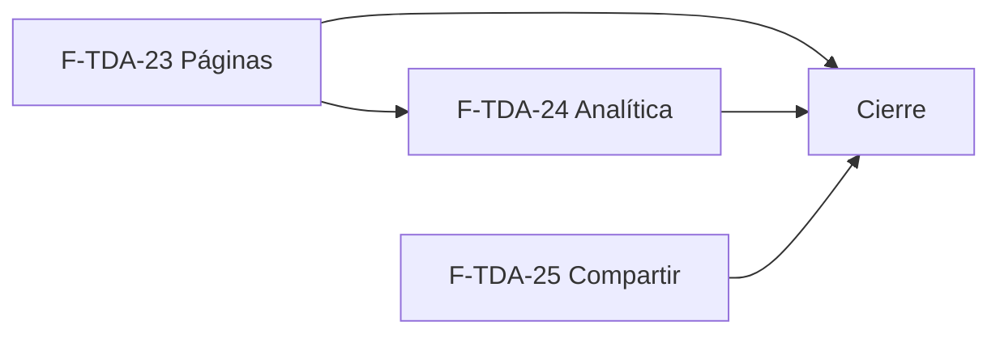

# Tasks: Tiendas online · Tienda contenido y analítica

**Input**: `specs/20270210-100000-tienda-contenido-y-analitica/` (spec.md, plan.md, contracts/tienda-contenido-analitica.md)

**Formato**: `- [ ] T### [P] [F-TDA-xx][USy] descripción`. **[P]** = paralelizable (archivos distintos, sin dependencia; las [P] del mismo grupo van en paralelo); sin [P] = secuencial. Las dependencias de cada tarea son solo dentro de su misma historia; ninguna tarea depende de otra historia ni de una `[CIERRE]`.

**Delivery scope**: `refine`, `supabase`

**Regla de cierre**: ninguna tarea queda `[ ]` al terminar: se hace con evidencia o se cierra con `[x]` + `Desvío: <motivo>` (ver commit) y, si la deuda es real, una Historia `[Deuda MSF-164]` con label `deuda`.

## Matriz de trazabilidad Jira ↔ US ↔ tasks

| Jira | Historia | FR / SC (dueño único) | Tasks |
|------|----------|-----------------------|-------|
| F-TDA-23 (clave Jira: la asigna el orquestador) | US1 Páginas de contenido | FR-001…FR-008, SC-001, SC-002, SC-003 | T001–T009 |
| F-TDA-24 (clave Jira: la asigna el orquestador) | US2 Analítica de visitas | FR-010…FR-017, SC-004, SC-005, SC-006 | T020–T028 |
| F-TDA-25 (clave Jira: la asigna el orquestador) | US3 Compartir producto | FR-020…FR-024, SC-007, SC-008 | T040–T045 |
| Tarea de cierre (label cierre) | Documentación, roadmap y gates | FR-060, SC-009, SC-010, SC-011 | T070–T072 |

### Dueño único por requisito

| Requisito | Tarea dueña | | Requisito | Tarea dueña |
|---|---|---|---|---|
| FR-001 | T001 | | FR-016 | T026 |
| FR-002 | T002 | | FR-017 | T020 |
| FR-003 | T003 | | FR-020 | T041 |
| FR-004 | T005 | | FR-021 | T042 |
| FR-005 | T006 | | FR-022 | T042 |
| FR-006 | T007 | | FR-023 | T040 |
| FR-007 | T008 | | FR-024 | T043 |
| FR-008 | T004 | | SC-001 | T004 |
| FR-010 | T020 | | SC-002 | T009 |
| FR-011 | T021 | | SC-003 | T009 |
| FR-012 | T022 | | SC-004 | T023 |
| FR-013 | T024 | | SC-005 | T028 |
| FR-014 | T025 | | SC-006 | T028 |
| FR-015 | T025 | | SC-007 / SC-008 | T044 / T045 |
| FR-060 | T070 | | SC-009 / SC-010 / SC-011 | T071 / T072 / T072 |

---

## Fase 1 — F-TDA-23 · Páginas de contenido (US1)

- [x] T001 [F-TDA-23][US1] Migración `supabase/migrations/20270212200001_tienda_paginas.sql`: tabla `dominio.tienda_paginas` en esquema `dominio` (FR-001), RLS por organización, solo `select` a `authenticated`, sin privilegios a `anon`, checks de longitud y de `slug`, `unique (empresa_id, slug)`; reversión documentada en `plan.md`. Verificar con `graphify`/migraciones que la tabla no existe antes. Verificación: pgTAP `supabase/tests/database/tienda_paginas.test.sql` (RLS, checks, `unique`, sin `grant` a `anon`) con `pnpm test`.
- [x] T002 [F-TDA-23][US1] RPC `public.guardar_pagina_tienda` y `public.eliminar_pagina_tienda` (FR-002) en la misma migración: permisos de edición en Empresas, empresa de la organización, slug estable y único, `revoke … from public, anon` + `grant … to authenticated`. Verificación: pgTAP `tienda_paginas.test.sql` (permisos, empresa ajena, slug único y estable, límites, HTML literal) con `pnpm test`. Depende de T001.
- [x] T003 [F-TDA-23][US1] Funciones `publico.paginas_por_dominio` y `publico.pagina_por_dominio` (FR-003) en la misma migración: lista blanca, `null` idéntico, solo visibles de empresa activa, `grant … to anon, authenticated`. Verificación: pgTAP `tienda_paginas.test.sql` (solo visibles, orden, `null` idéntico, lista blanca) con `pnpm test`. Depende de T001.
- [x] T004 [F-TDA-23][US1] pgTAP `supabase/tests/database/tienda_paginas.test.sql` (FR-008, SC-001): RLS, checks, permisos, slug único/estable, texto con HTML literal, visibles solamente, aislamiento entre dos tiendas, `null` idéntico, lista blanca, sin `grant` a `anon`. Depende de T002 y T003.
- [x] T005 [P] [F-TDA-23][US1] Pestaña «Páginas» (`pestanas/paginas.tsx` + registro en `pestanas.ts` + `lib/tiendaPaginas.ts`) (FR-004): lista con carga infinita, contador, vacío, error con reintento, reencuadre al cambiar de empresa; Vitest + axe `empresas/tienda/paginas.test.tsx`.
- [x] T006 [F-TDA-23][US1] Diálogo crear/editar y confirmación de borrado (FR-005) dentro de la pestaña: validación, errores por campo, interruptor «Visible en la tienda», foco y cierre al cambiar de empresa; Vitest + axe. Depende de T005.
- [x] T007 [P] [F-TDA-23][US1] Ruta pública `/pagina/:slug` (`rutas/pagina.tsx`) (FR-006): migas, texto plano en párrafos, 404 y error con reintento de la tienda, `CabeceraSeo` de MSF-149; Vitest + axe `rutas/pagina.test.tsx`.
- [x] T008 [P] [F-TDA-23][US1] Columna «Información» del pie (`layout/PieInformacion.tsx`, montada desde `PieCategorias`) (FR-007): enlaces a páginas visibles, sin hueco, falla silenciosa; Vitest + axe.
- [x] T009 [F-TDA-23][US1] E2E `apps/web/e2e/tienda-paginas.e2e.ts` con las dos tiendas del seed (SC-002, SC-003): crear → oculta → visible → pie y lectura → ocultar/eliminar da 404 → aislamiento; 320 / 768 / 1440 px. Depende de T005–T008.

**Checkpoint F-TDA-23**: páginas creables, visibles solo cuando se activan, aisladas por tienda.

---

## Fase 2 — F-TDA-24 · Analítica de visitas (US2)

- [x] T020 [F-TDA-24][US2] Migración `supabase/migrations/20270212200002_tienda_analitica.sql`: tabla `dominio.tienda_analitica` en esquema `dominio` (FR-010, FR-017), RLS por organización, solo `select` a `authenticated`, sin privilegios a `anon`, checks de formato; reversión documentada en `plan.md`. Verificación: pgTAP `supabase/tests/database/tienda_analitica.test.sql` (RLS, checks, sin `grant` a `anon`; aislamiento entre tiendas de FR-017) con `pnpm test`.
- [x] T021 [F-TDA-24][US2] RPC `public.guardar_analitica_tienda` (FR-011) en la misma migración: permisos, empresa de la organización, normalización y errores con `hint`. Verificación: pgTAP `tienda_analitica.test.sql` (permisos, empresa ajena, formatos, vaciar) con `pnpm test`. Depende de T020.
- [x] T022 [F-TDA-24][US2] Función `publico.analitica_por_dominio` (FR-012) en la misma migración: lista blanca, solo empresa activa, `null` idéntico. Verificación: pgTAP `tienda_analitica.test.sql` (lista blanca, `null` idéntico pausada/desconocida/inválida) con `pnpm test`. Depende de T020.
- [x] T023 [F-TDA-24][US2] pgTAP `supabase/tests/database/tienda_analitica.test.sql` (SC-004): RLS, formatos, permisos, vaciar, `null` idéntico pausada/desconocida/inválida, lista blanca, aislamiento. Depende de T021 y T022.
- [x] T024 [P] [F-TDA-24][US2] Pestaña «Analítica» (`pestanas/analitica.tsx` + registro en `pestanas.ts`) (FR-013): campos, validación, «Guardar»/«Descartar», aviso de condiciones, reencuadre y aviso de cambios sin guardar; Vitest + axe `empresas/tienda/analitica.test.tsx`.
- [x] T025 [P] [F-TDA-24][US2] `lib/analiticaTienda.ts` (FR-014, FR-015): consulta única por visita, carga condicional (publicada, con IDs, `aceptadas` de MSF-149, fuera de vista previa), aceptación tardía, visita por navegación, falla silenciosa, IDs como datos; integración en `LayoutTienda`/`index.tsx` con carga diferida; Vitest `analiticaTienda.test.ts`.
- [x] T026 [F-TDA-24][US2] Eventos `clic_whatsapp` y `envio_contacto` (FR-016) en `DialogoWhatsApp.tsx` y `FormularioContacto.tsx` vía `registrarEventoTienda`: una vez, sin bloquear, sin datos del visitante, nada en envío fallido; Vitest en ambos componentes. Depende de T025.
- [x] T028 [F-TDA-24][US2] Vitest consolidado y E2E `apps/web/e2e/tienda-analitica.e2e.ts` con las dos tiendas (SC-005, SC-006): sin consentimiento no hay pedidos a los dominios de medición; con consentimiento cada tienda carga sus IDs; pausada y vista previa no cargan; eventos emitidos. Depende de T024–T026.

**Checkpoint F-TDA-24**: medición solo en tienda publicada y con consentimiento; eventos de MSF-212 emitidos.

---

## Fase 3 — F-TDA-25 · Compartir producto (US3)

- [x] T040 [P] [F-TDA-25][US3] `lib/enlaceProducto.ts` (FR-023): URL con el dominio del `Host` y `/producto/<id>`, sin parámetros; Vitest `enlaceProducto.test.ts`. Evidencia: ver commit 87f9eb03 (`enlaceProducto.test.ts`).
- [x] T041 [F-TDA-25][US3] Componente `ficha/BotonCompartir.tsx` y montaje en la ficha (FR-020): estilo de botón secundario con `TemaTienda`, nombre accesible. Verificación: Vitest + axe `ficha/BotonCompartir.test.tsx` (presente, nombre accesible, teclado) con `pnpm --filter @platform/web test`. Depende de T040. Evidencia: ver commit 87f9eb03 (`BotonCompartir.tsx`, `BotonCompartir.test.tsx`).
- [x] T042 [F-TDA-25][US3] Comportamiento de compartir (FR-021, FR-022): `navigator.share` con nombre y enlace, cancelación silenciosa, copia al portapapeles con aviso «Enlace copiado» (`aria-live`), enlace manual si no se puede copiar, caída de un fallo no-cancelación al camino de copia. Verificación: Vitest `ficha/BotonCompartir.test.tsx` (`navigator.share` con título y URL, `AbortError` silencioso, copia, aviso, rechazo del portapapeles) y E2E `apps/web/e2e/tienda-compartir.e2e.ts` con `pnpm test`. Depende de T041. Evidencia: ver commit 87f9eb03 (`BotonCompartir.test.tsx`, `tienda-compartir.e2e.ts`).
- [x] T043 [F-TDA-25][US3] Accesibilidad y responsivo (FR-024): teclado, lector de pantalla y 320 / 768 / 1440 px; Vitest + axe `ficha/BotonCompartir.test.tsx`. Depende de T042. Evidencia: ver commit 87f9eb03 (axe en `BotonCompartir.test.tsx`).
- [x] T044 [F-TDA-25][US3] Verificación Vitest de SC-007: cobertura de `BotonCompartir` y `enlaceProducto` (selector, copia, rechazo, cancelación, dominio correcto). Depende de T043. Evidencia: ver commit 87f9eb03 (Vitest de `BotonCompartir` y `enlaceProducto`).
- [x] T045 [F-TDA-25][US3] E2E `apps/web/e2e/tienda-compartir.e2e.ts` en las dos tiendas (SC-008): selector simulado, copia con aviso, enlace con el dominio correcto; anchos. Depende de T043. Evidencia: ver commit 87f9eb03 (`tienda-compartir.e2e.ts`).

**Checkpoint F-TDA-25**: el visitante comparte o copia el enlace del producto.

---

## Fase 4 — Cierre (docs, seguridad y roadmap)

- [x] T070 [CIERRE] Verificar FR-060 de punta a punta: pgTAP de `anon` (solo funciones de `publico`), `revoke/grant` de las RPC nuevas, contrato `contracts/tienda-contenido-analitica.md` al día con las firmas finales y re-verificación de esquema (`dominio` para ambas tablas) en la implementación y el PR.
- [x] T071 [CIERRE] Documentar en `docs/tiendas-online.md` la sección «Contenido y analítica» (pestañas, rutas, IDs de medición, consentimiento, eventos, límites) y las contradicciones/diferencias de prototipo para la descripción del PR (SC-009). Verificación: `pnpm docs:check` y revisión de la sección en `docs/tiendas-online.md`.
- [x] T072 [CIERRE] Correr `pnpm lint`, `pnpm build`, `pnpm infra:config`, `pnpm test`, `pnpm prototipo:check`, `pnpm matriz:check`, `pnpm docs:check` (SC-010) y, al mergear, actualizar a mano la fila de MSF-164 en `docs/roadmap-template.md` (SC-011).

---

## Plan de ejecución (historias)

| Historia | Depende de | Grupo |
|---|---|---|
| F-TDA-23 | — | 1 |
| F-TDA-25 | — | 1 |
| F-TDA-24 | F-TDA-23 | 2 |
| [Cierre] | F-TDA-23, F-TDA-24, F-TDA-25 | 3 |

F-TDA-23 y F-TDA-25 son independientes (archivos, tablas y migraciones distintos) y van en paralelo. F-TDA-24 va después de F-TDA-23 solo porque ambas registran su pestaña en el mismo `pestanas.ts` y el pie/layout de la tienda; no comparten tablas ni migraciones. El bloqueo externo (MSF-149 y MSF-212) ya está resuelto a nivel de épica.

## Revisión independiente (QA y Code/Security) de la épica

- [x] T029 [F-TDA-24] Revocar el consentimiento borra cookies y globales de medición y recarga si es seguro; Meta Pixel sin `autoConfig` ni coincidencia avanzada; cambio de ID de GA4 y scripts bloqueados (`lib/analiticaTienda.ts` y su Vitest). Ver commit de la rama `fix/msf-164-pendientes`.
- [x] T030 [F-TDA-23] Tope de 50 páginas por empresa (`20270218100000_tienda_paginas_tope.sql`, pgTAP `tienda_paginas_tope.test.sql`), pie tolerante y bordes de 10000 / 10001 caracteres.
- [x] T031 [F-TDA-23][F-TDA-24] Pestañas «Páginas» y «Analítica» en solo lectura y mensaje propio para `42501` (Vitest de rol sin permiso).
- [x] T032 [F-TDA-24] CSP en modo reporte en `apps/web/nginx.conf`, tienda pausada sin medición (Vitest) y documentación (`docs/tiendas-online.md`). Desvío: la CSP queda en `Report-Only` con plan de endurecimiento documentado; el límite de frecuencia de las RPC públicas depende de PostgREST (no pasan por nginx).

