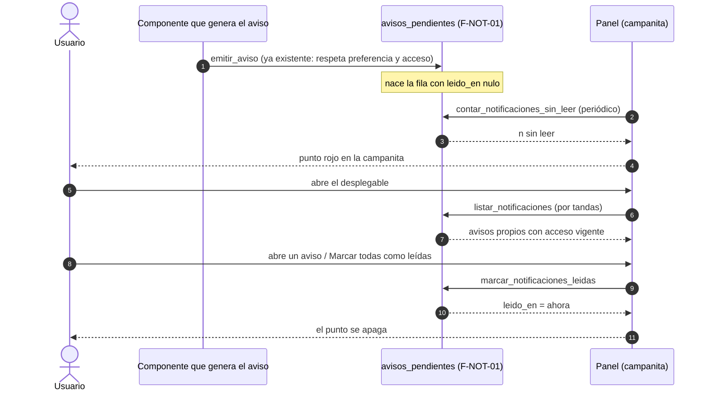
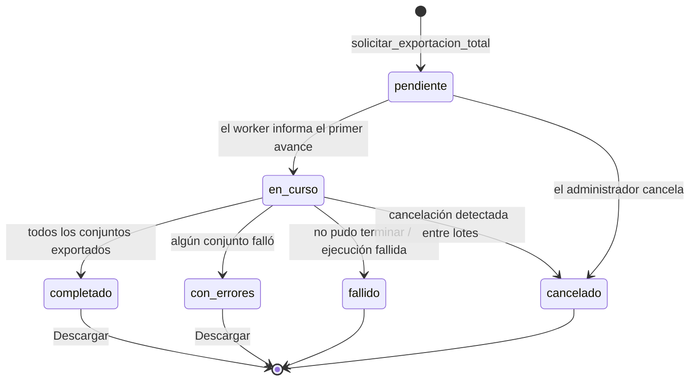
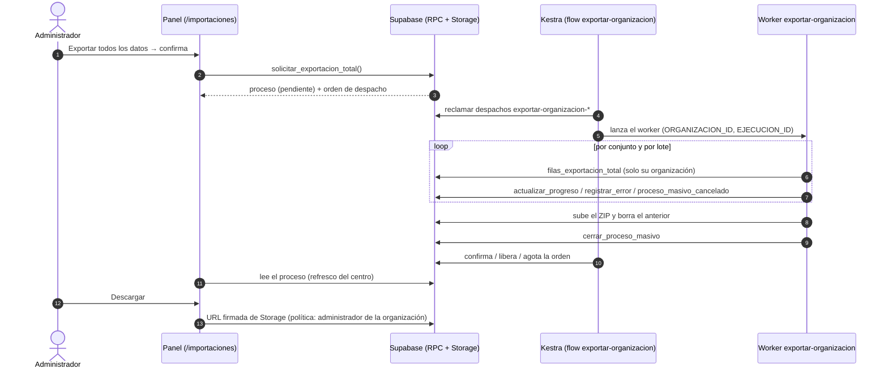
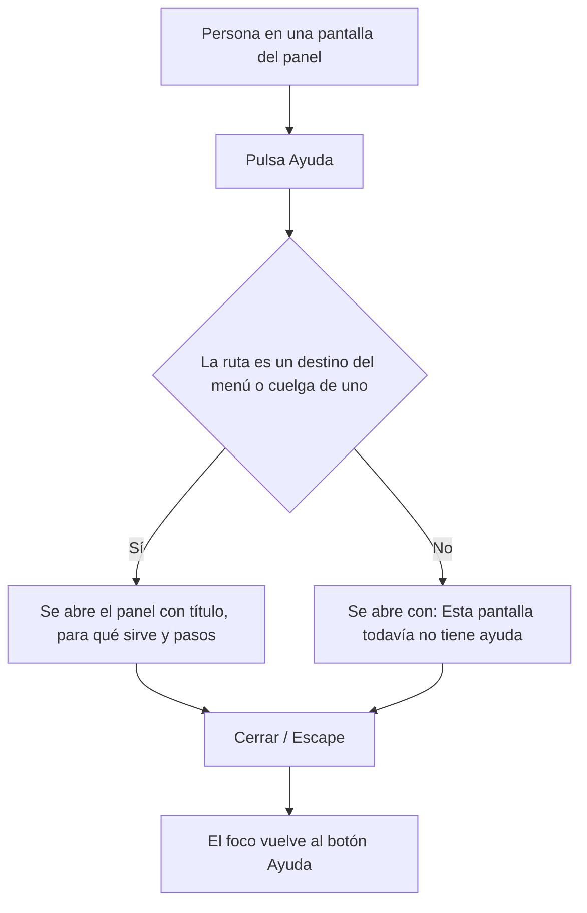

# Feature Specification: Plataforma · Notificaciones, ayuda y exportación total

**Épica**: MSF-224 · **Spec**: `notificaciones-ayuda-y-exportacion-total` · **Hito**: Etapa 3 (sin fecha) · **Prioridad**: P2 · **Horas aprox.**: 20 (roadmap original 22; las tallas suman 20)
**Historias**: F-NOT-02 Centro de notificaciones en el panel (MSF-378, M) · F-CFG-02 Ayuda dentro del panel (S) · F-OPS-06 Exportar todos los datos (MSF-396, M)
**Alcance de entrega**: `refine`, `supabase`, `kestra` y `workers` (sin `superset`: ningún reporte nuevo). El Jira marca «Alcance: fuera» refiriéndose al hito de diciembre, no a la entrega.
**Fuente**: especificación de Nicolás cargada en la épica (It's a Plan), instrucción `🎯 INSTRUCCIÓN` del 2026-11-07 (retomar y especificar), «Regla de fuentes» del issue y artefactos del repo. Esta spec **traduce**; no agrega alcance. Lo que la épica deja abierto está en *Decisiones abiertas*, con el valor por defecto que se asume.
**Bloqueos levantados**: MSF-189 (avisos y listas, F-NOT-01) está Finalizada y MSF-206 (importaciones y monitoreo, F-IMP-01) está integrada en `dokploy` (PR #764). Ya existen en el repo `public.avisos_pendientes` / `public.tipos_aviso` / `private.nivel_seccion_de_usuario` y `public.procesos_masivos` / `iniciar_proceso_masivo`.

## Objetivo

Al terminar, el usuario ve sus avisos en una campanita dentro del panel, aprende a usar cada pantalla con ayuda breve, y el propietario puede descargar toda la información de su organización.

## Modelo y supuestos

- **La campanita reutiliza los avisos de F-NOT-01**: lee las mismas filas de `public.avisos_pendientes` (un aviso por fila y por destinatario). No hay una tabla paralela de notificaciones. Quien apagó un tipo en «Avisos por correo» tampoco lo ve en la campanita, porque ese aviso nunca se encola para esa persona (Decisiones abiertas D-6).
- **El template no trae centro de notificaciones ni exportación por organización** (solo backup diario de Postgres y el kit de estados vacíos); ambos se construyen aquí.
- **La exportación total corre como proceso masivo** del centro de F-IMP-01: `iniciar_proceso_masivo` (tipo `exportacion`, funcionalidad `exportacion_total`), progreso, errores y cancelación por el contrato de `workers/CONTRATO.md`. Sigue el patrón de la exportación diferida de comprobantes (`exportar-comprobantes`: ejecución auditable + outbox + flow de Kestra + bucket privado).
- **«Propietario» = Administrador de la organización** (`private.es_administrador_de`): el repo no tiene un rol «propietario» (Decisiones abiertas D-1).
- **La ayuda es contenido versionado en el repo**, sin tabla ni red: texto breve por destino de navegación (`SECCIONES_PANEL`, 44 destinos hoy). Lo escribe esta historia para las pantallas ya existentes; las pantallas de épicas futuras suman su entrada con la misma regla (lo garantiza el test de cobertura).
- **Prototipo**: `AdminHeader.dc.html` dibuja los botones «Notificaciones» (con punto rojo) y «Ayuda» en la barra superior, pero **no dibuja** el desplegable de la campanita, el panel de ayuda ni la exportación total (la épica lo confirma: «Ninguna pantalla dibujada todavía»). Por la Regla de fuentes (3, 4 y 5) esos tres se construyen con los componentes del template y los tokens del sistema de diseño, sin inventar diseño propio.

### Esquema de datos (Constitución, Principio VII)

| Objeto | Esquema | Historia | Justificación | RLS / acceso |
|--------|---------|----------|---------------|--------------|
| `avisos_pendientes` (**existente, se altera**: columna nueva `leido_en timestamptz null` + índice `(user_id, creado_en desc)`) | `public` | F-NOT-02 | Es la cola de avisos de plataforma (F-NOT-01, `public`). El estado «leído» es del mismo aviso; una tabla nueva duplicaría datos. Aditiva. | **Sin cambios**: RLS activada sin políticas y sin privilegios para `anon` ni `authenticated`. La app solo lee y marca por funciones `security definer` filtradas por `auth.uid()`. |
| Funciones `listar_notificaciones`, `contar_notificaciones_sin_leer`, `marcar_notificaciones_leidas` | `public` | F-NOT-02 | Superficie de ejecución sin datos propios que la app puede llamar. | `revoke … from public, anon`; `grant execute … to authenticated` explícito |
| Funciones `private.conjuntos_exportacion_total`, `private.datos_exportacion_total`, `private.filas_exportacion_total` | `private` | F-OPS-06 | Catálogo (lista permitida) de lo que se exporta y lectura por lotes para el worker. | sin grants a `authenticated`/`anon`; solo el rol `worker_<org>` (miembro de `workers_orquestacion`) |
| `public.solicitar_exportacion_total()` | `public` | F-OPS-06 | Punto de entrada de la app; crea el proceso masivo. | `revoke … from public, anon`; `grant execute … to authenticated`; solo administradores |
| Bucket privado `exportaciones-organizacion` + política de lectura en `storage.objects` | Storage | F-OPS-06 | Archivo generado; no es una tabla. | `select` solo administrador de la organización dueña (ruta `<organizacion_id>/…`); sin insert/update/delete para `authenticated` |
| `procesos_masivos`, `procesos_masivos_errores`, `ejecuciones_worker`, `despachos_ejecucion` (existentes) | `public` | — | **Sin cambio de tabla ni de RLS**: F-OPS-06 solo registra un proceso nuevo. | RLS vigente de F-IMP-01 |

**No se crea ninguna tabla nueva** (ni en `public` ni en `dominio`). Las tablas que la exportación *lee* se declaran en `plan.md` (lista permitida por esquema); la prueba pgTAP `rls_en_toda_tabla` (recorre `public` + `dominio`) debe seguir verde. Migraciones **aditivas**; reversión en `plan.md`.

## User Scenarios & Testing *(mandatory)*

### User Story 1 - Centro de notificaciones en el panel (F-NOT-02 · MSF-378, P2, talla M)

El usuario ve en una campanita de la barra superior los avisos que le llegan, sabe cuáles no leyó y los marca como leídos.

**Why this priority**: los avisos hoy solo llegan por correo; la campanita los deja a la vista dentro del panel, reutilizando el mecanismo de F-NOT-01.

**Independent Test**: se emiten dos avisos de `consulta_nueva` a un usuario; la campanita muestra el punto y la lista con ambos; abrir uno lo marca leído; «Marcar todas como leídas» apaga el punto; otro usuario no ve nada de eso.

**Acceptance Scenarios**:

1. **Dado** el panel, **cuando** se carga la barra superior, **entonces** aparece el botón «Notificaciones» (icono de campana) entre el buscador y el menú de cuenta, como en `AdminHeader` (FR-006).
2. **Dado** que la persona tiene avisos sin leer, **entonces** el botón muestra el punto rojo del prototipo; **dado** que no tiene ninguno, **entonces** no hay punto (FR-004, FR-006).
3. **Dado** el botón, **cuando** se pulsa, **entonces** se abre un desplegable con los avisos recientes: tipo de aviso (nombre legible), detalle legible del aviso, cuándo llegó, y los no leídos destacados (FR-002, FR-007).
4. **Dado** muchos avisos, **entonces** se cargan por tandas al llegar al final de la lista, hay un «Cargar más» accesible por teclado y el total es visible (FR-007).
5. **Dado** que no hay avisos, **entonces** el desplegable muestra el estado vacío compartido; **dado** que la consulta falla, **entonces** muestra el error con «Reintentar» (FR-007).
6. **Dado** un aviso sin leer, **cuando** la persona lo abre (clic o Enter), **entonces** queda leído y el punto se actualiza (FR-005, FR-008).
7. **Dado** avisos sin leer, **cuando** pulsa «Marcar todas como leídas», **entonces** todos quedan leídos y desaparece el punto (FR-005, FR-008).
8. **Dado** el panel abierto, **cuando** entra un aviso nuevo, **entonces** el punto aparece sin recargar la página (FR-009).
9. **Dado** un aviso que la persona apagó en «Avisos por correo», **entonces** no aparece en la campanita (no se encola para ella) (FR-002).
10. **Dado** una persona que perdió el acceso a la sección de un tipo, **entonces** esos avisos dejan de listarse y de contarse (FR-003).
11. **Dado** otra persona u otra organización, **entonces** nunca ve avisos ajenos; `anon` no puede llamar las funciones (FR-010).
12. **Dado** 320, 768 o 1440 px, teclado y lector de pantalla, **entonces** la campanita y su desplegable son operables y anuncian la cantidad sin leer (FR-011).

### User Story 2 - Ayuda dentro del panel (F-CFG-02, P2, talla S)

El usuario pulsa «Ayuda» y ve una explicación breve de la pantalla en la que está.

**Independent Test**: en tres pantallas distintas el botón «Ayuda» abre un texto distinto y breve; el test de cobertura falla si a un destino del menú le falta su ayuda.

**Acceptance Scenarios**:

1. **Dado** el panel, **entonces** aparece el botón «Ayuda» (icono de signo de pregunta) junto a la campanita, como en `AdminHeader` (FR-020).
2. **Dado** una pantalla del menú, **cuando** se pulsa «Ayuda», **entonces** se abre un panel con el título de la pantalla, para qué sirve y los pasos o consejos principales, en castellano y sin términos técnicos (FR-021, FR-024).
3. **Dado** una subpantalla que no es un destino del menú (p. ej. una ficha), **entonces** muestra la ayuda de su destino padre; **dado** una ruta sin ayuda, **entonces** muestra «Esta pantalla todavía no tiene ayuda» (FR-022, FR-025).
4. **Dado** que se agrega un destino a `SECCIONES_PANEL` sin su ayuda, **entonces** el test de cobertura falla (FR-023).
5. **Dado** cualquier ayuda, **entonces** es breve (límite de longitud verificado por test) (FR-024).
6. **Dado** el panel de ayuda, **entonces** se cierra con «Cerrar» o Escape, devuelve el foco al botón y es operable por teclado y lector de pantalla; abrirlo no consulta datos de la empresa (FR-026, FR-027).

### User Story 3 - Exportar todos los datos (F-OPS-06 · MSF-396, P2, talla M)

El administrador (propietario) descarga toda la información de su organización en un archivo, sin trabarse el panel.

**Independent Test**: el administrador pide la exportación; se ve como un proceso en el centro, avanza, termina y aparece «Descargar»; el archivo trae un CSV por conjunto de datos solo de su organización; un no administrador no puede pedirla ni descargarla.

**Acceptance Scenarios**:

1. **Dado** el administrador en `/importaciones`, **entonces** ve el bloque «Exportar todos los datos» con su botón; **dado** que no es administrador, **entonces** no lo ve ni puede llamar a la función (FR-039, FR-040).
2. **Dado** el botón, **cuando** lo pulsa, **entonces** un diálogo de confirmación explica qué se descarga; al confirmar nace un proceso masivo de tipo exportación `exportacion_total` con actor, fecha y estado (FR-030, FR-039).
3. **Dado** que ya hay una exportación total abierta, **cuando** vuelve a pedirla, **entonces** no se crea otra: se muestra la que está en curso (FR-030).
4. **Dado** el proceso, **entonces** el worker lo recorre por conjuntos de datos y por lotes, informa el avance y los errores por el contrato de procesos masivos y respeta la cancelación entre lotes (FR-033, FR-034).
5. **Dado** el catálogo de conjuntos, **entonces** incluye todos los datos de negocio de la organización y excluye credenciales, tokens, secretos y datos de autenticación (FR-031).
6. **Dado** una tabla nueva con `organizacion_id` que no está ni en la lista permitida ni en la de exclusiones, **entonces** una prueba falla (FR-032).
7. **Dado** que termina bien, **entonces** el proceso queda `completado` (o `con_errores` si algún conjunto falló), el bloque muestra «Descargar» y el archivo es un ZIP con un CSV por conjunto (FR-033, FR-036, FR-039).
8. **Dado** el archivo, **entonces** vive en un bucket privado bajo `<organizacion_id>/…`, lo puede descargar solo un administrador de esa organización y no contiene filas de otra (FR-035, FR-036).
9. **Dado** una exportación nueva completada, **entonces** el archivo de la anterior se elimina y queda solo el último (FR-037).
10. **Dado** la ejecución en Kestra, **entonces** un flow reclama las órdenes `exportar-organizacion-*`, lanza el worker y resuelve la orden (confirmar, liberar o agotar) (FR-038).
11. **Dado** que el worker falla de forma no reintentable (código 78) o agota reintentos, **entonces** el proceso queda `fallido` con un motivo sanitizado y sin archivo parcial descargable (FR-034).
12. **Dado** la empresa activa de la barra superior, **entonces** el bloque de exportación total y su estado se ven siempre (la exportación es de toda la organización, no de una empresa) (FR-039).

### Edge Cases

- Aviso cuyo `datos` trae valores largos o con HTML: se muestra como texto plano, recortado, nunca como HTML.
- Dos pestañas abiertas: marcar leído en una se refleja en la otra al refrescar (el estado vive en la base).
- Aviso marcado `descartado` (la persona apagó el tipo con avisos pendientes): no se lista.
- Organización con muchas tablas o muchas filas: el worker procesa por lotes y no carga un conjunto entero en memoria.
- Un conjunto de datos falla a mitad: se registra el error de ese conjunto, los demás siguen y el proceso termina `con_errores`.
- Exportación cancelada: se conserva lo ya procesado en el proceso, no se publica ZIP parcial.
- Usuario con sesión de una organización distinta a la del proceso: no lo ve ni descarga (RLS de F-IMP-01 + política de Storage).
- Organización sin la conexión de exportación configurada: error claro `SIN_CONEXION_EXPORTACION` (mismo criterio que comprobantes).

## Flujos

Transcriben el objetivo y los supuestos de la épica; no agregan estados ni pasos. Cada paso mapea a un FR; lo que no, se declara fuera de alcance.

### Flujo 1 · Del aviso a la campanita (secuencia)

| Paso | Dueño |
|---|---|
| Emitir/encolar el aviso | **Ya existe** (F-NOT-01, MSF-319): fuera de alcance, esta épica solo lo reutiliza |
| Columna `leido_en` | FR-001 |
| Contar sin leer y punto rojo | FR-004, FR-006, FR-009 |
| Listar por tandas con acceso vigente | FR-002, FR-003, FR-007 |
| Marcar leído (uno / todos) | FR-005, FR-008 |
| Aislamiento por persona y organización | FR-010 |

### Flujo 2 · Exportación total (estados del proceso)

Estados tomados del contrato de F-IMP-01 (`procesos_masivos`); esta épica no agrega ninguno.

| Estado / transición | Dueño |
|---|---|
| `[*] → pendiente` (solo administrador, sin duplicar abiertas) | FR-030, FR-040 |
| `pendiente → en_curso` y avance por conjuntos/lotes | FR-033, FR-034 |
| `→ completado / con_errores` y publicación del ZIP | FR-033, FR-036, FR-037 |
| `→ fallido` (código 78, reintentos agotados, reconciliación) | FR-034 |
| `→ cancelado` | FR-034 (cancelación del centro F-IMP-01, ya existente) |
| «Descargar» | FR-036, FR-039 |

### Flujo 3 · Orquestación de la exportación (secuencia)

| Paso | Dueño |
|---|---|
| Botón y confirmación | FR-039 |
| `solicitar_exportacion_total` | FR-030 |
| Flow de Kestra | FR-038 |
| Lectura por conjuntos acotada a la organización | FR-031, FR-035 |
| Progreso / errores / cancelación | FR-034 |
| ZIP, bucket y reemplazo del anterior | FR-033, FR-036, FR-037 |
| Descarga | FR-036, FR-039 |

### Flujo 4 · Ayuda en el panel (proceso)

| Paso | Dueño |
|---|---|
| Botón Ayuda | FR-020 |
| Resolver destino o destino padre | FR-022 |
| Contenido breve por destino | FR-021, FR-024 |
| Ruta sin ayuda | FR-025 |
| Cierre y foco | FR-026 |

## Requirements *(mandatory)*

### F-NOT-02 · Centro de notificaciones

- **FR-001** `public.avisos_pendientes` suma `leido_en timestamptz null` (aditiva, sin tocar RLS ni privilegios) y el índice `(user_id, creado_en desc)`. Los avisos existentes quedan sin leer.
- **FR-002** `listar_notificaciones` devuelve los avisos de la persona de la sesión y la organización de la sesión, **sin** los `descartado`, del más nuevo al más viejo, por tandas con cursor, junto con el total y el nombre legible del tipo (`tipos_aviso.nombre`). Nunca recibe un `user_id` ni una organización por parámetro.
- **FR-003** Solo lista y cuenta avisos de tipos cuya sección la persona **todavía** puede ver (`private.nivel_seccion_de_usuario(auth.uid(), seccion) <> 'ninguno'`).
- **FR-004** `contar_notificaciones_sin_leer` devuelve la cantidad de avisos propios sin leer (mismos filtros de FR-002 y FR-003).
- **FR-005** `marcar_notificaciones_leidas(p_ids uuid[] default null)` marca `leido_en = now()` en los avisos propios indicados (o todos los propios sin leer si `p_ids` es nulo); es idempotente y no toca avisos ajenos.
- **FR-006** La barra superior (`EncabezadoPanel`) muestra el botón «Notificaciones» (`aria-label`, icono de campana) entre el buscador y el menú de cuenta, con el punto rojo (8 px, rojo del sistema de diseño, borde blanco) solo si hay sin leer.
- **FR-007** El desplegable lista los avisos con nombre del tipo, detalle legible de `datos` (texto plano, recortado), hora relativa y los no leídos destacados; carga por tandas con `IntersectionObserver` y «Cargar más» accesible por teclado; muestra el total y los estados compartidos de carga, vacío y error con «Reintentar». Se cierra con Escape y devuelve el foco al botón.
- **FR-008** Abrir un aviso lo marca leído; «Marcar todas como leídas» marca todos y se deshabilita si no hay sin leer. El punto se actualiza sin recargar.
- **FR-009** El conteo se refresca al abrir el panel, al volver a la pestaña y de forma periódica mientras la pestaña esté visible; no consulta con la pestaña oculta.
- **FR-010** Aislamiento: las funciones usan `auth.uid()` y la organización de la sesión (`private.organizacion_id()`); `revoke … from public, anon` y `grant execute … to authenticated` explícito; `anon` no ejecuta ninguna. `avisos_pendientes` conserva RLS sin políticas.
- **FR-011** Operable con teclado y lector de pantalla a 320, 768 y 1440 px; el botón anuncia «Notificaciones, N sin leer»; sin identificadores técnicos visibles (no se muestra `tipo_aviso` ni `grupo_id`).
- **FR-012** **Empresa activa (Principio VIII): no aplica.** Los avisos son personales: ya se filtraron por las empresas a las que la persona accede al emitirse (`private.empresas_accesibles_de_usuario`, F-NOT-01) y no se reencuadran por la empresa de la barra superior. La campanita no guarda su propia empresa ni duplica el selector. Queda documentado en `docs/notificaciones-en-panel.md`.

### F-CFG-02 · Ayuda dentro del panel

- **FR-020** La barra superior muestra el botón «Ayuda» (`aria-label`, icono de signo de pregunta) junto a la campanita.
- **FR-021** Al pulsarlo se abre un panel con el título de la pantalla actual, para qué sirve y los pasos o consejos principales de esa pantalla.
- **FR-022** La ayuda se resuelve con el mismo criterio de coincidencia de rutas que las migas de pan: el destino de `SECCIONES_PANEL` que coincide o, para subrutas (fichas, formularios), su destino padre.
- **FR-023** Un test falla si algún destino de `SECCIONES_PANEL` no tiene entrada de ayuda, o si hay una entrada sin destino.
- **FR-024** El contenido vive en el repo (módulo versionado por destino), en castellano, sin términos técnicos ni identificadores, y es breve: título + un párrafo + hasta 5 pasos, con un tope de caracteres verificado por test (valor en el plan). Cubre las pantallas existentes de los demás componentes.
- **FR-025** Una ruta que no es un destino ni cuelga de uno muestra «Esta pantalla todavía no tiene ayuda» (nunca queda vacío ni falla).
- **FR-026** El panel se cierra con «Cerrar» o Escape, devuelve el foco al botón, es operable por teclado y lector de pantalla y funciona a 320, 768 y 1440 px.
- **FR-027** Abrir la ayuda no hace consultas de datos ni depende de la empresa activa (contenido estático). **Empresa activa: no aplica** por ese motivo.

### F-OPS-06 · Exportar todos los datos

- **FR-030** `solicitar_exportacion_total()` (solo administradores de la organización de la sesión) registra el proceso con `iniciar_proceso_masivo` (tipo `exportacion`, funcionalidad `exportacion_total`, sin empresa) y su orden de despacho en la misma transacción; si ya hay una exportación total `pendiente` o `en_curso` de la organización, devuelve esa en lugar de crear otra. Errores: `NO_AUTORIZADO`, `SIN_CONEXION_EXPORTACION`.
- **FR-031** `private.conjuntos_exportacion_total()` es una **lista permitida** explícita de conjuntos (esquema, tabla, columnas) con todos los datos de negocio de la organización en `dominio` y en `public`, y una lista de **exclusiones** documentadas: credenciales, secretos/Vault, tokens, datos de `auth`, colas internas y registros operativos de plataforma.
- **FR-032** Una prueba pgTAP falla si existe una tabla con `organizacion_id` en `public` o `dominio` que no está ni en la lista permitida ni en las exclusiones.
- **FR-033** El worker `exportar-organizacion` genera un ZIP con un CSV por conjunto (cabecera, escape de comillas y neutralización de fórmulas), leyendo por lotes sin cargar un conjunto entero en memoria, y cierra el proceso `completado` o `con_errores`.
- **FR-034** El worker usa el contrato de procesos masivos: `actualizar_progreso_proceso_masivo` (total = cantidad de conjuntos), `registrar_error_proceso_masivo` por conjunto fallido, revisa `proceso_masivo_cancelado` entre lotes, y cierra `fallido` con motivo sanitizado ante una falla no reintentable (código 78) o reintentos agotados. Una cancelación o falla no publica un ZIP parcial.
- **FR-035** Aislamiento: el worker corre con el rol `worker_<org>`; las funciones de lectura filtran por `organizacion_id` de la ejecución (no por un parámetro libre) y solo se ejecutan si la ejecución es de la capacidad `exportar-organizacion-*` y está en curso.
- **FR-036** El ZIP se guarda en el bucket privado `exportaciones-organizacion` como `<organizacion_id>/<ejecucion_id>.zip`. La política de Storage deja leerlo solo a un administrador de esa organización; el cliente descarga con URL firmada de vida corta. La clave de servicio nunca llega al navegador.
- **FR-037** Al completar una exportación nueva, el worker elimina el archivo de la exportación total anterior de esa organización; queda solo el último.
- **FR-038** El flow de Kestra `exportar-organizacion` reclama las capacidades `exportar-organizacion-*` (nunca las de otros productos), lanza el worker y resuelve la orden (confirmar, liberar o agotar); código 78 se agota en el primer intento. Variables nuevas solo en `.env.example`.
- **FR-039** En `/importaciones`, el bloque «Exportar todos los datos» (botón, diálogo de confirmación, estado de la última exportación total y «Descargar» cuando hay archivo) se muestra con los estados compartidos de carga, vacío y error, y **no depende de la empresa activa**. El proceso aparece además en la tabla del centro (F-IMP-01, que lo trata como cualquier proceso sin empresa).
- **FR-040** El bloque no se muestra a quien no es administrador y `solicitar_exportacion_total` rechaza a un no administrador, a `anon` y a otra organización.
- **FR-041** Documentación: guía `docs/exportacion-total.md` (qué incluye, qué excluye, cómo agregar un conjunto nuevo) y sección en `workers/CONTRATO.md`/`workers/README.md`. **Empresa activa: no aplica** al bloque (exportación de toda la organización, declarado en FR-039).

### Success Criteria

- **SC-001** Prueba pgTAP de F-NOT-02: otra persona, otra organización, `anon`, aviso `descartado`, sección sin acceso, marcar ajeno y `leido_en` idempotente (FR-001–FR-005, FR-010).
- **SC-002** E2E con axe: emitir avisos, ver punto y lista, abrir uno, marcar todas, teclado y 320/768/1440 px (FR-006–FR-009, FR-011).
- **SC-003** Test de cobertura de ayuda verde y E2E en tres pantallas distintas con el panel abierto y cerrado por teclado (FR-020–FR-026).
- **SC-004** pgTAP de F-OPS-06: solo administrador solicita, idempotencia con una abierta, lectura acotada a la organización, `anon` sin acceso, completitud de la lista permitida (FR-030–FR-032, FR-035, FR-040).
- **SC-005** Test del worker: ZIP con un CSV por conjunto, lotes, cancelación sin ZIP parcial, falla 78 y reemplazo del archivo anterior (FR-033, FR-034, FR-037).
- **SC-006** E2E de la exportación: pedir, ver el avance en el centro, descargar y que un no administrador no vea el bloque (FR-036, FR-038–FR-040).
- **SC-007** `pnpm lint`, `pnpm build`, `pnpm infra:config`, `pnpm test`, `pnpm docs:check`, `pnpm matriz:check` y `pnpm prototipo:check` verdes.

## Trazabilidad requisito → verificación

| Requisito | Verificación | Comando |
|---|---|---|
| FR-001–FR-005, FR-010 | pgTAP `notificaciones_panel.test.sql` | `pnpm test:db` |
| FR-006–FR-009, FR-011 | Vitest `CampanitaNotificaciones.test.tsx` + E2E `notificaciones.e2e.ts` | `pnpm test` / `pnpm test:e2e` |
| FR-012, FR-027, FR-041 | revisión de `docs/` + `pnpm docs:check` | `pnpm docs:check` |
| FR-020–FR-026 | Vitest `ayuda.test.ts`, `PanelAyuda.test.tsx` + E2E `ayuda.e2e.ts` | `pnpm test` |
| FR-030, FR-031, FR-032, FR-035, FR-040 | pgTAP `exportacion_total.test.sql` | `pnpm test:db` |
| FR-033, FR-034, FR-037 | Vitest del worker | `pnpm --filter @workers/exportar-organizacion test` |
| FR-036, FR-038, FR-039 | pgTAP de la política + `pnpm infra:config` + E2E `exportacion-total.e2e.ts` | `pnpm test:db` / `pnpm infra:config` |

## Matriz pantalla↔criterios

El prototipo `AdminHeader.dc.html` es la única referencia: dibuja la barra superior con los botones «Notificaciones» (punto rojo) y «Ayuda». El inventario determinista (`pnpm prototipo:inventario`) lista solo los botones con texto visible; los dos botones de icono se agregan a mano aquí. **El desplegable de la campanita, el panel de ayuda y la exportación total no están dibujados** (la épica lo confirma): se construyen con los componentes del template y los tokens del sistema de diseño (Regla de fuentes 3 y 5) y la diferencia se anota en el PR. `ProductosCarga`, `StockExcel` y `MLImportaciones` son cargas de otras épicas y esta no las toca.

### AdminHeader (Barra superior)

| Ítem del prototipo | Pantalla | Dueño |
|---|---|---|
| Botón «Notificaciones» (icono de campana, `aria-label`) | AdminHeader | FR-006, FR-011 |
| Punto rojo de «sin leer» sobre la campana | AdminHeader | FR-004, FR-006 |
| Botón «Ayuda» (icono de signo de pregunta, `aria-label`) | AdminHeader | FR-020, FR-026 |
| Botón `Empresa activa· ·` (selector de empresa) | AdminHeader | **Fuera de alcance**: ya existe (F-ROL-06); la épica no lo modifica |
| Botón `AAdministrador` (abre el menú de cuenta) | AdminHeader | **Fuera de alcance**: ya existe (`MenuCuenta`); la épica no lo modifica |
| Enlace `Mi cuenta` | AdminHeader | **Fuera de alcance**: ya existe; no lo pide la épica |
| Enlace `Usuarios` | AdminHeader | **Fuera de alcance**: ya existe; no lo pide la épica |
| Enlace `Cerrar sesión` | AdminHeader | **Fuera de alcance**: ya existe; no lo pide la épica |
| Buscador de la barra superior (campo con lupa) | AdminHeader | **Fuera de alcance**: ya existe (`BusquedaGlobal`); no lo pide la épica |

### Pantallas pedidas por la épica sin dibujo (construidas con template y sistema de diseño)

| Elemento | Pantalla | Dueño |
|---|---|---|
| Desplegable de avisos: lista, tipo, detalle, hora, no leídos destacados | (sin dibujo) | FR-002, FR-007 |
| Total de avisos, «Cargar más», estados carga/vacío/error | (sin dibujo) | FR-007 |
| Abrir un aviso lo marca leído / «Marcar todas como leídas» | (sin dibujo) | FR-008 |
| Panel de ayuda: título, para qué sirve, pasos, «Cerrar» | (sin dibujo) | FR-021, FR-024, FR-025, FR-026 |
| Bloque «Exportar todos los datos», diálogo de confirmación, estado y «Descargar» | `/importaciones` (sin dibujo) | FR-039 |
| Navegar desde un aviso a la pantalla de origen | (sin dibujo) | **Fuera de alcance**: la épica no lo pide; podrá sumarlo otra historia |
| Preferencias propias de la campanita (apagar tipos solo en panel) | (sin dibujo) | **Fuera de alcance**: la campanita sigue las preferencias de «Avisos por correo» (D-6) |
| Programar o repetir exportaciones; exportar por empresa o por sección | (sin dibujo) | **Fuera de alcance**: la épica pide una descarga total de la organización |
| Editor de contenidos de ayuda desde la UI | (sin dibujo) | **Fuera de alcance**: la ayuda es contenido versionado en el repo (D-7) |

### Empresa activa (Principio VIII)

| Elemento | Pantalla | Dueño |
|---|---|---|
| Empresa activa — campanita | AdminHeader | FR-012 (no aplica: avisos personales, ya filtrados por las empresas accesibles al emitirse) |
| Empresa activa — ayuda | AdminHeader | FR-027 (no aplica: contenido estático sin datos) |
| Empresa activa — exportación total | `/importaciones` | FR-039, FR-041 (no aplica: exporta toda la organización; el bloque se ve con cualquier empresa activa) |

## Decisiones abiertas

Ninguna bloquea la implementación; se asume el valor por defecto.

1. **D-1 · «Propietario»**. El repo no tiene un rol «propietario». *Por defecto*: Administrador de la organización (`private.es_administrador_de`), como el centro de importaciones.
2. **D-2 · Qué datos entran**. La épica dice «toda la información de su organización». *Por defecto*: lista permitida explícita de datos de negocio (`dominio` y `public` con `organizacion_id`), con exclusiones de credenciales y datos de autenticación (FR-031). La lista exacta se afina en implementación con la prueba de completitud (FR-032).
3. **D-3 · Formato**. *Por defecto*: ZIP con un CSV por conjunto (UTF-8, `fflate` ya presente en `workers/historial-importador`).
4. **D-4 · Retención**. *Por defecto*: se conserva solo el último archivo por organización (FR-037); sin tarea programada de limpieza.
5. **D-5 · Dónde se pide**. La exportación no tiene pantalla dibujada. *Por defecto*: bloque en `/importaciones` (el centro ya es solo para administradores y muestra el proceso).
6. **D-6 · Campanita y preferencias**. *Por defecto*: la campanita muestra los mismos avisos que el correo y respeta «Avisos por correo»; no hay un conmutador distinto para el panel.
7. **D-7 · Textos de ayuda**. La épica no trae los textos. *Por defecto*: se redactan en castellano desde lo que hace cada pantalla hoy; Nicolás los revisa en el PR.
8. **D-8 · Registro de descargas**. *Por defecto*: la solicitud queda auditada por el proceso (actor, fecha, estado); la descarga no se registra aparte.
