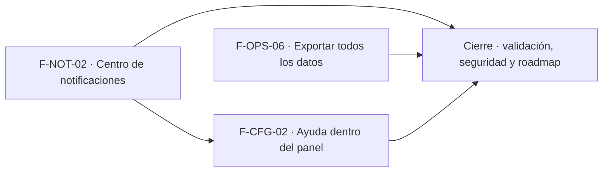

# Tasks: Plataforma · Notificaciones, ayuda y exportación total (MSF-224)

**Spec**: [`spec.md`](./spec.md) · **Plan**: [`plan.md`](./plan.md) · **Contratos**: [`contracts/notificaciones-ayuda-y-exportacion-total.md`](./contracts/notificaciones-ayuda-y-exportacion-total.md)

Formato: `- [ ] T### [P] [Historia][USn] descripción (FR/SC que posee)`. `[P]` = paralelizable (archivos distintos, sin dependencia dentro de la historia). Cada FR/SC tiene **una sola** tarea dueña, dentro de la historia que le toca. Las tareas de cada historia son autosuficientes: ninguna depende de otra historia ni de una tarea `[CIERRE]`.
**Validación por historia**: `pnpm test:db`, `pnpm lint`, `pnpm build` y `pnpm test:web` verdes antes de cerrar la fase.

## Matriz de trazabilidad (tracker ↔ US ↔ tareas)

| Tracker | Historia | US | Tareas | Requisitos que poseen |
|---|---|---|---|---|
| MSF-378 | F-NOT-02 Centro de notificaciones en el panel | US1 | T001–T010 | FR-001–FR-012, SC-001, SC-002 |
| (clave de la historia por asignar en el tracker) | F-CFG-02 Ayuda dentro del panel | US2 | T011–T016 | FR-020–FR-027, SC-003 |
| MSF-396 | F-OPS-06 Exportar todos los datos | US3 | T020–T029 | FR-030–FR-041, SC-004, SC-005, SC-006 |
| Tarea de cierre (label cierre) | Validación completa, seguridad y roadmap | — | T030–T031 | SC-007 |

## Phase 1: F-NOT-02 · Centro de notificaciones en el panel (US1)

- [ ] T001 [F-NOT-02][US1] Migración `supabase/migrations/20270215100001_notificaciones_leido.sql`: `leido_en timestamptz null` e índice `(user_id, creado_en desc)` sobre `public.avisos_pendientes`, sin tocar RLS ni privilegios; reversión en el encabezado. Esquema `public` re-verificado. Verifica: `pnpm test:db` (FR-001)
- [ ] T002 [F-NOT-02][US1] Migración `…100002_notificaciones_funciones.sql`: `listar_notificaciones`, `contar_notificaciones_sin_leer`, `marcar_notificaciones_leidas` (`security definer`, `search_path = ''`, `auth.uid()` + `private.organizacion_id()`, sin `descartado`, acceso vigente por `private.nivel_seccion_de_usuario`, límite acotado) con `revoke … from public, anon` y `grant execute … to authenticated`. Verifica: `notificaciones_panel.test.sql` (FR-002, FR-003, FR-004, FR-005, FR-010)
- [ ] T003 [P] [F-NOT-02][US1] pgTAP `supabase/tests/database/notificaciones_panel.test.sql`: otra persona, otra organización, `anon`, aviso `descartado`, sección sin acceso, marcar ajeno e idempotencia de `leido_en`; `rls_en_toda_tabla` sigue verde. Verifica: `pnpm test:db` (SC-001)
- [ ] T004 [P] [F-NOT-02][US1] `CampanitaNotificaciones` en `apps/web/src/components/navegacion/` con icono de campana, `aria-label` «Notificaciones», punto rojo del sistema de diseño solo si hay sin leer, insertada en `EncabezadoPanel` entre `BusquedaGlobal` y `MenuCuenta`. Verifica: `CampanitaNotificaciones.test.tsx` (FR-006)
- [ ] T005 [F-NOT-02][US1] Desplegable con la lista (nombre del tipo, detalle legible de `datos` en texto plano recortado, hora relativa, no leídos destacados), `useInfiniteQuery` + `IntersectionObserver` + «Cargar más» por teclado, total visible y estados compartidos de carga/vacío/error con «Reintentar». Verifica: `ListaNotificaciones.test.tsx` (FR-007)
- [ ] T006 [F-NOT-02][US1] Marcar leído al abrir un aviso y «Marcar todas como leídas» (deshabilitado sin pendientes), con actualización del punto sin recargar. Verifica: `marcar-leidas.test.tsx` (FR-008)
- [ ] T007 [F-NOT-02][US1] Refresco del conteo: al abrir el panel, al enfocar la pestaña y cada 60 s solo con la pestaña visible. Verifica: `refresco-notificaciones.test.tsx` (FR-009)
- [ ] T008 [F-NOT-02][US1] Accesibilidad y responsive a 320/768/1440 px: teclado, Escape y foco devuelto, anuncio «Notificaciones, N sin leer», sin identificadores técnicos visibles. Verifica: `CampanitaNotificaciones.a11y.test.tsx` (FR-011)
- [ ] T009 [P] [F-NOT-02][US1] `docs/notificaciones-en-panel.md`: piezas, permisos, reversión y la declaración «Empresa activa: no aplica» con su motivo. Verifica: `pnpm docs:check` (FR-012)
- [ ] T010 [F-NOT-02][US1] E2E `apps/web/e2e/notificaciones.e2e.ts` con axe: emitir avisos a un usuario, ver punto y lista, abrir uno, marcar todas, otro usuario sin avisos. Verifica: `pnpm test:e2e` (SC-002)

**Checkpoint F-NOT-02**: un usuario ve y marca sus avisos en la campanita, y nadie ve avisos ajenos.

## Phase 2: F-CFG-02 · Ayuda dentro del panel (US2)

- [ ] T011 [F-CFG-02][US2] Registro de ayuda `apps/web/src/ayuda/` (tipos, índice por `id` de destino) y resolver por ruta que reutiliza la coincidencia de las migas de pan (extraída como función compartida en `destinosPanel.ts`, sin cambiar su comportamiento): destino exacto, destino padre para subrutas y «Esta pantalla todavía no tiene ayuda» para el resto. Verifica: `resolverAyuda.test.ts` (FR-022, FR-025)
- [ ] T012 [F-CFG-02][US2] Contenidos de ayuda en castellano, breves (título + párrafo + hasta 5 pasos; tope de caracteres del plan) para los 44 destinos de `SECCIONES_PANEL`, un módulo por sección, sin términos técnicos. Verifica: `ayuda-contenidos.test.ts` (FR-024)
- [ ] T013 [F-CFG-02][US2] `PanelAyuda` (`Drawer`) y botón «Ayuda» (`aria-label`, icono de signo de pregunta) junto a la campanita en `EncabezadoPanel`; cierra con «Cerrar»/Escape, devuelve el foco, operable a 320/768/1440 px, sin consultas de datos ni dependencia de la empresa activa. Verifica: `PanelAyuda.test.tsx` (FR-020, FR-021, FR-026, FR-027)
- [ ] T014 [P] [F-CFG-02][US2] Test de cobertura `ayuda-cobertura.test.ts`: falla si un destino de `SECCIONES_PANEL` no tiene ayuda o si hay una entrada sin destino. Verifica: `pnpm test:web` (FR-023)
- [ ] T015 [F-CFG-02][US2] E2E `apps/web/e2e/ayuda.e2e.ts` con axe: tres pantallas distintas abren textos distintos, cierre por teclado y foco devuelto. Verifica: `pnpm test:e2e` (SC-003)
- [ ] T016 [P] [F-CFG-02][US2] `docs/ayuda-en-panel.md`: cómo agregar la ayuda de una pantalla nueva y la regla de cobertura. Verifica: `pnpm docs:check`

**Checkpoint F-CFG-02**: cada pantalla del menú tiene su ayuda breve y el CI impide dejar una sin ella.

## Phase 3: F-OPS-06 · Exportar todos los datos (US3)

- [ ] T020 [F-OPS-06][US3] Migración `supabase/migrations/20270215110001_exportacion_total_conjuntos.sql`: `private.conjuntos_exportacion_total` (lista permitida + exclusiones documentadas, armada leyendo el esquema real), `private.datos_exportacion_total` y `private.filas_exportacion_total` (filtro por la organización de la ejecución, ejecución de capacidad `exportar-organizacion-*` en curso, grants solo al rol de worker). Esquema `private` re-verificado. Verifica: `exportacion_total.test.sql` (FR-031, FR-035)
- [ ] T021 [F-OPS-06][US3] Migración `…110002_exportacion_total_solicitud.sql`: `public.solicitar_exportacion_total` (solo administradores, `iniciar_proceso_masivo`, idempotente con una abierta, `SIN_CONEXION_EXPORTACION`), iniciador privado, capacidad por organización, bucket `exportaciones-organizacion` y política `select` de administradores de la organización; `revoke … from public, anon` y `grant execute … to authenticated`; reversión en el encabezado. Verifica: `exportacion_total.test.sql` (FR-030, FR-036)
- [ ] T022 [P] [F-OPS-06][US3] pgTAP `supabase/tests/database/exportacion_total.test.sql`: solo administrador, otra organización, `anon`, idempotencia, lectura acotada a la organización de la ejecución y completitud (falla si una tabla con `organizacion_id` de `public`/`dominio` no está en la lista permitida ni en las exclusiones). Verifica: `pnpm test:db` (FR-032, SC-004)
- [ ] T023 [F-OPS-06][US3] Worker `workers/exportar-organizacion` (`@workers/exportar-organizacion`, scripts `build/lint/test/start`, Dockerfile como los demás): recorre los conjuntos por lotes, CSV con escape y neutralización de fórmulas, ZIP en streaming con `fflate`, subida al bucket, borrado del archivo anterior y cierre `completado`/`con_errores`. Verifica: `pnpm --filter @workers/exportar-organizacion test` (FR-033, FR-037)
- [ ] T024 [F-OPS-06][US3] Contrato de procesos masivos en el worker: progreso por conjunto (`total` = conjuntos), un error por conjunto fallido, cancelación entre lotes sin ZIP parcial, `fallido` con motivo sanitizado ante código 78 o reintentos agotados. Verifica: `exportar-cancelacion.test.ts` (FR-034, SC-005)
- [ ] T025 [P] [F-OPS-06][US3] Flow `infra/kestra/flows/exportar-organizacion.yml` (patrón de `exportar-comprobantes.yml`: reclama `exportar-organizacion-*`, lanza el worker, confirma/libera/agota; código 78 agota en el primer intento) y variables solo en `infra/kestra/.env.example`. Verifica: `pnpm infra:config` (FR-038)
- [ ] T026 [F-OPS-06][US3] Bloque «Exportar todos los datos» en `/importaciones`: botón, diálogo de confirmación, estado de la última exportación total y «Descargar» por URL firmada, estados compartidos, independiente de la empresa activa, oculto a no administradores. Verifica: `exportacion-total.test.tsx` y `exportacion-empresa-activa.test.tsx` (FR-039, FR-040)
- [ ] T027 [F-OPS-06][US3] Accesibilidad y responsive del bloque y del diálogo a 320/768/1440 px, teclado y lector de pantalla, sin identificadores técnicos visibles. Verifica: `exportacion-total.a11y.test.tsx` (FR-039)
- [ ] T028 [F-OPS-06][US3] E2E `apps/web/e2e/exportacion-total.e2e.ts` con axe: pedir, ver el avance en el centro, descargar el ZIP, administrador de otra organización sin acceso y no administrador sin el bloque. Verifica: `pnpm test:e2e` (SC-006)
- [ ] T029 [P] [F-OPS-06][US3] `docs/exportacion-total.md` (incluye, excluye, cómo agregar un conjunto, reversión) y sección en `workers/CONTRATO.md` y `workers/README.md`. Verifica: `pnpm docs:check` (FR-041)

**Checkpoint F-OPS-06**: el administrador pide, sigue y descarga la exportación total desde el centro; ningún dato de otra organización entra al archivo.

## Phase 4: Cierre [CIERRE]

- [ ] T030 [CIERRE] Validación completa (`pnpm lint`, `pnpm build`, `pnpm infra:config`, `pnpm test`, `pnpm docs:check`, `pnpm matriz:check`, `pnpm prototipo:check`) y revisión de seguridad de las tres historias (`authz-security` sobre las funciones y la política de Storage, `crypto-secrets` sobre el worker y el ZIP). Verifica: salida de los comandos y hallazgos resueltos o trazados (SC-007)
- [ ] T031 [CIERRE] Actualizar a mano `docs/roadmap-template.md` (estado, link a esta spec, mover de horizonte si aplica) como paso del cierre. Verifica: `pnpm docs:check`

## Notas de implementación

- Toda tarea `[ ]` debe terminar hecha con su evidencia o cerrada con `[x]` + `Desvío: <motivo>` (ver commit `<hash>`) y, si la deuda es real, una Historia `[Deuda MSF-224] <título>` con label `deuda`, hija de esta épica.
- Los ítems fuera de alcance de la matriz de la spec son notas, no tareas.

## Plan de ejecución (historias)

| Historia | Depende de | Grupo |
|----------|------------|-------|
| F-NOT-02 | — | 1 |
| F-OPS-06 | — | 1 |
| F-CFG-02 | F-NOT-02 | 2 |
| [Cierre] | F-NOT-02, F-CFG-02, F-OPS-06 | 3 |

F-NOT-02 y F-OPS-06 no comparten archivos, tabla ni migración y van en paralelo. F-CFG-02 espera a F-NOT-02 porque ambas editan `EncabezadoPanel.tsx`.

