# Feature Specification: Tiendas online · Tienda compra y cuentas (lista de pedido, presupuesto y «Mi cuenta»)

**Épica**: MSF-176 · **Spec**: `tienda-compra-y-cuentas` · **Historias**: F-CLI-20 (MSF-452; absorbe F-CON-07 y F-TDA-27, ya archivadas) y dos historias nuevas, «Lista de pedido sin cobro» y «Presupuesto desde la tienda» (claves por asignar en el tracker) · **Prioridad**: P3 (alcance aprobado por Nicolás el 2026-11-13)
**Alcance de entrega**: `refine`, `supabase` (sin `kestra`, `superset` ni `workers`: todo se resuelve con consultas en vivo y funciones SQL; el aviso por correo de Consultas ya existe)
**Fuente**: el alcance aprobado por Nicolás (2026-11-13), la evaluación previa `.specify/assessments/tienda-compra-y-cuentas/` y `clientes-pedidos-y-facturacion/` (rama `docs/evaluacion-msf-154-176`, commit `c4b24a46`) y el mapa del código verificado en `origin/dokploy` (2026-11-13). Modelo de estilo: `specs/20270305-100000-inicio-tablero-completo/`. Fuera de la épica heredada: el checkout (F-TDA-26 tal como estaba titulada).
**Cierre de la spec (2026-11-14)**: Nicolás delegó **todas** las decisiones («tomá todas las decisiones por mí, hacé todo»; solo dev, nada de staging ni producción). Quedan confirmadas D-1 a D-19, resueltas las preguntas abiertas como D-20 a D-25, definidas **todas las pantallas y textos** en la sección «Pantallas y textos» (no hay prototipo: D-26) y verificado el código contra `origin/dokploy` con MSF-816 ya entregada (D-17 ajustada, con dos obstáculos reales que la cita anterior no veía; ver «Modelo y supuestos»).

## Objetivo

Al terminar, un cliente con cuenta web activa entra a **«Mi cuenta»** en la tienda, ve sus compras y presupuestos de esa tienda y guarda productos como favoritos (A); cualquier visitante arma una **lista de pedido** con cantidades y la envía sin pagar, y le llega al operador a la bandeja de Consultas **con los ítems** (B1); y el cliente con cuenta activa puede, desde esa misma lista, **pedir un presupuesto real** que queda `pendiente` en Ventas con canal `tienda_online`, calculado por el servidor y sin mover stock ni cobrar (B2). La venta se sigue cerrando (pago, envío, factura) fuera del sistema, como hoy.

## Alcance aprobado y fuera de alcance

| | |
|---|---|
| **Dentro** | (A) cuentas de clientes con «Mi cuenta», historial de compras y favoritos = F-CLI-20; (B1) lista de pedido sin cobro que llega a Consultas como consulta con ítems; (B2) presupuesto real creado desde la tienda para un cliente con cuenta activa (comprobante `presupuesto`, estado `pendiente`, canal `tienda_online`). |
| **Fuera** | Checkout y pagos en línea; envíos con cotización; facturación fiscal / ARCA; auto-registro de clientes; Mercado Libre; carrito persistente entre dispositivos; cupones o descuentos nuevos en la lista (la promoción de precio vigente de la tienda sí rige en B2, igual que en el panel: D-17); reserva o descuento de stock desde la tienda; exponer cantidades exactas de stock (decisión previa: la tienda solo muestra «Disponible / Sin stock»); recuperación de contraseña y acceso (son de F-CLI-05 y F-CLI-06, ya entregadas); correo o notificación al cliente de que su pedido avanzó (la respuesta se da fuera del sistema); botón «Crear presupuesto desde la consulta» en el panel (D-14). |

## Modelo y supuestos (verificados en el código)

- **Cuenta web existente.** `public.cuentas_cliente` (una fila por cliente y tienda; estados `activa|suspendida`), identidad de Supabase Auth que **no** es miembro del panel (`private.organizacion_id()` es nulo para ella). `publico.acceso_cliente_por_dominio(host)` da el estado efectivo (`activa|suspendida|sin_cuenta|no_habilitado`) consultado en cada llamada, de modo que la suspensión rige al instante. Un usuario de Auth pertenece a un solo cliente (D1 de la cuenta web). Alta **solo por invitación** (D2); esta épica no la cambia.
- **Superficie pública.** Todo lo que ve o hace un visitante son funciones `publico.*` `security definer`, `search_path = ''`, sin tablas, con la empresa derivada **solo del `Host`** (`dominio.tiendas`); host desconocido y empresa desactivada responden lo mismo. `dominio` y `publico` están expuestos por PostgREST (`supabase/config.toml`), así que el control real es `revoke`/`grant` explícito y RLS, no «que nadie conozca la ruta».
- **Anti-spam existente.** `private.registrar_envio_tienda(empresa, origen, clave)`: tope de 5 envíos por hora por (empresa, hash de IP) con `pg_advisory_xact_lock`, idempotencia por `clave_envio` única y poda a 24 h (`dominio.tienda_envios`). `publico.crear_consulta_publica` quedó **solo interna** (sin `execute` para `anon` ni `authenticated`; migración `20261212120800`): el alta pública pasa por `enviar_consulta_contacto` o `registrar_consulta_whatsapp`, que aplican el límite.
- **Consultas hoy.** `dominio.consultas` (origen `formulario|whatsapp`, un solo `producto_id`, sin cantidades) y su bandeja (`public.consultas_bandeja`, estados `nueva|en_curso|resuelta`, aviso por correo con un trigger que encola). Es **solo un registro**: el panel no responde por el visitante.
- **Comprobantes hoy.** `public.crear_comprobante` y `public.guardar_lineas_comprobante` exigen sesión de panel (`private.organizacion_id()` y `auth.uid()`); `private.precio_para` es `security invoker` y devuelve vacío sin permiso de panel; la numeración (`private.siguiente_numero_comprobante`) también toma la organización de la sesión. El canal `tienda_online` ya es válido (`comprobantes_venta_canal_ck`); `operador_id` admite nulo. `aceptar_presupuesto` **no reserva ni descuenta stock** (FR-050 de Ventas): ese flujo del operador no cambia.
- **Precios.** Las líneas guardan una copia (descripción, código, precio, escala, alícuota) calculada **por el servidor** (`escala_para_linea`: minorista x1; mayorista x1/x5/x10/x50) más el descuento de la ficha del cliente. La tienda ya calcula el precio por escala de la cuenta activa con `private.precio_final_publico_escala` (`publico.precios_cliente_por_dominio`, tope 50 productos por llamada).
- **MSF-816 ya está en `dokploy`** (migraciones `20270310100100_precio_linea_venta.sql` a `20270310100300`): `private.precio_linea_venta(producto, empresa, tipo_cliente, cantidad, descuento, ahora, aplicar_descuento)` es la **única** función de precio de línea (la usan `guardar_lineas_comprobante` y `copiar_presupuesto`): «gana el más bajo, sin acumular» entre el precio normal del cliente (escala o precio propio, menos su descuento) y la promoción vigente de la tienda (bandera `promociones_precio`); si gana la promoción la línea guarda `precio_referencia` y `promocion_id` y `descuento_pct = 0`. **B2 la reutiliza (D-17), pero no se puede llamar tal cual desde una RPC de tienda**, por dos razones verificadas en el código:
  1. Es `security invoker` y delega en `private.precio_para`, que **devuelve vacío** si la sesión no tiene `empresas` o `ventas` en lectura/edición (`private.nivel_seccion`): un cliente web no tiene ninguna.
  2. Aun llamada desde una función `security definer`, dos piezas internas dependen de la **sesión de panel** y fallan **en silencio**: `private.alicuota_producto` filtra por `private.organizacion_id()` (nulo para el cliente → sin alícuota → **IVA 0**) y `private.precio_propio_empresa` filtra por `private.organizacion_id()` cuando hay `auth.uid()` (→ **ignora el precio propio** de la tienda y cobra otro precio que el panel). Sin error: el presupuesto saldría mal sin avisar.
  Por eso B2 **extrae el cálculo sin sesión** (tareas T050 a T052): `private.precio_para_calculo` (la lógica de `precio_para` sin la compuerta de sesión, acotada por la organización **de la empresa**) y `private.precio_linea_venta_calculo` (la lógica de `precio_linea_venta` sobre aquélla); `precio_para` y `precio_linea_venta` quedan como **envoltorios** con su compuerta y su aislamiento por organización de la sesión (hoy lo da la RLS del `security invoker`), con **el mismo resultado** que hoy (lo prueba el pgTAP vigente y una paridad nueva). La tienda llama al cálculo sin sesión con el tipo y el descuento **del cliente de la cuenta**. Una sola fórmula de precio en todo el producto; no hay motor propio.
- **No hay pantallas dibujadas** en el prototipo para «Mi cuenta», la lista de pedido ni la confirmación: la propia spec las define (sección «Pantallas y textos»: wireframe, componentes, tokens, textos exactos, estados y responsive; D-26). Se construyen con los componentes del template y el sistema de diseño (MSF-117), sin copiar HTML ni CSS del prototipo. Ver la matriz.
- **Bandera y tienda pública.** La bandera `tienda_pedidos` vive en `public.banderas_plataforma` (solo `select` para `authenticated`): el front de la tienda no puede leerla. Por eso se suma una RPC mínima `publico.capacidades_tienda_por_dominio(host)` que devuelve solo `{pedidos: bool}` (D-27) y de la que cuelgan «Mi cuenta», «Mi lista» y los botones.
- **Operador sin nombre.** `listar_presupuestos` y `obtener_comprobante` muestran `'Usuario sin nombre'` cuando `operador_id` es nulo (caso de todo presupuesto de la tienda): se ajusta en T058 (ver FR-061).
- **Carga infinita** (CLAUDE.md, Principio VI) en todos los listados nuevos, también los de «Mi cuenta» (`IntersectionObserver` + «Cargar más» por teclado); la lista de pedido es un máximo de 50 líneas y no pagina.

### Esquema de datos (Principio VII)

Cada tabla se ubica por su naturaleza; no se asume ningún esquema por defecto. Migraciones aditivas; versiones mayores que la última de `origin/dokploy` al integrar (el 2026-11-14 es `20270310100300`; otras ramas ya reservan `20270310100400` y `20270311100000`): las de esta spec van a partir de `20270320100000` con margen y **se ajustan al implementar** con `node scripts/verificar-migraciones.mjs` (siempre por encima del máximo del momento).

| Objeto | Esquema | Historia | Justificación | Acceso (RLS y grants) |
|---|---|---|---|---|
| `dominio.favoritos_cliente` (**nueva**: `id`, `organizacion_id`, `empresa_id`, `cuenta_cliente_id`, `producto_id`, `creado_en`; única `(cuenta_cliente_id, producto_id)`) | `dominio` | A | Es dato del negocio sobre productos del catálogo (qué guardó un cliente de una tienda), no plataforma. Se ata a la cuenta (que vive en `public` por ser identidad) y al producto. FK compuestas con `organizacion_id` (una fila no puede apuntar a otra organización); `on delete cascade` desde la cuenta. | RLS **activada**; política `select` solo de la cuenta propia (defensa en profundidad); **sin ningún privilegio** para `anon`, `public` ni `authenticated` sobre la tabla: se lee y escribe únicamente por las RPC `publico.*`. |
| `dominio.consulta_items` (**nueva**: `id`, `organizacion_id`, `empresa_id`, `consulta_id`, `orden`, `producto_id`, `descripcion`, `sku`, `cantidad`, `precio_referencia`, `creado_en`) | `dominio` | B1 | Líneas de una consulta del negocio: copia de lo que vio el visitante (nombre, SKU, cantidad, precio de referencia que calculó el servidor). Hoy `dominio.consultas` tiene un solo `producto_id` sin cantidad. | RLS por organización, empresa accesible y sección `consultas` ≥ lectura (igual que `dominio.consultas`); `select` solo para `authenticated`; sin políticas ni grants de escritura; `anon` sin privilegios. Lectura del panel por la vista `public.consulta_items_bandeja` (`security_invoker`). |
| `dominio.consultas` (**alterada**: `origen` suma `pedido`; columna `cliente_id` nullable) | `dominio` | B1 | La tabla ya es de dominio y tiene RLS. `cliente_id` lo fija el servidor **solo** si hay una cuenta activa; nunca viene del llamador. FK a `public.clientes (id, organizacion_id)` (índice único existente `clientes_id_organizacion_uq`). | RLS vigente, sin cambios. `consultas_mensaje_requerido` también exime a `pedido` (la nota es opcional). |
| `dominio.tienda_envios` (**alterada**: `origen` suma `pedido` y `presupuesto`) | `dominio` | B1, B2 | Misma tabla de límite e idempotencia por visitante. | RLS vigente, sin cambios (`anon` sin privilegios). |
| `dominio.presupuestos_tienda` (**nueva**: `id`, `organizacion_id`, `empresa_id`, `cuenta_cliente_id`, `cliente_id`, `comprobante_id`, `clave_envio`, `creado_en`; únicas `(cuenta_cliente_id, clave_envio)` y `(comprobante_id)`) | `dominio` | B2 | Vínculo entre un presupuesto y la cuenta que lo pidió desde la tienda: da idempotencia, el tope diario por cuenta y la trazabilidad para el operador. Es registro de negocio atado a un comprobante de `dominio`. FK compuestas `(comprobante_id, organizacion_id)` y `(empresa_id, organizacion_id)`. | RLS por organización, empresa accesible y `ventas` ≥ lectura; `select` solo para `authenticated`; sin escritura directa; `anon` sin privilegios. |
| `private.siguiente_numero_comprobante_org(p_org, p_empresa, p_tipo)` (**nueva**) | `private` | B2 | Misma numeración atómica que la de panel, pero con la organización **explícita** (no hay sesión de panel). La existente no se toca. | Sin `execute` para `anon` ni `authenticated`; solo la llaman las funciones `security definer` del propio esquema. |
| `private.cuenta_de_tienda(p_host)` (**nueva**) | `private` | A, B1, B2 | **Un único punto de identidad y aislamiento**: devuelve `(cuenta_cliente_id, cliente_id, organizacion_id, empresa_id, tipo)` de la sesión `auth.uid()` en la tienda del host **solo** si la cuenta está `activa`, el cliente habilitado (`clientes_empresas`) y no archivado, y no es consumidor final; si no, nada. Reutiliza la misma regla que `publico.acceso_cliente_por_dominio`. | Sin `execute` para API; `security definer`, `search_path = ''`. |
| `private.validar_items_pedido(p_items)` y `private.motor_presupuesto_tienda(...)` (**nuevas**) | `private` | B1, B2 | Lógica sin datos: validación y topes de los ítems; armado de líneas (producto visible, depósito, totales) **llamando** al cálculo de precio único (fila siguiente). | Sin `execute` para API. |
| `private.precio_para_calculo(...)` y `private.precio_linea_venta_calculo(...)` (**nuevas**; `private.precio_para` y `private.precio_linea_venta` de MSF-816 pasan a ser **envoltorios**, misma firma y mismo resultado) | `private` | B2 | Extrae el cálculo de precio sin depender de la sesión de panel (D-17): `security definer`, `search_path = ''`, acotado por la organización de la empresa. Sin datos. | Sin `execute` para API; los envoltorios conservan sus grants actuales. |
| `publico.*` (diez funciones nuevas, ver «Contratos») | `publico` | A, B1, B2 | Superficie de la tienda; `publico` sigue **sin tablas**. | `revoke … from public, anon`; `grant execute` explícito: `anon` + `authenticated` solo en las tres de visitante (`capacidades_tienda_por_dominio`, `lista_pedido_por_dominio`, `enviar_lista_pedido`); el resto, **solo `authenticated`**. |
| `public.consulta_items_bandeja` (**nueva**, vista `security_invoker`) | `public` | B1 | Lectura del panel; aplica la RLS de `dominio.consulta_items`. | `select` para `authenticated`; sin `anon`. |
| `public.registro_actividad` (**sin cambios de estructura**) | `public` | B2 | Auditoría transversal; se suma el evento `presupuesto.creado_desde_tienda`. | Sin cambios. |
| `public.tipos_evento_actividad` y `public.banderas_plataforma` (**una fila nueva** en cada una: el tipo `presupuesto.creado_desde_tienda`, no sensible, y la bandera `tienda_pedidos`, apagada) | `public` | B2, transversal | Catálogos de plataforma que ya existen; solo se agregan filas por migración. | Sin cambios. |
| `public.consultas_bandeja` (vista, **alterada**: suma `cliente_id` e `items_cantidad`) y `public.listar_presupuestos` (RPC, **alterada**: operador «Tienda online (cliente)» si no hay operador y el canal es `tienda_online`) | `public` | B1, B2 | Lecturas del panel ya existentes; no almacenan datos. | Mismos grants que hoy. |

`rls_en_toda_tabla` (pgTAP, recorre `public` + `dominio`) debe seguir verde con las tres tablas nuevas. **Reversión** (migración posterior, nunca en el mismo PR, exportando antes los datos personales de consultas): `drop function` de cada RPC, `drop view public.consulta_items_bandeja`, `drop table dominio.presupuestos_tienda`, `drop table dominio.consulta_items`, `drop table dominio.favoritos_cliente`, `alter table dominio.consultas drop column cliente_id` y restaurar los `check` de `origen` solo si no quedan filas `pedido`/`presupuesto`. Los presupuestos ya creados son comprobantes de Ventas y se **anulan** con el flujo normal; no se borran. Tabla detallada con migraciones en `plan.md`.

## Modelo de datos (DER)

Las tres tablas nuevas están en `dominio` (Principio VII, justificado arriba). El resto del grafo se muestra completo para ver a qué se ata cada una; las tablas `existente` no cambian. Además de las tablas hay cambios de **funciones y vistas** (no son tablas, por eso no están en el diagrama): `public.consultas_bandeja` suma `cliente_id` e `items_cantidad`; `public.listar_presupuestos` muestra «Tienda online (cliente)» como operador; `private.precio_para` y `private.precio_linea_venta` pasan a envoltorios de un cálculo sin sesión (D-17).

| Tabla | Estado | Cambio |
|---|---|---|
| `dominio.favoritos_cliente` | nueva | Favoritos de una cuenta web por tienda; sin privilegios de API (solo RPC `publico.*`) |
| `dominio.consulta_items` | nueva | Líneas de una consulta de pedido (producto, SKU, cantidad, precio de referencia) |
| `dominio.presupuestos_tienda` | nueva | Vínculo presupuesto ↔ cuenta que lo pidió desde la tienda; idempotencia y topes |
| `dominio.consultas` | alterada | `origen` suma `pedido`; columna `cliente_id` nullable; `consultas_mensaje_requerido` exime a `pedido` |
| `dominio.tienda_envios` | alterada | `origen` suma `pedido` y `presupuesto` |
| `public.cuentas_cliente` | existente | Identidad de la cuenta web (una por cliente y tienda) |
| `public.clientes` | existente | Cliente (tipo, descuento, archivado) |
| `public.clientes_empresas` | existente | Tiendas donde el cliente está habilitado |
| `dominio.empresas` | existente | Tienda / empresa |
| `dominio.tiendas` | existente | Dominio de la tienda pública (de ahí sale la empresa) |
| `dominio.productos` | existente | Catálogo |
| `dominio.comprobantes_venta` | existente | Cabecera del presupuesto (canal `tienda_online`, `operador_id` nulo) |
| `dominio.comprobantes_venta_lineas` | existente | Líneas del presupuesto (con `precio_referencia` y `promocion_id` de MSF-816) |
| `dominio.comprobantes_venta_numeracion` | existente | Contador correlativo por empresa y tipo |
| `dominio.depositos` | existente | Depósito por defecto que vende la tienda |
| `dominio.promociones_precio` | existente | Promoción vigente que lee el cálculo de precio |
| `public.registro_actividad` | existente | Auditoría (evento `presupuesto.creado_desde_tienda`) |
| `public.banderas_plataforma` | existente | Bandera `tienda_pedidos` (fila nueva, apagada) |

```mermaid
erDiagram
  empresas ||--|| tiendas : "dominio de la tienda"
  empresas ||--o{ cuentas_cliente : "una por cliente y tienda"
  clientes ||--o{ cuentas_cliente : tiene
  clientes ||--o{ clientes_empresas : "habilitado en"
  empresas ||--o{ clientes_empresas : habilita
  cuentas_cliente ||--o{ favoritos_cliente : guarda
  productos ||--o{ favoritos_cliente : "es favorito de"
  empresas ||--o{ consultas : recibe
  clientes |o--o{ consultas : "pidio (si hay cuenta activa)"
  productos |o--o{ consultas : "producto de interes"
  consultas ||--o{ consulta_items : "tiene lineas"
  productos |o--o{ consulta_items : "copia del producto"
  empresas ||--o{ tienda_envios : "limite por visitante"
  empresas ||--o{ comprobantes_venta : emite
  clientes ||--o{ comprobantes_venta : "a nombre de"
  comprobantes_venta ||--o{ comprobantes_venta_lineas : tiene
  productos ||--o{ comprobantes_venta_lineas : "se vende"
  depositos ||--o{ comprobantes_venta_lineas : "sale de"
  promociones_precio |o--o{ comprobantes_venta_lineas : "snapshot si gano"
  empresas ||--o{ comprobantes_venta_numeracion : numera
  cuentas_cliente ||--o{ presupuestos_tienda : "pidio desde la tienda"
  comprobantes_venta ||--|| presupuestos_tienda : "vinculo 1 a 1"
  empresas ||--o{ registro_actividad : audita

  favoritos_cliente {
    uuid id PK "nueva"
    uuid organizacion_id "nueva"
    uuid empresa_id "nueva"
    uuid cuenta_cliente_id FK "nueva: unica con producto_id"
    uuid producto_id FK "nueva"
    timestamptz creado_en "nueva"
  }
  consulta_items {
    uuid id PK "nueva"
    uuid organizacion_id "nueva"
    uuid empresa_id "nueva"
    uuid consulta_id FK "nueva"
    int orden "nueva"
    uuid producto_id FK "nueva"
    text descripcion "nueva: copia del nombre"
    text sku "nueva"
    int cantidad "nueva: 1 a 9999"
    numeric precio_referencia "nueva: lo calcula el servidor"
    timestamptz creado_en "nueva"
  }
  presupuestos_tienda {
    uuid id PK "nueva"
    uuid organizacion_id "nueva"
    uuid empresa_id "nueva"
    uuid cuenta_cliente_id FK "nueva"
    uuid cliente_id FK "nueva"
    uuid comprobante_id FK "nueva: unica"
    uuid clave_envio "nueva: unica con la cuenta"
    timestamptz creado_en "nueva"
  }
  consultas {
    uuid id PK
    uuid organizacion_id
    uuid empresa_id
    text origen "alterada: suma pedido"
    uuid cliente_id FK "nueva: nullable, lo fija el servidor"
    text nombre
    text contacto
    text mensaje "alterada: opcional para pedido"
    uuid producto_id FK
  }
  tienda_envios {
    uuid id PK
    uuid empresa_id
    text visitante
    uuid clave_envio
    text origen "alterada: suma pedido y presupuesto"
  }
  cuentas_cliente {
    uuid id PK
    uuid cliente_id FK
    uuid empresa_id FK
    uuid auth_user_id
    text estado
  }
  clientes {
    uuid id PK
    text tipo
    numeric descuento
    timestamptz archivado_en
  }
  clientes_empresas {
    uuid cliente_id FK
    uuid empresa_id FK
  }
  empresas {
    uuid id PK
    uuid organizacion_id
    boolean activa
  }
  tiendas {
    text dominio
    uuid empresa_id FK
  }
  productos {
    uuid id PK
    text nombre
    text sku
    boolean activo
  }
  comprobantes_venta {
    uuid id PK
    uuid empresa_id FK
    uuid cliente_id FK
    text tipo
    text estado
    text canal
    uuid operador_id "nullable: nulo en los de la tienda"
    date valido_hasta
    numeric total_con_iva
  }
  comprobantes_venta_lineas {
    uuid id PK
    uuid comprobante_id FK
    uuid producto_id FK
    numeric precio_unitario
    numeric precio_referencia
    uuid promocion_id FK
    uuid deposito_id FK
  }
  comprobantes_venta_numeracion {
    uuid empresa_id FK
    text tipo
    int ultimo
  }
  depositos {
    uuid id PK
    boolean por_defecto
    boolean activo
  }
  promociones_precio {
    uuid id PK
    uuid producto_id FK
    uuid empresa_id FK
    numeric precio_promocional
  }
  registro_actividad {
    uuid id PK
    uuid actor_id "nullable"
    text tipo
    text detalle
  }
  banderas_plataforma {
    text clave PK "fila nueva: tienda_pedidos"
    boolean activa
  }
```



## User Scenarios & Testing

Las historias se priorizan A → B1 → B2. **A** es independiente de las otras dos. **B1** es independiente de A y de B2 (usa solo Consultas y el catálogo públicos). **B2** reutiliza la pantalla «Lista» de B1 (el botón extra solo aparece con sesión activa) y la vista de presupuestos de A para que el cliente siga su estado; sin A, B2 igual se verifica por el panel de Ventas y por la confirmación con número. Cada una tiene su checkpoint en `plan.md`.

### Historia 1 — «Mi cuenta»: historial, presupuestos y favoritos (F-CLI-20 · MSF-452) · P1

Como **cliente con cuenta activa** quiero ver mis compras y presupuestos de esta tienda y guardar productos como favoritos, para volver a lo que me interesa sin repetir la búsqueda.

**Por qué P1**: es lo único de la épica que no cambia cómo se vende (riesgo bajo), reutiliza la cuenta web ya construida y cierra tres historias duplicadas (F-TDA-27, F-CON-07, F-CLI-20).

- **FR-001** El encabezado de la tienda muestra «Mi cuenta» (además de «Salir») solo con la función encendida (bandera `tienda_pedidos`, FR-014) y sesión de cuenta **activa** en esa tienda; sin sesión o con cuenta no activa no aparece. Ruta `/mi-cuenta`, con secciones «Compras y presupuestos» y «Favoritos» (pestañas; la sección viaja en `?seccion=`).
- **FR-002** Sin sesión, o con una cuenta que no está activa y habilitada en esta tienda, `/mi-cuenta` redirige a `/ingresar` conservando la ruta de vuelta; la respuesta del servidor es la misma en todos esos casos (no revela cuál).
- **FR-003** «Compras y presupuestos» lista, con **carga infinita** (nuevos primero; tandas de 20, tope 50 por llamada, cursor por `(fecha, id)`), los comprobantes de **ese cliente en esa tienda** (cualquier canal: mostrador, teléfono o tienda online): número, fecha, tipo (Compra / Presupuesto / Nota de crédito), estado público y **total con IVA**. Contador total visible, vacío «Todavía no tenés compras ni presupuestos en esta tienda», error con reintento.
- **FR-004** El **estado público** es simplificado y no expone el interno: presupuesto → «Pendiente», «Aceptado», «Vencido» (derivado de `valido_hasta`) o «Anulado»; compra (factura confirmada) → «Confirmada» o «Anulada»; nota de crédito → «Nota de crédito». Los estados de cobro y despacho (`cobrado`, `deuda`, `en_proceso`, `armando`, `incompleto`) **no se muestran** (D-10). Los borradores nunca aparecen.
- **FR-005** Cada fila abre el **detalle**: líneas (descripción, código, cantidad, precio unitario, subtotal) y totales; en una **nota de crédito** los totales y el subtotal de cada línea van **negativos** (y el precio unitario positivo) para que, en las notas de crédito por devolución de productos (las únicas con líneas), las líneas sumen el total con signo. El servidor **no devuelve** costos, márgenes, descuento, operador, notas internas, depósito ni datos de otros clientes; el contrato es una lista blanca de campos, probada.
- **FR-006** Pedir el detalle de un comprobante que no es de esa cuenta (otro cliente, otra tienda, otra organización) responde igual que uno inexistente (IDOR).
- **FR-007** La ficha del producto muestra «Guardar en favoritos» / «Quitar de favoritos» (alternar, idempotente) solo con sesión activa; sin sesión, el control lleva a «Ingresar». El estado se pinta con una sola llamada por pantalla (`favoritos_entre_por_dominio`).
- **FR-008** «Favoritos» lista con carga infinita los productos guardados en esta tienda con foto (miniatura de tamaño del componente compartido), nombre, disponibilidad («Disponible / Sin stock») y precio según la cuenta (escala del tipo de cliente, como en la ficha), y permite quitarlos. Un favorito cuyo producto dejó de ser visible en la tienda **no se lista** (no se borra: vuelve a aparecer si se vuelve a publicar). El cursor de la lista es `(creado_en, id)`, nuevos primero (`siguiente = {creado, id}`).
- **FR-009** Tope de **200 favoritos por cuenta**, contando **solo los favoritos de productos visibles hoy** (uno que se ocultó no se lista ni ocupa lugar; las filas están acotadas por la cantidad de productos de la tienda y el total visible puede superar 200 si se republican productos ocultos); el 201 responde «Llegaste al máximo de favoritos» sin guardar. Alternar es idempotente (guardar dos veces no duplica; quitar uno inexistente no falla). **Quitar nunca exige que el producto siga visible** (responde `ok` y borra la fila propia, también si el producto se ocultó); solo **guardar** exige visibilidad (si no, `no_encontrado`).
- **FR-010** Favoritos e historial son **por tienda**: la misma persona con cuentas en San Javucho y Mundo JC ve en cada dominio solo lo suyo de esa tienda (D-2).
- **FR-011** La suspensión de la cuenta o su baja de «Habilitado en» rigen **en la próxima llamada** (el estado se consulta cada vez); la pantalla ya abierta pasa a «Tu cuenta no está activa en esta tienda» al primer error de acceso, sin mostrar datos previos.
- **FR-012** Quien opera el panel **no ve** los favoritos del cliente (D-11); la ficha del cliente y su historial del panel no cambian.
- **FR-013** Accesibilidad y adaptación: teclado, lector de pantalla y anchos de 320, 768 y 1440 px; estados de carga, vacío, error con reintento y fin de lista con los patrones compartidos; sin identificadores técnicos a la vista. Wireframes, textos y estados exactos en «Pantallas y textos» (P-1 a P-3).
- **FR-014** **Bandera.** Con `tienda_pedidos` apagada (el valor por defecto en todo entorno, D-19) la tienda **no muestra** «Mi cuenta», «Mi lista», «Guardar en favoritos» ni «Agregar a la lista»; `/mi-cuenta` y `/lista` responden la página «no encontrada» de la tienda; y toda RPC de esta épica (salvo `capacidades_tienda_por_dominio`, que solo informa el estado) responde el `error`/`sin_acceso` genérico de su familia **sin tocar datos** (el servidor lo impone; el front solo lo refleja con `publico.capacidades_tienda_por_dominio`). Se enciende **solo en dev**, por script, para probar (D-24).

**Escenarios (Dado/cuando/entonces)**

1. Dado un cliente con cuenta activa en San Javucho, cuando abre «Mi cuenta», entonces ve solo sus comprobantes de San Javucho (no los de Mundo JC) con total con IVA y estado público.
2. Dado un cliente con una factura en estado `deuda` y otra `cobrado`, cuando abre su historial, entonces ambas figuran «Confirmada» (el cobro no se expone).
3. Dado un presupuesto `pendiente` con `valido_hasta` ayer, cuando lo ve, entonces figura «Vencido».
4. Dado un cliente A, cuando intenta abrir el detalle del comprobante de un cliente B (id válido), entonces recibe el mismo resultado que con un id inexistente y ningún dato de B.
5. Dado el detalle de una compra, cuando el cliente inspecciona la respuesta, entonces no hay costo, margen, descuento ni operador.
6. Dado un visitante sin sesión, cuando entra a `/mi-cuenta`, entonces va a «Ingresar» y, tras ingresar, vuelve a «Mi cuenta».
7. Dado un cliente con la cuenta suspendida a mitad de la sesión, cuando pide más compras, entonces ve «Tu cuenta no está activa en esta tienda» y nada del historial.
8. Dado un cliente, cuando guarda el mismo producto dos veces, entonces hay un solo favorito; cuando llega a 200, el 201 se rechaza con el aviso.
9. Dado un favorito cuyo producto se ocultó en la tienda, cuando abre «Favoritos», entonces no aparece; cuando el producto vuelve a publicarse, vuelve a aparecer.
10. Dado un usuario del panel de otra organización que llama a las RPC con su propia sesión, cuando consulta historial o favoritos, entonces recibe «sin acceso» (no tiene cuenta web).
11. Dada la bandera `tienda_pedidos` apagada, cuando un cliente con cuenta activa abre la tienda, entonces el encabezado no muestra «Mi cuenta», `/mi-cuenta` muestra «no encontrada» y las RPC responden el error genérico sin leer datos.

### Historia 2 — Lista de pedido sin cobro (B1) · P2

Como **visitante** de la tienda quiero armar una lista con varios productos y cantidades y enviarla, para no repetir producto por producto lo que ya elegí; sé que **no pago ni compro** en ese momento.

**Por qué P2**: valida la demanda de pedir en línea con costo medio y sin pagos, sobre el circuito de bandeja y anti-spam que ya existe.

- **FR-020** La ficha del producto suma «Agregar a la lista» (junto a «Consultar por WhatsApp»; definido en «Pantallas y textos», P-2). Agregar el mismo producto suma una cantidad (tope 9.999 por producto).
- **FR-021** El encabezado muestra «Mi lista» con la cantidad de productos; la ruta `/lista` muestra las líneas (foto, nombre, SKU, disponibilidad, cantidad editable con mínimo 1 y botón «Quitar»), el **precio de referencia** y el total de referencia, con la leyenda «Precios de referencia: se confirman al responder. Este pedido no reserva stock ni es una compra.» (D-3, D-4).
- **FR-022** La lista vive **en el navegador** (almacenamiento local por tienda, `try/catch`: si el navegador la bloquea la lista dura mientras la página está abierta y avisa). No se guarda en el servidor ni se sincroniza entre dispositivos (D-15). Solo guarda `producto_id` y `cantidad`; **nunca precios**.
- **FR-023** Cada vez que se abre la lista (y antes de enviar) el servidor la **revalida**: `publico.lista_pedido_por_dominio(host, items)` devuelve, por línea, nombre, SKU, imagen, disponibilidad y precio de referencia **calculados por el servidor**, y la lista de ítems **no disponibles** (producto inexistente, oculto, inactivo o de otra tienda; todos indistinguibles). La pantalla los avisa y los quita al enviar.
- **FR-024** Los productos «Sin stock» **se pueden agregar** (el operador decide al responder), marcados «Sin stock hoy: lo confirmamos al responder» (D-4).
- **FR-025** Sin sesión activa la lista pide **Nombre** (1–100), **Contacto** (correo, o teléfono de 8 a 15 dígitos) y **Nota** opcional (hasta 500), con las reglas de `private.validar_contacto_tienda`, más el aviso «Usaremos estos datos solo para responderte» con el enlace legal de la tienda si lo tiene.
- **FR-026** Con una cuenta **activa**, el nombre y el contacto **no se piden**: el servidor usa los de la ficha del cliente y marca la consulta con su `cliente_id` (D-8); la nota sigue siendo opcional.
- **FR-027** «Enviar pedido» llama a `publico.enviar_lista_pedido(host, nombre, contacto, nota, items, clave_envio)` con una `clave_envio` generada **al abrir el envío** (idempotente: reintentar tras un corte no duplica). Respuestas: `ok | invalido (campos) | limite | error`, sin datos internos.
- **FR-028** El servidor valida **todo**: host, lista de 1 a 50 líneas únicas (las repetidas se suman con tope), `cantidad` entera 1–9.999, cada producto **efectivamente visible** en la tienda del host, nombre/contacto/nota con las reglas de FR-025, y rechaza caracteres de control. Una lista vacía o que queda sin ítems válidos responde `invalido`.
- **FR-029** Límite por visitante: el **mismo** de la tienda (5 envíos por hora por empresa y hash de IP, compartido con el formulario y WhatsApp; falla cerrada sin IP) más la idempotencia por clave; si la entrega falla, el cupo no se gasta (misma sub-transacción que el formulario).
- **FR-030** Un envío válido crea **una** consulta `origen = 'pedido'` y sus `dominio.consulta_items` en una sola transacción (todo o nada), con `precio_referencia` calculado por el servidor y nunca recibido del cliente. El aviso por correo de Consultas la encola como a cualquier consulta (con el resumen de ítems en texto plano).
- **FR-031** La bandeja del panel muestra el origen «Pedido» y el detalle de la consulta lista los ítems (producto, SKU, cantidad, precio de referencia rotulado «referencia») y el total de referencia, con el nombre y contacto del visitante y, si lo hay, el cliente (Nº y nombre). El texto se renderiza **como texto** (nunca HTML). `Responder por correo/WhatsApp` sigue igual y su texto inicial incluye los ítems.
- **FR-032** La pantalla de confirmación dice «Recibimos tu pedido. Te vamos a responder para confirmar disponibilidad y precio. No se cobró nada.» y vacía la lista; con error o límite conserva la lista y ofrece reintentar (con el tiempo de espera de `limite` en minutos).
- **FR-033** Accesibilidad y adaptación (teclado, lector, 320/768/1440 px) y estados de carga, vacío («Tu lista está vacía» con «Ver catálogo»), error con reintento.

**Escenarios**

1. Dado un visitante con 3 productos en su lista, cuando envía su nombre y teléfono, entonces la bandeja muestra una consulta «Pedido» con las 3 líneas, cantidades y precio de referencia, y llega el aviso por correo.
2. Dado un visitante que reintenta con la misma `clave_envio` tras un corte de red, cuando reenvía, entonces hay **una** consulta.
3. Dado un visitante que ya hizo 5 envíos en la hora, cuando envía el sexto, entonces recibe `limite` y no se crea nada.
4. Dado un cliente que manipula la petición y manda `precio` o `precio_referencia` en cada ítem, cuando se guarda, entonces el precio guardado es el del servidor (la clave ajena se ignora).
5. Dado un producto oculto o de otra tienda dentro de la lista, cuando se revalida, entonces figura «No disponible» igual que uno inexistente y no se envía.
6. Dado un pedido con 51 líneas o una cantidad de 10.000, cuando se envía, entonces `invalido` y no se crea nada.
7. Dado un nombre o una nota con `<script>` o con un carácter de control, cuando llega al panel, entonces el texto se ve literal (o se rechaza el carácter de control) y no se ejecuta nada.
8. Dado un cliente con cuenta activa, cuando envía la lista, entonces no se le pide nombre ni contacto y la consulta lleva su Nº de cliente.
9. Dado un envío con host de una tienda inexistente, cuando se llama, entonces la respuesta es la misma que con una empresa desactivada.
10. Dado un navegador que bloquea el almacenamiento local, cuando arma la lista, entonces funciona en memoria y avisa que no se conservará al cerrar.

### Historia 3 — Presupuesto desde la tienda (B2) · P3

Como **cliente con cuenta activa** quiero pedir un presupuesto desde mi lista, para recibir el precio que me corresponde (mi escala y mi descuento) sin esperar a que alguien lo arme a mano.

**Por qué P3 y la más sensible**: crea un **comprobante real** sin sesión de panel, solo con la sesión de un cliente de tienda. Cada decisión de abajo es una barrera de seguridad; el modelo de amenazas es parte de la spec.

- **FR-050** Con sesión de cuenta **activa**, la lista suma «Pedir presupuesto» (definido en «Pantallas y textos», P-4). Antes de enviar, la pantalla muestra la **cotización del servidor** (`publico.cotizar_presupuesto_tienda`): líneas con la escala y el precio que le corresponden y el total con IVA; «lo que ves es lo que se crea» (misma función que la creación).
- **FR-051** `publico.crear_presupuesto_tienda(host, items, nota, clave_envio)` es ejecutable **solo por `authenticated`** (`anon` sin `execute`); la identidad y la tienda salen **únicamente** de `private.cuenta_de_tienda(host)`: la función **no recibe** `cliente_id`, `empresa_id`, `organizacion_id`, precios, estado ni canal. Sin cuenta activa y habilitada responde `sin_acceso` (igual para todos los casos).
- **FR-052** La función acepta solo `items` (`producto_id`, `cantidad`) con las reglas de FR-028 y una `nota` opcional (≤ 500, sin caracteres de control). **Ninguna otra clave** del `jsonb` se lee: un `precio`, `descuento`, `escala` o `deposito_id` enviado no tiene efecto (probado).
- **FR-053** El **precio lo calcula siempre el servidor**, con la **misma función que el panel** (`private.precio_linea_venta`, MSF-816, vía su cálculo sin sesión: D-17): producto activo y visible en la tienda, escala según el tipo del cliente y la cantidad de **esa** línea, precio propio de la tienda, descuento de la ficha del cliente sobre el neto, **promoción vigente de la tienda si es menor y la bandera `promociones_precio` está encendida** (gana el más bajo, sin acumular; la línea guarda `precio_referencia` y `promocion_id` como en el panel), IVA por alícuota, redondeo a 2 decimales. Un producto sin precio en pesos (falta la cotización del dólar) o con precio ≤ 0 se rechaza (`sin_precio`) y **nunca** crea una línea en cero. Prueba de **paridad**: el mismo conjunto de líneas dado por el panel y por la tienda da los mismos importes.
- **FR-054** Se crea, **en una sola transacción**, un comprobante `tipo = 'presupuesto'`, `estado = 'pendiente'`, `canal = 'tienda_online'`, de la empresa del host, a nombre del cliente de la cuenta, `operador_id` nulo, `valido_hasta` nulo (D-13), con numeración correlativa (`private.siguiente_numero_comprobante_org`), sus líneas, el registro `dominio.presupuestos_tienda` y el evento de actividad. Todo o nada: si algo falla no queda número consumido ni líneas sueltas.
- **FR-055** **Sin efectos de dinero ni de stock**: no se crea ningún cobro, contrarreembolso, reserva ni movimiento de stock, y el comprobante no pasa de `pendiente` (probado con pgTAP: cero filas nuevas en `movimientos_stock`, reservas y cobros). El stock «A pedido» y las reservas no se tocan (D-4).
- **FR-056** Depósito de las líneas: el depósito por defecto, activo, que vende la tienda (igual que el panel cuando no se elige); sin ninguno responde `error` genérico sin crear nada.
- **FR-057** **Topes por cuenta**: máximo **5 presupuestos creados por día** (día de Buenos Aires) y **10 presupuestos `pendiente` abiertos** a la vez desde la tienda por cuenta; superarlos responde `limite_cuenta` («Ya tenés presupuestos abiertos; esperá nuestra respuesta»). Más el cupo por hora de la tienda (FR-029, origen `presupuesto`). El conteo y el alta se serializan con `pg_advisory_xact_lock` por cuenta (dos llamadas simultáneas no superan el tope). Valores confirmados (D-9, D-23).
- **FR-058** **Idempotencia**: `(cuenta_cliente_id, clave_envio)` es único; repetir una clave devuelve el **mismo** presupuesto (`ok`, mismo número) sin crear otro ni gastar cupo.
- **FR-059** Respuesta `ok` con `{numero, fecha, total_con_iva}` del presupuesto; `invalido (campos)`, `sin_precio (producto)`, `limite`, `limite_cuenta`, `sin_acceso` y `error` genérico. Ninguna respuesta lleva mensajes de Postgres ni datos internos.
- **FR-060** **Auditoría**: el evento `presupuesto.creado_desde_tienda` en `public.registro_actividad` (misma transacción; el tipo se da de alta en `public.tipos_evento_actividad`, no sensible) con empresa, número de presupuesto y **cliente (Nº y nombre)**, sin correo ni datos de contacto; el evento no tiene actor de panel (actor nulo) y **Actividad lo rotula «Tienda online»** (hoy un actor nulo se rotula «Sistema» en la lista, el detalle y la exportación: se ajusta solo para este tipo de evento); la persona queda identificada por el cliente del detalle.
- **FR-061** **Visibilidad para el operador**: el presupuesto aparece en Ventas › Presupuestos como cualquier otro (estado «Pendiente», cliente) y se reconoce de dos maneras: la columna **Operador** muestra «Tienda online (cliente)» en vez de «Usuario sin nombre» (cambio de `listar_presupuestos`, T058: hoy esa lista no trae el canal ni tiene filtro por canal), y la ficha del comprobante rotula «Creado desde la tienda por el cliente» cuando `canal = 'tienda_online'` y no tiene operador (el front lo resuelve con campos que `obtener_comprobante` ya devuelve, `canal` y `operador_id`; el operador nulo se muestra «Tienda online (cliente)», no «Usuario sin nombre»). Un filtro por canal en Presupuestos queda como seguimiento. El operador lo acepta, modifica, copia o anula con los flujos de siempre; la tienda **no** puede modificarlo después de crearlo.
- **FR-062** La confirmación al cliente dice «Pedimos tu presupuesto Nº N. Es un presupuesto, no una compra: no reserva stock ni se cobró nada. Te vamos a responder para coordinar.» y lo enlaza en «Mi cuenta › Compras y presupuestos» (de A, si está construida); vacía la lista.
- **FR-063** Un aviso al equipo por presupuesto nuevo **no** forma parte de esta spec (D-12, D-22): queda como seguimiento; mientras tanto el operador lo ve en Ventas › Presupuestos (columna Operador «Tienda online (cliente)») y en Actividad.
- **FR-064** Accesibilidad, adaptación y estados como en FR-013/FR-033.

**Escenarios**

1. Dado un cliente mayorista activo con 12 unidades de un producto, cuando pide el presupuesto, entonces la línea sale en escala `x10` con su descuento y el total coincide con el que armaría el panel.
2. Dado el cliente A, cuando manipula la petición poniendo el `cliente_id` de B, entonces no hay efecto (la función ni lee ese campo) y el presupuesto, si se crea, es de A.
3. Dado un usuario sin cuenta web (o un usuario de panel), cuando llama a `crear_presupuesto_tienda`, entonces `sin_acceso` y no se crea nada.
4. Dado un cliente con la cuenta suspendida, cuando pide un presupuesto, entonces `sin_acceso` al instante.
5. Dado un cliente con cuenta en San Javucho, cuando llama a la función con el host de Mundo JC, entonces `sin_acceso` (la cuenta debe ser de esa tienda).
6. Dado un cliente que ya creó 5 presupuestos hoy, cuando pide el sexto, entonces `limite_cuenta` y nada se crea.
7. Dado dos llamadas simultáneas con 4 presupuestos ya creados hoy, cuando ambas intentan, entonces solo una se crea.
8. Dado un reintento con la misma `clave_envio`, cuando se repite, entonces devuelve el mismo número, sin otro comprobante.
9. Dado un producto sin precio en pesos, cuando se pide, entonces `sin_precio` con el producto y no se crea ningún comprobante ni se consume número.
10. Dado un presupuesto creado desde la tienda, cuando el operador abre Presupuestos, entonces lo ve «Pendiente», canal «Tienda online», sin ningún movimiento de stock, y puede aceptarlo con el flujo actual.
11. Dado un presupuesto creado, cuando se mira el registro de actividad, entonces hay un evento con número y cliente y sin correo.

### Casos borde

- Producto con variantes o sin precio visible; producto que se oculta entre que se agrega a la lista y se envía (se avisa y se quita).
- Cliente con descuento y producto con precio manual en panel: en la tienda **no hay precio manual**; el descuento se aplica como en el panel.
- Cliente `consumidor final` o archivado: nunca tiene cuenta activa; sin acceso.
- La tienda está pausada («Volvemos pronto»): ninguna función de esta épica opera (misma respuesta que host desconocido).
- Dos pestañas con la misma lista: gana la última escritura del almacenamiento local; el servidor es la autoridad al enviar.
- Contactos duplicados: la bandeja no deduplica (como hoy); vincular con `dominio.contactos` es del operador.
- Zona horaria: «hoy» del tope diario y el «Vencido» usan el día de Buenos Aires (trampa conocida UTC vs ART).

## Modelo de amenazas

Todo lo público se trata como hostil. Cada fila tiene su requisito y su prueba (T-ids en `tasks.md`); la revisión de seguridad integral (`docs/seguridad-tienda-compra-y-cuentas.md`) las recorre de nuevo contra el código final.

### 1 · Funciones `publico.*` ejecutables por `anon` (lista de pedido, B1)

| # | Amenaza | Vector | Mitigación | Prueba |
|---|---|---|---|---|
| 1.1 | Abuso y spam (inundar la bandeja y el correo del equipo) | Llamar `enviar_lista_pedido` en bucle, con claves nuevas, desde muchas IP | Tope de 5 por hora por (empresa, hash de IP) con lock, falla cerrada sin IP, idempotencia por clave, poda a 24 h (reutiliza `private.registrar_envio_tienda`); el aviso por correo ya se agrupa y reintenta; campo trampa del formulario si el front lo trae | FR-029; pgTAP: sexto envío `limite`; clave repetida = una consulta |
| 1.2 | Evadir el límite llamando directo a los insertores | Llamar `crear_consulta_publica` o escribir las tablas por PostgREST | `crear_consulta_publica` sigue **solo interna**; el insertor de pedidos es `private.*` sin `execute` de API; `dominio.consultas` y `dominio.consulta_items` sin privilegios de escritura ni para `anon` | pgTAP: `has_function_privilege`/`has_table_privilege` de `anon` y `authenticated` en cada objeto |
| 1.3 | Listas gigantes o `jsonb` malicioso (agotar CPU, memoria o romper el parser) | `items` con 10.000 elementos, anidado, tipos raros, `cantidad` negativa, decimal o texto, `producto_id` no uuid | `jsonb_typeof = 'array'`, tope de 50 elementos y de tamaño del texto (8 kB) **antes** de recorrer; cada elemento debe ser objeto con `producto_id` que cumpla la forma uuid (regex, sin cast que falle) y `cantidad` de 1 a 4 dígitos; resto de claves ignoradas | pgTAP con una batería de entradas inválidas: todas `invalido`, ninguna con error de Postgres |
| 1.4 | **Enumeración de productos / tenants** | Probar ids o hosts para saber qué existe en otra tienda u organización | La empresa sale solo del host; un producto que no es **efectivamente visible** (`catalogo_tienda_efectivo`) en esa tienda es indistinguible de uno inexistente; host desconocido = empresa desactivada = tienda pausada; los ids son uuid no adivinables; la respuesta devuelve solo los mismos campos que la ficha pública | pgTAP: producto de otra org, oculto, inactivo e inexistente dan la misma respuesta |
| 1.5 | **XSS e inyección** en `nombre`, `contacto`, `nota` | `<script>`, `javascript:`, HTML en el aviso, fórmulas de CSV (`=HYPERLINK(...)`), saltos de línea para forjar encabezados de correo | Todo se guarda como **texto** con longitudes y juego de caracteres validados (sin control); SQL solo con parámetros y sin SQL dinámico; el panel renderiza con React (sin `dangerouslySetInnerHTML`); el aviso por correo es texto plano y el asunto no incluye datos del visitante; el CSV de exportaciones neutraliza fórmulas (patrón existente); los enlaces `mailto:`/`wa.me` del «Responder» se construyen codificados | Vitest del detalle (texto literal); pgTAP de rechazo de control; test del texto del aviso |
| 1.6 | **Datos personales y consentimiento** | Guardar de más; filtrar a quien no corresponde | Mínimo: nombre, contacto, nota e ítems; sin dirección, DNI ni CUIT (D-7); la IP **nunca** se guarda (solo el hash por empresa); el contacto lo ve solo quien tiene `consultas` ≥ lectura en esa empresa (RLS); el aviso de uso de datos se muestra antes de enviar; sin registro de consentimiento formal (igual que el formulario actual). **Sin purga automática de consultas en esta épica (D-20): queda documentado y con seguimiento, no se inventa un plazo legal** | pgTAP de RLS; revisión de campos |
| 1.7 | Fuga de información en los errores | Provocar errores para leer SQL, nombres o datos | Respuesta cerrada `ok | invalido | limite | error`; el `exception when others` registra solo `sqlstate` (nunca `sqlerrm`) | pgTAP: ningún camino de error devuelve texto de Postgres |
| 1.8 | **Manipulación de precios** | Mandar `precio` o `total` en el `jsonb` | La función no lee precios; el `precio_referencia` es una copia del cálculo del servidor y se rotula «referencia» | Escenario B1-4 |
| 1.9 | Denegación por lecturas baratas y repetidas | Llamar `lista_pedido_por_dominio` miles de veces | Acotada a 50 productos por llamada (mismo orden que `precios_cliente_por_dominio`); se evalúa aplicar el limitador de pedidos públicos de la búsqueda (`public.limite_pedidos_publicos`) y un `statement_timeout` versionado para `anon`/`authenticated` (seguimiento ya abierto en la épica del tablero, H-7) | Prueba de rendimiento con 50 líneas |
| 1.10 | Cruce de tenants | Pasar un `producto_id` de otra organización | Los joins van con `organizacion_id` del host; FK compuestas en `consulta_items` | pgTAP de aislamiento entre dos organizaciones |

### 2 · B2: crear un comprobante sin sesión de panel (la más sensible)

| # | Amenaza | Vector | Mitigación | Prueba |
|---|---|---|---|---|
| 2.1 | **IDOR / suplantación**: crear un presupuesto para otro cliente | Mandar `cliente_id` de otro; reutilizar un id de comprobante | La función **no recibe** cliente, empresa ni organización; la identidad sale solo de `private.cuenta_de_tienda(host)` con `auth.uid()`; un usuario de Auth tiene **un** cliente (D1); el detalle del historial exige `cliente_id` y `empresa_id` de la cuenta | pgTAP con dos clientes: A no crea ni lee para B |
| 2.2 | Un usuario autenticado que **no** es cliente (miembro de otro panel, otra organización) | Llamar con su JWT | `sin_acceso` si no hay fila `activa` en `cuentas_cliente` para `auth.uid()` y la tienda del host; el miembro del panel no tiene cuenta (D5: no mezcla identidades) | pgTAP: panel de otra org → `sin_acceso` |
| 2.3 | **Aislamiento por organización y tienda** | Usar el host de una tienda con la cuenta de otra | La cuenta debe ser de **esa** empresa y estar habilitada (`clientes_empresas`); la organización sale de la empresa del host y debe coincidir con la de la cuenta; FK compuestas | pgTAP: cuenta de San Javucho con host de Mundo JC → `sin_acceso` |
| 2.4 | **Precio manipulado por el cliente** | Mandar `precio`, `escala`, `descuento`, `deposito_id`, `estado` | Las claves ajenas no se leen; el servidor calcula escala, descuento (de la ficha), IVA y redondeo; sin precio manual; paridad con el panel | pgTAP: payload con claves extra = mismo resultado que sin ellas; paridad |
| 2.5 | Presupuestos «basura» que ensucian numeración y reportes | Bucle de creaciones | Tope de 5 por día y 10 abiertos por cuenta (lock por cuenta); cupo por hora por visitante; cuentas solo por invitación; el operador puede anular con el flujo existente; un presupuesto `pendiente` no cuenta como facturado (`comprobante_cuenta_como_facturado`) | pgTAP de topes y de concurrencia |
| 2.6 | **Doble creación** (doble clic, reintento) | Repetir la petición | Clave por cuenta única; devuelve el mismo número; alta atómica | Escenario B2-8 |
| 2.7 | **Efectos colaterales de dinero o stock** | Que el presupuesto reserve o descuente stock, o cree cobros | La función solo inserta comprobante, líneas, vínculo y actividad; no llama a funciones de stock, reservas ni cobros; estado fijo `pendiente`; las transiciones siguientes son del operador | pgTAP: conteo de filas antes y después en `movimientos_stock`, reservas y cobros |
| 2.8 | **Escalada de privilegios por `security definer`** | `search_path` manipulado, SQL dinámico, función ejecutable por quien no corresponde | `security definer`, `set search_path = ''` y nombres calificados; sin `execute format`; `revoke … from public, anon` y `grant … to authenticated` explícitos; el motor y los helpers `private.*` sin `execute` de API; dueño de las funciones sin `bypassrls` extra | pgTAP de privilegios; revisión de código |
| 2.9 | **Auditoría insuficiente** | Un presupuesto sin rastro de quién lo pidió | Evento `presupuesto.creado_desde_tienda` (empresa, número, cliente Nº y nombre) y vínculo `dominio.presupuestos_tienda` con cuenta y clave; el operador lo ve en Presupuestos (canal «Tienda online») y en Actividad. Sin correo ni contacto en el detalle del evento | pgTAP de actividad |
| 2.10 | Cuenta comprometida (robo de contraseña) | Quien tenga la sesión del cliente pide presupuestos en su nombre | El daño está acotado: presupuesto `pendiente`, sin stock ni cobro, con topes, validado por un operador antes de aceptarse; el bloqueo por intentos del template protege el ingreso; la suspensión es inmediata | Prueba de bloqueo existente (F-CLI-06) |
| 2.11 | **Divulgación al operador de datos de otro cliente** | Mezclar líneas o datos al crear | El presupuesto se arma solo con `producto_id` de la tienda y el cliente de la cuenta; el vínculo guarda la cuenta | pgTAP |
| 2.12 | Consumo de numeración desde afuera de la transacción | Fallar después de numerar | El número se toma dentro de la misma transacción: si falla, el contador revierte (no hay saltos) | pgTAP: error provocado = contador sin cambio |

### 3 · Favoritos e historial (datos propios del cliente)

| # | Amenaza | Vector | Mitigación | Prueba |
|---|---|---|---|---|
| 3.1 | Leer o modificar lo de otro | Pasar ids ajenos | Ninguna RPC recibe `cuenta_cliente_id` ni `cliente_id`; todo sale de `private.cuenta_de_tienda`; la tabla de favoritos no tiene privilegios de API y su RLS es «solo la cuenta propia» | pgTAP con dos cuentas |
| 3.2 | Exponer costos, márgenes, descuentos u otros datos internos | Respuestas con columnas de más | Lista blanca de campos en el `jsonb` (probada por claves); nunca `costo*`, `margen`, `operador`, `nota*`, `descuento_pct`, `deposito`, estados de cobro/despacho | pgTAP: las claves devueltas son exactamente las del contrato |
| 3.3 | Fuga entre tiendas del mismo cliente | Ver en una tienda lo de la otra | Todo se filtra por `empresa_id` del host | Escenario A-1 |
| 3.4 | Crecimiento sin tope (favoritos) | Millones de filas | Tope 200 por cuenta con lock; `on delete cascade` al borrar la cuenta | pgTAP |
| 3.5 | Paginación abusiva | `limite` enorme, cursores forjados | Tope de 50 por llamada; el cursor `(fecha, id)` solo ordena, no autoriza (la consulta siempre filtra por cuenta) | pgTAP |
| 3.6 | Mostrar compras de un cliente fusionado o archivado | Cliente archivado con sesión viva | `cuenta_de_tienda` exige cliente no archivado; la fusión de clientes ya mueve los comprobantes | pgTAP |

## Decisiones confirmadas (Nicolás delegó todas las decisiones el 2026-11-14)

Resuelven las preguntas de negocio de `decision.md` con **las recomendaciones de la evaluación** y, desde el 2026-11-14, Nicolás delegó **todas** las decisiones («tomá todas las decisiones por mí, hacé todo»; solo dev, nada de staging ni producción): **D-1 a D-19 quedan confirmadas tal como están** y D-20 a D-28 resuelven lo que estaba abierto. No son requisitos inventados: son el criterio con el que se implementa.

| # | Decisión | Alternativa |
|---|---|---|
| D-1 | Solo **ordenar el pedido sin cobrar**; la venta se cierra fuera del sistema. F-TDA-26 completa (checkout, pagos, envíos, ARCA) queda **fuera**: se cierra o se reabre solo con evidencia de demanda (eval. P1) | Cobrar en línea (≥ 5 specs: carrito, pagos, envíos, facturación, pedidos) |
| D-2 | **Una cuenta por tienda**, creada **por invitación**, sin auto-registro; favoritos e historial **por tienda** (eval. P8–P10; D1 y D2 de la cuenta web) | Cuenta única entre tiendas; auto-registro con aprobación |
| D-3 | El precio mostrado en la lista es **referencia no firme** («se confirma al responder»); el presupuesto de B2 usa el precio que calcula el servidor pero sigue siendo `pendiente`: el operador decide (eval. P11) | Precio firme |
| D-4 | El pedido **no reserva stock** ni descuenta; se permiten productos sin stock marcados; el operador confirma disponibilidad (eval. P7). La tienda sigue sin mostrar cantidades | Reservar en la tienda |
| D-5 | El presupuesto es un **comprobante interno no fiscal** (sin ARCA), canal `tienda_online` (eval. P6) | Facturación fiscal electrónica como spec propia |
| D-6 | **Envíos y cobros se coordinan fuera del sistema**, como hoy (transportes, contrarreembolso y cuentas de cobro manuales) (eval. P3–P5) | Cotización de envío y pasarela de pago |
| D-7 | Datos personales **mínimos** (nombre, contacto, nota, ítems), sin dirección, DNI ni CUIT; sin consentimiento formal guardado, igual que el formulario actual; la **retención** se resuelve en D-20 (eval. P12) | Registrar consentimiento como `dominio.contactos` |
| D-8 | Con cuenta activa, la lista de B1 usa nombre y contacto de la ficha y guarda `cliente_id` en la consulta | Pedir los datos igual y no vincular |
| D-9 | Topes: 50 líneas, 9.999 u. por producto, nota ≤ 500; envíos de la tienda 5/h (existente); B2 5 por día y 10 abiertos por cuenta | Otros valores; sin tope diario |
| D-10 | El historial muestra **todos** los comprobantes del cliente en esa tienda (cualquier canal), con **estado público simplificado**, total con IVA, sin cobro ni despacho | Solo los creados en línea; mostrar el estado de cobro |
| D-11 | Los favoritos son **privados del cliente**: el operador no los ve; tope 200 | Visibles en la ficha del cliente |
| D-12 | **Sin aviso al equipo** de presupuestos nuevos desde la tienda en esta spec (se ven en Ventas › Presupuestos y en Actividad); recomendado como seguimiento reusar el aviso por correo de Consultas o una alerta de Inicio (ver D-22) | Crear además una consulta `pedido` vinculada |
| D-13 | El presupuesto nace **sin validez** (`valido_hasta` nulo); el operador la fija (ver D-21) | Validez por defecto (p. ej. 7 días) |
| D-14 | «Crear presupuesto desde la consulta» (panel, para B1) queda **fuera**: seguimiento recomendado por la evaluación (spec 3 opcional) | Incluirlo en esta spec |
| D-15 | La lista vive **en el navegador** (por tienda), sin carrito persistente entre dispositivos | Guardarla en la cuenta |
| D-16 | Las líneas de B2 salen del depósito por defecto activo que vende la tienda (como el panel sin elegir) | Elegir depósito en la tienda |
| D-17 | **B2 reutiliza `private.precio_linea_venta` de MSF-816 (ya en `dokploy`) y no trae motor propio.** Como esa función exige sesión de panel y dos de sus piezas internas fallan en silencio sin ella (IVA 0 y precio propio ignorado: ver «Modelo y supuestos»), B2 **extrae su cálculo sin sesión** (`private.precio_para_calculo` y `private.precio_linea_venta_calculo`) y deja `precio_para` y `precio_linea_venta` como envoltorios con su compuerta y el mismo resultado de hoy, probado por el pgTAP vigente y una paridad nueva. Una sola fórmula de precio en todo el producto; la promoción vigente también rige en la tienda, igual que en el panel | Motor propio con paridad (descartado: duplica la fórmula y ya diverge en promociones); esperar a MSF-816 (ya no hace falta) |
| D-18 | F-TDA-27 y F-CON-07 ya archivadas; MSF-176 se reencuadra en las tres historias de arriba; la dependencia circular F-TDA-27 ↔ F-CON-07 ↔ MSF-176 ↔ MSF-154 desaparece | — |
| D-19 | Las tres historias quedan detrás de la bandera de plataforma `tienda_pedidos`, **apagada por defecto** y encendida por SQL por entorno (patrón `promociones_precio`); en esta épica solo se enciende en dev (D-24) | Encender al desplegar |
| D-20 | **Retención de las consultas con datos personales: sin purga automática en esta épica.** No se inventa un plazo legal: queda documentado en `docs/consultas.md` y `docs/tienda-compra-y-cuentas.md` (qué se guarda, quién lo ve, que no se borra solo y cómo borrar a mano una consulta o un cliente) y con una tarea de **seguimiento** trazada («definir plazo de retención y purga de consultas y ítems de pedido»). La IP nunca se guarda y el envío se poda a 24 h (existente) | Purga a los N meses (requiere un plazo legal que nadie fijó) |
| D-21 | **Validez del presupuesto desde la tienda: nace sin validez** (se mantiene D-13). El cliente lo ve «Pendiente» y nunca «Vencido» hasta que el operador fije una fecha | Validez por defecto de 7 días |
| D-22 | **Aviso al equipo: fuera** (se mantiene D-12). Seguimiento trazado: reusar el aviso por correo de Consultas o una alerta de Inicio | Crear una consulta `pedido` vinculada por cada presupuesto |
| D-23 | **Topes de la lista y de B2: los de D-9** (lista: 50 líneas, 9.999 u., nota ≤ 500, 5 envíos por hora por visitante; B2: 5 por día y 10 abiertos por cuenta). Son un supuesto técnico, revisable por constante sin migrar estructura | Otros valores |
| D-24 | **Demanda real: no medible en dev.** Las tres historias quedan detrás de `tienda_pedidos` **apagada por defecto** (D-19) y se enciende **solo en dev**, por script (`scripts/tienda-pedidos-dev.mjs encender\|apagar\|estado`, que se niega a correr contra cualquier entorno que no sea dev), para probar. **Ningún otro entorno se enciende en esta épica**: encender en otro lugar requiere una decisión nueva con demanda medida (T071 documenta cómo) | Medir demanda antes de construir |
| D-25 | **Clientes sin correo:** la cuenta web ya exige correo (no aplica a esta spec); B1 con cuenta usa el correo de la ficha como contacto | Pedir el contacto igual |
| D-26 | **Pantallas definidas en esta spec, sin prototipo.** Nicolás delegó el diseño: la sección «Pantallas y textos» es la fuente de verdad visual de esta épica (wireframe, componentes, tokens, textos, estados y responsive); no se agregan `.dc.html` (`pnpm prototipo:check` solo vigila los que existen). Si Nicolás dibuja el prototipo después, se concilia como cambio de alcance (regla 4 de `docs/prototipos.md`) y mientras tanto las diferencias se anotan en el PR (regla 5 de la Regla de fuentes) | Esperar el dibujo |
| D-27 | La bandera no es legible por el front público: se suma `publico.capacidades_tienda_por_dominio(host)` → `{estado, pedidos}` (`anon` + `authenticated`; solo un booleano; host desconocido = empresa desactivada = tienda pausada: mismo `error`) y de ahí cuelga todo lo visible de la épica | Que el front pruebe llamando a otra RPC |
| D-28 | **El precio de referencia de la lista (B1) es el que la persona ve en la tienda** (la ficha y, con cuenta, la escala de su tipo por cantidad), **sin** el descuento de la ficha del cliente; la **cotización de B2 es el precio del panel** (con descuento y promoción vigente). Por eso la pantalla de B2 muestra la cotización aparte, rotulada, y puede ser menor que la referencia | Mostrar el descuento también en la lista |

## Preguntas abiertas: resueltas

| Pregunta | Resolución |
|---|---|
| Demanda real (P2 y P15 de la evaluación) | D-24: no medible en dev; bandera apagada por defecto, encendida solo en dev por script |
| Retención y política de privacidad de las consultas con datos personales | D-20: sin purga automática en esta épica; documentado y con seguimiento; el aviso de uso de datos se mantiene (FR-025) |
| Validez del presupuesto desde la tienda y aviso al equipo | D-21 y D-22 (se mantienen D-13 y D-12; aviso como seguimiento) |
| Topes de B2 y de la lista | D-23 (los de D-9) |
| Textos y pantallas | D-26: definidos en esta spec («Pantallas y textos») |
| Clientes sin correo en la ficha | D-25 |

No quedan preguntas de negocio pendientes en esta spec: todo lo que estaba abierto tiene su decisión.

## Success Criteria

- **SC-001** Un cliente con cuenta activa llega a «Mi cuenta» desde el encabezado y ve su historial de la tienda en menos de 3 s con 200 comprobantes (carga por tandas).
- **SC-002** Un visitante arma una lista de 5 productos y la envía en 4 pasos (agregar, abrir la lista, completar datos, enviar) y el operador ve los 5 ítems con cantidades en la bandeja.
- **SC-003** Con cuenta activa, el presupuesto pedido tiene **los mismos importes** que el que armaría el panel con las mismas líneas (paridad de pgTAP, 0 diferencias).
- **SC-004** Cero escrituras de stock, reservas o cobros por B1 y B2 (pgTAP) y cero funciones nuevas ejecutables por `anon` fuera de las dos de visitante (pgTAP de superficie).
- **SC-005** Un cliente no puede ver ni crear nada para otro cliente, tienda u organización (batería de pgTAP con dos organizaciones y tres clientes).
- **SC-006** El 100 % de los listados nuevos cargan por tandas con «Cargar más» por teclado y pasan axe a 320, 768 y 1440 px.

## Contratos

El detalle de entradas, salidas, errores y permisos de cada RPC está en `contracts/tienda-compra-y-cuentas.md`. Resumen:

| RPC (`publico.*`) | Historia | Quién ejecuta | Devuelve |
|---|---|---|---|
| `capacidades_tienda_por_dominio(host)` | A, B1, B2 | `anon`, `authenticated` | `{estado: ok\|error, pedidos: bool}` |
| `mis_compras_por_dominio(host, desde_fecha, desde_id, limite)` | A | `authenticated` | `{estado, total, filas[], siguiente}` |
| `mi_compra_por_dominio(host, comprobante_id)` | A | `authenticated` | detalle con líneas (lista blanca) |
| `mis_favoritos_por_dominio(host, desde_creado, desde_id, limite)` | A | `authenticated` | `{estado, total, filas[], siguiente}` |
| `cambiar_favorito_por_dominio(host, producto_id, favorito)` | A | `authenticated` | `{estado: ok\|limite_favoritos\|no_encontrado\|sin_acceso\|error, favorito}` |
| `favoritos_entre_por_dominio(host, productos uuid[])` | A | `authenticated` | `uuid[]` de los que son favoritos (máx. 50) |
| `lista_pedido_por_dominio(host, items)` | B1 | `anon`, `authenticated` | líneas revalidadas con precio de referencia y `no_disponibles` |
| `enviar_lista_pedido(host, nombre, contacto, nota, items, clave_envio)` | B1 | `anon`, `authenticated` | `{estado: ok|invalido|limite|error}` |
| `cotizar_presupuesto_tienda(host, items)` | B2 | `authenticated` | cotización con escala, descuento, IVA y total |
| `crear_presupuesto_tienda(host, items, nota, clave_envio)` | B2 | `authenticated` | `{estado, numero, fecha, total_con_iva}` |

## Pantallas y textos

**Fuente de verdad visual de esta épica (D-26).** No hay prototipo `.dc.html` de estas pantallas: esta sección define, para cada una, la estructura (wireframe en texto), los componentes del template, los tokens, los **textos exactos**, los estados y el comportamiento responsive. Lo que no está acá no se inventa al implementar: se pregunta o se anota como diferencia en el PR. Se miró contra la tienda existente (`apps/web/src/pages/tienda-publica/**`: `layout/LayoutTienda`, `layout/AccesoCliente`, `rutas/ingresar`, `ficha/DatosProducto`, `disponibilidad/EtiquetaDisponibilidad`, `ErrorConReintento`, `catalogo/PrecioTachado`) y contra los prototipos `MJC_Producto`, `MJC_M_Producto`, `SJ_Producto`, `SJ_M_Producto` (ficha, desktop y móvil, de las dos tiendas) y `Consultas.dc.html`.

### Reglas comunes

- **Tema y tokens.** Son las pantallas **públicas**: usan el tema de la tienda (`ProveedorTemaTienda`, `tema.tienda.*`, `primary.main`, `text.secondary`, `success.main`, `error.main`) y las medidas de `layout/medidas.ts` (`ANCHO_MAXIMO_TIENDA`, `MARGEN_LATERAL_TIENDA`, `LINEA_SUAVE`, `BORDE_CAMPO`, `COLOR_FOCO`). Separaciones con `theme.spacing` (múltiplos de 8 px; los 12 px del prototipo de la ficha se respetan donde ya existen). Sin colores ni dimensiones literales (`pnpm estilos:check`). Las pantallas del **panel** (P-6 y P-7) usan el tema del panel y `tokens` de MSF-117 (`EtiquetaEstado`, `EstadoError`, `TituloDialogo`, `ContenidoAdaptable`).
- **Componentes (se reutilizan, no se copian):** `Tabs`/`Tab`, `Button`, `IconButton`, `Chip`, `TextField`, `Alert`, `Snackbar`, `Dialog` (`fullScreen` en celular), `MigasTienda`, `CabeceraSeo noindex`, `EstadoCargaPagina`, `EstadoVacio`, `EstadoExito`, `ErrorConReintento`, `CargaInfinita` + `useListadoAcumulado`, `MiniaturaProducto` (zoom al pasar el mouse), `EtiquetaDisponibilidad`, `PrecioTachado`, `formatearPrecioArs`. No hay `FiltroEmpresa` ni `SelectorEmpresas`: la tienda es una sola empresa.
- **Redacción.** Castellano rioplatense (voseo: «Ingresá», «Probá», «Tenés»), tono cercano y directo, sin tecnicismos ni identificadores (nada de «RPC», uuid ni «sqlstate»). Números de comprobante con ceros como en el panel («Nº 00000012»). Importes de **comprobantes** con centavos (`formatearImporteArs`: `$ 12.500,00`) y precios de **producto** con `formatearPrecioArs` (pesos enteros); una nota de crédito con signo negativo. El estado se dice **con texto**, nunca solo con color.
- **Accesibilidad.** Cada ruta nueva tiene un `h1` único y al entrar lleva el foco a él; las pestañas se operan con flechas; los botones de ícono tienen nombre accesible; los avisos de resultado van en regiones `aria-live` (`polite` para confirmaciones, `assertive` para errores); objetivos táctiles de al menos 44 px en celular (como `ErrorConReintento`); contraste AA con los colores del tema; `prefers-reduced-motion` respetado.
- **Responsive.** Se prueba a **320 px** (celular: bajo `sm`), **768 px** (tableta: entre `sm` y `md`; la tienda usa el menú móvil hasta 899 px, `useCelular`) y **1440 px** (escritorio: desde `md`, contenido de 1200 px centrado). Nunca hay scroll horizontal de la página.
- **Estados que toda pantalla de datos cubre:** carga (`EstadoCargaPagina` con etiqueta propia), vacío (`EstadoVacio`), error con reintento (`ErrorConReintento`), sin sesión, sin permiso (cuenta no activa), función apagada. Su tratamiento exacto está en cada pantalla.
- **Función apagada (bandera `tienda_pedidos`, FR-014):** ningún elemento de P-1 a P-5 se dibuja; `/mi-cuenta` y `/lista` muestran `PaginaNoEncontrada`. El front lo sabe por `publico.capacidades_tienda_por_dominio` (D-27); mientras se resuelve no se dibuja ningún control de la épica (sin saltos: ninguno ocupa lugar reservado).

### P-1 · Encabezado de la tienda: «Mi cuenta» y «Mi lista (n)»

Se extiende `layout/AccesoCliente` y se suma `lista/IndicadorLista` en el encabezado de `LayoutTienda` (a la izquierda de `AccesoCliente`).

```
Escritorio (≥ 900 px)
[Marca]        [ Buscador .............. ]   Inicio  Contacto   [Mi lista (3)] [Mi cuenta] [Salir]
Celular / tableta (< 900 px)
[☰]   [Marca]                              [🛍 3] [Mi cuenta]        (el «Salir» pasa al menú ☰ y a la página Mi cuenta)
[ Buscador a todo el ancho ................................ ]
```

- **«Mi lista (n)»**: `Button variant="text"` con ícono de bolsa y el texto «Mi lista» más « (n)» cuando n ≥ 1 (n = cantidad de **productos distintos**, no de unidades). Nombre accesible: «Mi lista, 3 productos» (singular «1 producto»; con 0: «Mi lista, vacía»). Lleva a `/lista`. Se muestra a todos los visitantes (con o sin sesión) mientras la función esté encendida. En celular es un `IconButton` con `Badge` (el número) y el mismo nombre accesible.
- **«Mi cuenta»**: `Button variant="outlined" size="small"` (como «Ingresar»), solo con sesión de cuenta **activa**; lleva a `/mi-cuenta`. **«Salir»** conserva su comportamiento. Sin sesión se ve solo «Ingresar» (sin cambios). Mientras no se sabe si hay sesión no se muestra ninguno (regla vigente de `AccesoCliente`).
- El número de «Mi lista» se actualiza al instante al agregar o quitar (misma pestaña) y al volver el foco a la pestaña (otra pestaña con la misma lista, gana la última escritura).
- **Menú móvil** (`layout/MenuMovil`): con sesión activa suma «Mi cuenta», «Mi lista» y «Salir» al final, separados por una línea suave (`LINEA_SUAVE`).
- Estados: sin datos que cargar; si la sesión falla o es desconocida no se muestran «Mi cuenta» ni «Salir»; «Mi lista» no depende de la sesión.
- Orden de tabulación: marca, buscador, navegación, «Mi lista», «Mi cuenta»/«Ingresar», «Salir».

### P-2 · Ficha del producto: «Agregar a la lista» y «Guardar en favoritos»

Se extiende `ficha/DatosProducto` (fila `acciones-ficha`). El prototipo de la ficha (`MJC_Producto`, `SJ_Producto`) tiene «Consultar por WhatsApp» (relleno) y «Ver más productos» (borde de 2 px); el móvil solo «Consultar por WhatsApp». Se **conservan** esos botones, su orden y su estilo; los nuevos se suman sin moverlos.

```
Escritorio                                            Celular (320) / tableta (768)
[Consultar por WhatsApp] [Agregar a la lista]         [   Consultar por WhatsApp   ]   (ancho completo)
[Ver más productos] [Compartir]                       [    Agregar a la lista      ]   (outlined, ancho completo)
♡ Guardar en favoritos      (texto, debajo)           [  ♡ Guardar en favoritos    ]   (texto, ancho completo)
Ya tenés 2 en tu lista · Ver lista                    [          Compartir         ]
                                                      Ya tenés 2 en tu lista · Ver lista
```

- **«Agregar a la lista»**: `Button variant="outlined"` con el mismo borde de 2 px y `primary.main` que «Ver más productos» (el botón relleno sigue siendo uno solo: WhatsApp). Ícono de bolsa con «+». Cada clic suma 1 unidad (mismo producto = suma cantidad). Resultado en `Snackbar` (`aria-live="polite"`, 4 s): «Agregamos «{nombre}» a tu lista» con acción «Ver lista». Debajo de los botones, una línea secundaria (`text.secondary`, 13 px del tema como «Precios y disponibilidad sujetos a cambios.»): «Ya tenés {n} en tu lista · Ver lista» (solo si n ≥ 1; «Ver lista» es un enlace a `/lista`).
- Producto **sin stock**: el botón sigue activo y la línea secundaria dice «Sin stock hoy: lo confirmamos al responder» (FR-024).
- Avisos de tope: «Llegaste al máximo de 9.999 unidades de este producto» (tope por producto) y «Tu lista ya tiene 50 productos. Enviala o quitá alguno para sumar otro» (tope de líneas). El botón no se deshabilita (el aviso explica el motivo).
- **«Guardar en favoritos» / «Quitar de favoritos»**: `Button variant="text"` con ícono de corazón (relleno al estar guardado) y `aria-pressed`. **Solo con sesión activa**: el estado se pinta con una sola llamada (`favoritos_entre_por_dominio`). **Sin sesión** el control se ve igual, pero es un enlace a `/ingresar?volver=<ruta de la ficha>` con el texto «Guardar en favoritos» y, debajo (`text.secondary`), «Ingresá para guardar tus favoritos». Resultados en `Snackbar`: «Guardamos «{nombre}» en tus favoritos» / «Quitamos «{nombre}» de tus favoritos». Errores: «Llegaste al máximo de favoritos» (límite 200, FR-009), «No pudimos guardar el favorito. Probá de nuevo.», «Tu cuenta no está activa en esta tienda».
- Mientras se resuelve la bandera o la sesión los dos controles no se dibujan (sin hueco). Con la función apagada no existen. El botón de favoritos solo existe en la ficha completa; las tarjetas del catálogo no cambian.
- Orden de tabulación: WhatsApp, Agregar a la lista, Ver más productos, Compartir, Guardar en favoritos.

### P-3 · «Mi cuenta» (`/mi-cuenta`): Compras y presupuestos, Favoritos y detalle

Ruta pública nueva `rutas/mi-cuenta.tsx`; componentes en `pages/tienda-publica/cuenta/` (el historial se llama `HistorialMiCuenta` para no chocar con `components/clientes/ComprasCliente` del panel). `CabeceraSeo noindex pagina="Mi cuenta"`.

```
Inicio › Mi cuenta                                                   (MigasTienda)
Mi cuenta                                             [Salir] (solo en celular/tableta)   (h1)
Tus compras y presupuestos en {nombre de la tienda}                  (text.secondary)
[ Compras y presupuestos ]  [ Favoritos ]                            (Tabs; ?seccion=compras|favoritos)
──────────────────────────────────────────────────────────────────
COMPRAS Y PRESUPUESTOS
12 comprobantes                                           (contador total, aria-live polite)
Escritorio (tabla)                                        Celular / tableta (tarjetas)
Fecha | Número | Tipo | Estado | Total                    ┌ Presupuesto Nº 00000012   [Pendiente] ┐
12/11/2026 | 00000012 | Presupuesto | Pendiente | $ 85.000  │ 12/11/2026              $ 85.000,00 │
...                                                       └──────────────────────────────────────┘
[ Cargar más ]  /  «Llegaste al final de tus compras y presupuestos»          (CargaInfinita)
──────────────────────────────────────────────────────────────────
FAVORITOS
3 favoritos
Escritorio (grilla de 2 columnas)           Celular / tableta (1 columna)
[miniatura 40] Nombre del producto (enlace)  [miniatura] Nombre
  Disponible · $ 2.500,00 (x1)                 Disponible · $ 2.500,00
  [Agregar a la lista] [Quitar]                [Agregar a la lista] [Quitar]
```

- **Pestañas:** «Compras y presupuestos» y «Favoritos» (`Tabs` con `aria-label="Secciones de Mi cuenta"`); la activa viaja en `?seccion=` (`compras` por defecto); cambiar de pestaña conserva la otra cargada hasta salir de la página.
- **Compras y presupuestos** (FR-003 a FR-006). Filas: fecha (dd/mm/aaaa), número («Nº 00000012»), tipo («Compra», «Presupuesto», «Nota de crédito»), **estado público** con `Chip` (texto + color del tema): «Pendiente» (`warning`), «Aceptado» (`success`), «Vencido» (`default`, contorno), «Anulado» y «Anulada» (`error`, contorno), «Confirmada» (`success`), «Nota de crédito» (`info`); total con IVA. Toda la fila (o tarjeta) es un enlace al detalle. Carga por tandas de 20 con `CargaInfinita` («Cargar más» operable con teclado; fin de lista: «Llegaste al final de tus compras y presupuestos»). Contador: «{n} comprobantes» («1 comprobante»). Ningún estado de cobro ni de despacho (D-10).
- **Detalle de una compra o presupuesto:** `Dialog` (en celular y tableta `fullScreen`; desde `md`, `maxWidth="md"`), con la dirección `?seccion=compras&compra=<id>` para que «atrás» y los enlaces funcionen. Estructura: título «{Compra|Presupuesto|Nota de crédito} Nº 00000012» + `Chip` de estado; datos «Fecha», «Válido hasta» (solo presupuesto con fecha) y, si es un presupuesto, el aviso «Es un presupuesto: no reserva stock ni es una compra.»; líneas (escritorio: tabla `Descripción · Código · Cantidad · Precio unitario · Subtotal`; celular: una tarjeta por línea con descripción, «Cód. {código}», «{cantidad} × {precio unitario}» y subtotal a la derecha); totales «Subtotal sin IVA», «IVA», «Total con IVA» (este en negrita); botón «Cerrar». Nada de costos, márgenes, descuento, operador, depósito ni notas internas (FR-005). Un comprobante ajeno o inexistente muestra **lo mismo**: `EstadoVacio` «No encontramos ese comprobante» con la acción «Volver a mis compras» (FR-006).
- **Favoritos** (FR-007 a FR-010). Cada tarjeta: `MiniaturaProducto` (40 px del componente compartido, con zoom), nombre (enlace a la ficha, `overflow-wrap: anywhere`), `EtiquetaDisponibilidad` («Disponible» / «Sin stock»), precio según la cuenta (escala del tipo, `formatearPrecioArs`; sin precio: «Precio a confirmar»), «Agregar a la lista» (mismo comportamiento y aviso que en la ficha) y «Quitar» (quita el favorito; `Snackbar` «Quitamos «{nombre}» de tus favoritos» con acción «Deshacer»). Carga por tandas de 20. Contador «{n} favoritos» («1 favorito»). Fin de lista: «Llegaste al final de tus favoritos».
- **Textos de estado**
  - Cargando: `EstadoCargaPagina` con etiqueta «Cargando tus compras» / «Cargando tus favoritos».
  - Vacío compras: título «Todavía no tenés compras ni presupuestos en esta tienda», descripción «Cuando compres o pidas un presupuesto, lo vas a ver acá.», acción «Ver catálogo».
  - Vacío favoritos: título «Todavía no guardaste favoritos», descripción «Tocá «Guardar en favoritos» en la ficha de un producto para tenerlo a mano.», acción «Ver catálogo».
  - Error: `ErrorConReintento` con «No pudimos cargar tus compras.» / «No pudimos cargar tus favoritos.» y «Revisá tu conexión y probá de nuevo.»; un error al pedir **más** filas muestra el error de `CargaInfinita` sin perder lo ya cargado.
  - **Sin sesión** (o cuenta no activa al entrar): redirección a `/ingresar?volver=<ruta y pestaña>` sin decir el motivo (FR-002); tras ingresar vuelve acá. La pantalla de ingreso acepta `volver` solo si es una ruta interna (empieza con `/`, no con `//` ni contiene `:`).
  - **Sin permiso** (la cuenta se suspendió o se dio de baja con la pantalla abierta, FR-011): reemplaza todo el contenido por `Alert severity="warning"` con título «Tu cuenta no está activa en esta tienda», texto «Si creés que es un error, escribinos desde Contacto.» y los botones «Ir a Contacto» y «Salir». No se conserva ningún dato anterior en pantalla.
  - **Función apagada:** `PaginaNoEncontrada`.
- **Responsive.** 1440 px: tabla de cinco columnas y favoritos en dos columnas, sobre el ancho de 1200 px. 768 px: tarjetas de una columna con el título y el chip en la misma fila; el detalle y el menú van a pantalla completa. 320 px: igual a 768 px; la fecha y el total pasan a una segunda línea si no entran; los botones de cada favorito se apilan a ancho completo. Sin scroll horizontal; las descripciones largas cortan con `overflow-wrap: anywhere`.

**Notas del front de A (MSF-452, PR #956; lo que se definió al implementar).** La miniatura de favoritos es la de 40 px del componente compartido (la regla del repo prohíbe miniaturas propias). Textos que esta sección no traía: error al **quitar** un favorito «No pudimos quitar el favorito. Probá de nuevo.» (y los de «Deshacer»); título del detalle sin datos «Detalle del comprobante»; cargas «Cargando tu cuenta» y «Cargando el comprobante»; error de sesión de `/mi-cuenta` «No pudimos verificar tu acceso.». `/mi-cuenta` redirige a «Ingresar» solo con la función encendida (con ella apagada un anónimo ve la 404). La sesión del cliente se consulta una vez por host y se comparte entre encabezado, menú y ficha (`useSesionClienteDetallada` suma `falla`, `reintentar` y `version`). «Mi cuenta» y «Salir» son `size="small"` como el «Ingresar» existente. El detalle abierto desde la lista se cierra con «atrás».

### P-4 · «Lista de pedido» (`/lista`)

Ruta pública nueva `rutas/lista.tsx`; componentes en `pages/tienda-publica/lista/` (`PantallaLista`, `LineaLista`, `FormularioPedido`, `DialogoPresupuesto`, `ConfirmacionPedido`). `CabeceraSeo noindex pagina="Mi lista"`.

```
Inicio › Mi lista                                                       (MigasTienda)
Mi lista de pedido                                                      (h1)
Armá tu pedido y mandalo sin pagar: te respondemos para confirmar disponibilidad y precio.
[Alert info: Precios de referencia: se confirman al responder. Este pedido no reserva stock ni es una compra.]
Escritorio (≥ 900)                                                  
┌ LÍNEAS (7/12) ───────────────────────────────┐  ┌ RESUMEN Y ENVÍO (5/12, fijo al scroll) ────┐
│ [miniatura 40] Nombre (enlace a la ficha)       │  │ 3 productos                               │
│   SKU CAR-001 · Disponible                      │  │ Total de referencia        $ 12.500,00   │
│   Precio de referencia $ 2.500,00               │  │ ─ Sin sesión ──────────────────────────  │
│   [–] [ 2 ] [+]        Subtotal $ 5.000,00 Quitar│  │ Nombre*      [..................]       │
│ [miniatura] Otro producto · Sin stock           │  │ Correo o teléfono*  [.............]      │
│   Sin stock hoy: lo confirmamos al responder    │  │ Nota (opcional) [............] 0/500     │
│ ...                                             │  │ Usaremos estos datos solo para responderte│
│ (productos no disponibles, en gris, «Quitar»)   │  │ [        Enviar pedido        ]          │
└─────────────────────────────────────────────────┘  └───────────────────────────────────────────┘
Celular / tableta: una columna → Alert, líneas, resumen, formulario y botones; los botones a ancho completo.
Con cuenta activa, el bloque de datos se reemplaza por «Vamos a usar los datos de tu cuenta.» + Nota y suma «Pedir presupuesto».
```

- **Línea** (`LineaLista`): `MiniaturaProducto`, nombre (enlace a la ficha), «SKU {sku}» (si lo tiene) y `EtiquetaDisponibilidad`; precio de referencia con `PrecioTachado` (precio vigente y, si hay, el anterior tachado, igual que la ficha) o «Precio a confirmar» si el producto no tiene precio visible; **cantidad editable**: `TextField` numérico (mínimo 1, máximo 9.999, entero) entre dos `IconButton` «−» y «+» (nombres accesibles «Quitar una unidad de {nombre}» y «Sumar una unidad de {nombre}»; el campo se llama «Cantidad de {nombre}»); subtotal de referencia (cantidad × precio); botón «Quitar» (nombre accesible «Quitar {nombre} de la lista»). Con cuenta activa de tipo mayorista el precio unitario cambia de escala según la cantidad de **esa** línea y se rotula la escala («Escala x10»). Sin stock: «Sin stock hoy: lo confirmamos al responder».
- **Revalidación (FR-023).** Al abrir la página y antes de enviar, el servidor revisa la lista (`lista_pedido_por_dominio`). Los productos que ya no están disponibles se muestran en una sección «No disponibles» (línea en gris, chip «No disponible», solo «Quitar»), **no cuentan** en el total y se sacan de la lista al enviar; encima, `Alert severity="warning"`: «{n} producto(s) de tu lista ya no está(n) disponible(s). No lo(s) vamos a enviar.».
- **Resumen:** «{n} producto(s)», «Total de referencia {importe}» (suma solo líneas con precio; si alguna no tiene: «Total de referencia (sin los productos con precio a confirmar)»), y la leyenda fija **«Precios de referencia: se confirman al responder. Este pedido no reserva stock ni es una compra.»** (arriba, `Alert severity="info"`, y no se oculta nunca).
- **Formulario del visitante** (FR-025): «Nombre» (obligatorio, 1 a 100), «Correo o teléfono» (obligatorio; correo, o teléfono de 8 a 15 números), «Nota (opcional)» (hasta 500, contador «0/500»); aviso «Usaremos estos datos solo para responderte.» con el enlace «Política de privacidad» a la página legal de la tienda **si la tiene** (el mismo enlace del pie). Botón principal **«Enviar pedido»** (`contained`, ancho completo en celular). Errores bajo cada campo: «Ingresá tu nombre.», «Ingresá un correo o un teléfono válido (de 8 a 15 números).», «La nota admite hasta 500 caracteres.», «Hay caracteres que no podemos aceptar.» (se validan al enviar y al salir de cada campo; el foco va al primero con error).
- **Con cuenta activa** (FR-026, FR-050): no se piden nombre ni contacto; el bloque dice «Vamos a usar los datos de tu cuenta.»; queda la «Nota (opcional)». Botones: **«Pedir presupuesto»** (`contained`; debajo, `text.secondary`: «Te calculamos el precio que te corresponde. Queda a la espera de nuestra respuesta.») y **«Enviar pedido»** (`outlined`; debajo: «Mandamos tu lista como consulta, con precios de referencia.»). «Pedir presupuesto» solo existe con cuenta **activa**.
- **Diálogo «Tu presupuesto»** (`DialogoPresupuesto`; `fullScreen` en celular y tableta, `maxWidth="md"` desde `md`): al abrirlo llama a `cotizar_presupuesto_tienda`. Muestra por línea: producto, cantidad, «Escala x10» (si corresponde), precio unitario, subtotal; totales «Subtotal sin IVA», «IVA», «Total con IVA»; leyenda «Es un presupuesto, no una compra: no reserva stock ni se cobra nada. El precio puede ser menor que el de referencia de la lista porque incluye tu descuento y las promociones vigentes.» (D-28); botones **«Confirmar presupuesto»** y «Volver a la lista». Cotizando: `EstadoCargaPagina` con «Calculando tu presupuesto». Si la cotización informa `sin_precio` o `no_disponibles`, «Confirmar presupuesto» queda deshabilitado y se lista cada caso: «No pudimos calcular el precio de «{nombre}». Quitalo de la lista o enviá el pedido sin presupuesto.» / ««{nombre}» ya no está disponible. Quitalo para continuar.»
- **Envío.** Una sola petición en vuelo (el botón queda `disabled` con «Enviando…» y `aria-busy`); la `clave_envio` se genera al abrir el envío y se reutiliza en los reintentos. Resultados: `ok` → P-5; `invalido` → los mensajes de campo de arriba (o «Revisá tu lista: hay productos que no se pueden enviar» si el campo es `items`); `limite` → `Alert`: «Hiciste varios envíos seguidos. Probá de nuevo en {n} minutos.» (n = segundos de espera redondeados hacia arriba a minutos, mínimo 1) y el botón vuelve a habilitarse al cumplirse la espera; `limite_cuenta` → «Ya tenés presupuestos abiertos. Esperá nuestra respuesta para pedir otro.»; `sin_acceso` → «Tu cuenta no está activa en esta tienda.» (y la pantalla se comporta como visitante); `error` → «No pudimos enviar tu pedido. Tu lista sigue acá: probá de nuevo.» con el botón «Reintentar». **Ante cualquier error la lista se conserva.**
- **Estados.**
  - Cargando (revalidando): `EstadoCargaPagina` con «Revisando tu lista» y el esqueleto de las líneas; el formulario ya se ve pero «Enviar pedido» está deshabilitado hasta tener la revalidación.
  - Vacío (lista sin productos): título «Tu lista está vacía», descripción «Agregá productos desde el catálogo para armar tu pedido.», acción «Ver catálogo».
  - Error de revalidación: `ErrorConReintento` «No pudimos revisar tu lista.» / «Revisá tu conexión y probá de nuevo.»
  - Sin sesión: es el estado normal del visitante (formulario con datos). Cuenta suspendida o sin habilitar: se la trata como visitante (sin «Pedir presupuesto»).
  - Navegador que bloquea el almacenamiento: `Alert severity="info"` «Tu navegador no nos deja guardar la lista: se conserva mientras no cierres esta página.» (FR-022).
  - Función apagada: `PaginaNoEncontrada`.
- **Responsive.** 1440 px: dos columnas (líneas 7/12, resumen 5/12 con `position: sticky`). 768 px: una columna; resumen y formulario debajo de las líneas; botones a ancho completo; el diálogo del presupuesto a pantalla completa. 320 px: una columna; la línea apila miniatura (56 px) + nombre arriba y, debajo, cantidad, subtotal y «Quitar»; los campos y botones ocupan el ancho completo y miden al menos 44 px de alto.

### P-5 · Confirmaciones (pedido y presupuesto)

No son rutas aparte: reemplazan el contenido de `/lista` (`ConfirmacionPedido`, `EstadoExito`, `role="status"`, el foco va al título). Al confirmar se **vacía la lista** y el indicador de P-1 vuelve a «Mi lista».

- **Pedido enviado** (FR-032): título «Recibimos tu pedido», descripción **«Te vamos a responder para confirmar disponibilidad y precio. No se cobró nada.»**; acciones «Seguir viendo productos» (a `/catalogo`) y, con cuenta activa, el enlace «Ir a Mi cuenta».
- **Presupuesto pedido** (FR-062): título «Pedimos tu presupuesto Nº {número}», descripción **«Es un presupuesto, no una compra: no reserva stock ni se cobró nada. Te vamos a responder para coordinar.»**, línea «Total con IVA: {importe}», acción principal «Ver en Mi cuenta» (a `/mi-cuenta?seccion=compras`) y secundaria «Seguir viendo productos». Si el total confirmado difiere del cotizado: `Alert severity="info"` «El precio cambió mientras armabas el presupuesto. Este es el total vigente.»
- Repetir la misma `clave_envio` (reintento tras un corte) muestra **la misma** confirmación, sin duplicar nada.
- Responsive: columna única centrada de hasta 560 px a 1440 y 768 px; a 320 px los botones van apilados a ancho completo.

### P-6 · Panel: Consultas (bandeja y detalle de un pedido)

Se extiende `pages/consultas/list.tsx` y `components/consultas/DetalleConsulta.tsx` (prototipo `Consultas.dc.html`: tabla `Estado · Cuándo · Empresa · Contacto · Producto · Origen`, diálogo «Consulta de ·», botones «Cerrar» y «Responder por ·»). Se conserva todo lo dibujado; se suma lo nuevo.

- **Bandeja.** `ETIQUETA_ORIGEN_CONSULTA` suma `pedido: 'Pedido'` (mismo `Chip` contorno que «Formulario» y «WhatsApp»). En la columna **Producto**, una consulta de pedido muestra «Pedido de {n} productos» («1 producto») en vez de un nombre de producto. El número sale de la columna `items_cantidad` que se suma a `public.consultas_bandeja` (T030). No hay filtro de origen en la bandeja y no se agrega (sin columnas ni filtros nuevos).
- **Detalle** (diálogo «Consulta de {nombre}», `maxWidth="sm"` → en pedidos `maxWidth="md"` para que entre la tabla): los chips de empresa, origen y estado, la fecha y el contacto quedan como hoy. Para `origen = 'pedido'`:
  - el bloque «Producto de interés» se reemplaza por **«Pedido»**: tabla `Producto · SKU · Cantidad · Precio de referencia · Subtotal` (celular: una tarjeta por línea), pie «Total de referencia {importe}» y la nota `text.secondary` «Precios de referencia calculados al enviar, tal como los vio la persona en la tienda. Confirmalos al responder.»; cada precio lleva el rótulo «referencia» (nunca «precio»);
  - «Mensaje» pasa a llamarse **«Nota de la persona»** y, si no escribió nada, dice «Sin nota»;
  - si la consulta tiene cliente (cuenta activa): fila **«Cliente»** con «Nº {n} · {nombre}» (enlace a su ficha); si no, nada;
  - el texto de nombre, contacto, nota y descripciones se muestra **como texto** (React escapa; nunca HTML), de modo que `<script>` se ve literal.
  - **Cargando los ítems:** `Skeleton` de la tabla con «Cargando los productos del pedido». **Error:** `EstadoError` «No pudimos cargar los productos del pedido.» con «Reintentar». **Sin ítems** (no debería pasar): «Este pedido no tiene productos cargados.»
  - **«Responder por correo/WhatsApp»** no cambia; su texto inicial (`lib/textoInicialConsulta.ts`) para un pedido es: «Hola {nombre}, recibimos tu pedido:» + una línea por ítem «• {cantidad} × {descripción} ({sku})» + «Te escribimos para confirmar disponibilidad y precio.» (enlaces `mailto:`/`wa.me` siempre codificados).
- **Empresa activa:** igual que la bandeja actual (ver la matriz). **Permisos:** sección `consultas` ≥ lectura para ver el pedido; edición para cambiar estado, responsable y nota (sin cambios).
- Responsive: como Consultas hoy; a 320 px el diálogo es de pantalla completa y la tabla de ítems pasa a tarjetas.

### P-7 · Panel: presupuestos creados desde la tienda (Ventas y Actividad)

- **Ventas › Presupuestos** (`pages/ventas/presupuestos.tsx`): la columna **Operador** muestra **«Tienda online (cliente)»** (texto `text.secondary`) cuando el presupuesto no tiene operador y su canal es `tienda_online`; el estado es «Pendiente» como cualquier otro. Sin columna ni filtro nuevo (seguimiento).
- **Ficha del comprobante** (`pages/ventas/comprobante.tsx`): junto a los chips de estado y canal aparece `EtiquetaEstado variante="info"` con el texto **«Creado desde la tienda por el cliente»** cuando `canal = 'tienda_online'` y `operador_id` es nulo; el campo «Operador» dice «Tienda online (cliente)». El comprobante se edita, acepta, copia y anula como siempre.
- **Actividad** (`pages/actividad/list.tsx`, `DetalleActividadDialog`, exportación): el evento `presupuesto.creado_desde_tienda` muestra en «Quién» **«Tienda online»** (los demás eventos sin actor siguen diciendo «Sistema»). Detalle del evento: «Presupuesto {número} pedido desde la tienda por el cliente Nº {n} · {nombre}» (sin correo ni teléfono).
- Estados y responsive: los de esas pantallas, sin cambios.

## Matriz pantalla↔criterios

**El prototipo no dibuja ninguna pantalla de esta épica**: Nicolás delegó el diseño y la propia spec las define (sección «Pantallas y textos», D-26) con wireframe en texto, componentes, tokens del sistema de diseño (MSF-117), textos exactos, estados y responsive a 320, 768 y 1440 px. Se implementan con los componentes del template, sin copiar HTML ni CSS de ningún prototipo; las diferencias que aparezcan al implementar se anotan en el PR (regla 5 de la Regla de fuentes). Inventarios revisados: `design/pantallas/MJC_Producto`, `MJC_M_Producto`, `SJ_Producto` y `SJ_M_Producto` (ficha de las dos tiendas, escritorio y móvil: botones «Consultar por WhatsApp», «Ver más productos», «Escribinos»; el móvil no tiene «Ver más productos»), `MJC_Home` y `MJC_Catalogo` (sin acceso a cuenta ni lista), `Consultas.dc.html` (tabla `Estado · Cuándo · Empresa · Contacto · Producto · Origen`, diálogo «Consulta de ·», botones «Cerrar» y «Responder por ·») y `ClienteFicha.dc.html` (bloque «Cuenta web»; no cambia).

«Estado en el prototipo» = **Definida en la spec (sin dibujo)** quiere decir que la pantalla está especificada en «Pantallas y textos» y no existe un `.dc.html` que la dibuje.

| Ítem | Pantalla / componente | Estado en el prototipo | Dueño |
|---|---|---|---|
| Acceso «Mi cuenta» y «Salir» en el encabezado de la tienda | `AccesoCliente` (existente; se suma «Mi cuenta») | Definida en la spec (sin dibujo): P-1 (solo «Ingresar»/«Salir» de F-CLI-06, tampoco dibujado) | FR-001, FR-014 |
| Indicador «Mi lista (n)» en el encabezado | Barra del encabezado de la tienda (`LayoutTienda`, `IndicadorLista`) | Definida en la spec (sin dibujo): P-1 | FR-021 |
| Página «Mi cuenta» con pestañas «Compras y presupuestos» y «Favoritos» | Ruta pública nueva `mi-cuenta` (`Tabs`, tabla/tarjetas, `CargaInfinita`) | Definida en la spec (sin dibujo): P-3 | FR-001 a FR-013 |
| Detalle de una compra o presupuesto | `Dialog` con tabla de líneas y totales | Definida en la spec (sin dibujo): P-3 | FR-005, FR-006 |
| Botón «Guardar en favoritos» / «Quitar de favoritos» en la ficha | `ficha/DatosProducto` junto a «Consultar por WhatsApp» | Definida en la spec (sin dibujo): P-2 (el prototipo de la ficha no tiene el botón) | FR-007 |
| Botón «Agregar a la lista» en la ficha | `ficha/DatosProducto` junto a «Consultar por WhatsApp» | Definida en la spec (sin dibujo): P-2 | FR-020, FR-024 |
| Página «Lista de pedido» (líneas, cantidades, precio de referencia, formulario, «Enviar pedido» / «Pedir presupuesto») | Ruta pública nueva `lista` | Definida en la spec (sin dibujo): P-4 | FR-021 a FR-033, FR-050 a FR-064 |
| Diálogo «Tu presupuesto» (cotización antes de confirmar) | `DialogoPresupuesto` | Definida en la spec (sin dibujo): P-4 | FR-050 |
| Confirmación de pedido y de presupuesto | Pantalla de resultado en `/lista` | Definida en la spec (sin dibujo): P-5 | FR-032, FR-062 |
| Función apagada por la bandera (`tienda_pedidos`) | Todas las anteriores no se dibujan; `/mi-cuenta` y `/lista` = «no encontrada» | Definida en la spec (sin dibujo): «Reglas comunes» | FR-014 |
| Bloque «Retiro y envíos / No hay compra online en esta versión» del prototipo de la ficha | `MJC_Producto` | Dibujado, **fuera de alcance**: promete un estado de compra que esta épica no cambia (el prototipo y los requisitos se contradicen: manda el comportamiento; ya anotado en `docs/tiendas-online.md`) | — |
| Columna «Origen» de la bandeja con el valor «Pedido» y «Pedido de n productos» en «Producto» | `Consultas.dc.html` (tabla) | Dibujada la columna; el valor `Pedido` y el texto de producto de un pedido: definidos en la spec (sin dibujo): P-6 | FR-031 |
| Detalle «Consulta de ·» con ítems, total de referencia y cliente | `Consultas.dc.html` (diálogo) | Dibujado el diálogo, **sin ítems**; el bloque «Pedido» está definido en la spec (sin dibujo): P-6 | FR-031 |
| Columna «Operador» «Tienda online (cliente)», rótulo «Creado desde la tienda por el cliente» y «Quién: Tienda online» en Actividad | Ventas › Presupuestos, ficha del comprobante y Actividad | Pantallas existentes; lo nuevo está definido en la spec (sin dibujo): P-7 | FR-060, FR-061 |
| Marca de «Favoritos» en la ficha del cliente del panel | `ClienteFicha.dc.html` | **Fuera de alcance** (D-11) | — |
| Aviso al equipo por presupuesto nuevo | Inicio / correo | **Fuera de alcance** (D-12, D-22, seguimiento) | FR-063 |
| Checkout, medios de pago, envío, «Seguir mi pedido» | — | **Fuera de alcance** (D-1, D-6) | — |
| Empresa activa | Tienda pública: **no aplica** (la empresa sale del `Host`; no hay selector, `FiltroEmpresa` ni `SelectorEmpresas`, no se puede cambiar de empresa dentro de la página, así que no hay selección ni diálogo que invalidar). Panel (P-6, P-7): la bandeja de Consultas y Ventas › Presupuestos ya filtran por la empresa activa o «Todas mis empresas» y muestran su columna «Empresa»/«Tienda»; el detalle de un pedido se lee por la consulta abierta (sus ítems llevan su `empresa_id`) y, al cambiar la empresa activa, el diálogo abierto se cierra con el aviso de hoy y la lista se recarga entera | Definida en la spec (sin dibujo): P-6 y P-7, sin cambios de comportamiento | T037 (test que cambia de empresa con un pedido abierto) |

Componentes del template a reutilizar: `Tabs`, `Button`, `Chip` (estados), `TextField`, tabla/tarjeta de listados y `CargaInfinita` / `useListadoAcumulado`, `MiniaturaProducto` (zoom), patrones compartidos de carga, vacío y error con reintento, `EtiquetaDisponibilidad`, `PrecioTachado` de la ficha, y los tokens del tema de la tienda (sin colores ni dimensiones literales: `pnpm estilos:check`). El panel no suma pantallas nuevas (solo el detalle de Consultas, la columna Operador y el rótulo en Ventas, y el rótulo de Actividad).
