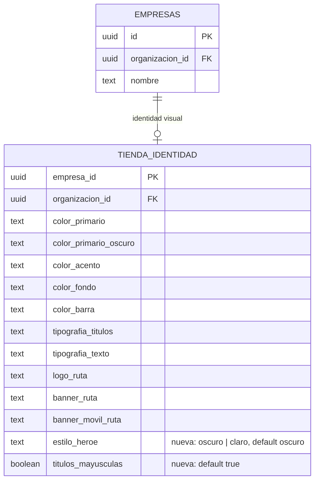

# Feature Specification: Tiendas · Estilo del encabezado y mayúsculas por identidad (MSF-848)

**Épica**: MSF-848 (cierra las decisiones abiertas de MSF-847) · **Spec**: `tiendas-identidad-heroe-mayusculas` · **Prioridad**: P2
**Alcance de entrega**: `refine` y `supabase` (una migración aditiva, `20270308100000_tienda_estilo_heroe_mayusculas.sql`; sin `kestra`, `superset` ni `workers`).
**Regla de producto (Nicolás)**: «si bien son 2 tiendas diferentes, todo es por config». Nada se decide por nombre, dominio ni organización de la tienda: las dos diferencias de diseño entre MundoJC y San Javucho se expresan en la **identidad visual** y se editan en el panel.

## Objetivo

MSF-847 dejó tres «decisiones abiertas». Dos se resuelven agregando dos campos a la identidad visual (mismo patrón que `color_barra`, MSF-841); la tercera queda declarada:

1. **`estilo_heroe`** — «Estilo del encabezado de la portada», lista cerrada `oscuro | claro` (por defecto `oscuro`, el diseño actual).
2. **`titulos_mayusculas`** — «Títulos del menú y botones en mayúsculas», booleano (por defecto `true`, el diseño actual).
3. **Color de la franja inclinada (H-02)**: sin campo nuevo. Sigue siendo el **primario oscuro de la identidad** (`colorPrimarioOscuro`), ya editable en «Colores»; el prototipo fija `#8C0004` y la demo usa `#7A0A12`. Se declara como decisión: la franja es parte del estilo oscuro y se rige por un color que la persona ya configura.

Los valores de las tiendas demo **no se cambian** en este tramo (se cargan por el panel).

## User Scenarios & Testing

### User Story 1 - Elegir el estilo del encabezado (P1)
1. En Empresas · Tienda · **Identidad visual** hay una tarjeta «Portada y menú» con el selector «Estilo del encabezado de la portada» (Oscuro / Claro) y su ayuda.
2. **Oscuro** (MundoJC, `MJC_Home` / `MJC_M_Home`): franja de 440 px con el color de la barra, título de 72 px (44 px en celular), texto de la franja con el mayor contraste, dos franjas inclinadas (primario oscuro y primario) y botón en el acento.
3. **Claro** (San Javucho, `SJ_Home` / `SJ_M_Home`): franja de 440 px con el color de **superficie** de la tienda, texto y título en el color **primario** (si no llega a AA sobre la superficie, el texto de la tienda o negro), título de **60 px** (36 px en celular) y un **círculo de 360 px** del color de **acento** (90 % de opacidad, a 120 px del borde derecho y 40 px del superior; solo desde 1200 px de ancho). Sin franjas inclinadas.
4. El botón del héroe es visible con cualquier identidad en las dos variantes: acento con el texto de mayor contraste; si el acento casi no se distingue de la franja (< 1,5:1, `UMBRAL_BOTON`) toma el color del texto de la franja.
5. La vista previa del panel (miniatura de la pestaña y «Vista previa» de la tienda) muestra la variante elegida con los valores sin guardar.

### User Story 2 - Mayúsculas del menú y los botones (P1)
1. El interruptor «Títulos del menú y botones en mayúsculas» controla `text-transform: uppercase` (y el `letter-spacing: .04em` asociado) de la **barra de categorías**, y `text-transform` del **título** y del **botón** del héroe.
2. MundoJC (`MJC_*`) las usa; San Javucho (`SJ_*`) no. El `letter-spacing: .03em` del botón del héroe es del prototipo en las dos tiendas y no depende del campo. El encabezado «Categorías» del menú de celular va siempre en mayúsculas en los dos prototipos y no se toca.
3. Los dos campos son independientes (estilo claro con mayúsculas, estilo oscuro sin ellas).

### User Story 3 - Publicación, versiones y compatibilidad (P1)
1. Los dos campos viajan por el flujo de F-TDA-06: se guardan en el borrador, el resumen de cambios los nombra («estilo del encabezado», «mayúsculas de los títulos»), se publican con la identidad y quedan en la instantánea de cada versión (restaurar una versión restaura también ambos).
2. Borradores y versiones anteriores a esta migración no traen las claves y valen `oscuro` / `true`: **no aparece ningún «cambio» fantasma** al publicar o restaurar.
3. La tienda pública los lee de `publico.identidad_por_dominio` (lista blanca; se agregan las dos claves) y los aplica por el tema (`theme.tienda.heroe`, `theme.tienda.titulosMayusculas`); sin identidad legible la tienda queda con el diseño actual.

## Requisitos

- **FR-001** `dominio.tienda_identidad.estilo_heroe text not null default 'oscuro' check (estilo_heroe in ('oscuro','claro'))` y `titulos_mayusculas boolean not null default true`.
- **FR-002** `private.validar_tienda_identidad` valida y normaliza ambos (estilo recortado y en minúsculas; booleano estricto; claves ausentes o `null` = valores por defecto). Errores `22023` en castellano.
- **FR-003** `private.identidad_vivo` incluye ambos; `private.detalle_cambios_tienda` agrega los rótulos «estilo del encabezado» y «mayúsculas de los títulos» y compara las claves ausentes como valores por defecto.
- **FR-004** `public.guardar_tienda_identidad` recibe `p_estilo_heroe text default null` y `p_titulos_mayusculas boolean default null` **al final** (la firma de 11 argumentos se elimina; sin otros llamadores). Sigue sin ser ejecutable por `anon` ni `authenticated` (solo `public.publicar_tienda`, FR-052 de F-TDA-06, que conserva sus grants).
- **FR-005** `publico.identidad_por_dominio` devuelve además `estilo_heroe` y `titulos_mayusculas` (mismos grants `anon` y `authenticated`). `public.vista_previa_tienda` no cambia: usa `identidad_vivo` o el borrador.
- **FR-006** Tipos TS (`IdentidadTienda.estiloHeroe`, `.titulosMayusculas`; `FilaIdentidad` con claves opcionales), tema (`ColoresTienda.heroe`, `.titulosMayusculas`), pestaña «Identidad visual» (selector accesible con ayuda, `Switch` con etiqueta y descripción, vista previa) y front público (`BannerContenido`, `MenuCategorias`).
- **FR-007** Un valor fuera de la lista (dato corrupto) cae al estilo `oscuro` en el tema y en `identidadDesdeFila`; nada se inyecta como CSS.
- **FR-008** Sin scroll horizontal ni violaciones de axe a 320, 768 y 1440 px en las dos variantes.

## Modelo de datos (DER)

Una sola tabla alterada, `dominio.tienda_identidad` (esquema `dominio`, Principio VII: es dominio del producto de tiendas), con dos columnas aditivas y con default; las filas existentes toman los valores por defecto. `dominio.empresas` se muestra por su FK. Sin tablas nuevas ni cambios de RLS: la lectura pública sigue por `publico.identidad_por_dominio` (lista blanca con las dos claves nuevas).

| Tabla | Estado | Cambio |
|---|---|---|
| `dominio.tienda_identidad` | alterada | `+ estilo_heroe text not null default 'oscuro'` con `check (estilo_heroe in ('oscuro','claro'))`; `+ titulos_mayusculas boolean not null default true` |
| `dominio.empresas` | existente | sin cambios |

## Matriz pantalla↔criterios

Prototipos: `design/pantallas/MJC_Home`, `MJC_M_Home`, `SJ_Home`, `SJ_M_Home` (y `MJC_Catalogo`, `MJC_Categoria`, `MJC_Producto`, `MJC_Contacto`, `SJ_Catalogo`, `SJ_Categoria`, `SJ_Producto`, `SJ_Contacto` para la barra de categorías) y `SJ_StoreIdentidad` (panel). Fuente de las medidas: CSS de los prototipos (`design/pantallas/SJ_Home.dc.html`, `MJC_Home.dc.html`).

| Ítem del inventario / elemento visible | Pantalla | Criterio |
|---|---|---|
| «Explorar productos» (SJ_Home, SJ_M_Home) | Portada, estilo claro | US1.3–4, FR-006 (acento `#E9A23B` con texto `#1A1A1A` en la tienda —el prototipo usa `#1B2430`, pero el color de texto no es parte de la identidad y se toma el `#1A1A1A` por defecto del tema, con contraste AA—, 16 px/700, radio 8, `.03em` en escritorio; sin mayúsculas porque `SJ_*` no las usa) |
| «Ver catálogo» (MJC_Home, MJC_M_Home) | Portada, estilo oscuro | US1.2, US2.1 (16 px/700 en mayúsculas con `.03em` en escritorio; ya existía, ahora condicionado a `titulos_mayusculas`) |
| Título del héroe «Elegí lo que necesitás» (SJ) / «Todo para tu consola» (MJC) | Portada | US1.2–3, US2.1 (60/36 px sin mayúsculas en SJ; 72/44 px en mayúsculas en MJC) |
| Franja del héroe (`#F1E9D8` en SJ, `#2A2A2A` en MJC) y círculo de acento de 360 px | Portada | US1.2–3 (superficie derivada del fondo de la tienda en vez de `#F1E9D8` fijo; círculo desde 1200 px, ver «Diferencias declaradas») |
| Franjas inclinadas (`#8C0004` / `#A3111D`) | Portada, estilo oscuro | Decisión H-02: primario oscuro de la identidad y primario; sin campo nuevo |
| Cargadores, Protectores, Joysticks, Cases y estuches, Vidrios templados, Skins y calcos (barra de categorías) | Todas las pantallas públicas | US2.1 (mayúsculas con `.04em` en `MJC_*`; sin transformar en `SJ_*`) |
| «Categorías» (menú de celular), «Inicio», «Contacto» | Celular / todas | Sin cambio: mayúsculas fijas en los dos prototipos (menú de celular) o sin mayúsculas en los dos («Inicio», «Contacto») |
| Tarjetas de producto sobre el héroe (3 en SJ, 3 en MJC) | Portada | Fuera de alcance: el banner no trae productos (ya declarado en MSF-847) |
| Campos «Estilo del encabezado de la portada» y «Títulos del menú y botones en mayúsculas» | Panel · Identidad visual | US1.1, US2.1, FR-006: no existen en `SJ_StoreIdentidad`; son campos de configuración nuevos pedidos por producto, con el mismo patrón visual que Colores y Tipografía |
| Vista previa de la identidad (miniatura) | Panel · Identidad visual | US1.5 |
| «Vista previa» de la tienda (Dominio y publicación) | Panel | US1.5, US3 (usa la fuente de la vista previa con el tema de la identidad del borrador) |
| Empresa activa | Panel · Identidad visual | Los dos campos son de **una** empresa (la de la gestión de tienda, `empresaId`): se leen y guardan de esa empresa y su borrador. Al cambiar de empresa la pestaña vuelve a «cargando» y el formulario se remonta con `key={empresaId}`: no queda ningún valor (ni estilo ni mayúsculas) de la empresa anterior. Test existente: `IdentidadTienda.test.tsx` («al cambiar de empresa…», `rerender` con `e-2`). La tienda pública no tiene empresa activa: se resuelve por el host |

## Diferencias declaradas con el prototipo

- La franja clara usa el color de **superficie** derivado del fondo de la tienda (`mezclar(fondo, negro, 4,3 %)`), igual que las tarjetas; con el fondo `#FBF8F2` de San Javucho da `#F0EDE8` y no `#F1E9D8`. Se pidió «el color de superficie»; ajustar el fondo de la identidad acerca el valor.
- El círculo se dibuja desde 1200 px (`lg`): entre 900 y 1199 px pasaría por debajo del texto y comprometería el contraste. Debajo de 900 px (celular) tampoco está en el prototipo.
- En la vista previa del panel (recuadro angosto) no se dibujan la capa a todo el ancho, el círculo ni las franjas inclinadas (como antes); sí los colores y mayúsculas de la variante.
- El color de texto del héroe claro es el primario solo si llega a 4,5:1 sobre la superficie; si no, se usa el texto de la tienda o negro.

## Decisiones

- Un solo cambio de firma en `guardar_tienda_identidad` (parámetros al final con `default null`), como en MSF-841.
- No se agregan variables CSS `--tienda-*` para estos campos (no hay estilos sueltos que los lean): el tema es la única vía.
- No se cambian valores de las tiendas demo.
- Reversión: ver el encabezado de la migración (recrear las funciones de 20270303200000 / 20270303300000 y, recién entonces, borrar las dos columnas) y revertir los commits del front.
