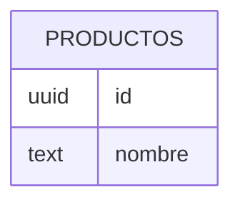

# Feature Specification: Tiendas públicas · Hallazgos de la re-auditoría de fidelidad (MSF-849)

**Épica**: MSF-849 (seguimiento de MSF-847/MSF-848) · **Spec**: `tiendas-hallazgos-reauditoria` · **Prioridad**: P2
**Alcance de entrega**: `refine` (sin `supabase`, `kestra`, `superset` ni `workers`: no hay migraciones ni cambios de base).
**Fuente**: re-auditoría independiente sobre dev (37 de 52 diferencias corregidas, 5 parciales, 6 que persisten como decisiones declaradas, 4 pendientes de MSF-848 y 3 nuevas). Esta spec **traduce**; no agrega alcance de negocio. El héroe y las mayúsculas (H-07, C-14) son de MSF-848 y no se tocan acá.

## Objetivo

1. El logo del pie se ve (hoy un PNG de fondo opaco invertido a blanco era un bloque sólido sin marca).
2. Las diferencias nuevas y parciales de la re-auditoría quedan corregidas.
3. Todo control de la tienda alcanzable con teclado muestra un indicador de foco visible y único.

## User Scenarios & Testing

### User Story 1 - Logo del pie con sus colores (P1)
El logo se dibuja con sus colores sobre un recuadro blanco redondeado de 44 px de alto (imagen de 36 px), con transparente u opaco. La ayuda del campo «Logo» de la pestaña de identidad lo dice.

### User Story 2 - Detalles del diálogo y del menú (P2)
En el diálogo de WhatsApp el nombre del producto va en negrita (solo en la vista; el campo de solo lectura y el texto que se envía no cambian). «Inicio» y «Contacto» del menú de celular van en 600 también cuando son la página actual.

### User Story 3 - Foco visible único (P1)
Enlaces, botones y selectores (incluidos «Ingresar», «Limpiar filtros» y «Ordenar por») muestran con `:focus-visible` un contorno de 2 px del color primario a 2 px del control; sobre la barra superior y el pie oscuros toma el color del texto.

## Requirements

- **FR-001**: `layout/PieCategorias.tsx` dibuja el logo sin filtro sobre un recuadro blanco con radio 8 (`data-testid="pie-logo"`); la ayuda de `ImagenTienda` y `docs/tiendas-online.md` lo reflejan.
- **FR-002**: `whatsapp/DialogoWhatsApp.tsx` muestra el producto en `<b>` dentro de una vista `aria-hidden` y conserva el `textarea` de solo lectura (etiqueta «Mensaje que se va a enviar», `tabindex=-1`) con el texto completo.
- **FR-003**: `layout/MenuMovil.tsx`: «Inicio» y «Contacto» en 600 con `aria-current`.
- **FR-004**: `layout/FocoVisible.tsx` (estilos globales de la tienda) con el contorno de foco; los controles que ya traen el suyo (campos, casilla, píldoras, héroe, diálogo) lo conservan.
- **SC-001**: Vitest en verde, axe real a 390 y 1440 px sin violaciones y medición de las filas en Chromium.

## Matriz pantalla↔criterios

Prototipos: `design/pantallas/MJC_Home`, `MJC_Catalogo`, `MJC_Producto`, `MJC_M_Home`, `MJC_M_Catalogo` y sus equivalentes `SJ_*`. No se agrega ni quita ningún elemento visible.

| Ítem de la re-auditoría | Pantalla | Criterio |
|---|---|---|
| N-01 logo del pie | Todas | FR-001. Desvío respecto del prototipo (que invierte el logo con `filter`): con un PNG de fondo opaco —el caso real de la demo— la inversión deja un bloque blanco; el recuadro blanco sirve con cualquier logo |
| N-02 producto en negrita en el mensaje | Ficha (diálogo) | FR-002 |
| MM-03 «Inicio» actual en 600 | Todas (celular) | FR-003 |
| MH-10 enlaces del pie móvil de 12 px | Todas (celular) | Desvío accesible: se mantienen 14 px (12 px baja del mínimo razonable de lectura en celular) |
| Foco de «Ingresar», «Limpiar filtros», «Ordenar por» y demás controles | Todas | FR-004 (el prototipo no define foco; WCAG 2.4.7) |
| MH-01 / MM-07 botones de menú y cierre (36×36 px en vez de 28×31 / 36×29) | Todas (celular) | Desvío accesible declarado en MSF-847: área táctil ≥ 36 px |
| C-05 enlaces «Inicio»/«Contacto» de 36 px de alto | Todas | Desvío accesible declarado (el texto mide lo mismo que el prototipo) |
| MP-01 enlace «← Todos los productos» de 44 px | Ficha (celular) | Desvío accesible declarado |
| N-03 botón «Cerrar filtros» de 36 px | Catálogo (celular) | Desvío accesible declarado: el prototipo cierra tocando fuera; el botón es el cierre alcanzable con lector de pantalla y teclado (además de Esc) |
| K-05 «Cargar más» | Catálogo | Decisión del repo (carga infinita con alternativa por teclado) |
| MF-06 «Precio máximo» en la hoja móvil | Catálogo (celular) | Decisión declarada: el filtro existe y no se quita funcionalidad |
| C-03 barra con las categorías que entran + «Más categorías» | Todas | Decisión declarada (MSF-825/MSF-846) |
| H-02 color de la franja inclinada | Portada | Decisión abierta de MSF-848 (héroe) |
| H-07 botón del héroe en mayúsculas, ancho | Portada | MSF-848 |

## Modelo de datos (DER)

Sin cambios de esquema: la tienda solo lee productos y categorías ya expuestos; esta spec toca únicamente el front.

| Tabla | Estado | Cambio |
|---|---|---|
| `dominio.productos` | existente | sin cambios (solo lectura desde la tienda) |

## Decisiones

- El logo sobre recuadro blanco es una decisión de implementación frente a la inversión del prototipo, por los logos con fondo opaco.
- El foco unificado se define una vez para toda la tienda (estilos globales dentro del layout) en lugar de por componente, para cubrir controles futuros.
- Reversión: revertir los commits (sin migraciones).
