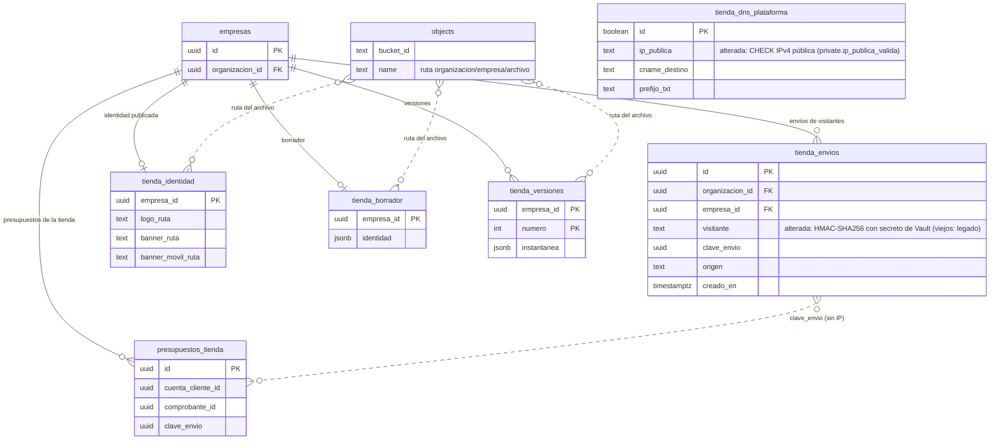

# Feature Specification: Deuda técnica · Lote 1: seguridad e integridad de la tienda pública (MSF-515)

**Épica contenedora**: MSF-515 «Deuda técnica y seguimientos de review» · **Lote**: 1 · **Spec**: `deuda-tecnica-lote-1-seguridad-tienda` · **Prioridad**: P2 (MSF-796 y MSF-945 tratan datos; MSF-797 es P3)
**Alcance de entrega**: `supabase` (cuatro migraciones, una Edge Function y pgTAP) y `refine` en `apps/web/src/lib` y un texto de error en el aviso ya existente de «Dominio y publicación» (**sin pantallas nuevas**). Sin `kestra`, `superset` ni `workers`.
**Fuente**: revisión de seguridad de MSF-133 (SC-002: MSF-796 y MSF-797) y revisión de seguridad T070 de MSF-176 (hallazgo H-1: MSF-945). Esta spec **traduce** esos hallazgos a requisitos; no agrega alcance de negocio.

## Objetivo

1. **MSF-796** — Un editor ya no puede borrar un archivo del bucket `tienda-identidad` que la tienda publicada, el borrador o una versión restaurable todavía usan. La garantía deja de ser un consejo del cliente y pasa a la base.
2. **MSF-797** — La IP del registro A que se le muestra a la clienta y a la que la Edge Function abre una conexión TLS debe ser una IPv4 pública; y esa conexión se cierra siempre, también al vencer el timeout.
3. **MSF-945** — El «visitante» de `dominio.tienda_envios` deja de ser un `sha256` de la IP que se enumera en minutos y pasa a un HMAC con un secreto del servidor; la tabla la lee solo quien administra la tienda. Se aplica **antes** de encender `tienda_pedidos` fuera de dev.

## User Scenarios & Testing

### User Story 1 — El archivo que una versión usa no se borra (MSF-796, P2)
**Dado** un editor de Empresas, **cuando** la Storage API le pide borrar `<org>/<empresa>/logo-viejo.png` y ese logo está en la instantánea de la versión 7 (aunque ya no esté en la identidad publicada ni en el borrador), **entonces** el archivo sigue en el bucket y la API no devuelve error (simplemente no lo cuenta como borrado). **Cuando** el archivo no lo referencia nada, **entonces** se borra. Otra organización, o una persona sin edición en Empresas, no borra nada.
*Escenario del panel*: reemplazar o quitar el logo/banner en «Identidad» sigue funcionando; el archivo reemplazado queda mientras una versión lo use y se libera solo cuando ninguna referencia lo conserva.

### User Story 2 — Una IP interna no llega a la verificación del dominio (MSF-797 a, P3)
**Dado** que el equipo técnico carga `ip_publica` en `public.tienda_dns_plataforma`, **cuando** la IP es `127.0.0.1`, `10.x`, `192.168.x`, `172.16–31.x`, `100.64–127.x`, `169.254.x`, multicast, reservada, o tiene un octeto > 255, **entonces** la base rechaza el `update`. Los valores de documentación que siembra la migración de la tienda (`203.0.113.24`) y la IP pública de dev (`212.90.120.53`) siguen aceptándose.
**Cuando** una fila ya existente tuviera una IP no pública, **entonces** «Verificar ahora» responde 503 `plataforma_no_configurada` sin consultar DNS ni abrir conexiones y el panel no muestra un registro A erróneo.

### User Story 3 — El socket de una verificación colgada se cierra (MSF-797 b, P3)
**Dado** un dominio verificado cuyo servidor TLS no responde, **cuando** pasan 5 s, **entonces** la verificación informa «pendiente» **y** la conexión TCP/TLS abierta queda cerrada (también si el handshake termina después del vencimiento).

### User Story 4 — La IP del visitante no se recupera de la base (MSF-945, P2)
**Dado** una copia de `dominio.tienda_envios`, **cuando** alguien prueba todas las IPv4 con `sha256(ip|empresa)`, **entonces** no coincide con ninguna fila (el visitante es un HMAC con una clave que no está en la tabla ni en Git). El límite de 5 envíos por hora por visitante y empresa y la idempotencia por `clave_envio` siguen funcionando igual. Un rol sin edición en Empresas, o una persona asignada a otra tienda, ya no lee las filas.

## Requirements

### MSF-796
- **FR-001**: `private.ruta_identidad_referenciada(p_ruta text) → boolean` (`security definer`, `search_path` vacío, `stable`) devuelve verdadero si la ruta es `logo_ruta`, `banner_ruta` o `banner_movil_ruta` de `dominio.tienda_identidad` (publicada), de `dominio.tienda_borrador.identidad` o de `dominio.tienda_versiones.instantanea -> 'identidad'` (cualquier versión) de **la empresa que lleva la propia ruta** (`<org>/<empresa>/<archivo>`). Ruta nula, mal formada o sin empresa válida → falso, sin error.
- **FR-002**: la política `tienda_identidad_objetos_delete` de `storage.objects` conserva organización propia y edición en Empresas y agrega `not private.ruta_identidad_referenciada(name)`.
- **FR-003**: `execute` de la función solo para `authenticated` (revoke a `public` y `anon`); la política se evalúa con los privilegios de la persona.
- **FR-004**: el panel no cambia de comportamiento: `borrarImagenes` sigue llamando a `storage.remove`; un borrado negado por la política no es un error. `rutas_tienda_sin_referencia` se mantiene como filtro previo y desde la migración `20270323100300` usa la misma función `private.ruta_identidad_referenciada` (una sola fuente de verdad; misma firma y grants).

### MSF-797
- **FR-005**: `private.ip_publica_valida(text) → boolean` (`immutable`, `search_path` vacío): cuatro octetos decimales 0–255 **sin ceros a la izquierda** y fuera de `0.0.0.0/8`, `10.0.0.0/8`, `100.64.0.0/10`, `127.0.0.0/8`, `169.254.0.0/16`, `172.16.0.0/12`, `192.0.0.0/24`, `192.0.2.0/24`, `192.168.0.0/16`, `198.18.0.0/15`, `224.0.0.0/4`, `240.0.0.0/4`. Se admiten `198.51.100.0/24` y `203.0.113.0/24` (decisión D-3).
- **FR-006**: CHECK `tienda_dns_plataforma_ip_publica` sobre `public.tienda_dns_plataforma.ip_publica`, creado `NOT VALID` y validado en la misma migración; si una fila existente lo viola la migración **avisa y no falla** (D-4).
- **FR-007**: `public.preparar_verificacion_tienda` lanza `plataforma_no_configurada` (`22023`) si la IP no es pública, **antes** de consumir el límite de 10 s; `public.obtener_dominio_tienda` omite el registro A en ese caso. Misma firma y grants.
- **FR-008**: la Edge Function responde 503 `{ error: 'plataforma_no_configurada' }` a ese error, sin consultas DNS ni TLS ni escritura; el contrato OpenAPI lo documenta y el panel lo traduce a un motivo propio con el mensaje «La plataforma todavía no tiene configurada su IP pública para verificar dominios. Avisá a soporte.».
- **FR-009**: `comprobarTls` (`tls.ts`, sin dependencias de Deno) cierra toda conexión que abre (con la limitación de D-5 si el handshake TLS queda colgado): la TLS (que cierra la TCP) si se negoció, la TCP si no, y cualquier conexión que llegue **después** del vencimiento de los 5 s. Cerrar una conexión ya cerrada no es un error. El resultado sigue siendo `activo` / `pendiente` / `error` como antes.

### MSF-945
- **FR-010**: el secreto `visitante_hmac` vive en Supabase Vault, se genera con `gen_random_bytes(32)` al aplicar la migración (aleatorio por entorno; nunca en Git) y la migración falla con un mensaje claro si Vault no es visible (mismo patrón que `acceso_hmac`, MSF-470).
- **FR-011**: `private.visitante_hash(empresa)` devuelve `hmac_sha256(ip || '|' || empresa, secreto)` en hex (64 caracteres). Misma firma, misma elección de IP (saltos de proxy), mismo cupo «sin-ip» sin cabecera. Sin secreto, **falla** (no vuelve al `sha256`). Sin acceso para `anon` ni `authenticated`.
- **FR-012**: al crear el secreto (una sola vez por entorno) los `visitante` existentes con formato `sha256` se reemplazan por el marcador `legado`; las claves de idempotencia y el resto de las columnas no cambian. Repetir la migración no toca nada.
- **FR-013**: `tienda_envios_select` exige organización propia, `empresa_id in (select private.empresas_accesibles())` y `private.nivel_seccion('empresas') = 'edicion'`.
- **FR-014**: ninguna otra tabla (`presupuestos_tienda`, `consultas`, `consulta_items`, cuentas) guarda IP, visitante ni hash, y `tienda_envios` no referencia cuentas ni presupuestos; el único dato en común es `clave_envio`, de modo que no hay camino a la IP.

### Comunes
- **FR-015**: migraciones aditivas e idempotentes con versión `20270323…`, reversión documentada en su encabezado, funciones `security definer` con `search_path` vacío y grants exactos (nada para `anon`; Principio de CLAUDE.md sobre `anon`).
- **SC-001**: pgTAP de las tres migraciones en verde (ver tasks), Vitest del borrado y `node --test` del handler y de `tls.ts` en verde, y los guards del repo en verde.

## Decisiones y justificación

- **D-1 (MSF-796): la regla va en la política de borrado, no en una RPC de limpieza.** Una RPC `security definer` de limpieza dejaría el borrado directo abierto salvo que se retire el permiso de `DELETE` a las personas, y el panel hoy borra con `storage.remove` (también el flujo de «Quitar imagen», la subida fallida y el reemplazo). Con la política cada cliente de la Storage API queda cubierto sin tocar el front y una política negada no es un error (el panel limpia «en el mejor esfuerzo»). La función auxiliar es `security definer` porque la persona editora no puede leer versiones ni borrador por tabla. Se acota la búsqueda por la empresa de la propia ruta (clave primaria) para que el costo no crezca con las demás tiendas.
- **D-2 (MSF-796): referencias contempladas.** No existe ninguna regla que pode `tienda_versiones`: el listado del panel muestra solo las últimas 100, pero todas las versiones siguen protegiendo sus archivos. Las únicas columnas de ruta del esquema son `logo_ruta`, `banner_ruta` y `banner_movil_ruta` (identidad, borrador y las instantáneas de versiones; ninguna migración posterior agregó otra). El bucket tampoco guarda otra cosa (los comprobantes leen el logo, no lo escriben).
- **D-3 (MSF-797): TEST-NET-2 y TEST-NET-3 se admiten; TEST-NET-1 no.** El pedido enumera `192.0.2.0/24` como rechazado y no menciona las otras dos. La migración `20270205110000` siembra `203.0.113.24` en cada entorno nuevo (CI, local, staging) y los tests de Deno/Vitest/pgTAP usan `203.0.113.x` y `198.51.100.x`: rechazarlas rompería el seed y la cola de migraciones. No son enrutables (RFC 5737), así que una conexión TLS a ellas no llega a ninguna red interna, que es el riesgo que se cierra. Queda documentado que hay que reemplazarlas por la IP real. La fila de dev vale `212.90.120.53` (pública): se verificó que cumple.
- **D-4 (MSF-797): `NOT VALID` y avisar.** Si la fila de algún entorno ya tuviera una IP interna, `ADD CONSTRAINT` fallaría y, como el aplicador se detiene en el primer error, bloquearía la cola entera. `NOT VALID` hace valer el CHECK para toda escritura nueva desde ya; la validación se intenta en la misma migración y, si falla, deja un `raise warning` con el comando para corregir y validar. Mientras tanto las dos RPC dejan de usar esa IP (FR-007).
- **D-5 (MSF-797): `tls.ts` aparte con operaciones inyectadas.** `index.ts` usa `Deno.*` y no se puede probar con `node --test` (el patrón de las Edge Functions del repo: el handler no importa Deno). La lógica de cierre se mueve a un módulo puro con `conectar` e `iniciarTls` inyectadas; `index.ts` solo las cablea. El cierre cubre tres momentos: salida normal, timeout y llegada tardía de la conexión (la promesa de `Deno.connect` no es cancelable). **Limitación conocida, no verificada en un Deno real:** `Deno.startTls` consume la conexión TCP; si el handshake queda colgado, al vencer solo se *intenta* cerrar la TCP (se tolera que ya esté consumida) y el socket TLS en curso no se puede cerrar hasta que `startTls` resuelva o falle (entonces sí se cierra). Impacto acotado: una conexión a la IP de la plataforma, a lo sumo una verificación cada 10 s por tienda.
- **D-6 (MSF-945): Vault, como `acceso_hmac`.** Alternativas descartadas: una tabla de configuración privada (el secreto quedaría en texto plano en la propia base y en cada copia), un GUC del rol (`alter database … set`, difícil de rotar y operar por entorno, queda en `pg_db_role_setting`) y una variable de entorno de la Edge Function (la lógica vive en funciones SQL que llaman anónimos). Vault ya está habilitado en todos los entornos, cifra en reposo con una clave que no está en la base, tiene un precedente en el repo y un test que lo ejerce. Costo: cada envío descifra el secreto (una lectura puntual), el mismo trade-off que ya se aceptó para el acceso.
- **D-7 (MSF-945): los hashes viejos se reemplazan por `legado`, no se conservan.** Un `sha256` sin clave es justamente la exposición; no se pueden recalcular (la IP no se guarda) y dejarlos «solo para ventanas vencidas» los deja enumerables hasta que la poda de 24 h los borre (las filas de empresas sin tráfico no se podan nunca: la poda corre por empresa al registrar). El marcador no coincide con ningún HMAC, así que el límite sigue funcionando: el único efecto es que quien ya había gastado cupo en la última hora lo recupera una vez, tras el despliegue. Se hace en el mismo acto de crear el secreto (idempotente y una sola vez); para poder probarlo vive en `private.inicializar_visitante_hmac()`.
- **D-8 (MSF-945): sección = Empresas en edición, más empresa accesible.** La tabla es del panel de la tienda (donde vive la configuración y el rastro de abuso), no de Ventas ni de Consultas, y lo que se lee (clave de envío, origen, visitante) solo sirve para diagnosticar abuso. `tienda_identidad_select` usa la misma sección; se suma `empresas_accesibles()` como en `consultas_select` para respetar a las personas asignadas por tienda. Nada en el panel, en las Edge Functions ni en los workers lee la tabla (se buscó): la restricción no rompe ningún flujo. La única lectura es la exportación total, que lista la tabla y corre con `service_role` (no pasa por RLS): desde este cambio exporta HMAC o `legado` en vez de hashes enumerables. Se descartó quitar `select` del todo para no cerrar el diagnóstico a quien lo necesite.
- **D-9 (MSF-945): `clave_envio` no se desacopla.** `presupuestos_tienda(cuenta_cliente_id, clave_envio)` y `tienda_envios(empresa_id, clave_envio, visitante)` comparten la clave cruda, y `enviar_lista_pedido` consulta `tienda_envios` por esa clave para el reintento idempotente: derivarla exigiría reescribir tres RPC públicas. Con el HMAC la IP **no es recuperable** por ese camino ni con una copia de la base; queda un vínculo opaco cuenta ↔ token de visitante mientras la fila exista (24 h por empresa con tráfico; sin tráfico, indefinidamente), visible solo para quien tenga edición en Empresas **y** lectura de Ventas (las dos políticas). Es un compromiso aceptado y verificado por pgTAP (FR-014).
- **D-10 (fuera de alcance, para seguimiento): `private.visitante_publico`.** El límite de lecturas de la búsqueda (`public.limite_pedidos_publicos`, MSF-191) usa `sha256(ip|host)`: mismo defecto de fondo, pero la tabla no tiene `grant` para ningún rol de API (solo funciones del servidor) y sus ventanas duran minutos. Cambiarlo toca otro conjunto de tests; se traza como seguimiento.

## Matriz pantalla↔criterios

**Fuera de alcance: esta spec no agrega, mueve ni rediseña pantallas.** Cambian la base, una Edge Function, un comentario con su test en `apps/web/src/lib` y un texto de error nuevo en el aviso ya existente de «Verificar ahora». No hay prototipo asociado en `design/pantallas`.

| Ítem | Criterio |
|---|---|
| Empresa activa: no aplica | No se agrega ni cambia ninguna pantalla ni diálogo; el flujo de «Identidad» y el de «Dominio» conservan su comportamiento con la empresa activa tal como están. `tienda_envios` no tiene pantalla. |
| «Quitar»/reemplazar logo y banners (Identidad) | Sin cambio visible: FR-004. Un archivo que una versión usa queda en el bucket (el panel ya lo toleraba como huérfano). |
| «Verificar ahora» (Dominio y publicación) | Con IP no pública el aviso de error existente muestra un mensaje propio: «La plataforma todavía no tiene configurada su IP pública para verificar dominios. Avisá a soporte.» (motivo `plataforma_no_configurada` en `lib/tiendaDominio.ts`, FR-008). Mismo componente de aviso; sin elementos nuevos. |

## Modelo de datos (DER)

Sin tablas nuevas. Tablas del grafo afectado:

| Tabla | Estado | Cambio |
|---|---|---|
| `public.tienda_dns_plataforma` | alterada | CHECK `tienda_dns_plataforma_ip_publica` sobre `ip_publica` (`private.ip_publica_valida`). Esquema `public`: configuración de plataforma. |
| `dominio.tienda_envios` | alterada | Sin columnas nuevas: `visitante` pasa a HMAC (los viejos a `legado`) y su política `tienda_envios_select` exige edición en Empresas. Esquema `dominio`. |
| `storage.objects` | existente | Política de borrado `tienda_identidad_objetos_delete` reemplazada (infraestructura de Storage; no es tabla de negocio). |
| `dominio.tienda_identidad` | existente | Solo lectura desde `private.ruta_identidad_referenciada`. |
| `dominio.tienda_borrador` | existente | Solo lectura desde `private.ruta_identidad_referenciada`. |
| `dominio.tienda_versiones` | existente | Solo lectura desde `private.ruta_identidad_referenciada`. |
| `dominio.presupuestos_tienda` | existente | Sin cambios; se verifica que no guarda IP ni visitante (FR-014). |
| `dominio.empresas` | existente | Referencia de `tienda_envios` y de las tablas de la tienda; sin cambios. |

## Reversión

Las tres migraciones son aditivas y traen su reversión en el encabezado (nada se destruye en el mismo PR que lo crea). Lo único **no reversible** es el reemplazo de los hashes viejos por `legado` (a propósito: no se pueden restaurar sin la IP). Revertir el PR (`git revert -m 1`) deja las funciones y políticas nuevas en la base hasta que se aplique la migración inversa; el front no depende de ellas.

## Fuera de alcance / seguimientos

- `private.visitante_publico` con `sha256` (D-10).
- Poda de `tienda_envios` para empresas sin tráfico (hoy solo se poda por empresa al registrar un envío nuevo; con HMAC deja de ser un riesgo de privacidad, queda como higiene).
- E2E: no hay flujo visible nuevo; no se agregan.
