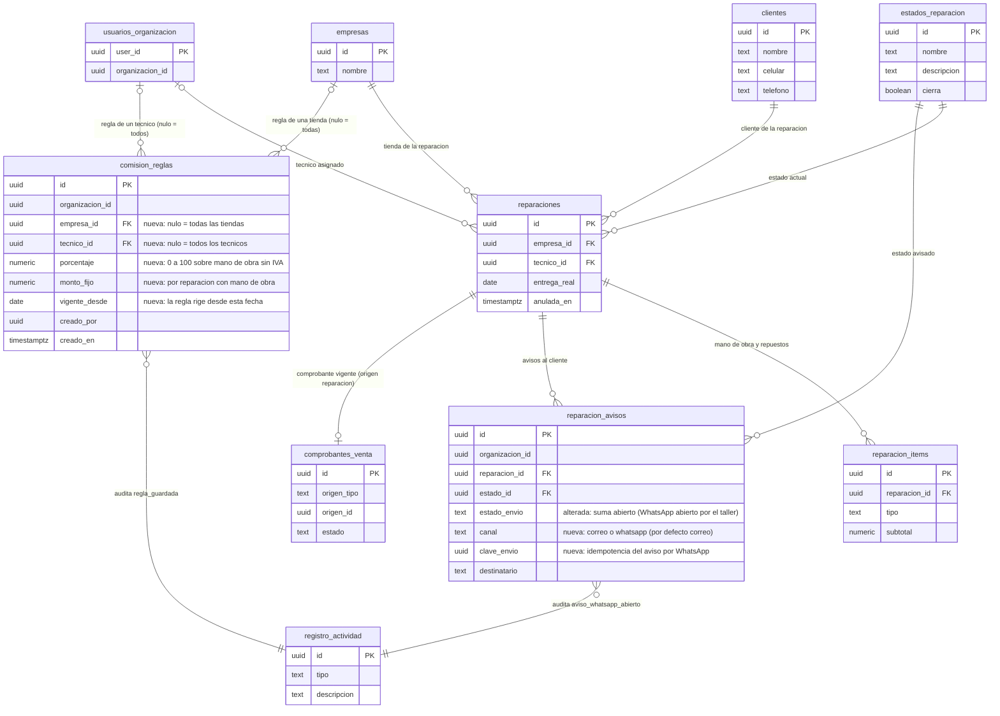

# Feature Specification: Service técnico · Service ideas futuras (aviso por WhatsApp, comisiones de técnicos y etiqueta con QR)

**Épica**: MSF-118 · **Spec**: `service-ideas-futuras-v2` (reemplaza a la spec de gate `20261104-100000-service-ideas-futuras` del PR #680, que **no se mergea**) · **Historias**: F-SVC-30 Aviso al cliente por WhatsApp (MSF-181), F-SVC-31 Comisiones de técnicos (MSF-187), F-SVC-32 Etiqueta con código QR del equipo (MSF-190) · **Prioridad**: P3 (alcance definido por delegación de Nicolás, 2026-11-14)
**Alcance de entrega**: `refine` (apps/web) y `supabase` (migraciones, RPC, pgTAP). Sin `kestra`, `superset` ni `workers`: nada se envía desde el servidor (el aviso por WhatsApp abre el chat en el navegador de la persona), las comisiones se calculan con SQL determinista y la etiqueta se arma y se imprime en el navegador. El envío automático por WhatsApp desde el servidor (que sí necesitaría un flow de Kestra y un proveedor contratado) queda como **seguimiento** (D-1, D-5).
**Fuente**: la épica MSF-118 y sus tres historias (hoy sin requisitos ni pantallas), el código verificado contra `origin/dokploy` (commit `1ad0fd2e`, 2026-11-14) y las specs de Service ya entregadas: `20261028-100000-service-cobro-y-avisos` (MSF-232, que **ya está en `dokploy`**), `20261022-100000-service-listado-items-e-impresion` y `20261028-100000-service-seguimiento-y-reportes`; y de Consultas, `20261024-140000-consultas-seguimiento-y-whatsapp`. Modelo de estilo y de decisiones delegadas: `specs/20270306-100000-tienda-compra-y-cuentas/`.
**Cierre de la spec (2026-11-14)**: Nicolás delegó **todas** las decisiones («tomá todas las decisiones por mí»; solo dev, nada de staging ni producción). Quedan tomadas D-1 a D-26 (sección «Decisiones»), con su justificación y la alternativa descartada, y **todas las pantallas y textos** definidos en «Pantallas y textos» (no hay prototipo: D-21). Las decisiones guía del pedido se respetaron salvo dos mejoras que el código real justificó (D-2: el registro del aviso reutiliza `reparacion_avisos` en vez de una tabla nueva, y D-8: la comisión se devenga a la entrega y no al cobro).

## Objetivo

Al terminar, el taller puede (1) **avisar al cliente por WhatsApp** con un clic —se abre el chat con el mensaje del estado de la reparación ya escrito— sin contratar ningún proveedor ni pagar nada, y el historial de avisos lo registra; (2) **ver cuánta comisión le corresponde a cada técnico por período**, calculada por SQL sobre la mano de obra de las reparaciones entregadas, con reglas por técnico y/o tienda; y (3) **imprimir una etiqueta con un código QR** para pegar en el equipo: al escanearlo con el celular se abre la reparación en el panel (con sesión), sin que el código lleve ningún dato personal.

## Alcance aprobado y fuera de alcance

| | |
|---|---|
| **Dentro** | F-SVC-30: botón «Avisar por WhatsApp» en el detalle de la reparación (enlace `wa.me` con mensaje prellenado que abre la persona), registro del aviso en el historial. F-SVC-31: reglas de comisión (porcentaje sobre mano de obra y/o monto fijo, por técnico y/o tienda, con vigencia), informe por técnico y período con detalle por reparación y exportación a CSV. F-SVC-32: etiqueta imprimible con QR (tamaño configurable simple, cantidad de copias) y generador de QR propio y mínimo. |
| **Fuera** | Envío automático de WhatsApp desde el servidor (proveedor de mensajería, plantillas aprobadas, consentimiento y costo: seguimiento S-1). Liquidación de sueldos, pagos, recibos y estados «pagada» (D-14). «Mis comisiones» para que el técnico vea la suya (S-3). Comisión sobre repuestos o sobre la ganancia (D-15). Escáner de QR dentro de la app con la cámara (S-5): se usa la cámara nativa del celular. Impresión directa a impresoras térmicas por ZPL/ESC-POS (D-20). Cambios al aviso por correo de MSF-232. Cualquier cambio de staging o producción: solo dev. |

## Modelo y supuestos (verificados en el código)

- **MSF-232 ya está entregada en `dokploy`** (la épica de la que F-SVC-30 dependía: su gate G-3 se cumple). Está en las migraciones `20270201200130` a `20270201200137` y en `apps/web/src/lib/reparacionAvisos.ts`, `apps/web/src/components/service/AvisosReparacion.tsx` y `apps/web/src/hooks/useAvisosReparacion.ts`: tabla `dominio.reparacion_avisos` (RLS por organización, `service_tecnico` y tienda accesible; sin escritura directa; `estado_envio` ∈ `pendiente|enviado|fallido`), RPC `avisar_cliente_reparacion` y `avisos_de_reparacion`, el flow `reparaciones-aviso-correo` y la sección «Avisos al cliente» del detalle. Esta spec **extiende** esa sección sin tocar el aviso por correo.
- **Click-to-chat ya existe en Consultas y en la tienda.** `apps/web/src/lib/whatsapp.ts` trae `normalizarNumero` (lleva un número argentino a formato internacional, quita 0 y 15, devuelve `null` si no es seguro) y `urlWhatsapp(numero, mensaje)` → `https://wa.me/<dígitos>?text=<codificado>`; `lib/responderConsulta.ts` lo usa para «Responder por WhatsApp» y el panel **no envía nada**: abre la aplicación externa y registra la acción. F-SVC-30 reutiliza esas dos funciones, no escribe otra normalización.
- **Enlace público de seguimiento ya existe** (F-SVC-22, MSF-124): `obtener_enlace_consulta` (exige `edicion`) devuelve el token de 192 bits de la reparación y `lib/enlaceConsulta.ts` arma `/seguimiento/<token>`. El aviso por WhatsApp puede incluirlo, pero **el QR de la etiqueta nunca lo lleva** (D-17).
- **Reparaciones.** `dominio.reparaciones` tiene `tecnico_id` (miembro de la organización; **un técnico por reparación**), `empresa_id`, `ingreso_en`, `entrega_real` (se fija una sola vez en `registrar_entrega_reparacion`, que además exige un estado que `cierra`), `anulada_en` y costos internos protegidos por la acción `ver_costos`. Los ítems (`dominio.reparacion_items`) tienen `tipo` ∈ `mano_obra|repuesto` y `subtotal` en ARS **sin IVA**. No existe una entidad «equipo» aparte: el equipo es el **modelo + número de serie de la reparación** (D-16).
- **Cobro.** MSF-232 genera un comprobante de Ventas con `origen_tipo = 'reparacion'`; `public.comprobante_de_reparacion` devuelve el vigente (no anulado) y su estado. El estado de cobro final es `cobrado` (`lib/estadosComprobante.ts`). El comprobante **no guarda una fecha de cobro confiable para esta cuenta** (D-8 explica por qué la comisión no depende de ella).
- **Permisos.** `service_tecnico` (`ninguno|lectura|edicion`) más las acciones `ver_costos` y `exportar` de `private.puede_accion` (matriz `public.permisos_rol_accion`): `ver_costos` está sembrada para Administrador y Administración. Los técnicos se listan con `public.tecnicos_de_service()` (miembros activos con `edicion` en `service_tecnico`).
- **Impresión.** Las órdenes y remitos se imprimen desde el navegador con `components/service/DocumentoA4.tsx` (`@page` A4, clase `.no-imprimir`). La etiqueta usa la misma idea con un `@page` del tamaño de la etiqueta.
- **Sin librería de QR.** No hay ninguna en `apps/web/package.json` ni en `pnpm-lock.yaml` (verificado). D-18 decide el generador.
- **Acceso por enlace.** Una ruta del panel sin sesión redirige a `/login?to=<destino>` y `authProvider` vuelve al destino con `destinoInternoSeguro` (solo rutas internas). Por eso un QR que apunta a `/service-tecnico/reparaciones/<id>` funciona escaneado desde un celular sin sesión (inicia sesión y llega a la reparación).
- **No hay pantallas dibujadas** para esta épica en `design/pantallas/` (`ServicioReparacion.dc.html` y `ServicioReparaciones.dc.html` no las traen). Esta spec define las pantallas y textos (D-21), como se hizo en `20270306-100000-tienda-compra-y-cuentas`. Se conserva todo lo dibujado y lo ya entregado; se **suma** lo nuevo.

### Esquema de datos (Principio VII)

Cada objeto se ubica por su naturaleza; no se asume ningún esquema por defecto. Migraciones **aditivas** con reversión (posterior, nunca en el mismo PR); versiones mayores que la última de `origin/dokploy` (hoy `20270322100700`): las de esta spec van desde `20270323100000` y **se ajustan al implementar** con `node scripts/verificar-migraciones.mjs` (siempre por encima del máximo del momento).

| Objeto | Esquema | Historia | Justificación | Acceso (RLS y grants) |
|---|---|---|---|---|
| `dominio.reparacion_avisos` (**alterada**: columnas `canal` y `clave_envio`; `estado_envio` suma `abierto`) | `dominio` | F-SVC-30 | Ya es el historial de avisos al cliente de una reparación (entidad de negocio del taller). El aviso por WhatsApp es **otro canal del mismo hecho**: misma reparación, estado avisado, destinatario, quién y cuándo. Una tabla aparte duplicaría RLS, índices, RPC de lectura y pantalla (D-2). | RLS y grants vigentes sin cambios; `canal` se suma a la lista de columnas con `select`. Sin escritura directa: solo `public.registrar_aviso_whatsapp` (`security definer`). `anon` sin acceso. |
| `dominio.comision_reglas` (**nueva**: `id`, `organizacion_id`, `empresa_id`, `tecnico_id`, `porcentaje`, `monto_fijo`, `vigente_desde`, `creado_por`, `creado_en`) | `dominio` | F-SVC-31 | Regla de negocio del taller (cuánto se paga de comisión): no es plataforma ni identidad. Se ata a la tienda (`dominio.empresas`) y a un miembro de la organización. **Solo se agrega**: no hay `update` ni `delete` (el historial de reglas es lo que permite recalcular un período pasado con la regla que regía entonces). | RLS **activada**; `select` solo con `organizacion_id = private.organizacion_id()`, `service_tecnico` ≥ lectura y la acción `ver_costos` (`private.puede_accion`); sin políticas ni grants de escritura; `anon` nada. Se escribe solo por `public.guardar_regla_comision`. FK compuesta `(empresa_id, organizacion_id)`. |
| `private.regla_comision(...)`, `private.comisiones_calculadas(...)` (**nuevas**) | `private` | F-SVC-31 | Lógica sin datos propios: resolución de la regla vigente y cálculo por reparación. Un único punto de cálculo que usan el resumen y el detalle (el mismo número en las dos pantallas). | `security definer`, `search_path = ''`; sin `execute` para `anon` ni `authenticated`. |
| `public.datos_aviso_whatsapp`, `public.registrar_aviso_whatsapp`, `public.guardar_regla_comision`, `public.listar_reglas_comision`, `public.comisiones_resumen`, `public.comisiones_detalle` (**nuevas**) | `public` | F-SVC-30, F-SVC-31 | Superficie RPC del panel, sin tablas (convención de Service: `obtener_reparacion`, `avisar_cliente_reparacion`). | `security definer`, `search_path = ''`; `revoke … from public, anon` y `grant execute … to authenticated`; validan organización, sección, acción y tienda accesible dentro de la función. |
| `public.avisos_de_reparacion` (**alterada**: devuelve también `canal`) | `public` | F-SVC-30 | Lectura ya existente; salida aditiva. | Mismos grants. |
| `private.conjuntos_exportacion_total()` (**alterada**: incluye `dominio.comision_reglas`) | `private` | F-SVC-31 | La exportación total de datos de la organización tiene un pgTAP de completitud: toda tabla de `dominio` se exporta o se excluye con motivo. | Sin cambios de acceso. |
| `public.registro_actividad` (sin cambios de estructura) | `public` | F-SVC-30, F-SVC-31 | Auditoría transversal; se suman los tipos `reparacion.aviso_whatsapp_abierto` y `comision.regla_guardada` (sin datos personales en la descripción). | Sin cambios. |

**F-SVC-32 no crea ni cambia ningún objeto de base de datos.** La preferencia de tamaño de etiqueta vive en el navegador (D-19).

`rls_en_toda_tabla` (pgTAP, recorre `public` + `dominio`) debe seguir verde con la tabla nueva. **Reversión** (migración posterior, exportando antes los datos): `drop function` de cada RPC y función `private`; `drop table dominio.comision_reglas`; en `reparacion_avisos`, borrar antes las filas `canal = 'whatsapp'` (o exportarlas), `drop column canal, clave_envio` y restaurar el `check` de `estado_envio` a `('pendiente','enviado','fallido')`; restaurar `avisos_de_reparacion` de `20270201200135` y `private.conjuntos_exportacion_total` de su versión anterior. El detalle por migración está en `plan.md`.

## Modelo de datos (DER)

Tabla nueva en `dominio` (Principio VII, justificado arriba) y una alterada. El resto del grafo se muestra completo para ver a qué se atan; las tablas `existente` no cambian.

| Tabla | Estado | Cambio |
|---|---|---|
| `dominio.comision_reglas` | nueva | Regla de comisión por técnico y/o tienda (porcentaje sobre mano de obra y/o monto fijo) con vigencia; solo se agregan reglas |
| `dominio.reparacion_avisos` | alterada | Suma `canal` (`correo`/`whatsapp`), `clave_envio` (idempotencia del doble clic) y el estado `abierto` |
| `dominio.reparaciones` | existente | `tecnico_id`, `entrega_real`, `anulada_en` alimentan el cálculo; la entregada no cambia de técnico sin `ver_costos` (regla de un disparador, sin columnas nuevas) |
| `dominio.reparacion_items` | existente | Mano de obra (`tipo = 'mano_obra'`, `subtotal` sin IVA) que es la base de la comisión |
| `dominio.estados_reparacion` | existente | Estado avisado y su descripción (texto del mensaje) |
| `dominio.empresas` | existente | Tienda (alcance de la regla, nombre en el mensaje y en la etiqueta) |
| `public.clientes` | existente | Nombre y teléfonos que arman el aviso por WhatsApp (solo los lee la RPC) |
| `dominio.comprobantes_venta` | existente | Comprobante vigente de la reparación (`origen_tipo = 'reparacion'`) y su estado `cobrado` |
| `public.usuarios_organizacion` | existente | El técnico de una regla debe ser miembro de la organización |
| `public.registro_actividad` | existente | Auditoría de avisos abiertos y reglas guardadas |



## User Scenarios & Testing *(mandatory)*

Las historias son independientes: cada una se implementa, se revisa y se mergea sola. Orden recomendado de implementación: **F-SVC-32 → F-SVC-30 → F-SVC-31** (D-22); las historias se numeran como en la épica.

### Historia 1 — Aviso al cliente por WhatsApp, sin proveedor (F-SVC-30 · MSF-181) · P3 · talla M

Como persona del taller con edición en Service, quiero avisar al cliente por WhatsApp con un clic desde la reparación, con el mensaje del estado ya escrito, para que se entere sin que yo tenga que redactar ni copiar nada.

**Why this priority**: el aviso por correo (MSF-232) no llega a quien no mira el correo; el WhatsApp es el canal real del cliente de un taller. Sin proveedor contratado ni costo, el «click-to-chat» da el 90 % del valor (el mensaje listo) con ninguna dependencia nueva.

**Independent Test**: en una reparación con cliente con celular, «Avisar por WhatsApp» abre el diálogo con el teléfono y el mensaje armados; «Abrir WhatsApp» abre `wa.me/549…?text=…` en una pestaña nueva y deja un aviso «Abierto en WhatsApp» en el historial; el doble clic deja un solo registro; sin teléfono válido se puede escribir uno; con `lectura` no hay botón.

**Escenarios de aceptación**:
1. **Dado** el detalle de una reparación abierta y una persona con `service_tecnico` en `edicion`, **cuando** mira la sección «Avisos al cliente», **entonces** ve el botón «Avisar por WhatsApp» junto al título (y el aviso por correo de MSF-232 sigue como estaba).
2. **Dado** un cliente con celular, **cuando** pulsa el botón, **entonces** se abre el diálogo «Avisar por WhatsApp» con el celular elegido, el mensaje armado con la tienda, el código `R-0238`, el equipo, el estado actual y su descripción, y la casilla «Incluir el enlace para seguir la reparación» tildada.
3. **Dado** el diálogo abierto, **cuando** edita el mensaje o cambia el teléfono y pulsa «Abrir WhatsApp», **entonces** se abre `https://wa.me/<dígitos>?text=<mensaje codificado>` en una pestaña nueva con `noopener noreferrer`, se registra el aviso (canal WhatsApp, estado «Abierto en WhatsApp», destinatario, estado avisado, quién y cuándo) y aparece el mensaje «Abrimos WhatsApp y dejamos el registro del aviso».
4. **Dado** el doble clic en «Abrir WhatsApp», **entonces** se registra **un solo** aviso (idempotencia por clave).
5. **Dado** un cliente sin celular pero con teléfono fijo o con un contacto en la reparación, **entonces** el diálogo ofrece esos números como opciones; **dado** que ninguno es válido, **entonces** el campo queda vacío con el mensaje «El cliente no tiene un teléfono válido para WhatsApp. Podés escribir uno.» y el botón se habilita al ingresar un número válido.
6. **Dado** un teléfono inválido escrito a mano, **entonces** el campo muestra «Ingresá un teléfono con código de área.» y no se abre nada (nunca se arma un enlace a un número dudoso).
7. **Dado** que la casilla del enlace está tildada, **cuando** pulsa «Abrir WhatsApp», **entonces** el mensaje lleva el enlace público de seguimiento de la reparación (se genera si todavía no existía); si no se pudo generar, se avisa «No pudimos generar el enlace de seguimiento. Podés mandar el mensaje sin él.», se destilda la casilla y no se abre nada hasta que la persona vuelva a pulsar.
8. **Dado** que el registro falla después de abrir WhatsApp, **entonces** el panel dice «Abrimos WhatsApp, pero no pudimos dejar el registro del aviso. Podés intentarlo de nuevo.» y no repite la apertura sin que la persona lo pida.
9. **Dado** el historial, **entonces** las filas de WhatsApp muestran «Abierto en WhatsApp» (no «Enviado»), el número, el estado avisado, la fecha y quién lo pidió, con la nota «WhatsApp no confirma si el mensaje se envió», y con `edicion` el botón «Avisar de nuevo por WhatsApp»; las filas de correo no cambian.
10. **Dado** una persona con `service_tecnico` en `lectura`, **entonces** ve el historial (incluidas las filas de WhatsApp) pero no el botón; **dado** una reparación anulada, **entonces** no se ofrece avisar (como el correo) y la base lo rechaza (`55000`).
11. **Dado** el cambio de empresa activa con el diálogo abierto, **entonces** el diálogo se cierra con el aviso «Cambiaste de empresa: cerramos el aviso por WhatsApp para no mezclar datos» (Principio VIII).
12. **Dado** cualquier camino, **entonces** el sistema **nunca** envía un mensaje por su cuenta ni llama a un servicio de mensajería: solo abre el enlace en el navegador de la persona.

### Historia 2 — Comisiones de técnicos (F-SVC-31 · MSF-187) · P3 · talla L

Como administrador del taller, quiero definir cuánto cobra de comisión cada técnico y ver, por período, cuánto le corresponde según las reparaciones que entregó, para liquidar sin planillas a mano.

**Why this priority**: es la única ayuda del sistema para el costo de mano de obra de las personas; hoy se calcula afuera. No toca dinero real (no liquida ni paga): da el número y su detalle verificable.

**Independent Test**: con dos técnicos, una regla general del 10 % y una del técnico A del 15 % + $ 500, reparaciones entregadas con mano de obra y repuestos en el período, el informe muestra por técnico la base (solo mano de obra sin IVA), la comisión con la regla correcta, el desglose cobrada/pendiente y un detalle por reparación que cierra con el total; cambiar una regla no altera lo calculado para una entrega anterior a su vigencia.

**Escenarios de aceptación**:
1. **Dado** una persona con `service_tecnico` en `edicion` y la acción `ver_costos`, **cuando** abre «Service técnico», **entonces** ve la pestaña «Comisiones»; sin `ver_costos` (o con `ninguno`) la pestaña no existe y la ruta responde «Acceso restringido».
2. **Dado** el informe con el período por defecto («Este mes», hasta hoy), **cuando** carga, **entonces** muestra una fila por técnico con: reparaciones entregadas, mano de obra (sin IVA), comisión, cobrada y pendiente de cobro, más una fila de totales.
3. **Dado** una reparación entregada con 2 ítems de mano de obra ($ 10.000 + $ 5.000) y un repuesto de $ 20.000, y la regla del técnico del 15 % + $ 500, **entonces** la base es $ 15.000 y la comisión $ 2.750 ($ 2.250 + $ 500); el repuesto no cuenta.
4. **Dado** una reparación entregada **sin mano de obra** (p. ej. una garantía sin cobro), **entonces** la base es $ 0, la comisión $ 0 y **el monto fijo no se aplica**.
5. **Dado** varias reglas posibles, **entonces** gana la más específica: técnico y tienda > técnico > tienda > general; entre reglas del mismo alcance, la de mayor `vigente_desde` que sea menor o igual a la fecha de **entrega** de la reparación. Una reparación sin regla aplicable queda con comisión $ 0 y se cuenta en «sin regla de comisión».
6. **Dado** que se carga una regla nueva con `vigente_desde` hoy, **entonces** las reparaciones entregadas **antes** de esa fecha se siguen calculando con la regla anterior (las reglas solo se agregan).
7. **Dado** una reparación entregada cuyo comprobante vigente está `cobrado`, **entonces** su comisión suma a «Cobrada»; con comprobante sin cobrar, o sin comprobante, suma a «Pendiente de cobro». Cobrar después **no mueve la reparación de período**: solo pasa de «Pendiente» a «Cobrada».
8. **Dado** reparaciones entregadas **sin técnico asignado**, **entonces** no generan comisión y el informe lo dice («{n} reparaciones entregadas sin técnico: no generan comisión»); una reparación anulada no cuenta.
9. **Dado** el botón «Ver detalle» de un técnico, **entonces** se abre el listado de sus reparaciones del período (carga infinita) con código, tienda, equipo, entrega, mano de obra, regla aplicada, comisión y estado de cobro; la suma del detalle coincide con la fila del resumen.
10. **Dado** «Reglas de comisión», **cuando** carga una regla (técnico, tienda, porcentaje, monto fijo, vigencia), **entonces** queda guardada y visible como «Vigente» o «Futura»; **dado** una regla con el mismo alcance y la misma fecha, **entonces** la base la rechaza con «Ya hay una regla para ese alcance y esa fecha. Elegí otra fecha.»; para dejar de pagar comisión se carga una regla con 0 % y $ 0.
11. **Dado** una reparación **entregada**, **cuando** alguien sin `ver_costos` intenta cambiarle el técnico, **entonces** la base lo rechaza (`22023`, «La reparación ya fue entregada: solo quien ve costos puede cambiar el técnico»); con `ver_costos` se permite y queda en la actividad.
12. **Dado** «Exportar CSV» (acción `exportar`), **entonces** se descarga el resumen (o el detalle de un técnico) con las mismas cifras y los textos neutralizados contra fórmulas.
13. **Dado** el cambio de empresa activa, **entonces** el informe se recalcula para esa tienda (o todas las accesibles con «Todas mis empresas»), vuelve al principio del detalle y descarta un detalle abierto de otra empresa.
14. **Dado** cualquier pantalla de esta historia, **entonces** no hay ningún botón, estado ni importe de «liquidar», «pagar» o «pagada»: dice «Es una estimación para liquidar: no registra pagos.»

### Historia 3 — Etiqueta con código QR del equipo (F-SVC-32 · MSF-190) · P3 · talla M

Como persona del taller, quiero imprimir una etiqueta con un QR para pegar en el equipo, para encontrar su reparación en el panel con el celular sin buscar a mano por número.

**Why this priority**: en un taller con decenas de equipos en estantes, la búsqueda por número es lo que más tiempo se pierde; es la historia más chica y sin migraciones, por eso va primera.

**Independent Test**: desde una reparación, «Imprimir etiqueta» muestra la etiqueta con el QR, el código `R-0238`, la tienda, el equipo y la fecha de ingreso; el QR escaneado con un lector independiente decodifica **exactamente** `<origen>/service-tecnico/reparaciones/<uuid>` (nada más); cambiar el tamaño cambia la etiqueta y el `@page`; el QR no contiene nombre, teléfono, falla, serie ni token de seguimiento.

**Escenarios de aceptación**:
1. **Dado** el detalle de una reparación no anulada y una persona con `service_tecnico` en `lectura` o más, **cuando** pulsa «Imprimir etiqueta» (junto a «Imprimir orden»), **entonces** va a `/service-tecnico/reparaciones/:id/etiqueta`.
2. **Dado** la vista de la etiqueta, **entonces** muestra la vista previa con el QR, el código `R-0238` grande, la tienda, el equipo (modelo) y «Ingreso dd/mm/aaaa», y los controles de tamaño y cantidad; nada de eso lleva datos personales.
3. **Dado** el QR, **cuando** se escanea con la cámara del celular, **entonces** decodifica `https://<panel>/service-tecnico/reparaciones/<id>`; sin sesión, el celular pasa por el ingreso y vuelve a la reparación; sin permiso en Service, ve «Acceso restringido»; con una tienda no accesible, «La reparación no existe o no tenés acceso».
4. **Dado** el selector de tamaño, **cuando** elige «Chica · 40 × 25 mm», «Mediana · 50 × 30 mm» (por defecto), «Grande · 70 × 40 mm» o «Personalizada» (ancho 25–100 mm, alto 15–100 mm), **entonces** la vista previa y la hoja de impresión cambian; la elección se recuerda en ese navegador.
5. **Dado** «Cantidad de etiquetas» (1 a 10), **cuando** imprime, **entonces** salen esa cantidad de etiquetas iguales, una por página del tamaño elegido.
6. **Dado** un tamaño donde el QR quedaría con módulos menores a 0,4 mm, **entonces** se avisa «Con este tamaño el código QR queda demasiado chico para leerse. Probá con una etiqueta más grande.» y «Imprimir» queda deshabilitado.
7. **Dado** «Imprimir», **entonces** se abre el diálogo de impresión del navegador con `@page` del tamaño de la etiqueta y sin márgenes; no se imprimen menús, botones ni avisos.
8. **Dado** una reparación anulada, **entonces** no se ofrece el botón y la ruta dice «La reparación está anulada: no se imprime etiqueta».
9. **Dado** que el panel se abre desde un entorno de prueba (`localhost`, `127.0.0.1`), **entonces** aparece «Estás en un entorno de prueba: el QR apunta a esta dirección y no va a funcionar en otros equipos.».
10. **Dado** una persona que usa lector de pantalla, **entonces** la etiqueta tiene nombre accesible («Código QR de la reparación R-0238») y el código está también en texto.

### Casos borde

- **WhatsApp**: el cliente cambió de celular entre el pedido y el envío: el aviso guarda el número usado (foto). El estado cambia en otra pestaña con el diálogo abierto: el mensaje queda con el estado con que se abrió (el registro guarda ese `estado_id`); no se reescribe solo. Un mensaje largo (descripción de estado de 500 caracteres + enlace): se recorta la descripción para respetar el tope de 1.000 caracteres del mensaje. Un cliente sin permiso de la persona sobre `clientes`: la RPC (no la pantalla) trae los teléfonos, así que el Técnico los ve igual (solo lo necesario para avisar).
- **Comisiones**: reparación entregada antes de que existiera ninguna regla: queda «sin regla» y no se reescribe nada. Técnico dado de baja de la organización: sus reparaciones ya entregadas siguen en el informe con su nombre (se resuelve por `auth.users`/perfil, no por membresía vigente) y sus reglas siguen existiendo. Período partido a medias: se filtra por `entrega_real` (fecha, sin zona horaria). Más de 366 días: `22023`. Redondeo: por reparación a 2 decimales, y las sumas son de esos redondeos (el detalle suma exactamente el resumen).
- **QR**: una URL de panel muy larga (dominio propio largo) puede pasar de la versión 10 del generador (213 bytes): se avisa «La dirección del panel es demasiado larga para el código QR» y no se imprime (nunca se trunca). Cambio de dominio del panel: las etiquetas ya pegadas apuntan al dominio viejo; queda documentado en `docs/service-etiqueta-qr.md` (reimprimir o mantener la redirección del dominio viejo).
- **Empresa activa en todas**: ver la matriz.
- **Zona horaria**: «hoy», «Este mes» y «Mes anterior» se calculan con el día de Buenos Aires (trampa conocida UTC vs ART).

## Modelo de amenazas

Cada fila tiene su requisito y su prueba (T-ids en `tasks.md`); la revisión de seguridad `[REV]` de cada historia las recorre contra el código final.

### 1 · F-SVC-30 · aviso por WhatsApp

| # | Amenaza | Vector | Mitigación | Prueba |
|---|---|---|---|---|
| 1.1 | **Fuga de datos personales** del cliente a quien no corresponde | Llamar `datos_aviso_whatsapp` con una reparación de otra organización o de una tienda no accesible; pedirla con rol `lectura` | La RPC valida organización, `service_tecnico` en **edición** y tienda accesible dentro de la función; reparación ajena y no accesible responden lo mismo (`P0002`); solo devuelve nombre, teléfonos y datos del mensaje (sin correo, domicilio, DNI, costos ni notas internas) | pgTAP con dos organizaciones y dos tiendas: ajena, tienda no accesible, `lectura`, `anon`; las claves devueltas son exactamente las del contrato |
| 1.2 | **Inyección en el enlace**: forzar otro destino o parámetros en `wa.me` | Un teléfono con `?`, `&`, `/`, espacios o letras; un mensaje con saltos de línea o `%` | Solo se arma con los dígitos devueltos por `normalizarNumero` (8 a 15 dígitos, nunca texto libre) y el mensaje pasa por `encodeURIComponent`; el servidor valida `^[0-9]{8,15}$` antes de guardar; no se concatena nada sin codificar | Vitest con batería de entradas hostiles; pgTAP del formato del destino |
| 1.3 | **Phishing / apertura de un sitio ajeno** | Que el enlace apunte a un host distinto de `wa.me` | El host está fijo en `urlWhatsapp`; la apertura usa `noopener noreferrer`; no hay `href` armado desde datos del servidor | Vitest: la URL abierta empieza siempre con `https://wa.me/` |
| 1.4 | **Registro falso** (marcar avisos que no ocurrieron) o duplicado por doble clic | Repetir la RPC; mandar un `estado_id` ajeno | Idempotencia por `clave_envio` única por reparación; el `estado_id` debe ser de la organización; el estado se guarda como «abierto» (nunca «enviado»: no hay confirmación) | pgTAP: clave repetida = una fila; estado de otra organización rechazado |
| 1.5 | **Spam / uso de WhatsApp como canal de marketing** | Usarlo para mensajes promocionales | La plantilla es solo de estado de la reparación del cliente (transaccional); sin envío masivo ni automático; la política y el consentimiento quedan documentados (S-1 los exige antes de un proveedor) | Revisión `[REV]`; docs |
| 1.6 | **Exposición del enlace de seguimiento** | Incluirlo sin querer o dejarlo visible a terceros | La casilla es explícita (tildada, con su aclaración «cualquiera que lo tenga ve el estado»); el enlace es el de F-SVC-22, ya aceptado por esa spec; sin él, el mensaje no filtra nada más | Vitest: sin casilla, el texto no contiene `/seguimiento/` |
| 1.7 | **Escalada**: usar la RPC desde un rol sin edición, o `anon` | Llamada directa | `revoke … from public, anon`; `grant … to authenticated`; chequeo interno de nivel | pgTAP de `has_function_privilege` y de rol `lectura` |
| 1.8 | **Fuga por la auditoría** | Poner el teléfono o el nombre en `registro_actividad` | La descripción de la actividad lleva solo código de reparación y estado | pgTAP: la descripción no contiene el número |
| 1.9 | **Bloqueo de ventanas emergentes** convierte el registro en inconsistente | `window.open` fuera del gesto del usuario | Se abre **primero** (dentro del clic) y se registra después; si la apertura es bloqueada se informa y se registra igual solo si la persona confirma | Vitest con `window.open` devolviendo `null` |

### 2 · F-SVC-31 · comisiones

| # | Amenaza | Vector | Mitigación | Prueba |
|---|---|---|---|---|
| 2.1 | **Ver comisiones o costos internos sin permiso** (es información de remuneración) | Llamar el resumen/detalle con un Técnico o con `lectura` sin `ver_costos`; leer la tabla por PostgREST | Cada RPC exige `service_tecnico` y `private.puede_accion('service_tecnico','ver_costos')`; `comision_reglas` solo tiene política `select` con la misma condición y ningún grant de escritura; `anon` nada | pgTAP: Técnico, Operador, `lectura`, sin acción, `anon`, lectura directa de la tabla |
| 2.2 | **Aislamiento entre organizaciones y tiendas** | Pedir el informe de otra organización o una tienda no accesible; mandar `p_empresa` ajena | Todo filtra por `private.organizacion_id()` y `private.empresas_accesibles()`; una empresa no accesible da vacío/`P0002` sin distinguir existente de inexistente | pgTAP con dos organizaciones y tiendas restringidas |
| 2.3 | **Manipular el cálculo cambiando el pasado** | Cambiar una regla para reescribir un período o reasignar el técnico después de la entrega | Reglas **append-only** con vigencia (sin `update`/`delete`); la regla de cada reparación se resuelve por su fecha de entrega; el técnico de una entregada solo lo cambia quien tiene `ver_costos` (FR-028) y queda en la actividad | pgTAP: regla nueva no altera una entrega anterior; reasignación rechazada |
| 2.4 | **Alta de reglas con valores absurdos** | Porcentaje negativo o > 100, monto enorme, fechas locas, técnico de otra organización | `check` de rangos en la tabla (porcentaje 0–100, monto 0–99.999.999,99); `vigente_desde` acotada (hoy −31 días a hoy +90); técnico validado como miembro de la organización; tienda de la organización (FK compuesta) | pgTAP de cada rango y de técnico/tienda ajenos |
| 2.5 | **Inyección CSV** al exportar | Un nombre de técnico o de equipo que empieza con `=`, `+`, `-`, `@` | Se reutiliza `armarCsv` (que neutraliza fórmulas, `neutralizarFormula`) y se exige la acción `exportar` | Vitest con valores hostiles |
| 2.6 | **Denegación por consultas pesadas** | Rangos enormes o muchos pedidos | Rango máximo 366 días (`22023`); índice parcial sobre reparaciones entregadas; el detalle pagina por cursor con tope 100; una sola consulta agregada para el resumen | pgTAP de volumen (10.000 reparaciones) con tiempo acotado |
| 2.7 | **Error de redondeo o doble conteo** | Un ítem contado dos veces por un join | El cálculo agrega los ítems **antes** de unir con la regla y el comprobante (una fila por reparación); el detalle suma exactamente el resumen | pgTAP: igualdad resumen = Σ detalle con casos de varios ítems y varios comprobantes (uno anulado) |
| 2.8 | **Fuga por el nombre del técnico o el cliente** | Mostrar datos del cliente en el informe | El informe **no** incluye datos del cliente (ni nombre ni contacto): solo código, tienda, equipo y fechas | pgTAP: claves exactas del contrato |
| 2.9 | **Escalada por `security definer`** | `search_path` manipulado, SQL dinámico | `set search_path = ''`, nombres calificados, sin `execute format`; funciones `private` sin `execute` de API | pgTAP de privilegios; revisión `[REV]` |
| 2.10 | **Auditoría insuficiente** | Cambiar reglas sin rastro | `comision.regla_guardada` por `private.registrar_actividad` (alcance, valores y vigencia, sin importes de comisión de personas) en la misma transacción | pgTAP de actividad |

### 3 · F-SVC-32 · etiqueta con QR

| # | Amenaza | Vector | Mitigación | Prueba |
|---|---|---|---|---|
| 3.1 | **Datos personales o secretos en el QR** (la etiqueta queda a la vista de cualquiera) | Incluir nombre, teléfono, falla, serie o el token de seguimiento | El QR codifica **solo** `<origen>/service-tecnico/reparaciones/<uuid>`; un test fija el contenido exacto y falla si cambia; **nunca** el enlace público `/seguimiento/<token>` (D-17) | Vitest: contenido exacto; el texto no contiene el token ni datos de cliente |
| 3.2 | **Acceso por adivinación del id** | Probar uuid | El uuid no es adivinable y, aun conociéndolo, la ruta exige sesión, `service_tecnico` y tienda accesible (las mismas reglas del detalle; `P0002` uniforme) | Vitest de la ruta; pgTAP existente de `obtener_reparacion` |
| 3.3 | **Redirección abierta** al volver del ingreso | Un QR forjado que apunte a `/login?to=https://sitio-malo` | `destinoInternoSeguro` ya acepta solo rutas internas; la etiqueta que imprimimos nunca lleva `to=` | Vitest existente de `authProvider` + uno de la URL |
| 3.4 | **QR falso pegado sobre uno verdadero** (suplantación de la etiqueta) | Pegar otro QR | Riesgo físico fuera del sistema; la etiqueta imprime también el código en texto para contrastar; el panel exige sesión: un QR falso solo podría llevar a un sitio ajeno, por eso se documenta «verificá que la dirección empiece con el dominio de tu panel» | Docs; manual |
| 3.5 | **Generador defectuoso** produce un QR que se lee mal o que decodifica **otra cosa** | Bug en Reed-Solomon, máscaras o ubicación de datos | Vectores dorados contra una implementación de referencia, prueba de ida y vuelta (un lector de prueba reconstruye el texto desde la matriz y verifica el resto de Reed-Solomon) y **escaneo real** con un decodificador independiente; criterio de abandono con fallback a dependencia fijada (D-18) | FR-041 |
| 3.6 | **Cadena de suministro** | Una dependencia nueva con script de instalación o comprometida | **Cero dependencias nuevas** (`package.json` y lockfile sin cambios, verificado en CI por diff); código propio de ~250 líneas, puro (sin DOM, red, `eval` ni `Function`) | FR-051 |
| 3.7 | **XSS en la etiqueta** | Nombre de tienda/equipo con HTML o `<script>` | React escapa; el QR se dibuja como `<path>` de SVG construido por nosotros, sin `dangerouslySetInnerHTML` ni cadenas HTML concatenadas | Vitest con valores hostiles |
| 3.8 | **Preferencia manipulada en el navegador** (tamaños extremos) | Editar `localStorage` con tamaños absurdos | La lectura valida y recorta a los rangos (25–100 × 15–100 mm, copias 1–10); un valor inválido cae al predeterminado; el acceso a `localStorage` va en `try/catch` | Vitest |

## Decisiones (Nicolás delegó todas el 2026-11-14)

Todas se toman con criterio, con su alternativa descartada. Las «decisiones guía» del pedido se respetaron; donde el código real justificó otra cosa, se explica. Son el criterio con el que se implementa.

| # | Decisión | Justificación y alternativa descartada |
|---|---|---|
| D-1 | **WhatsApp sin proveedor ni costo: «click-to-chat».** El panel arma un enlace `wa.me` con el mensaje prellenado y **lo abre la persona**; el servidor no envía nada. | Reutiliza lo que ya hace Consultas (`lib/whatsapp.ts`, `lib/responderConsulta.ts`) y el patrón del aviso F-SVC-14. *Descartado*: WhatsApp Business Cloud API / Twilio: requiere contratar proveedor, plantillas aprobadas por Meta, consentimiento explícito y tiene costo por conversación; es un seguimiento (S-1), no una dependencia de esta épica. |
| D-2 | **El registro del aviso por WhatsApp reutiliza `dominio.reparacion_avisos`** con una columna `canal` y el estado `abierto`; no se crea una tabla nueva. *(Mejora sobre la guía: el pedido sugería reutilizar el aviso de F-SVC-14, no decía cómo.)* | La tabla ya es «aviso al cliente de una reparación»: RLS, índices, RPC de lectura (`avisos_de_reparacion`) y la sección del detalle ya existen; con `canal` el día que haya proveedor el mismo modelo sirve (estados `pendiente → enviado/fallido`). *Descartado*: tabla `reparacion_avisos_whatsapp` (duplica todo) y «solo actividad» (no se vería en el historial del detalle ni se podría contar quién avisó). |
| D-3 | **Teléfono del aviso:** primero el celular del cliente, luego su teléfono, luego el contacto de la reparación; se ofrecen todos los válidos y la persona puede escribir otro. Siempre se normaliza con `normalizarNumero`; si no es seguro, no hay enlace. | El taller carga celular como dato principal; el contacto de la reparación es texto libre. *Descartado*: usar solo `contacto` (a veces es un correo) o autocompletar el primero sin permitir editar (error silencioso de destinatario). |
| D-4 | **Mensaje:** plantilla fija editable, con el estado y su descripción; el enlace público de seguimiento es opcional (casilla tildada). | Un texto base evita redactar cada vez y la edición cubre el caso especial. El enlace es el de F-SVC-22 (decisión ya aceptada por esa spec). *Descartado*: plantillas configurables por empresa (S-4: sin demanda todavía) y mensaje sin edición. |
| D-5 | **«Abierto en WhatsApp», nunca «Enviado».** No se cambia el estado de la reparación ni se presume el envío. | El sistema no puede saber si la persona mandó el mensaje (igual que en Consultas). Decir «Enviado» sería falso. *Descartado*: marcar enviado al abrir; botón «Confirmar que lo envié» (más fricción, dato igual de incierto). |
| D-6 | **Dependencia con MSF-232 resuelta:** ya está en `dokploy`; no se espera nada. El gate G-3 del PR #680 se cumple y los G-1 y G-2 quedan reemplazados por la decisión de Nicolás y por D-1 (sin proveedor). | Verificado en el árbol (migraciones `20270201200130…137`). |
| D-7 | **Comisión = porcentaje sobre la mano de obra (sin IVA) y/o un monto fijo por reparación**, por reparación entregada. | Es lo que el taller entiende y se puede calcular con datos que ya existen (ítems `mano_obra`). *Descartado*: porcentaje sobre ganancia (exige costos internos y mezcla repuestos), escalas por tramos o metas (no pedido, complejidad alta). |
| D-8 | **La comisión se devenga a la entrega** (`entrega_real`), y «cobrada/pendiente de cobro» es un **desglose** del mismo número. *(Mejora sobre la guía, que decía «cerradas/cobradas».)* | El comprobante no guarda una fecha de cobro confiable y, si el período dependiera del cobro, **cobrar tarde reescribiría un período ya liquidado**. Con la entrega (fecha inmutable: se fija una vez) el período no cambia nunca y el informe igual muestra cuánto de la comisión ya se cobró. *Descartado*: devengar al cobro (períodos inestables, sin fecha confiable) y exigir cobro para contar (oculta trabajo hecho). |
| D-9 | **Reglas append-only con vigencia y precedencia** técnico+tienda > técnico > tienda > general; resolución por la fecha de entrega. | Permite cambiar el porcentaje sin tocar el pasado y es determinista y auditable. *Descartado*: una regla editable por técnico (cambia el historial sin avisar) y reglas por reparación (carga manual inviable). |
| D-10 | **Permiso: se reutiliza la acción `ver_costos` de `service_tecnico`** (más `edicion` para cargar reglas y `exportar` para el CSV). No se crea una acción nueva. | La comisión es costo interno de mano de obra: la misma gente (Administrador, Administración) que ya ve costos. Una acción nueva obligaría a tocar la matriz de roles, su pantalla y `private.puede_accion` sin una regla de negocio que lo pida (como hizo `editar_precio`). *Descartado*: acción `ver_comisiones` (a revisar si el cliente quiere separar quién ve costos de quién ve comisiones). |
| D-11 | **Cálculo en SQL, expuesto por RPC** (`comisiones_resumen`, `comisiones_detalle`) sobre una única función `private.comisiones_calculadas`. | Determinista, probado con pgTAP, un solo lugar de verdad (resumen = Σ detalle) y respeta RLS/permisos. *Descartado*: dashboard de Superset (más infraestructura, el guest token no distingue `ver_costos`) y cálculo en el front (cifras distintas según el cliente, sin auditoría). |
| D-12 | **El monto fijo solo se aplica si la reparación tiene mano de obra** (base > 0). | Una garantía sin cobro no debe generar un pago fijo. Si el cliente quiere lo contrario, es una condición de la función. |
| D-13 | **El técnico de la comisión es el asignado a la reparación**, y una reparación entregada **no cambia de técnico sin `ver_costos`**. | Hay un solo técnico por reparación (no hay reparto entre varios: S-2). Congelar evita que cambiar el técnico reescriba comisiones. *Descartado*: snapshot del técnico en una columna nueva (requiere tocar `registrar_entrega_reparacion`, que MSF-182 ya entregó y probó). |
| D-14 | **Sin liquidación ni pagos:** no hay estado «pagada», recibos, ni se guarda lo liquidado. El informe es una estimación. | Es lo pedido y evita meter nómina/contabilidad en un módulo de taller. |
| D-15 | **Solo mano de obra comisiona**, no los repuestos. | Los repuestos son producto y su margen es otra cuenta (Rentabilidad); mezclarlos exigiría costos. |
| D-16 | **El QR apunta a la reparación** (`/service-tecnico/reparaciones/<uuid>`); no hay entidad «equipo». | El «equipo» del taller es el modelo + serie **de una reparación**; es lo que se busca al ver un equipo en un estante. |
| D-17 | **El QR nunca lleva el token público de seguimiento** ni ningún dato personal. | La etiqueta queda pegada a un objeto que puede pasar por muchas manos: un token público ahí daría acceso al estado de la reparación a cualquiera que lo fotografíe. La ruta del panel exige sesión y permiso. *Descartado*: QR con el enlace público (cómodo para el cliente pero expone el token). |
| D-18 | **Generador de QR propio y mínimo, sin dependencia.** Solo modo byte (UTF-8), corrección de errores M, versiones 1 a 10 (hasta 213 bytes), 8 máscaras con penalización; módulo puro en `apps/web/src/lib/qr/`. **Criterio de abandono:** si T005 (verificación del generador) no cierra (dorados + ida y vuelta + escaneo real), se descarta y se usa una librería de QR sin dependencias transitivas, fijada a versión exacta con más de 14 días de antigüedad (política del repo), auditada con `supply-chain-security`. | Es ~250 líneas con alcance acotado (una URL corta); cero superficie de cadena de suministro en un panel con sesiones; el repo ya fija versiones exactas y desconfía de lo recién publicado (ver `pnpm-workspace.yaml`). El riesgo de corrección se acota con verificación determinista. *Descartado*: dependencia directa desde el principio (suma código ajeno de ~50 kB al bundle y una revisión de licencias/instalación por algo que cabe en un archivo) y generar el QR con un servicio externo (filtraría la URL y exigiría internet: prohibido). |
| D-19 | **Tamaño de etiqueta: tres tamaños predefinidos y uno personalizado, guardados en el navegador** (no en la base). | La impresora de etiquetas es de una estación de trabajo concreta; es una preferencia de esa máquina. *Descartado*: configuración por organización en la base (tabla, RLS y RPC para un ajuste físico que cambia por puesto). |
| D-20 | **Impresión con el diálogo del navegador (`window.print`) y `@page` del tamaño de la etiqueta.** Sin ZPL ni ESC/POS directos. | Funciona con cualquier impresora con driver (térmica o láser), igual que la orden y el remito. *Descartado*: lenguajes de impresora (un driver por marca, imposible de probar sin hardware). |
| D-21 | **Pantallas y textos definidos en esta spec (sin prototipo):** P-1 a P-7 en «Pantallas y textos». | No hay `.dc.html` de estas pantallas; la regla de épicas anteriores sin pantalla (`20270306-100000-tienda-compra-y-cuentas`, D-26) es definirlas en la spec, con textos exactos, estados y responsive. Lo dibujado en `ServicioReparacion` y `ServicioReparaciones` no se toca. |
| D-22 | **Orden de implementación: F-SVC-32 → F-SVC-30 → F-SVC-31**, cada historia con su PR, sus revisiones independientes y su merge antes de empezar la siguiente. | De menor a mayor riesgo y tamaño: el QR no toca la base; el WhatsApp tiene una migración chica sobre una tabla ya probada; las comisiones tienen tabla, cálculo y la pantalla más grande. Ninguna depende de otra. |
| D-23 | **Sin bandera de plataforma.** Las tres historias son aditivas y quedan controladas por permisos (`edicion`, `ver_costos`, `exportar`). | Una bandera (como `tienda_pedidos`) se justificaba por una superficie pública y para anónimos; acá todo es del panel con sesión. Se apaga quitando el permiso. |
| D-24 | **Versiones de migración desde `20270323100000`**, a renumerar al implementar. | El máximo de `origin/dokploy` es `20270322100700`; hay otras ramas en vuelo. |
| D-25 | **El PR #680 (spec de gate) queda reemplazado:** se cierra sin mergear cuando se mergee esta spec. | Su contenido (G-1, G-2, G-3) queda resuelto por D-1 y D-6. |
| D-26 | **Solo dev.** Nada se enciende, aplica ni verifica en staging o producción; el cron de dev aplica las migraciones al desplegar. | Instrucción de Nicolás. |

**Seguimientos trazados al implementar** (Tarea `seguimiento` en el tracker): **S-1** envío automático por WhatsApp con proveedor (flow de Kestra análogo a `reparaciones-aviso-correo`, `canal = 'whatsapp'`, estados `pendiente → enviado/fallido`, plantillas aprobadas y consentimiento); **S-2** reparto de la comisión entre varios técnicos por reparación; **S-3** «Mis comisiones» para el técnico; **S-4** plantillas de mensaje configurables por empresa; **S-5** escáner de QR dentro de la app (búsqueda al escanear); **S-6** acción de permiso propia `ver_comisiones` si el cliente quiere separarla de `ver_costos`.

## Requirements *(mandatory)*

### Functional Requirements

**F-SVC-30 · Aviso al cliente por WhatsApp**

- **FR-001**: DEBE existir `public.datos_aviso_whatsapp(p_reparacion uuid) returns jsonb` (`security definer`, `search_path = ''`) que exige `service_tecnico` en `edicion` y la tienda accesible (`42501`, `P0002`), rechaza la reparación anulada (`55000`) y devuelve **solo** `{ reparacion_id, codigo, tienda, equipo, estado_id, estado, estado_descripcion, cliente_nombre, telefonos: [{ origen, valor }] }`, con los teléfonos no vacíos en el orden celular, teléfono, contacto de la reparación. Sin correo, domicilio, documento, costos ni notas internas. `revoke … from public, anon` y `grant execute … to authenticated`. **Verificación**: pgTAP `supabase/tests/database/service_aviso_whatsapp.test.sql` (`pnpm test:db`): claves exactas, orden de teléfonos, `42501`, `P0002`, `55000`, otra organización, tienda no accesible, `lectura`, `anon`.
- **FR-002**: `dominio.reparacion_avisos` DEBE sumar `canal text not null default 'correo' check (canal in ('correo','whatsapp'))` y `clave_envio uuid`, y su `check` de `estado_envio` DEBE aceptar además `abierto`; un `check` de coherencia exige: `canal = 'whatsapp'` ⇒ `estado_envio = 'abierto'`, `enviado_en` nulo y `clave_envio` no nula; `canal = 'correo'` ⇒ `estado_envio ∈ {pendiente, enviado, fallido}`. Índice único `(reparacion_id, clave_envio) where canal = 'whatsapp'`. `canal` entra en la lista de columnas con `select` para `authenticated`. Las filas existentes quedan `canal = 'correo'`. Migración aditiva. **Verificación**: pgTAP `service_aviso_whatsapp.test.sql`: columnas, checks de coherencia, filas previas intactas, RLS vigente, sin escritura directa ni `delete`, `anon`; `rls_en_toda_tabla`.
- **FR-003**: DEBE existir `public.registrar_aviso_whatsapp(p_reparacion uuid, p_estado_id uuid, p_destino text, p_clave uuid) returns jsonb` (`security definer`) que exige `service_tecnico` en `edicion` y tienda accesible, rechaza reparación anulada (`55000`) y destino que no cumpla `^[0-9]{8,15}$` (`22023`, hint `destino`), valida que el estado sea de la organización (por defecto el actual), inserta la fila (`canal = 'whatsapp'`, `estado_envio = 'abierto'`, `destinatario = p_destino`, `estado_nombre` copiado, `solicitado_por = auth.uid()`) y es **idempotente por `(reparacion, clave)`**: devuelve `{ aviso_id, repetido }`. Registra la actividad `reparacion.aviso_whatsapp_abierto` (solo código de reparación y estado) en la misma transacción. **Verificación**: pgTAP `service_aviso_whatsapp.test.sql`: alta, clave repetida = una fila, destino inválido, estado ajeno, anulada, `lectura`, otra organización, actividad sin el número, `anon`.
- **FR-004**: `public.avisos_de_reparacion` DEBE devolver también `canal` (aditivo; el resto de la salida y el orden no cambian) y los flujos del aviso por correo (`avisar_cliente_reparacion`, el índice de aviso pendiente, `private.cerrar_aviso_reparacion`, el flow `reparaciones-aviso-correo`) NO DEBEN verse afectados. **Verificación**: pgTAP `service_avisos.test.sql` (vigente) sigue verde sin cambios y `service_aviso_whatsapp.test.sql` prueba que una fila de WhatsApp no bloquea ni cuenta como aviso pendiente de correo.
- **FR-005**: DEBE existir `apps/web/src/lib/avisoWhatsapp.ts` con `armarMensajeAvisoWhatsapp(datos, { enlace })` **pura y determinista**: «Hola {nombre}, te escribimos de {tienda}. Tu reparación {codigo} ({equipo}) está en estado «{estado}». {descripción} Podés seguirla acá: {enlace}»; omite la descripción vacía y la línea del enlace si no hay; sin importes ni costos; tope de 1.000 caracteres (se recorta la descripción, nunca el enlace); y `telefonosCandidatos(telefonos)` que filtra con `normalizarNumero` (reutilizado de `lib/whatsapp.ts`, sin otra normalización) y quita repetidos. **Verificación**: Vitest `apps/web/src/lib/avisoWhatsapp.test.ts`: plantilla exacta, recorte, sin enlace, candidatos, números inválidos.
- **FR-006**: DEBE existir el diálogo **P-2** («Avisar por WhatsApp», `components/service/AvisoWhatsappDialog.tsx`) con teléfono (opciones válidas y «Otro número»), mensaje editable con contador, casilla del enlace de seguimiento y los botones «Cancelar» y «Abrir WhatsApp». «Abrir WhatsApp» abre `urlWhatsapp(numero, mensaje)` con `window.open(url, '_blank', 'noopener,noreferrer')` **dentro del clic** y recién después llama a `registrar_aviso_whatsapp` con una `clave` generada al abrir el diálogo; doble clic = una apertura y un registro; sin número válido no se abre nada. **Verificación**: Vitest `AvisoWhatsappDialog.test.tsx`: apertura con la URL exacta, `window.open` antes del registro, doble clic, número inválido, `window.open` bloqueado, error de registro (textos exactos de los escenarios 3 a 8) y que **no** se invoca `fetch` ni ninguna RPC distinta de `datos_aviso_whatsapp`, `registrar_aviso_whatsapp` y `obtener_enlace_consulta`.
- **FR-007**: Con la casilla tildada, el diálogo DEBE obtener el enlace con `obtenerEnlaceConsulta` (`lib/enlaceConsulta.ts`, que exige `edicion` y devuelve siempre el mismo token) y armar `urlEnlaceSeguimiento(window.location.origin, token)`; si falla, destilda la casilla, informa y no abre nada. Sin la casilla el texto no contiene `/seguimiento/`. **Verificación**: Vitest `AvisoWhatsappDialog.test.tsx` y `avisoWhatsapp.test.ts`.
- **FR-008**: La sección «Avisos al cliente» (**P-1**, `components/service/AvisosReparacion.tsx`) DEBE mostrar el botón «Avisar por WhatsApp» solo con `edicion` y reparación no anulada, y listar las filas de WhatsApp con «Abierto en WhatsApp», el número, el estado avisado, la fecha, quién lo pidió, la nota «WhatsApp no confirma si el mensaje se envió» y, con `edicion`, «Avisar de nuevo por WhatsApp»; las filas de correo conservan «Pendiente/Enviado/Fallido» y «Reenviar». **Verificación**: Vitest `reparacion.avisos.test.tsx` (existente, ampliado): botón por permisos, filas por canal, `lectura` sin acciones, anulada sin botón, sin regresión del correo.
- **FR-009**: El diálogo DEBE cerrarse con el aviso «Cambiaste de empresa: cerramos el aviso por WhatsApp para no mezclar datos» si cambia la empresa activa, y todos los datos del diálogo se recargan al abrirse (nunca se reutilizan los de otra reparación o empresa). **Verificación**: Vitest `AvisoWhatsappDialog.test.tsx`: cambio de empresa activa con el diálogo abierto.
- **FR-010**: El sistema NO DEBE enviar mensajes de WhatsApp ni llamar a un servicio de mensajería: no hay flow, worker, función Edge ni credenciales nuevas; las únicas salidas son el `window.open` de la persona y las tres RPC del FR-006. **Verificación**: Vitest (FR-006) y `[REV]` de seguridad (T033) sobre el diff (ningún archivo en `infra/`, `workers/` ni `supabase/functions/`).
- **FR-011**: DEBE documentar el flujo, el modelo (`canal`, `abierto`), la plantilla, qué no hace (no envía, no confirma), la reversión y el camino a un proveedor (S-1) en `docs/service-avisos.md`, los tipos de actividad en `docs/actividad.md` y el recorrido en el manual de ayuda (`apps/web/src/ayuda/contenidos/service.ts`). **Verificación**: `pnpm docs:check`.

**F-SVC-31 · Comisiones de técnicos**

- **FR-020**: DEBE existir `dominio.comision_reglas` con `id`, `organizacion_id` (por defecto `private.organizacion_id()`), `empresa_id` (nulo = todas las tiendas), `tecnico_id` (nulo = todos los técnicos), `porcentaje numeric(5,2) not null default 0 check (porcentaje between 0 and 100)`, `monto_fijo numeric(12,2) not null default 0 check (monto_fijo between 0 and 99999999.99)`, `vigente_desde date not null`, `creado_por`, `creado_en`; FK compuesta `(empresa_id, organizacion_id)` a `dominio.empresas`; un disparador valida que `tecnico_id` sea miembro de la organización; índice único sobre `(organizacion_id, coalesce(empresa_id, cero), coalesce(tecnico_id, cero), vigente_desde)`; RLS de `select` (organización + `service_tecnico` ≥ lectura + `ver_costos`); **sin** políticas ni grants de `insert/update/delete` ni para `anon`. **Verificación**: pgTAP `supabase/tests/database/service_comisiones.test.sql`: columnas, rangos, único, técnico ajeno, RLS, privilegios, sin `delete`/`update`; `rls_en_toda_tabla`.
- **FR-021**: DEBE existir `public.guardar_regla_comision(p_empresa uuid, p_tecnico uuid, p_porcentaje numeric, p_monto_fijo numeric, p_vigente_desde date) returns jsonb` que exige `service_tecnico` en `edicion` **y** `ver_costos`, valida rangos y que `p_vigente_desde` esté entre `hoy − 31 días` y `hoy + 90 días` (`22023`, hint del campo), tienda y técnico de la organización, responde `23505` («Ya hay una regla para ese alcance y esa fecha. Elegí otra fecha.») ante un duplicado y registra `comision.regla_guardada` por `private.registrar_actividad`. `hoy` es el día de Buenos Aires. **Verificación**: pgTAP `service_comisiones.test.sql`: alta, rangos de porcentaje/monto/fecha, duplicado, técnico y tienda ajenos, sin `ver_costos`, `lectura`, `anon`, actividad.
- **FR-022**: DEBE existir `public.listar_reglas_comision() returns jsonb` (misma exigencia de permiso) que devuelve las reglas con nombre de técnico y de tienda y su estado calculado `vigente | futura | reemplazada`, ordenadas por alcance y `vigente_desde` descendente. **Verificación**: pgTAP `service_comisiones.test.sql`: estados, orden, aislamiento, permisos.
- **FR-023**: `private.regla_comision(p_org, p_empresa, p_tecnico, p_fecha)` DEBE resolver la regla de una reparación con la precedencia técnico+tienda > técnico > tienda > general y, dentro del mismo alcance, la de mayor `vigente_desde ≤ p_fecha`; sin regla devuelve nada (comisión $ 0, contada como «sin regla»). **Verificación**: pgTAP `service_comisiones.test.sql`: las cuatro precedencias, vigencia (regla futura no aplica al pasado), regla 0 %/$ 0 que «apaga», sin regla.
- **FR-024**: `private.comisiones_calculadas(p_org, p_desde, p_hasta, p_empresa, p_tecnico)` DEBE devolver **una fila por reparación** con `entrega_real` en el rango (ambos extremos incluidos), no anulada, con técnico y en una tienda accesible, con: `base` = Σ `subtotal` de los ítems `mano_obra` (agregada **antes** de unir), la regla aplicada, `comision = round(base × porcentaje / 100, 2) + (monto_fijo si base > 0)` y `cobrada`. Nunca lee costos internos. **Verificación**: pgTAP `service_comisiones.test.sql`: el ejemplo del escenario 3 ($ 2.750), base sin repuestos, monto fijo no aplicado con base $ 0, anulada excluida, sin técnico excluida, redondeo.
- **FR-025**: `cobrada` DEBE ser verdadero si el comprobante vigente (`origen_tipo = 'reparacion'`, estado distinto de `anulada`) está `cobrado`; con comprobante en otro estado o sin comprobante es falso. Varias filas de comprobante (uno anulado y otro vigente) NO DEBEN duplicar la reparación. **Verificación**: pgTAP `service_comisiones.test.sql`: cobrado, confirmado, borrador, sin comprobante, anulado + vigente.
- **FR-026**: DEBE existir `public.comisiones_resumen(p_desde date, p_hasta date, p_empresa uuid default null, p_tecnico uuid default null) returns jsonb` con `{ tecnicos: [{ tecnico_id, nombre, reparaciones, base, comision, cobrada, pendiente }], totales, sin_tecnico: { reparaciones }, sin_regla: { reparaciones } }`; rango máximo 366 días y `p_desde ≤ p_hasta` (`22023`); exige `service_tecnico` ≥ lectura y `ver_costos`; `p_empresa` ajena o no accesible responde vacío sin distinguir. El nombre sale del perfil (`perfiles_usuario`) o, a falta, del correo del miembro, **como en `tecnicos_de_service`**; el correo solo como último recurso de identificación. **Verificación**: pgTAP `service_comisiones.test.sql`: ejemplo con dos técnicos y tres reglas, sin técnico, sin regla, rango, empresa ajena, permisos, claves exactas.
- **FR-027**: DEBE existir `public.comisiones_detalle(p_tecnico uuid, p_desde date, p_hasta date, p_empresa uuid default null, p_despues_fecha date default null, p_despues_id uuid default null, p_limite integer default 25) returns jsonb` con `{ total_filas, filas: [{ reparacion_id, codigo, empresa, equipo, entrega_real, base, regla: { porcentaje, monto_fijo, alcance } | null, comision, cobro }] }` donde `cobro ∈ cobrada | pendiente | sin_comprobante`; pagina por cursor `(entrega_real desc, id)` con tope de 100 y **no incluye datos del cliente**. La suma de `comision` de todas las filas DEBE igualar la del resumen. **Verificación**: pgTAP `service_comisiones.test.sql`: claves exactas, cursor, tope, igualdad resumen = Σ detalle.
- **FR-028**: Una reparación **entregada** (`entrega_real` no nulo) NO DEBE cambiar de `tecnico_id` salvo que quien lo hace tenga `ver_costos`: el disparador de `dominio.reparaciones` rechaza con `22023` («La reparación ya fue entregada: solo quien ve costos puede cambiar el técnico»); con `ver_costos` se permite y se registra la actividad. (Antes de escribir el disparador se verifica en `actualizar_reparacion` si hoy se puede cambiar el técnico de una entregada; si ya no se puede, el requisito queda cubierto y solo se agrega el test.) **Verificación**: pgTAP `service_comisiones.test.sql`: rechazo sin `ver_costos`, permitido con `ver_costos`, reparación no entregada sin restricción.
- **FR-029**: Todas las RPC de comisiones DEBEN llevar `revoke … from public, anon` y `grant execute … to authenticated`; las `private.*` no son ejecutables por la API; todas con `search_path = ''`, sin SQL dinámico. **Verificación**: pgTAP `service_comisiones.test.sql`: `has_function_privilege` de `anon` y `authenticated` en cada una.
- **FR-030**: DEBE existir la pestaña «Comisiones» (`PestanasService`), la ruta `/service-tecnico/comisiones` (`pages/service-tecnico/comisiones.tsx`, lazy y con `RequiereAccesoSeccion seccion="service_tecnico"`), el destino de navegación `service-tecnico-comisiones` (`destinosPanel.ts`, `lib/permisos.ts`, `recursosCondicionadosAFeature.ts`) y la entrada del manual; la pestaña y el destino solo existen con `ver_costos`; sin él la ruta responde «Acceso restringido». **Verificación**: Vitest `comisiones.test.tsx` y de `PestanasService`/`destinosPanel`: pestaña por permiso, ruta sin permiso.
- **FR-031**: La pantalla **P-5** (informe) y **P-6** (detalle por técnico) DEBEN mostrar los textos, columnas, estados (carga, vacío, error con reintento, sin reglas) y el responsive de «Pantallas y textos»; períodos «Este mes», «Mes anterior» y «Personalizado» con el día de Buenos Aires; el detalle con `CargaInfinita` y «Cargar más» por teclado; contador total siempre visible. **Verificación**: Vitest `comisiones.test.tsx` y `DetalleComisionesDialog.test.tsx` (con axe a 320, 768 y 1440 px).
- **FR-032**: La pantalla **P-7** («Reglas de comisión») DEBE listar las reglas con su estado, permitir cargar una con las validaciones y textos de la spec, usar `FiltroEmpresa` para la tienda («Todas las tiendas» + una por empresa), no ofrecer editar ni borrar, y explicar la precedencia y cómo «apagar» una comisión. **Verificación**: Vitest `ReglasComisionDialog.test.tsx`: alta, errores de campo, duplicado, sin edición/borrado, `FiltroEmpresa`; `pnpm ui:empresas:check`.
- **FR-033**: «Exportar CSV» DEBE existir solo con la acción `exportar` y exportar con `armarCsv` (neutraliza fórmulas) el resumen o el detalle completo del técnico (recorriendo las tandas del servidor hasta `TOPE_FILAS_EXPORTACION`), con las mismas cifras de la pantalla y el nombre `comisiones-service-AAAA-MM-DD.csv`. **Verificación**: Vitest `comisiones.test.tsx` y `lib/comisiones.test.ts`: columnas, cifras iguales, valores hostiles, sin `exportar` sin botón.
- **FR-034**: El informe NO DEBE ofrecer liquidar, pagar ni marcar como pagada, y DEBE mostrar «Es una estimación para liquidar: no registra pagos.»; no se persiste ningún importe calculado. **Verificación**: Vitest `comisiones.test.tsx`: el texto y la ausencia de acciones de pago; pgTAP: no hay tabla de liquidaciones (`rls_en_toda_tabla` lista cerrada).
- **FR-035**: El informe y sus diálogos DEBEN respetar la **empresa activa** (Principio VIII): una tienda filtra por ella; «Todas mis empresas» muestra las accesibles con la columna «Tienda» en el detalle; al cambiarla se invalidan y recargan todas las consultas (resumen, detalle, reglas), se vuelve al principio y se cierra un detalle abierto con aviso. **Verificación**: Vitest `comisiones.test.tsx`: cambio de empresa activa con el detalle abierto.
- **FR-036**: DEBE existir un índice parcial `dominio.reparaciones (organizacion_id, entrega_real) where entrega_real is not null and anulada_en is null` (aditivo) y el cálculo DEBE resolverse en consultas agregadas (no por reparación). **Verificación**: pgTAP `service_comisiones_volumen.test.sql` (10.000 reparaciones entregadas, 20.000 ítems): resumen y primera página del detalle dentro del tope de tiempo del patrón de `service_listado_volumen.test.sql`, y `explain` sin recorrido secuencial de la tabla completa.
- **FR-037**: `private.conjuntos_exportacion_total()` DEBE incluir `dominio.comision_reglas`; DEBE documentarse el modelo, la precedencia, el ejemplo de cálculo, el permiso, qué no hace y la reversión en `docs/service-comisiones.md`, los tipos de actividad en `docs/actividad.md` y la entrada del manual. **Verificación**: pgTAP de completitud de la exportación total existente y `pnpm docs:check`.

**F-SVC-32 · Etiqueta con código QR del equipo**

- **FR-040**: DEBE existir `apps/web/src/lib/qr/` con `generarQr(texto: string): { tamano: number, modulos: boolean[][], version: number }` — modo byte (UTF-8), corrección de errores **M**, versiones 1 a 10 (hasta 213 bytes; versión mínima que entra), 8 máscaras con las cuatro reglas de penalización, patrones de búsqueda, alineación, temporización, módulo oscuro, información de formato y de versión — y `qrASvgPath(modulos, { zonaQuieta: 4 }): string` (un solo `<path>` de SVG). Funciones **puras** (sin DOM, red, `eval` ni `Function`); un texto de más de 213 bytes lanza `QrDemasiadoLargo`. **Verificación**: Vitest `apps/web/src/lib/qr/qr.test.ts` (FR-041).
- **FR-041**: La corrección del generador DEBE probarse con tres capas: (a) **vectores dorados**: matrices de referencia de al menos 8 textos (URLs de 40 a 213 bytes, una con acentos) generadas **una vez** con una implementación de referencia en un contenedor descartable (sin agregarla al repo) y comparadas módulo a módulo; (b) **ida y vuelta**: un lector de prueba (solo en tests) reconstruye el texto desde la matriz (formato, máscara inversa, palabras de código, desentrelazado) y verifica que el resto de Reed-Solomon de cada bloque sea cero; (c) **escaneo real**: las etiquetas generadas se decodifican con un decodificador independiente (`zbarimg`) y con un celular, y el resultado coincide con la URL. **Verificación**: Vitest `qr.test.ts` y `qr.dorados.test.ts` (a y b) + evidencia de (c) en el PR (comando y salida, y foto/nota del escaneo con celular); el criterio de abandono de D-18 se evalúa en esta tarea.
- **FR-042**: `urlEtiquetaReparacion(origen, id)` (`lib/etiquetaReparacion.ts`) DEBE devolver exactamente `${origen sin barra final}/service-tecnico/reparaciones/${id}`, aceptar solo un `id` con forma de UUID y un `origen` `http(s)` sin credenciales, ruta, query ni fragmento, y NUNCA incluir datos de cliente, número de serie, falla ni el token de seguimiento. **Verificación**: Vitest `etiquetaReparacion.test.ts`: contenido exacto, entradas hostiles, ausencia de datos personales.
- **FR-043**: DEBE existir la ruta `/service-tecnico/reparaciones/:id/etiqueta` (`pages/service-tecnico/etiqueta.tsx`, lazy, `RequiereAccesoSeccion seccion="service_tecnico"`, como `orden` y `remito`) y el botón «Imprimir etiqueta» **P-3** en el detalle, junto a «Imprimir orden», visible con `lectura` o más y reparación no anulada; una reparación anulada responde «La reparación está anulada: no se imprime etiqueta». Reutiliza `useDocumentoReparacion`. **Verificación**: Vitest `etiqueta.test.tsx` y `reparacion.test.tsx`: botón por permiso y anulada, ruta, carga/error/anulada.
- **FR-044**: La etiqueta (**P-4**) DEBE mostrar el QR, el código `R-0238` grande, la tienda, el equipo (modelo) y «Ingreso dd/mm/aaaa»; NO DEBE mostrar nombre, contacto, falla, serie, accesorios, técnico ni importes. **Verificación**: Vitest `etiqueta.test.tsx`: contenido exacto y ausencia de datos personales con una reparación de prueba cargada de datos.
- **FR-045**: DEBE ofrecer los tamaños «Chica · 40 × 25 mm», «Mediana · 50 × 30 mm» (por defecto), «Grande · 70 × 40 mm» y «Personalizada» (ancho 25–100 mm, alto 15–100 mm, enteros) y «Cantidad de etiquetas» de 1 a 10; la preferencia (tamaño y medidas, no la cantidad) se guarda en `localStorage` bajo `msf.service.etiqueta` con acceso en `try/catch`, se valida al leer y un valor inválido cae al predeterminado. **Verificación**: Vitest `etiquetaReparacion.test.ts` y `etiqueta.test.tsx`: tamaños, límites, persistencia, `localStorage` bloqueado o corrupto.
- **FR-046**: «Imprimir» DEBE llamar a `window.print()` con un `@page { size: <ancho>mm <alto>mm; margin: 0 }` del tamaño elegido, una etiqueta por página, ocultando todo lo que no sea la etiqueta (`.no-imprimir`, menú, avisos); el QR se imprime en negro sobre blanco con zona quieta de 4 módulos y `shape-rendering="crispEdges"`. **Verificación**: Vitest `etiqueta.test.tsx`: estilo `@page` por tamaño, copias, elementos ocultos al imprimir.
- **FR-047**: Si el módulo del QR midiera menos de 0,4 mm en el tamaño elegido, DEBE mostrar «Con este tamaño el código QR queda demasiado chico para leerse. Probá con una etiqueta más grande.» y deshabilitar «Imprimir»; si la URL no entra en la versión 10, «La dirección del panel es demasiado larga para el código QR.» y deshabilitar. **Verificación**: Vitest `etiqueta.test.tsx` y `etiquetaReparacion.test.ts`: umbral exacto y URL larga.
- **FR-048**: La etiqueta DEBE ser accesible: el QR con `role="img"` y nombre «Código QR de la reparación R-0238», el código también en texto, controles etiquetados y operables con teclado, sin `dangerouslySetInnerHTML`. **Verificación**: Vitest `etiqueta.test.tsx` con axe a 320, 768 y 1440 px.
- **FR-049**: En `localhost` o `127.0.0.1` DEBE mostrar «Estás en un entorno de prueba: el QR apunta a esta dirección y no va a funcionar en otros equipos.». **Verificación**: Vitest `etiqueta.test.tsx`.
- **FR-050**: Escanear el QR DEBE llevar a la reparación con las reglas ya vigentes del detalle: sin sesión pasa por `/login?to=…` y vuelve (solo ruta interna); sin `service_tecnico` «Acceso restringido»; tienda no accesible o inexistente, el mismo mensaje. No se agrega ninguna ruta ni RPC nueva. **Verificación**: Vitest de `destinoInternoSeguro` con esa ruta y E2E de cierre (T070).
- **FR-051**: F-SVC-32 NO DEBE agregar dependencias: `apps/web/package.json` y `pnpm-lock.yaml` quedan sin cambios en su PR. **Verificación**: `git diff --stat origin/dokploy -- apps/web/package.json pnpm-lock.yaml` vacío (evidencia en el PR) y la revisión `[REV]` con `supply-chain-security`.
- **FR-052**: DEBE documentar el flujo, el contenido y qué **no** lleva el QR, el tamaño de etiqueta, la impresión recomendada (escala 100 %, sin márgenes), el cambio de dominio del panel, el generador y su verificación, y la reversión en `docs/service-etiqueta-qr.md`, el cruce en `docs/service-impresion.md` y la entrada del manual. **Verificación**: `pnpm docs:check`.

**Cierre**

- **FR-090**: Revisión de seguridad independiente por historia contra el modelo de amenazas (1.x, 2.x, 3.x), re-verificación del esquema de cada objeto (Principio VII) y nota en `docs/seguridad-service-ideas-futuras.md`. **Verificación**: informes `[REV]` en el PR y el archivo de seguridad con hallazgos H-n corregidos o trazados.
- **FR-091**: E2E de las tres historias: reparación con cliente → «Avisar por WhatsApp» (URL `wa.me` exacta y fila «Abierto en WhatsApp»); dos técnicos con reglas → informe con cifras exactas y detalle; etiqueta → QR decodificado igual a la ruta. **Verificación**: `pnpm test:e2e` (`apps/web/e2e/service-ideas-futuras.e2e.ts`).
- **FR-092**: Manual de usuario y ayuda de las tres funciones. **Verificación**: `pnpm docs:check` y Vitest del contenido de ayuda existente.
- **FR-093**: Al merge de cada PR de historia, actualizar la fila de Service técnico en `docs/roadmap-template.md` (paso manual) y comprobar que ninguna tarea queda `[ ]`. **Verificación**: `grep -c '^- \[ \]' specs/20270323-100000-service-ideas-futuras-v2/tasks.md` devuelve 0 en el commit de cierre y `pnpm docs:check`.

### Success Criteria

- **SC-001**: pgTAP del WhatsApp: datos mínimos, registro idempotente, destino y estado validados, aislamiento, `lectura`/`anon` sin acceso, el correo intacto. *(F-SVC-30)* **Verificación**: `pnpm test:db` (`service_aviso_whatsapp.test.sql`, `service_avisos.test.sql`, `rls_en_toda_tabla`).
- **SC-002**: Vitest del WhatsApp: plantilla exacta, URL `wa.me` exacta, apertura antes del registro, doble clic, número inválido, sin envío del servidor, cambio de empresa, historial por canal. *(F-SVC-30)* **Verificación**: `pnpm test:web` (`avisoWhatsapp.test.ts`, `AvisoWhatsappDialog.test.tsx`, `reparacion.avisos.test.tsx`).
- **SC-003**: pgTAP de comisiones: precedencia, vigencia, cálculo (ejemplo $ 2.750), cobrada/pendiente, resumen = Σ detalle, técnico congelado, permisos, aislamiento, `anon`, volumen. *(F-SVC-31)* **Verificación**: `pnpm test:db` (`service_comisiones.test.sql`, `service_comisiones_volumen.test.sql`, `rls_en_toda_tabla`, completitud de exportación total).
- **SC-004**: Vitest de comisiones: pestaña por permiso, informe, detalle con carga infinita, reglas, CSV seguro, sin acciones de pago, cambio de empresa, axe. *(F-SVC-31)* **Verificación**: `pnpm test:web` (`comisiones.test.tsx`, `DetalleComisionesDialog.test.tsx`, `ReglasComisionDialog.test.tsx`, `lib/comisiones.test.ts`).
- **SC-005**: El generador de QR pasa los dorados, la ida y vuelta y el escaneo real; la etiqueta decodifica exactamente la ruta y nada más. *(F-SVC-32)* **Verificación**: `pnpm test:web` (`qr.test.ts`, `qr.dorados.test.ts`, `etiquetaReparacion.test.ts`, `etiqueta.test.tsx`) y la evidencia de escaneo del PR.
- **SC-006**: F-SVC-32 no cambia dependencias ni base de datos. *(F-SVC-32)* **Verificación**: diff vacío de `apps/web/package.json`, `pnpm-lock.yaml` y `supabase/migrations/` en su PR.
- **SC-007**: E2E de las tres historias. **Verificación**: `pnpm test:e2e` (`service-ideas-futuras.e2e.ts`).
- **SC-008**: `pnpm lint && pnpm build && pnpm test && pnpm docs:check && pnpm matriz:check && pnpm prototipo:check && pnpm der:check && pnpm estilos:check && pnpm ui:empresas:check` y `rls_en_toda_tabla` verdes en cada PR. *(cierre)* **Verificación**: el propio comando.

## Verificación por requisito

Cada FR/SC tiene su verificación nombrada y exactamente una tarea dueña en `tasks.md`; la tabla de trazabilidad está en la cabecera de ese archivo. Los archivos de prueba nuevos los crea la tarea indicada.

## Pantallas y textos

**Fuente de verdad visual de esta épica (D-21).** No hay prototipo `.dc.html` de estas pantallas: esta sección define, para cada una, la estructura (wireframe en texto), los componentes del template, los **textos exactos**, los estados y el comportamiento responsive. Lo que no está acá no se inventa al implementar: se pregunta o se anota como diferencia en el PR. Se miró contra `design/pantallas/ServicioReparacion.dc.html` (botones «Avisar al cliente» e «Imprimir orden», sin cambios) y `ServicioReparaciones.dc.html` (pestañas «Reparaciones · Modelos · Estados de reparación», a las que ya se sumó «Reportes» en MSF-124), y contra el detalle real (`pages/service-tecnico/reparacion.tsx`, `components/service/AvisosReparacion.tsx`, `DocumentoA4.tsx`, `PestanasService.tsx`).

### Reglas comunes

- **Tema y tokens.** Son pantallas del **panel**: usan el tema del panel y los tokens de MSF-117 (`EtiquetaEstado`, `EstadoError`, `EstadoVacio`, `EstadoCargaPagina`, `TituloDialogo`, `ContenidoAdaptable`, `CargaInfinita` + `useListadoAcumulado`), sin colores ni dimensiones literales (`pnpm estilos:check`). La **hoja de la etiqueta** (P-4) imprime en negro sobre blanco como `DocumentoA4` (la excepción documentada de los documentos imprimibles).
- **Redacción.** Castellano rioplatense (voseo: «Ingresá», «Probá», «Podés»), tono directo, sin tecnicismos ni identificadores (nada de «RPC», uuid ni «sqlstate»). Importes con `formatearImporteArs` (`$ 12.500,00`). El estado se dice **con texto**, nunca solo con color.
- **Accesibilidad.** Cada diálogo con `TituloDialogo` y foco al abrir/cerrar; cada ruta con un `h1`; los avisos de resultado en regiones `aria-live` (`polite` confirmaciones, `assertive` errores); objetivos táctiles de al menos 44 px en celular; contraste AA; `prefers-reduced-motion` respetado.
- **Responsive.** Se prueba a **320 px** (celular), **768 px** (tableta) y **1440 px** (escritorio); los diálogos son de pantalla completa en celular; sin scroll horizontal de la página.
- **Estados que toda pantalla de datos cubre:** carga, vacío, error con reintento, sin permiso («Acceso restringido»).

### P-1 · Sección «Avisos al cliente» (detalle de la reparación)

Se extiende `components/service/AvisosReparacion.tsx` (MSF-232). Se conserva todo lo existente.

```
Avisos al cliente                                    [ Avisar por WhatsApp ]   ← nuevo (solo edición, reparación abierta)
⚠ El cliente no tiene correo                          (si corresponde, como hoy)
• Listo para entregar · cliente@correo.com      [Enviado]   12/11/2026 10:30 · Ana Pérez            [Reenviar]
• Listo para entregar · 54 9 11 2345 6789       [Abierto en WhatsApp]  12/11/2026 10:35 · Ana Pérez
    WhatsApp no confirma si el mensaje se envió.        [Avisar de nuevo por WhatsApp]
```

- **Botón «Avisar por WhatsApp»**: `Button variant="outlined"` con el ícono de WhatsApp (`@mui/icons-material/WhatsApp`) a la izquierda del texto; nombre accesible «Avisar por WhatsApp»; abre P-2. Solo con `edicion` y reparación no anulada. Con `lectura` no se dibuja.
- **Fila de WhatsApp**: `EtiquetaEstado variante="info"` con el texto **«Abierto en WhatsApp»** (nunca «Enviado»), el número en formato internacional legible (`+54 9 11 2345-6789`), el estado avisado, la fecha y quién lo pidió (nombre, nunca correo). Debajo, `text.secondary`: «WhatsApp no confirma si el mensaje se envió.». Con `edicion`, el botón de texto «Avisar de nuevo por WhatsApp» abre P-2 con el estado actual.
- **Estados**: los de la sección existente (carga «Cargando los avisos…», error con «Reintentar», vacío «Todavía no se avisó al cliente.»).
- Responsive: en celular el botón pasa a ancho completo bajo el título y cada fila apila texto y acción.

### P-2 · Diálogo «Avisar por WhatsApp»

`components/service/AvisoWhatsappDialog.tsx`: `Dialog` `maxWidth="sm"`, `fullScreen` en celular y tableta.

```
Avisar por WhatsApp                                                          [×]
ⓘ El panel no envía el mensaje: abre WhatsApp con el texto listo y lo mandás vos.
   WhatsApp no avisa si se envió.
Teléfono       [ Celular · 11 2345-6789  ▾ ]      (Select; opciones válidas + «Otro número»)
               (si «Otro número»: [ 11 2345-6789 ] con ayuda «Con código de área. Ejemplo: 11 2345-6789»)
Mensaje        [ Hola Ana, te escribimos de San Javucho. Tu reparación R-0238 (PlayStation 5)
                 está en estado «Listo para entregar». Se avisa al cliente para que retire.
                 Podés seguirla acá: https://panel…/seguimiento/…                       ]   (multilínea, 6 filas)
                                                                           123/1000
☑ Incluir el enlace para seguir la reparación
   Es el enlace público de seguimiento: cualquiera que lo tenga ve el estado de esta reparación.
                                                   [ Cancelar ]  [ Abrir WhatsApp ]
```

- **Componentes**: `Dialog`/`TituloDialogo`, `Alert severity="info"`, `TextField select` (teléfono), `TextField multiline` (mensaje, `inputProps maxLength=1000`, contador), `FormControlLabel` + `Checkbox`, `Button`.
- **Textos exactos**: título «Avisar por WhatsApp»; aviso «El panel no envía el mensaje: abre WhatsApp con el texto listo y lo mandás vos. WhatsApp no avisa si se envió.»; etiquetas «Teléfono», «Mensaje»; opciones «Celular · {número}», «Teléfono · {número}», «Contacto de la reparación · {número}», «Otro número»; casilla «Incluir el enlace para seguir la reparación» con su ayuda; botones «Cancelar» y «Abrir WhatsApp» (mientras registra: «Abriendo…», `aria-busy`, deshabilitado).
- **Errores y avisos**: sin teléfono válido «El cliente no tiene un teléfono válido para WhatsApp. Podés escribir uno.»; número inválido «Ingresá un teléfono con código de área.»; enlace «No pudimos generar el enlace de seguimiento. Podés mandar el mensaje sin él.»; registro «Abrimos WhatsApp, pero no pudimos dejar el registro del aviso. Podés intentarlo de nuevo.»; ventana bloqueada «Tu navegador bloqueó la ventana de WhatsApp. Permitila para este sitio y probá de nuevo.» (no se registra); éxito (Snackbar, `aria-live="polite"`) «Abrimos WhatsApp y dejamos el registro del aviso»; carga de datos «Preparando el aviso…» con `EstadoCargaPagina`; error de carga `EstadoError` «No pudimos preparar el aviso.» con «Reintentar»; reparación anulada «La reparación está anulada: no se puede avisar al cliente.».
- **Empresa activa**: al cambiar de empresa se cierra con «Cambiaste de empresa: cerramos el aviso por WhatsApp para no mezclar datos» (FR-009).
- **Foco y teclado**: al abrir, foco en el teléfono; `Esc` cierra; el orden de tabulación es teléfono, mensaje, casilla, «Cancelar», «Abrir WhatsApp».
- Responsive: pantalla completa a 320 px y 768 px; a 1440 px diálogo de 600 px. Los botones miden al menos 44 px en celular.

### P-3 · Botón «Imprimir etiqueta» en el detalle

En `pages/service-tecnico/reparacion.tsx`, en el grupo del encabezado donde está «Imprimir orden». `Button variant="outlined"` con el ícono `QrCode2` y el texto **«Imprimir etiqueta»**, enlace (`RouterLink`) a `/service-tecnico/reparaciones/:id/etiqueta`. Visible con `lectura` o más y reparación no anulada. Orden de tabulación: «Avisar al cliente», «Imprimir orden», **«Imprimir etiqueta»**, «Imprimir remito» (si aplica), «Guardar». En celular el grupo se apila a ancho completo como hoy.

### P-4 · Vista de la etiqueta (`/service-tecnico/reparaciones/:id/etiqueta`)

`pages/service-tecnico/etiqueta.tsx`, con `h1` «Etiqueta de la reparación R-0238» (oculto al imprimir).

```
← Volver a la reparación                                            [ Imprimir ]
ⓘ Estás en un entorno de prueba: …                    (solo en localhost)
Tamaño de la etiqueta  [ Mediana · 50 × 30 mm ▾ ]   Cantidad de etiquetas [ 1 ]
(si «Personalizada»)   Ancho (mm) [ 50 ]   Alto (mm) [ 30 ]
Se imprime con el diálogo del navegador. Elegí tu impresora de etiquetas, dejá la escala en 100 %
y los márgenes en «Ninguno».
┌────────────────────────────────────────┐   ← vista previa a escala (50 × 30 mm)
│ ██████████   R-0238                    │
│ ██████████   San Javucho               │
│ ██████████   PlayStation 5             │
│ ██████████   Ingreso 12/11/2026        │
└────────────────────────────────────────┘
El código QR abre esta reparación en el panel: hace falta tener sesión.
```

- **Etiqueta** (`components/service/EtiquetaReparacion.tsx`): disposición **horizontal** (QR a la izquierda, texto a la derecha) cuando el ancho es al menos 1,25 veces el alto; si no, **vertical** (QR arriba, texto abajo). Texto: código en negrita (tamaño proporcional al alto), tienda, equipo (hasta 2 líneas con elipsis) y «Ingreso dd/mm/aaaa». El QR ocupa el mayor cuadrado que entra con un margen de 1,5 mm, con zona quieta de 4 módulos. Negro sobre blanco (`DocumentoA4`).
- **Controles** (clase `.no-imprimir`): `Select` «Tamaño de la etiqueta» («Chica · 40 × 25 mm», «Mediana · 50 × 30 mm», «Grande · 70 × 40 mm», «Personalizada»), `TextField` numéricos «Ancho (mm)» y «Alto (mm)» (solo en «Personalizada», con errores «Ingresá un ancho entre 25 y 100 mm.» / «Ingresá un alto entre 15 y 100 mm.»), `TextField` «Cantidad de etiquetas» (1 a 10, «Ingresá una cantidad entre 1 y 10.»), `Button` «Imprimir» (contained).
- **Estados**: carga `EstadoCargaPagina`; error `EstadoError` «No pudimos cargar la reparación.» con «Reintentar»; anulada «La reparación está anulada: no se imprime etiqueta.» con el enlace «← Volver a la reparación»; sin acceso «Acceso restringido»; QR demasiado chico «Con este tamaño el código QR queda demasiado chico para leerse. Probá con una etiqueta más grande.» (`Alert severity="warning"`, «Imprimir» deshabilitado); dirección demasiado larga «La dirección del panel es demasiado larga para el código QR.» (`Alert severity="error"`, «Imprimir» deshabilitado).
- **Impresión**: `@page { size: Wmm Hmm; margin: 0 }`, una etiqueta por página repetida `cantidad` veces, todo lo marcado `.no-imprimir` oculto; la vista previa en pantalla se escala solo para entrar en el ancho disponible.
- **Accesibilidad**: el SVG del QR con `role="img"` y `aria-label="Código QR de la reparación R-0238"`; el código también está en texto; los controles etiquetados y operables con teclado.
- Responsive: a 320 px los controles se apilan y la vista previa se escala para no generar scroll horizontal; a 1440 px los controles van en una fila.

### P-5 · Pestaña «Comisiones» (informe por técnico)

`pages/service-tecnico/comisiones.tsx`, con `PestanasService activa="comisiones"`.

```
Servicio técnico   [Reparaciones] [Modelos] [Estados de reparación] [Reportes] [Comisiones]
Comisiones de técnicos                                       [ Reglas de comisión ] [ Exportar CSV ]
Período  (Este mes) (Mes anterior) (Personalizado)    Desde [01/11/2026]  Hasta [14/11/2026]
ⓘ Se calcula sobre la mano de obra (sin IVA) de las reparaciones entregadas en el período.
   Es una estimación para liquidar: no registra pagos.
Técnico        Reparaciones   Mano de obra   Comisión    Cobrada    Pendiente de cobro
Ana Pérez            12       $ 180.000,00   $ 27.500,00  $ 20.000,00   $ 7.500,00     [ Ver detalle ]
Luis Gómez            8       $ 96.000,00    $ 9.600,00   $ 9.600,00    $ 0,00         [ Ver detalle ]
Totales              20       $ 276.000,00   $ 37.100,00  $ 29.600,00   $ 7.500,00
3 reparaciones entregadas sin técnico asignado: no generan comisión.
2 reparaciones entregadas sin regla de comisión.
```

- **Componentes**: `PestanasService`, `ToggleButtonGroup` para el período (no es empresa: se permite), `TextField type="date"`, `Alert severity="info"`, tabla en escritorio y tarjetas por técnico en celular (`ContenidoAdaptable`), `Button` «Ver detalle» (texto, nombre accesible «Ver detalle de {técnico}»), `Button` «Reglas de comisión» (outlined) y «Exportar CSV» (solo con la acción `exportar`).
- **Textos exactos**: título «Comisiones de técnicos»; períodos «Este mes», «Mes anterior», «Personalizado»; columnas «Técnico», «Reparaciones», «Mano de obra», «Comisión», «Cobrada», «Pendiente de cobro»; aviso «Se calcula sobre la mano de obra (sin IVA) de las reparaciones entregadas en el período. Es una estimación para liquidar: no registra pagos.»; notas «{n} reparaciones entregadas sin técnico asignado: no generan comisión.» / «{n} reparaciones entregadas sin regla de comisión.» («1 reparación entregada …», solo si n ≥ 1).
- **Estados**: carga `EstadoCargaPagina` «Calculando comisiones…»; vacío «No hay reparaciones entregadas en este período.»; **sin reglas** (ninguna regla cargada) `Alert severity="warning"` «Todavía no hay reglas de comisión. Cargá una para empezar a calcular.» con el botón «Cargar regla»; error `EstadoError` «No pudimos calcular las comisiones.» con «Reintentar»; rango inválido «El período no puede pasar de 366 días.» / «La fecha de inicio no puede ser posterior a la de fin.»; sin permiso «Acceso restringido».
- **Empresa activa**: respeta la empresa activa de la barra superior; sin selector propio (FR-035).
- **Orden de tabulación**: pestañas, período, fechas, «Reglas de comisión», «Exportar CSV», filas («Ver detalle» de cada una).
- Responsive: a 1440 px tabla; a 768 y 320 px una tarjeta por técnico (nombre, reparaciones, mano de obra, comisión, cobrada, pendiente, «Ver detalle»); los totales como tarjeta final.

### P-6 · Detalle de un técnico

`components/service/DetalleComisionesDialog.tsx`: `Dialog` `maxWidth="lg"`, `fullScreen` en celular y tableta. Título «Comisión de {técnico} · {período}».

```
Comisión de Ana Pérez · 01/11/2026 al 14/11/2026                                    [Exportar CSV] [×]
12 reparaciones · Mano de obra $ 180.000,00 · Comisión $ 27.500,00 · Cobrada $ 20.000,00 · Pendiente $ 7.500,00
Reparación  Tienda        Equipo         Entrega     Mano de obra   Regla           Comisión     Cobro
R-0238      San Javucho   PlayStation 5  12/11/2026  $ 15.000,00    15 % + $ 500    $ 2.750,00   Cobrada
R-0231      Mundo JC      Switch         10/11/2026  $ 8.000,00     10 %            $ 800,00     Pendiente de cobro
[ Cargar más ]  /  «Llegaste al final del detalle»
```

- Filas: código (enlace a `/service-tecnico/reparaciones/:id`), tienda (columna visible siempre que haya más de una tienda accesible), equipo, entrega (dd/mm/aaaa), mano de obra, regla («15 %», «15 % + $ 500», «$ 500 fijos», «Sin regla»), comisión y cobro («Cobrada», «Pendiente de cobro», «Sin comprobante», con `EtiquetaEstado`). En celular, una tarjeta por reparación.
- **Carga infinita** de 25 en 25 con `CargaInfinita` («Cargar más» operable con teclado, fin «Llegaste al final del detalle»), contador siempre visible «{n} reparaciones»; estados: carga «Cargando el detalle…», vacío «Este técnico no tiene reparaciones entregadas en el período.», error «No pudimos cargar el detalle.» con «Reintentar».
- **Empresa activa**: el diálogo se cierra con «Cambiaste de empresa: cerramos el detalle para no mostrar datos de la anterior» al cambiarla.

### P-7 · Diálogo «Reglas de comisión»

`components/service/ReglasComisionDialog.tsx`: `Dialog` `maxWidth="md"`, `fullScreen` en celular y tableta; botón «Reglas de comisión» en P-5.

```
Reglas de comisión                                                                 [ Nueva regla ] [×]
Si hay varias reglas, gana la más específica: técnico y tienda, después técnico, después tienda y, por último, todos.
Para dejar de pagar comisión, cargá una regla con 0 % y $ 0.
Aplica a                          Porcentaje   Monto fijo    Rige desde   Estado
Todos los técnicos · Todas las tiendas   10 %    $ 0,00     01/09/2026   Vigente
Ana Pérez · Todas las tiendas            15 %    $ 500,00   01/11/2026   Vigente
Ana Pérez · Todas las tiendas            12 %    $ 0,00     01/09/2026   Reemplazada
Ana Pérez · Todas las tiendas            15 %    $ 700,00   01/12/2026   Futura
```

- **Formulario «Nueva regla»** (diálogo interno, mismo patrón): «Técnico» (`Select`: «Todos los técnicos» + técnicos de `tecnicos_de_service`), «Tienda» con **`FiltroEmpresa`** («Todas las tiendas» + una por empresa), «Porcentaje sobre la mano de obra» (0 a 100, hasta 2 decimales, sufijo «%»), «Monto fijo por reparación» (prefijo «$», ayuda «Se suma solo en reparaciones con mano de obra»), «Rige desde» (fecha, por defecto hoy, ayuda «No cambia lo calculado antes de esa fecha»); botones «Cancelar» y «Guardar regla».
- **Textos**: éxito (Snackbar) «Regla guardada»; errores «Ingresá un porcentaje entre 0 y 100.», «Ingresá un monto entre $ 0 y $ 99.999.999,99.», «La fecha tiene que estar entre {desde} y {hasta}.», «Ya hay una regla para ese alcance y esa fecha. Elegí otra fecha.»; vacío «Todavía no hay reglas de comisión.» con «Nueva regla»; error de carga «No pudimos cargar las reglas.» con «Reintentar».
- **No hay** editar ni borrar: una regla se reemplaza cargando otra con una fecha posterior.
- **Estado**: `EtiquetaEstado` con texto «Vigente», «Futura», «Reemplazada».
- **Empresa activa**: las reglas son de la organización (la tienda es un dato de la regla, no un filtro): el diálogo lista **todas** las reglas aunque haya una empresa activa elegida, y se aclara en la matriz; el selector de tienda del formulario es la regla, no la empresa activa. Al cambiar la empresa activa el diálogo **no** se cierra (no muestra datos de una empresa), pero se recarga.
- Responsive: a 320 y 768 px la lista pasa a tarjetas (alcance, porcentaje, monto, vigencia, estado).

## Matriz pantalla↔criterios

Prototipos: `design/pantallas/ServicioReparacion.dc.html` y `ServicioReparaciones.dc.html` (inventarios generados con `pnpm prototipo:inventario` en `design/pantallas/*.inventory.json`, al día). **El prototipo no dibuja ninguna pantalla nueva de esta épica**: Nicolás delegó el diseño y la propia spec las define (sección «Pantallas y textos», D-21) con wireframe en texto, componentes, textos exactos, estados y responsive a 320, 768 y 1440 px. Se implementan con los componentes del template y los tokens del sistema de diseño (MSF-117), sin copiar HTML ni CSS de ningún prototipo; las diferencias que aparezcan al implementar se anotan en el PR. «Ya entregado» = existe en `dokploy` y esta épica no lo cambia. «Definida en la spec (sin dibujo)» = especificada en «Pantallas y textos» y sin `.dc.html`.

### Service técnico · Reparación (detalle) (`ServicioReparacion`)

| Ítem del inventario | Estado en el prototipo | Dueño |
|---|---|---|
| Campos Tienda, Cliente, Contacto, Consola o equipo, Modelo, N.º de serie, Accesorios recibidos, Falla informada, Técnico, Ingreso, Entrega prevista, Entrega real | Dibujados; ya entregado (MSF-182) | Sin cambios; el Técnico cambia de regla solo con `ver_costos` una vez entregada (FR-028) |
| Campos Costo mano de obra, Costo repuestos (tarjeta «Costo interno») | Dibujados; ya entregado | Sin cambios (el cálculo de comisión **no** lee costos internos, FR-024) |
| Botón «Avisar al cliente» (encabezado) y aviso por correo | Dibujado; ya entregado (MSF-232, F-SVC-14) | Sin cambios; el aviso por WhatsApp es un **botón nuevo** en la sección «Avisos al cliente» (FR-008) |
| Botón «Imprimir orden» | Dibujado; ya entregado (MSF-199) | Sin cambios; «Imprimir etiqueta» se suma al lado (FR-043, P-3) |
| Botones «Reparaciones» (breadcrumb), «Guardar», «Agregar mano de obra», «Agregar repuesto», «Cancelar», diálogos de ítems | Dibujados; ya entregado | Sin cambios |
| Botón «Avisar por WhatsApp», diálogo P-2 y filas «Abierto en WhatsApp» | Definida en la spec (sin dibujo): P-1, P-2 | FR-001 a FR-009 |
| Botón «Imprimir etiqueta» | Definida en la spec (sin dibujo): P-3 | FR-043 |
| Vista de etiqueta con QR (`/etiqueta`) | Definida en la spec (sin dibujo): P-4 | FR-040 a FR-050 |
| Empresa activa (Principio VIII) | Detalle: la tienda de la reparación la fija el detalle ya entregado; el diálogo P-2 se cierra con aviso al cambiar la empresa (FR-009); la etiqueta (P-4) opera sobre la tienda de la reparación y la base valida su acceso, un cambio de empresa recarga el detalle como hoy | FR-009; test en `AvisoWhatsappDialog.test.tsx` y `etiqueta.test.tsx` |

### Service técnico · Reparaciones (listado) (`ServicioReparaciones`)

| Ítem del inventario | Estado en el prototipo | Dueño |
|---|---|---|
| Tabla Reparación, Tienda, Cliente, Equipo, N.º de serie, Estado, Técnico, Entrega, Total; botón «Nueva reparación» | Dibujados; ya entregado (MSF-182, MSF-199) | Sin cambios |
| Tabs «Reparaciones», «Modelos», «Estados de reparación» | Dibujadas; ya entregado (más «Reportes» de MSF-124) | Sin cambios; se suma la pestaña «Comisiones» solo con `ver_costos` (FR-030, P-5) |
| Pestaña «Comisiones», informe, detalle por técnico, reglas | Definida en la spec (sin dibujo): P-5, P-6, P-7 | FR-020 a FR-037 |
| Exportar CSV del informe | Definida en la spec (sin dibujo): P-5, P-6 | FR-033 |
| Empresa activa (Principio VIII) | **Informe y detalle (P-5, P-6)**: respetan la empresa activa de la barra superior (una tienda filtra; «Todas mis empresas» muestra las accesibles con la columna «Tienda» en el detalle; recarga todo y cierra un detalle abierto al cambiarla). **Reglas (P-7)**: son de la organización; la tienda es un dato de la regla (con `FiltroEmpresa`), no la empresa activa, y el diálogo lista todas | FR-035; test `comisiones.test.tsx` cambia de empresa con el detalle abierto |

### Fuera de alcance explícito

- Envío automático desde el servidor, proveedor de mensajería, plantillas aprobadas (S-1); plantillas de mensaje por empresa (S-4).
- Liquidación, pagos, recibos, «Mis comisiones» del técnico, reparto entre técnicos, comisión sobre repuestos o ganancia (D-14, D-15, S-2, S-3).
- Escáner de QR en la app (S-5); impresión directa a impresoras térmicas (D-20).
- Cambios al aviso por correo, al cobro o al listado de reparaciones de MSF-232 y MSF-182.

## Matriz de trazabilidad Jira ↔ US ↔ FR ↔ tareas

| Jira | Historia | US | FR / SC | Tareas |
|------|----------|----|---------|--------|
| MSF-181 (F-SVC-30) | Aviso al cliente por WhatsApp | Historia 1 | FR-001…FR-011, SC-001, SC-002 | T020–T033 |
| MSF-187 (F-SVC-31) | Comisiones de técnicos | Historia 2 | FR-020…FR-037, SC-003, SC-004 | T040–T063 |
| MSF-190 (F-SVC-32) | Etiqueta con código QR del equipo | Historia 3 | FR-040…FR-052, SC-005, SC-006 | T001–T016 |
| MSF-118 (épica, cierre) | E2E, seguridad, manual, roadmap | — | FR-090…FR-093, SC-007, SC-008 | T070–T076 |
