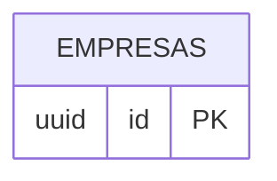

# Feature Specification: Deuda técnica · Lote 2: higiene de código y documentación (MSF-515)

**Épica contenedora**: MSF-515 «Deuda técnica y seguimientos de review» · **Lote**: 2 · **Spec**: `deuda-tecnica-lote-2-higiene-codigo-y-docs` · **Prioridad**: P3
**Alcance de entrega**: `refine` (comentarios y nombres de test en `apps/web/src`, un test de higiene) y `workers` solo en el sentido de código sin uso en `packages/ia-navegacion` y en la Edge Function `chat-ia-responder` (import y función sin uso). Sin `supabase` (ninguna migración), `kestra` ni `superset`.
**Fuente**: seguimientos de revisión MSF-626 (MSF-777), MSF-702 (MSF-753) y la revisión semanal del 2026-11-02 (MSF-745). Esta spec **traduce** esos hallazgos a requisitos; no cambia comportamiento.

## Objetivo

1. **MSF-777** — Quitar de `apps/web/src` las referencias a «Etapa N» y los códigos «MSF-…» de los **nombres de test** (`describe`/`it`/`test`), y que un test lo vigile.
2. **MSF-753** — El espía de `console.error` de `mensajeErrorBase.test.ts` queda siempre bajo el `afterEach` que restaura los mocks.
3. **MSF-745** — Quitar el import `sanitizarDato` (sin uso) de `chat-ia-responder` y la función `abrirInvocacion` (sin uso) de `intentarRecuperarPaso.ts`.

## Ítems revisados y no incluidos (verificados contra `origin/dokploy`)

- **MSF-580**: ya resuelto; `scripts/verificar-migraciones.mjs` existe (y `pnpm docs:check` lo corre), así que los docs que lo citan son correctos.
- **MSF-631**: el test de `scripts/migraciones-ventas-comprobantes.test.mjs` ya usa un piso (`>= 12`); queda la mitad de `perfil_usuario.test.sql`, que necesita Supabase local.
- **MSF-584**: `knip.json` ya declara los entry points, binarios y dependencias; `renderPanel.tsx` está declarado y `useFeatureHabilitada` se usa. Quedan exports sin uso y avisos `set-state-in-effect`, que cambian comportamiento y van con su pantalla.
- **MSF-862**: ya mergeado (#974). **MSF-539**: requiere migraciones (lote aparte).

## User Scenarios & Testing

### Historia 1 — Los tests describen comportamiento (MSF-777, P3)
**Dado** un test de `apps/web/src`, **cuando** se lee su nombre, **entonces** no cita un ticket; **y** ningún archivo dice «Etapa N». El texto que ve la persona (`AYUDA_CANAL_ML`, el aviso de consultas) no cambia.

### Historia 2 — El espía no contamina (MSF-753, P3)
**Dado** `mensajeErrorBase.test.ts`, **cuando** se agrega un test nuevo, **entonces** queda dentro del bloque que restaura los mocks.

### Historia 3 — Sin código muerto (MSF-745, P3)
**Dado** el import y la función sin uso, **cuando** se quitan, **entonces** la suite de `ia-navegacion` y el chequeo de tipos pasan igual.

## Requirements

- **FR-001**: ningún `describe`/`it`/`test` de `apps/web/src` lleva `MSF-<n>` en su título; los títulos conservan el resto de su texto.
- **FR-002**: `git grep -E 'Etapa [0-9]' apps/web/src` no devuelve coincidencias; los comentarios reformulados dicen que Mercado Libre «todavía no es un canal elegible».
- **FR-003**: un test (`higieneReferenciasInternas.test.ts`) falla si reaparece un título con código MSF o un «Etapa N», y verifica que `AYUDA_CANAL_ML` no los contiene.
- **FR-004**: `mensajeErrorBase.test.ts` anida el `describe` de «log sin PII» en el bloque con `beforeEach`/`afterEach(vi.restoreAllMocks)` y reutiliza el espía.
- **FR-005**: sin cambios de comportamiento ni de texto visible.
- **SC-001**: Vitest de los archivos tocados, `test` de `ia-navegacion`, `tsc -b`, `oxlint` y los guards del repo en verde.

## Decisiones y justificación

- **D-1 (MSF-777): alcance parcial.** Los **comentarios** de código con `MSF-<n>` son ~450 líneas en cientos de archivos y funcionan hoy como trazabilidad al ticket de origen; reescribirlos en bloque es una decisión de convención más amplia que el seguimiento. Este lote cierra lo que el seguimiento nombra explícitamente («Etapa N», nombres de test) con un test que impide la regresión; los comentarios con código de ticket quedan como seguimiento si Nicolás decide prohibirlos.
- **D-2 (MSF-777): reescritura mecánica de títulos.** Se quitó el token `MSF-<n>[:T<m>]` del título y la puntuación que quedó huérfana; ningún test cambia de lógica.
- **D-3 (MSF-745)**: `sanitizarDato` se sigue nombrando en un comentario que explica por qué no se aplica; la función `abrirInvocacion` se reemplazó en el comentario por «abrir la invocación».

## Matriz pantalla↔criterios

**Fuera de alcance: esta spec no agrega, mueve ni rediseña pantallas.** Solo cambian comentarios, nombres de test y código sin uso. No hay prototipo asociado en `design/pantallas`.

| Ítem | Criterio |
|---|---|
| Empresa activa: no aplica | No se toca ninguna pantalla ni diálogo; solo nombres de test y comentarios. |

## Modelo de datos (DER)

Sin cambios de esquema (sin migraciones; no se lee ni se escribe ninguna tabla).

| Tabla | Estado | Cambio |
|---|---|---|
| `dominio.empresas` | existente | sin cambios; se cita solo para completar el diagrama |

## Reversión

Revertir el PR (`git revert -m 1`) restaura comentarios y nombres; no hay datos ni migraciones.

## Fuera de alcance / seguimientos

- Comentarios de código con `MSF-<n>` (D-1).
- Exports sin uso y avisos `set-state-in-effect` de MSF-584.
- Test 11 de `perfil_usuario.test.sql` (MSF-631), necesita stack local.
