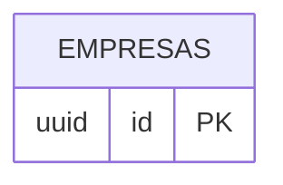

# Feature Specification: Deuda técnica · Lote 2: higiene de código y documentación (MSF-515)

**Épica contenedora**: MSF-515 «Deuda técnica y seguimientos de review» · **Lote**: 2 · **Spec**: `deuda-tecnica-lote-2-higiene-codigo-y-docs` · **Prioridad**: P3
**Alcance de entrega**: `refine` (comentarios y nombres de test en `apps/web/src`, un test de higiene), `workers` solo en el sentido de código sin uso en `packages/ia-navegacion` y en la Edge Function `chat-ia-responder`, y tooling propio (`scripts/docs-manifest.mjs`, MSF-950). Sin `supabase` (ninguna migración), `kestra` ni `superset`.
**Fuente**: seguimientos de revisión MSF-626 (MSF-777), MSF-702 (MSF-753), la revisión semanal del 2026-11-02 (MSF-745) y el bug MSF-950 (falso drift del job `build` del workflow docs). Esta spec **traduce** esos hallazgos a requisitos; no cambia comportamiento de producto.

## Objetivo

1. **MSF-777 (parcial)** — Quitar de `apps/web/src` las referencias a «Etapa N» y los códigos «MSF-…» de los **nombres de test** (`describe`/`it`/`test`, incluidas las formas `.each`, `.skip`, títulos en otra línea y comillas mixtas), y que un test lo vigile.
2. **MSF-753** — El espía de `console.error` de `mensajeErrorBase.test.ts` queda siempre bajo el `afterEach` que restaura los mocks.
3. **MSF-745** — Quitar el import `sanitizarDato` (sin uso) de `chat-ia-responder`, la función `abrirInvocacion` y el tipo `InteraccionEnCurso` que quedó sin uso de `intentarRecuperarPaso.ts`.
4. **MSF-950** — `sourceAt` del manifest de docs (`docs/manifest.json`) no depende de HEAD: es el último commit propio (`--no-merges`) de la página, igual que `commit`. En el CI HEAD es el merge efímero del PR y generaba un falso drift.

## Ítems revisados y no incluidos (verificados contra `origin/dokploy`)

- **MSF-580**: ya resuelto; `scripts/verificar-migraciones.mjs` existe (y `pnpm docs:check` lo corre), así que los docs que lo citan son correctos.
- **MSF-631** (padre MSF-585, consolidado en MSF-878): ya está completo en `dokploy` (`on conflict do nothing` en `perfil_usuario.test.sql`, piso `>= 12` en `migraciones-ventas-comprobantes.test.mjs`; commits `fe1898c0` y `5266c863`). No se toca.
- **MSF-584**: `knip.json` ya declara los entry points, binarios y dependencias; `renderPanel.tsx` está declarado y `useFeatureHabilitada` se usa. Quedan exports sin uso y avisos `set-state-in-effect`, que cambian comportamiento y van con su pantalla.
- **MSF-862**: ya mergeado (#974). **MSF-539**: requiere migraciones (lote aparte).

## Reconciliación con los lotes consolidados

MSF-878 (L17) consolida 584, 745, 631 y 753; MSF-895 (L36) consolida 539, 580 y 777. Ambos figuran «En curso» con delegado; se buscaron ramas y PR abiertos del SDLC o de otra sesión (`gh pr list --search`, `git branch -r`) y **no hay ninguno** que haga lo mismo (los resultados son otros ítems con el mismo número, p. ej. el PR #745 de MSF-808). Qué hizo este lote, para no cerrarlos como completos:

| Consolidado | Ítem | Estado tras este lote |
|---|---|---|
| MSF-878 | 745 | hecho aquí |
| MSF-878 | 753 | hecho aquí |
| MSF-878 | 631 | ya completo en dokploy |
| MSF-878 | 584 | pendiente (exports sin uso y avisos de efectos) |
| MSF-895 | 777 | **parcial**: queda abierto (comentarios con código MSF) |
| MSF-895 | 580 | ya resuelto en dokploy |
| MSF-895 | 539 | pendiente (migraciones, lote aparte) |

## User Scenarios & Testing

### Historia 1 — Los tests describen comportamiento (MSF-777, P3)
**Dado** un test de `apps/web/src`, **cuando** se lee su nombre, **entonces** no cita un ticket; **y** ningún archivo dice «Etapa N». El texto que ve la persona (`AYUDA_CANAL_ML`, el aviso de consultas) no cambia.

### Historia 2 — El espía no contamina (MSF-753, P3)
**Dado** `mensajeErrorBase.test.ts`, **cuando** se agrega un test nuevo, **entonces** queda dentro del bloque que restaura los mocks.

### Historia 3 — Sin código muerto (MSF-745, P3)
**Dado** el import, la función y el tipo sin uso, **cuando** se quitan, **entonces** la suite de `ia-navegacion`, `tsc --noUnusedLocals` y oxlint pasan igual.

### Historia 4 — El manifest de docs es estable entre el PR y su merge (MSF-950, P2)
**Dado** una página con `sources`, **cuando** HEAD cambia sin tocar la página (commit vacío, merge efímero del CI), **entonces** `sourceAt`, `sourceHash` y `commit` del manifest no cambian y el job `build` no ve drift falso.

## Requirements

- **FR-001**: ningún `describe`/`it`/`test` de `apps/web/src` lleva `MSF-<n>` en su título; los títulos conservan el resto de su texto.
- **FR-002**: `git grep -E 'Etapa [0-9]' apps/web/src` no devuelve coincidencias; los comentarios reformulados dicen que Mercado Libre «todavía no es un canal elegible».
- **FR-003**: un test (`higieneReferenciasInternas.test.ts`) falla si reaparece un título con código MSF o un «Etapa N», y verifica que `AYUDA_CANAL_ML` no los contiene.
- **FR-004**: `mensajeErrorBase.test.ts` anida el `describe` de «log sin PII» en el bloque con `beforeEach`/`afterEach(vi.restoreAllMocks)` y reutiliza el espía.
- **FR-005**: sin cambios de comportamiento ni de texto visible.
- **FR-006**: el guardián detecta el primer literal de título de cualquier llamada `it|test|describe` (con `.skip`, `.only`, `.each([...])(…)` incluso con genéricos de TS, `.each` con tabla de plantilla, `.skipIf(c)(…)`, `.runIf(c)(…)`, `.for([...])(…)`, título en la línea siguiente, comillas mixtas y comentarios o regex con comillas dentro de la tabla del `.each`) y tiene casos sintéticos positivos y negativos para cada forma. **Fuera de alcance** (no se detectan): títulos construidos por concatenación o variable (`it(TITULO, …)`), plantillas con `${}` que contengan comillas, y wrappers propios de `it`; el guardián revisa solo el primer literal.
- **FR-007**: `scripts/docs-manifest.mjs` calcula `sourceAt` con `git log -1 --no-merges --format=%h -- <página>` (nunca con HEAD) y `sourceHash` sobre los archivos que la fuente tenía en ese commit, el mismo criterio que `docs-drift.mjs`; un test con dos HEAD distintos lo garantiza.
- **SC-001**: Vitest de los archivos tocados, `test` de `ia-navegacion`, `tsc -b`, `oxlint`, `pnpm test:docs:manifest`, `node scripts/docs-manifest.mjs` sin diff y los guards del repo en verde.

## Decisiones y justificación

- **D-1 (MSF-777): alcance parcial.** Los **comentarios** de código con `MSF-<n>` son ~450 líneas en cientos de archivos y funcionan hoy como trazabilidad al ticket de origen; reescribirlos en bloque es una decisión de convención más amplia que el seguimiento. Este lote cierra lo que el seguimiento nombra explícitamente («Etapa N», nombres de test) con un test que impide la regresión; los comentarios con código de ticket quedan como seguimiento si Nicolás decide prohibirlos.
- **D-2 (MSF-777): reescritura mecánica de títulos.** Se quitó el token `MSF-<n>[:T<m>]` del título y la puntuación que quedó huérfana; ningún test cambia de lógica.
- **D-4 (MSF-950): sourceHash con el mismo alcance que el drift.** Con `sourceAt` anclado a un commit propio (más viejo que HEAD), el hash de las fuentes debe calcularse sobre los archivos de ese commit, como hace `docs-drift.mjs`; si no, sumar un archivo a una fuente daría drift. Las páginas sin cambios conservan sus valores (se reusan), por lo que el manifest solo cambia en las páginas editadas. Consecuencia: el drift pasa a ser **menos sensible** a archivos agregados a una fuente después de `sourceAt` (no marcan la página como vieja; editar o borrar uno ya existente, sí); un test lo fija (`docs-manifest.test.mjs`).
- **D-5 (MSF-950): el drift real es previo y no se resuelve acá.** `docs-drift.mjs` da 134 páginas con la fuente cambiada sobre `origin/dokploy` (dokploy no adoptó el wiki de docs de main, MSF-862); este lote suma 12 por editar nombres de test bajo `apps/web/src` (fuente de varias páginas). MSF-950 arregla solo que `sourceAt` dependa de HEAD; reconciliar páginas y fuentes es el seguimiento de MSF-862 y puede dejar el paso `drift de fuentes` del workflow docs en rojo hasta entonces.
- **D-3 (MSF-745)**: `sanitizarDato` se sigue nombrando en un comentario que explica por qué no se aplica; la función `abrirInvocacion` se reemplazó en el comentario por «abrir la invocación».

## Matriz pantalla↔criterios

**Fuera de alcance: esta spec no agrega, mueve ni rediseña pantallas.** Solo cambian comentarios, nombres de test y código sin uso. No hay prototipo asociado en `design/pantallas`.

| Ítem | Criterio |
|---|---|
| Empresa activa: no aplica | No se toca ninguna pantalla ni diálogo; solo nombres de test y comentarios. |

## Modelo de datos (DER)

Sin cambios de esquema (sin migraciones; no se lee ni se escribe ninguna tabla).

| Tabla | Estado | Cambio |
|---|---|---|
| `dominio.empresas` | existente | sin cambios; se cita solo para completar el diagrama |

## Reversión

Revertir el PR (`git revert -m 1`) restaura comentarios y nombres; no hay datos ni migraciones.

## Fuera de alcance / seguimientos

- Comentarios de código con `MSF-<n>` (D-1).
- Exports sin uso y avisos `set-state-in-effect` de MSF-584.
