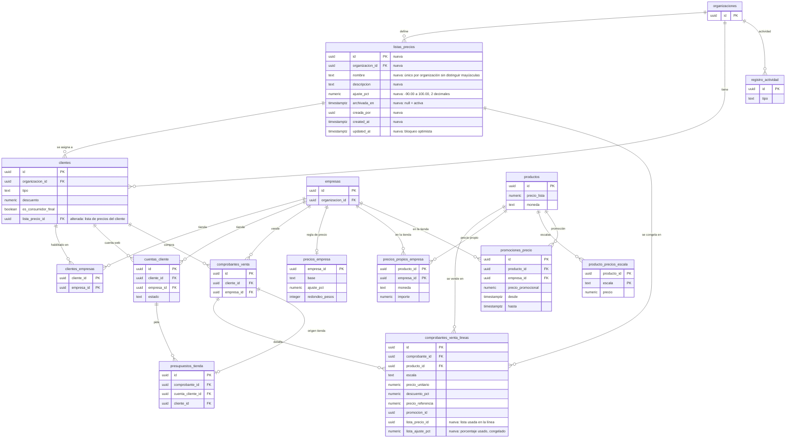
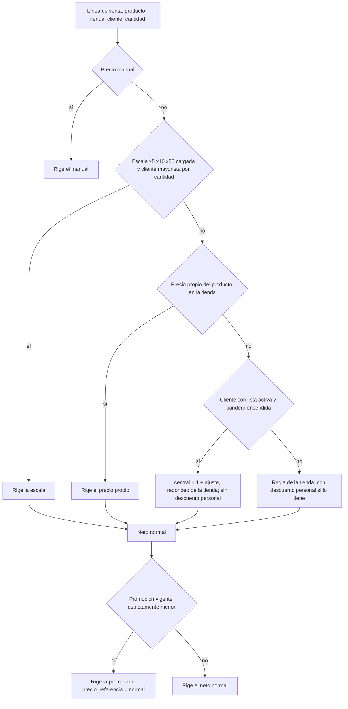
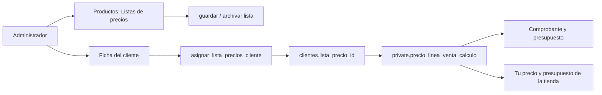

# Feature Specification: Listas de precios por cliente (F-PRE-14 + F-CLI-21)

**Épicas**: MSF-373 (Precios y dólar · Cotización sugerida y mayoristas) y MSF-450 (Clientes y proveedores · Cuentas y compras a proveedores) · **Spec**: `listas-de-precios-por-cliente` · **Historias**: F-PRE-14 «Listas de precios mayoristas» (MSF-442) y F-CLI-21 «Listas de precios por cliente» (MSF-453) · **Prioridad**: P3
**Alcance de entrega**: `refine` y `supabase` (sin `kestra`, `superset` ni `workers`).
**Estado**: spec redactada; **Fases 1 a 5 implementadas** (Fases 1 y 2 sin efecto en ningún precio; Fases 3 y 4 detrás de la bandera `listas_precios`, apagada hasta que Nicolás decida; Fase 5 = cierre). Retoma F-PRE-14, descartada (2026-11-12) por decisión de Nicolás del 2026-11-15; reemplaza también la «Pregunta abierta 1» de `specs/20261029-100000-cuentas-y-compras-a-proveedores/spec.md`.
**Fuente**: decisión de Nicolás (2026-11-15) comentada en MSF-442 y MSF-453, los tickets, `docs/precios.md`, `docs/precios-escalas.md`, `docs/promociones-precio.md`, `docs/configuracion-dolar-y-precio-propio.md`, `docs/cuentas-y-compras-a-proveedores.md` y el código vigente de `dokploy` (migraciones hasta `20270326100000`).

## Objetivo

Que un **administrador** defina **listas de precios** —cada una es un **porcentaje de ajuste sobre el precio central**— y **asigne una lista a un cliente** (por ejemplo «Revendedores −20 %»), de modo que cada venta a ese cliente, en el mostrador y en la tienda con su cuenta web, use el precio de su lista sin cargar precios a mano.

## Decisión de negocio (Nicolás, 2026-11-15) y decisiones delegadas

**Decisión tomada por Nicolás**: una lista de precios es un **porcentaje de ajuste aplicado sobre el precio central**. **No** hay precios fijos por producto dentro de una lista.

Todo lo que sigue **no estaba definido** y se decidió con el criterio de reutilizar el modelo vigente (la regla de precio por empresa, el precio propio, las escalas, el descuento por cliente y las promociones). Cada fila es una **«Decisión (delegada)»** que Nicolás puede revisar; cambiar una no obliga a rehacer las demás salvo donde se indica.

| # | Decisión (delegada) | Motivo |
|---|---|---|
| D1 | **Esta spec une F-PRE-14 y F-CLI-21.** F-PRE-14 es «definir listas» y F-CLI-21 es «asignar una lista a un cliente»; no tienen sentido por separado y comparten motor de precio, migraciones y pantallas. F-PRE-14 deja de estar cancelada. | Evita dos specs que se pisan; cada historia conserva sus RF/CA y su tarea dueña. |
| D2 | **El ajuste es un porcentaje con signo, de −90,00 % a +100,00 %, con 2 decimales.** Negativo = descuento (el caso de revendedores); positivo = recargo; 0 % = «precio central puro». | Es el mismo tipo de dato que `precios_empresa.ajuste_pct` (F-PRE-07). Los topes evitan un precio nulo o absurdo por un error de tipeo. |
| D3 | **La lista parte del precio central, igual que la regla de precio de la empresa, y la REEMPLAZA** (no se suma): `neto = redondear( central_en_pesos × (1 + ajuste/100), redondeo_pesos de la empresa )`. El IVA se aplica después, como siempre (la lista es **sin IVA**). El «central en pesos» sale de `private.a_pesos` con la cotización de la empresa del comprobante. | Sumar el ajuste de la empresa y el de la lista daría un porcentaje distinto del que el administrador ve en la lista (−20 % y +10 % de la tienda no serían −20 %). Reemplazar hace que el número de la lista sea el que se cobra. Efecto declarado: una lista de 0 % da el central sin el ajuste de la tienda. |
| D4 | **Una lista por cliente** (a lo sumo una) y **por organización**: rige en todas las tiendas en las que el cliente compra. Las listas no se acotan por empresa. | Es lo que dice la historia («una lista propia»). Acotar por tienda duplica el modelo sin un caso real. |
| D5 | **Precedencia de la línea (regla única, la más específica gana)**: 1) precio manual de la línea (`editar_precio`, sin cambios); 2) precio de **escala por cantidad** x5/x10/x50 cargado en el producto (F-PRE-15); 3) **precio propio** del producto en la tienda (F-PRE-08); 4) **lista del cliente**; 5) regla de la empresa (hoy). Sobre el neto resultante rige el descuento personal y, al final, la promoción (D6, D7). | Sigue la lógica ya vigente («un precio de escala cargado a mano gana sobre el precio propio»; lo explícito por producto gana sobre lo general). La lista es una regla general por cliente: no pisa un precio que alguien fijó a propósito para ese producto. |
| D6 | **Lista y descuento personal (F-VTA-32) no se acumulan**: si el precio de la línea lo fijó la lista (paso 4), el descuento personal del cliente **no se aplica** a esa línea; en las líneas donde la lista no rige (pasos 1–3) el descuento personal sigue como hoy. En la ficha se avisa cuando un cliente tiene las dos cosas. | Evita el doble descuento silencioso. Es la misma filosofía «sin acumular» de MSF-816. Es el punto más sensible para revisar. |
| D7 | **Lista y promoción (MSF-363/816): gana el precio más bajo, sin acumular.** La promoción se compara con el precio normal de la línea (que ya incluye la lista) y gana solo si es **estrictamente menor**, exactamente como `private.precio_linea_venta` hoy. | No se toca la regla ya implementada y verificada de MSF-816; la lista solo cambia qué es «el precio normal». |
| D8 | **Lista y tipo de cliente mayorista (F-PRE-15 / F-VTA-06) son independientes.** El tipo sigue eligiendo la escala por cantidad (x5 desde 5, x10 desde 10, x50 desde 50) y esa escala gana a la lista (D5, paso 2). La lista no cambia el tipo del cliente. **No** se crea la pantalla ni la tabla «Tipos de cliente». | Cumple «cancelada por chocar con F-PRE-15»: ahora conviven con precedencia clara. Una lista por tipo de cliente queda fuera de alcance. |
| D9 | **Quién**: solo el rol **Administrador** crea, edita, archiva listas y asigna una lista a un cliente (la base lo exige, como el descuento personal). Leen las listas los roles con `clientes` o `ventas` en lectura, para ver el nombre de la lista y calcular. | Es el criterio de F-VTA-32 (descuento por cliente, solo Administrador). La historia dice «como administrador». |
| D10 | **Una lista no se borra: se archiva**, y **no se puede archivar una lista con clientes asignados** (la base responde con la cantidad de clientes; primero se reasigna o se quita). Una lista archivada no se puede asignar. | Evita que un cliente cambie de precio sin que nadie lo decida. Es el patrón «se archiva, no se borra» de Clientes. |
| D11 | **El Consumidor final no admite lista** (es el cliente anónimo del mostrador). | Su precio es el de lista pública por diseño (`es_consumidor_final`, uno por organización). |
| D12 | **Congelado en la venta**: cada línea guarda `lista_precio_id` y `lista_ajuste_pct` (qué lista y qué porcentaje se usaron). Cambiar el % de una lista o reasignar al cliente **no cambia** comprobantes ya confirmados ni sus notas de crédito; los borradores se recalculan al guardar líneas, como hoy. **Un borrador cuyo snapshot de lista ya no coincide con el motor al confirmar (porcentaje cambiado, lista reasignada o quitada, bandera apagada) responde «Los precios cambiaron» y se vuelve a guardar** (no contradice D12: protege lo confirmado, no un borrador). | Mismo criterio que `descuento_pct` y `precio_referencia`: lo ya vendido no se mueve. |
| D13 | **Bandera de apagado `listas_precios`, apagada por defecto en cada entorno** (tabla `public.banderas_plataforma`, como `promociones_precio`). Apagada: el motor de precio **ignora** las listas (resultado idéntico a hoy), «Guardar lista» y «Asignar» responden `55000`, archivar y quitar siguen permitidos. Se enciende dev → stg → prd por SQL del equipo técnico. | Cambia lo que se cobra: se quiere poder apagarlo al instante sin migrar. Mismo patrón y mismo orden de encendido que las promociones. |
| D14 | **La tienda con cuenta web usa la misma lista** (Fase 4): «Tu precio» de la ficha y el presupuesto armado desde la tienda salen del mismo motor, así que el precio visto es el que se cobra. Las **tarjetas del catálogo no cambian** (siguen mostrando el precio público x1, igual que hoy para el mayorista). | Evita que la tienda muestre un precio distinto del mostrador. Es una fase aparte y se puede cortar sin afectar al mostrador. |
| D15 | **Mercado Libre queda fuera**: las listas no generan cola ni precio en publicaciones. | Igual que el precio propio (FR-020 de MSF-352). |
| D16 | **UI mínima sin prototipo**: pantalla nueva **Productos → Listas de precios** y campo «Lista de precios» en la ficha del cliente (ver «Matriz pantalla↔criterios»). | El prototipo no dibuja listas; se resuelve con el sistema de diseño y los componentes compartidos. |

## Modelo y supuestos (verificados en el código de `dokploy`)

- **Hoy** el precio de una línea de venta sale de `private.precio_linea_venta` (que envuelve `private.precio_para` y `private.escala_para_linea`): escala por tipo de cliente y cantidad → precio propio (solo x1 o escala sin precio) → regla de la empresa (`aplicar_regla_precio`: base `central` o `central_ajuste`, `ajuste_pct`, `redondeo_pesos`) → descuento personal del cliente (`clientes.descuento`, F-VTA-32) → promoción vigente de la tienda («gana el más bajo, sin acumular», MSF-816, bandera `promociones_precio`). La tienda y el presupuesto de la tienda usan las gemelas sin sesión `precio_para_calculo` / `precio_linea_venta_calculo` (MSF-176 B2).
- **Clientes**: `public.clientes` (esquema `public` por decisión histórica de MSF-180) ya tiene `tipo` (`minorista`/`mayorista`), `descuento` (solo Administrador, con disparador y actividad), `es_consumidor_final`. La cuenta web (`public.cuentas_cliente`) cuelga de `cliente_id`.
- **No existe** `tipos_cliente` ni su pantalla (F-PRE-15 solo implementó las escalas por producto); `TiposCliente.dc.html` es un prototipo sin entregar. **No hay pantalla dibujada** de listas de precios (ver «Matriz pantalla↔criterios»).
- **Bloqueo anterior**: las dos historias figuraban como «sin requisitos» y bloqueadas por el modelo comercial. La decisión de Nicolás lo cierra. MSF-116 ya está entregada (F-PRE-13 implementada), así que ya no bloquea.
- **Cancelación previa**: F-PRE-14 se canceló el 2026-11-12 por chocar con F-PRE-15. Esta spec la retoma con una resolución explícita del choque (D5 y D8). Los textos que dicen «cancelada» en `docs/precios.md`, `docs/cuentas-y-compras-a-proveedores.md` y las specs `20261105-100000-cotizacion-sugerida-y-mayoristas` y `20261029-100000-cuentas-y-compras-a-proveedores` se actualizan en la Fase 5 (no se editan en esta spec).

### Esquema de datos (Constitución, Principio VII), verificado objeto por objeto

| Objeto | Esquema | Historia | Justificación | Acceso |
|---|---|---|---|---|
| `dominio.listas_precios` (tabla nueva) | **`dominio`** | F-PRE-14 | Es una regla comercial del negocio (política de precios), como `precios_empresa`, `promociones_precio` y `producto_precios_escala`: no es plataforma | RLS por organización y por sección; `select` para `authenticated`; **sin escritura directa** (solo RPC `security definer`); sin política `DELETE`; sin privilegios para `anon` |
| `public.clientes.lista_precio_id` (columna nueva) | `public` (donde ya vive `clientes`, MSF-180) | F-CLI-21 | Atributo del cliente; solo se agrega una columna nulable con FK compuesta a `dominio.listas_precios`. No se mueve `clientes` de esquema | RLS vigente de `clientes`; **sin** `grant update` de columna: solo la RPC `asignar_lista_precios_cliente` la escribe |
| `dominio.comprobantes_venta_lineas.lista_precio_id`, `lista_ajuste_pct` (columnas nuevas) | `dominio` | F-CLI-21 | Snapshot de la venta (D12), junto a `descuento_pct` y `precio_referencia` | RLS vigente; las escribe `guardar_lineas_comprobante` |
| Fila `listas_precios` en `public.banderas_plataforma` | `public` (plataforma) | ambas | Dato, no estructura (D13) | `authenticated` solo lee; la cambia el equipo técnico por SQL |
| Vista `public.listas_precios_resumen` | `public` | F-PRE-14 | Superficie de lectura con la cantidad de clientes por lista; `security_invoker`, sin datos propios | Hereda la RLS de la tabla |
| `public.guardar_lista_precios`, `archivar_lista_precios`, `restaurar_lista_precios`, `asignar_lista_precios_cliente` | `public` (RPC) | ambas | Superficie de ejecución sin datos propios | `grant execute` solo a `authenticated`; `revoke … from public, anon` |
| `private.lista_precios_cliente`, extensión de `precio_para_calculo` / `precio_linea_venta(_calculo)` | `private` | ambas | Cálculo | Sin `execute` para `anon`/`authenticated` salvo lo que hoy ya tienen |

## Modelo de datos (DER)

La única tabla nueva es `dominio.listas_precios`. Se alteran `public.clientes` (una columna) y `dominio.comprobantes_venta_lineas` (dos columnas de snapshot). El resto del grafo de precio y de cliente se muestra completo para ver a qué se ata cada pieza y qué tabla alimenta cada paso de la precedencia (D5).

| Tabla | Estado | Cambio |
|---|---|---|
| `dominio.listas_precios` | nueva | Lista de precios por organización: nombre, descripción, `ajuste_pct` (−90 a +100), archivada o no, auditoría y bloqueo optimista |
| `public.clientes` | alterada | Columna `lista_precio_id` (nulable, FK compuesta a la lista): la lista del cliente |
| `dominio.comprobantes_venta_lineas` | alterada | Columnas `lista_precio_id` y `lista_ajuste_pct`: qué lista y qué porcentaje se usaron en la línea (D12) |
| `dominio.comprobantes_venta` | existente | Comprobante con `cliente_id` y `empresa_id`; define el cliente y la tienda del cálculo |
| `public.cuentas_cliente` | existente | Cuenta web del cliente en una tienda (Fase 4) |
| `dominio.presupuestos_tienda` | existente | Presupuesto armado desde la tienda; su comprobante guarda las líneas con snapshot |
| `public.clientes_empresas` | existente | Tiendas en las que el cliente está habilitado |
| `dominio.empresas` | existente | Tienda: redondeo, cotización y regla de precio |
| `dominio.precios_empresa` | existente | Regla de precio de la tienda (`base`, `ajuste_pct`, `redondeo_pesos`): paso 5 de D5 y fuente del redondeo de la lista |
| `dominio.precios_propios_empresa` | existente | Precio propio por producto y tienda (F-PRE-08): paso 3 de D5 |
| `dominio.producto_precios_escala` | existente | Escalas x5/x10/x50 por producto (F-PRE-15): paso 2 de D5 |
| `dominio.promociones_precio` | existente | Promoción de la tienda (MSF-363/816): se compara al final (D7) |
| `dominio.productos` | existente | Producto con `precio_lista` central |
| `public.registro_actividad` | existente | Eventos de alta, edición, archivo y asignación de listas |
| `public.organizaciones` | existente | Organización dueña de las listas |

`public.banderas_plataforma` (fila `listas_precios`) no se dibuja: es una tabla de claves sin relaciones; su fila es un dato (D13).

## User Scenarios & Testing *(mandatory)*

### Historia 1 — Listas de precios mayoristas (F-PRE-14, P3)

Como **administrador** quiero crear listas de precios para revendedores (cada una, un porcentaje de ajuste sobre el precio central) para vender por mayor sin cargar precios a mano.

**Escenarios de aceptación**

- **CA-PRE-14-1** — **Dado** un administrador, **cuando** crea la lista «Revendedores» con ajuste −20 %, **entonces** queda activa, con 0 clientes, y la Actividad registra su alta; el mismo nombre (sin distinguir mayúsculas ni espacios de más) en la organización se rechaza con un mensaje claro.
- **CA-PRE-14-2** — **Dado** una lista, **cuando** el administrador cambia su porcentaje, **entonces** el cambio rige para las **próximas** líneas calculadas de sus clientes; los comprobantes ya confirmados no cambian (D12) y la Actividad guarda el valor anterior y el nuevo.
- **CA-PRE-14-3** — **Dado** un ajuste fuera de −90 % a +100 % o con más de 2 decimales, **cuando** se guarda, **entonces** se rechaza con un error de validación y no se escribe nada.
- **CA-PRE-14-4** — **Dado** una lista sin clientes, **cuando** se archiva, **entonces** deja de ofrecerse para asignar y se puede restaurar; **dado** una lista con clientes asignados, **cuando** se intenta archivar, **entonces** se rechaza indicando cuántos clientes la usan (D10).
- **CA-PRE-14-5** — **Dado** un rol que no es administrador, **entonces** no ve «Nueva lista», «Editar» ni «Archivar», y si llama directo a la base recibe `42501`; un rol con `clientes` o `ventas` en lectura ve las listas pero no las cambia.
- **CA-PRE-14-6** — **Dado** dos organizaciones, **entonces** cada una ve solo sus listas y no puede asignar una lista ajena (pgTAP de aislamiento).
- **CA-PRE-14-7** — **Dado** la bandera `listas_precios` apagada, **entonces** «Guardar lista» y «Asignar» responden `55000` («Las listas de precios están desactivadas en este entorno»), la pantalla queda en modo solo-archivar con un aviso, y los precios se calculan como si las listas no existieran (D13).

### Historia 2 — Listas de precios por cliente (F-CLI-21, P3)

Como **administrador** quiero asignar una lista de precios propia a un cliente, para que sus compras salgan al precio de esa lista.

**Escenarios de aceptación**

- **CA-CLI-21-1** — **Dado** un cliente, **cuando** el administrador elige una lista en su ficha y guarda, **entonces** el cliente queda con esa lista, la Actividad registra quién y cuándo (cliente, lista anterior y nueva, sin datos de contacto) y la ficha la muestra con su porcentaje.
- **CA-CLI-21-2** — **Dado** un cliente con lista, **cuando** se arma un comprobante en una tienda, **entonces** cada línea sin precio manual, sin escala cargada ni precio propio se cobra a `central × (1 + ajuste)` redondeado con el redondeo de **esa** tienda, y la línea guarda `lista_precio_id` y `lista_ajuste_pct`.
- **CA-CLI-21-3** — **Dado** un producto con precio propio en la tienda, **o** un cliente mayorista que compra una cantidad con escala cargada, **entonces** rige ese precio y no la lista (D5); la línea no guarda lista.
- **CA-CLI-21-4** — **Dado** un cliente con lista **y** descuento personal, **entonces** en las líneas fijadas por la lista **no** se aplica el descuento personal (D6) y la ficha lo avisa; en una línea con precio propio sí rige el descuento personal como hoy.
- **CA-CLI-21-5** — **Dado** una promoción vigente de la tienda menor al precio de lista, **entonces** gana la promoción (D7) y la línea conserva `precio_referencia` = precio de lista; si es igual o mayor, rige la lista.
- **CA-CLI-21-6** — **Dado** el cliente sin lista (o la bandera apagada), **entonces** el precio es exactamente el de hoy (paridad con `precio_linea_venta` vigente, probada).
- **CA-CLI-21-7** — **Dado** una lista archivada o el Consumidor final, **cuando** se intenta asignar, **entonces** se rechaza (`22023`); **dado** un cliente de otra organización, `P0002`.
- **CA-CLI-21-8** — **Dado** un cliente con lista, **cuando** se quita la lista, **entonces** vuelve al precio normal desde las próximas líneas; lo ya vendido conserva su snapshot.
- **CA-CLI-21-9** — **Dado** un administrador editando un comprobante en borrador de un cliente con lista, **entonces** ve una marca «Lista: Revendedores −20 %» en la línea o el encabezado; sin lista no aparece nada nuevo.
- **CA-CLI-21-10** — **Dado** un cliente con cuenta web y lista, **cuando** abre la ficha de un producto, **entonces** «Tu precio» es el precio de su lista (mismo valor que cobraría el mostrador, probado por paridad) y el presupuesto que arma desde la tienda usa ese precio (Fase 4); el catálogo muestra el precio público como hoy.
- **CA-CLI-21-11** — **Dado** un rol que no es administrador, **entonces** la ficha muestra la lista del cliente en solo lectura y no puede asignar; llamar directo a la base da `42501`.

### Casos borde

- **Producto en USD**: el central se convierte con la cotización de la **empresa del comprobante** (`private.a_pesos`), y la lista se aplica sobre los pesos; sin cotización, el precio es nulo como hoy (no se inventa).
- **Redondeo**: el de la tienda (`redondeo_pesos`, 10 por omisión). Dos tiendas de la misma organización pueden dar netos distintos para el mismo cliente y lista (cotización y redondeo propios).
- **Lista con 0 %**: da el precio central **sin** el ajuste de la tienda (D3); no es lo mismo que «sin lista» cuando la tienda tiene un ajuste.
- **Lista con recargo** (+): se cobra el recargo; si hay una promoción menor, gana la promoción (D7).
- **Cliente con lista y tienda con base `central`**: la lista sigue rigiendo (parte del mismo central).
- **Cambio de la lista entre borrador y confirmación**: el comprobante en borrador se recalcula al guardar líneas; la confirmación valida los precios vigentes (`confirmar_comprobante`, 20270310100400) con el mismo motor y la misma lista, así que una lista cambiada a mitad de camino se detecta como cualquier otro cambio de precio vigente.
- **Notas de crédito y devoluciones**: usan el precio congelado de la línea original (snapshot), nunca recalculan con la lista actual.
- **Fusión de clientes** (`fusion_clientes`): el cliente que se conserva mantiene su lista; la del cliente absorbido se descarta y la vista previa de la fusión lo muestra si difieren.
- **Archivo del cliente**: conserva su lista (se restaura con ella); un cliente archivado no se asigna ni se vende.
- **Importación y exportación de clientes**: la exportación de clientes **no** lleva la lista en esta spec (fuera de alcance); la exportación total de la organización **sí** incluye `dominio.listas_precios`.
- **Empresa desactivada**: sus comprobantes viejos conservan el snapshot; no hay efecto sobre las listas (son de la organización).
- **Bandera apagada con borradores abiertos**: los borradores ya calculados con lista conservan sus líneas hasta que se vuelva a guardar; al guardar se recalculan sin lista (mismo comportamiento y seguimiento que las promociones, MSF-937).

## Requirements *(mandatory)*

### F-PRE-14 — Listas de precios mayoristas

- **RF-PRE-14-1**: DEBE existir `dominio.listas_precios` (esquema `dominio`, Principio VII) con `organizacion_id`, `nombre` (1 a 80 caracteres, único por organización sin distinguir mayúsculas ni espacios), `descripcion` (opcional, hasta 300), `ajuste_pct numeric(5,2)` entre −90,00 y +100,00, `archivada_en`, auditoría (`creada_por`, `created_at`, `updated_at`).
- **RF-PRE-14-2**: Solo el rol Administrador DEBE poder crear, editar, archivar y restaurar listas, por RPC `security definer` con `search_path = ''`; la organización y el rol salen de la sesión, nunca de un parámetro. La edición usa bloqueo optimista con `updated_at` (`40001` ante un cambio concurrente).
- **RF-PRE-14-3**: Archivar una lista con clientes asignados DEBE rechazarse indicando la cantidad (D10); una lista archivada no se asigna.
- **RF-PRE-14-4**: Cada alta, edición (con valor anterior y nuevo del porcentaje), archivo y restauración DEBE dejar un evento en Actividad (`lista_precios.creada|editada|archivada|restaurada`).
- **RF-PRE-14-5**: La pantalla **Productos → Listas de precios** (`/productos/listas-de-precios`) DEBE listar las listas (nombre, ajuste, cantidad de clientes, estado) con carga infinita, y permitir crear, editar, archivar y restaurar desde un diálogo; usa los patrones compartidos de carga, vacío, error y éxito (Principio VI).
- **RF-PRE-14-6**: La bandera `listas_precios` (D13) DEBE gobernar las escrituras y el motor; apagada, el sistema se comporta exactamente como hoy.

### F-CLI-21 — Listas de precios por cliente

- **RF-CLI-21-1**: `public.clientes` DEBE tener `lista_precio_id` nulable con FK compuesta `(lista_precio_id, organizacion_id)` a la lista; no se concede `update` de la columna a `authenticated`.
- **RF-CLI-21-2**: `public.asignar_lista_precios_cliente(cliente, lista)` DEBE asignar o quitar (`null`) la lista, solo Administrador, idempotente, con rechazo de lista archivada o ajena, de cliente ajeno o archivado y del Consumidor final (D11); deja el evento `cliente.lista_precio_asignada` (cliente, lista anterior y nueva).
- **RF-CLI-21-3**: La ficha del cliente DEBE mostrar el campo «Lista de precios» (selector de listas activas, editable solo por Administrador, solo lectura para los demás) con el porcentaje y el aviso de D6 cuando el cliente también tiene descuento personal; **no** crea una pantalla de gestión nueva (la ficha de cliente absorbe la asignación).
- **RF-CLI-21-4**: Cuando se calcula una línea, DEBE aplicarse la precedencia de D5–D7 en **un solo lugar** de la base (el motor extiende `private.precio_para_calculo` / `private.precio_linea_venta(_calculo)`; no se duplica la fórmula en la web, en las vistas ni en la tienda).
- **RF-CLI-21-5**: `guardar_lineas_comprobante`, `copiar_presupuesto` y la validación de `confirmar_comprobante` DEBEN usar la lista del cliente del comprobante y guardar el snapshot `lista_precio_id` / `lista_ajuste_pct` en la línea (D12); las notas de crédito reutilizan el snapshot.
- **RF-CLI-21-6**: El comprobante en edición DEBE mostrar una marca de la lista aplicada (CA-CLI-21-9); sin lista no cambia nada visible.
- **RF-CLI-21-7** *(Fase 4)*: `publico.precios_cliente_por_dominio` y el motor del presupuesto de la tienda DEBEN aplicar la lista del cliente de la cuenta web activa, con la misma función que el mostrador; visitante, cuenta suspendida o no habilitada no ven listas.
- **RF-CLI-21-8**: La exportación total de la organización DEBE incluir `dominio.listas_precios` y `lista_precio_id` de `clientes`.

### Seguridad y datos (transversal)

- **RF-LP-1**: RLS activada en `dominio.listas_precios` con política de solo lectura por organización y sección; sin política `DELETE`; sin escritura directa (solo RPC); `anon` sin privilegios; toda RPC nueva con `revoke … from public, anon` y `grant execute … to authenticated` explícitos (constitución y `CLAUDE.md`).
- **RF-LP-2**: Migraciones aditivas e idempotentes con reversión en el encabezado de cada una; ninguna destruye datos en el mismo PR.
- **RF-LP-3**: Ninguna tabla ni RPC nueva expone costos ni datos de contacto; la Actividad guarda porcentajes (no importes) y nombres, sin datos de contacto.

### Criterios de éxito

- **SC-001**: con la bandera encendida, un cliente con la lista «Revendedores −20 %» compra un producto sin precio propio ni escala y la línea sale a `central × 0,80` redondeado; sin lista (o con la bandera apagada) sale exactamente al precio de hoy (pgTAP de paridad contra el motor vigente).
- **SC-002**: el precio de «Tu precio» en la tienda y el de la línea del mostrador coinciden para el mismo cliente, producto y tienda (pgTAP de paridad).
- **SC-003**: otra organización no ve ni asigna listas ajenas (pgTAP de aislamiento) y `rls_en_toda_tabla` sigue verde con la tabla nueva.

## Verificación por requisito

Cada RF y SC tiene una verificación nombrada. Las pruebas de base de datos corren en el job `database` del CI (`pnpm test:db`); las de interfaz con Vitest.

| Requisito | Verificación (test / comando) |
|---|---|
| RF-PRE-14-1 | pgTAP `listas_precios.test.sql` (estructura, topes, unicidad sin mayúsculas) |
| RF-PRE-14-2 | pgTAP `listas_precios.test.sql` (rol Administrador vs otros, `42501`, `40001`, `search_path`) |
| RF-PRE-14-3 | pgTAP `listas_precios.test.sql` (archivar con clientes, asignar archivada) |
| RF-PRE-14-4 | pgTAP `listas_precios.test.sql` (eventos de Actividad con anterior y nuevo) |
| RF-PRE-14-5 | Vitest `pages/productos/listas-de-precios.test.tsx` (lista, diálogo, estados, axe a 320/768/1440 px, carga infinita) |
| RF-PRE-14-6 | pgTAP `listas_precios_bandera.test.sql` (apagada: `55000` y precio idéntico al vigente) |
| RF-CLI-21-1 | pgTAP `clientes_lista_precios.test.sql` (columna, FK compuesta, sin `grant update`) |
| RF-CLI-21-2 | pgTAP `clientes_lista_precios.test.sql` (asignar, quitar, idempotencia, archivada, ajena, Consumidor final, evento) |
| RF-CLI-21-3 | Vitest `FormularioCliente.test.tsx` (selector, solo lectura para no administradores, aviso de D6, axe) |
| RF-CLI-21-4 | pgTAP `precio_lista_cliente.test.sql` (precedencia D5, D6 y D7, USD, redondeo por tienda, paridad con el motor vigente sin lista) |
| RF-CLI-21-5 | pgTAP `ventas_lista_precios.test.sql` (`guardar_lineas_comprobante`, `copiar_presupuesto`, confirmación, snapshot, nota de crédito) |
| RF-CLI-21-6 | Vitest del comprobante (marca de lista) |
| RF-CLI-21-7 | pgTAP `precios_cliente.test.sql` extendido y `precio_lista_tienda_paridad.test.sql` (paridad mostrador↔tienda, lista blanca de la respuesta, estados de cuenta) |
| RF-CLI-21-8 | pgTAP `exportacion_total.test.sql` extendido |
| RF-LP-1, RF-LP-2, RF-LP-3 | `rls_en_toda_tabla`, `privilegios_anon_endurecidos`, `listas_precios.test.sql` (grants exactos) y `node scripts/verificar-migraciones.mjs --estricto` |
| SC-001 | `precio_lista_cliente.test.sql` |
| SC-002 | `precio_lista_tienda_paridad.test.sql` |
| SC-003 | `listas_precios.test.sql` (aislamiento) y `rls_en_toda_tabla.test.sql` |

## Matriz pantalla↔criterios

`pnpm prototipo:inventario` se corrió: el prototipo **no tiene pantalla de listas de precios** (no hay `.dc.html` ni inventario con «lista de precios» fuera de `Consultas`, que no es de precios). Las dos pantallas relacionadas del prototipo, `ClienteFicha.dc.html` y `TiposCliente.dc.html`, **no incluyen** listas: `ClienteFicha` solo trae número, DNI/CUIT, nombre, correo, teléfonos, dirección, expreso preferido y correo de acceso, y `TiposCliente` es de F-PRE-15 (otra historia, sin entregar; su «Descuento adicional» y «Escalas que usa» **no** se implementan acá). Como las historias exigen administrar y asignar listas, **la UI mínima necesaria se declara como decisión (delegada, D16)** y se resuelve con el sistema de diseño (`docs/sistema-de-diseno.md`) y los componentes compartidos del panel; la diferencia con el prototipo se anota en el PR de implementación.

| Ítem | Dueño | Nota |
|---|---|---|
| Ítems del inventario del prototipo | — | Sin pantalla dibujada de listas: fuera de alcance por inexistencia, no por omisión. Los campos de `ClienteFicha` y `TiposCliente` no cambian |
| Pantalla nueva Productos → Listas de precios (`/productos/listas-de-precios`): tabla (nombre, ajuste, clientes, estado), «Nueva lista», «Editar», «Archivar», «Restaurar» | RF-PRE-14-5, CA-PRE-14-1…5 | Hermana de Promociones y Precios masivos (destino del menú Productos, sección `productos`, audiencia administrador); carga diferida (`lazy`). **No se absorbe en otra pantalla**: Promociones es por tienda y fechas, y «Precios masivos» es una acción puntual; ninguna administra políticas permanentes |
| Diálogo «Nueva lista» / «Editar lista»: nombre, descripción, ajuste (%), con vista del ejemplo «un producto de $ 10.000 queda en $ X» | RF-PRE-14-1, CA-PRE-14-1…3 | Campos y validación del servidor; el ejemplo es solo ilustrativo (no consulta la base) |
| Aviso de bandera apagada en la pantalla (solo-archivar) | RF-PRE-14-6, CA-PRE-14-7 | Mismo patrón que Promociones |
| Ficha del cliente: campo «Lista de precios» junto a «Descuento», con porcentaje y aviso de D6 | RF-CLI-21-3, CA-CLI-21-1, CA-CLI-21-4, CA-CLI-21-11 | La ficha existente absorbe la asignación (regla «una pantalla de gestión por producto»); editable solo por Administrador |
| Comprobante en edición: marca «Lista: nombre ±n %» de la lista aplicada | RF-CLI-21-6, CA-CLI-21-9 | Sin pantalla nueva; la marca vive donde hoy se muestra el cliente o la línea |
| Tienda: «Tu precio» de la ficha de producto con lista (Fase 4) | RF-CLI-21-7, CA-CLI-21-10 | Mismo componente que hoy (`PreciosCliente`); no cambia el catálogo |
| **Empresa activa** | RF-PRE-14-5, RF-CLI-21-3, CA-CLI-21-2, CA-CLI-21-9 | **Listas de precios y ficha del cliente: «Empresa activa: no aplica»**: las listas son de **toda la organización** (D4) y la ficha ya ofrece su propio bloque de tiendas; la pantalla no filtra ni lee datos por empresa y no hay selección que descartar. **Comprobante**: el precio se calcula con la empresa **del comprobante** (cotización y redondeo), no con la barra superior; si se cambia la empresa activa con un comprobante abierto se mantiene el comportamiento vigente del mostrador (la empresa del comprobante manda) y el diálogo de la lista nunca guarda datos de otra empresa porque no los usa. Test de Vitest que cambia de empresa con la pantalla de listas abierta y verifica que no se recarga ni se pierden cambios |

La pantalla de listas (D16) se ubica dentro de **Productos** (menú, ícono de etiqueta de precio) y no en Clientes, porque lo que se define es una política de precios; el vínculo con el cliente es solo la asignación en su ficha. Si Nicolás prefiere verla bajo Clientes, es un cambio de menú y de ruta sin tocar la base.

## Flujos

Pasos: B → manual; C → RF-CLI-21-4 (D5, D8); D → D5; F/L → D3, D6; Z/G/H/I → D7.

## Contratos

- [`contracts/listas-de-precios.md`](./contracts/listas-de-precios.md): RPC, vista, eventos de Actividad, extensión del motor y bandera.

## Riesgos y desvíos declarados

- **Es un cambio de lo que se cobra.** Por eso la bandera `listas_precios` nace apagada (D13), el motor conserva el resultado actual sin lista y hay pgTAP de **paridad** contra el comportamiento vigente.
- **Precedencia (D5, D6, D7)** es la decisión más delicada. Dos efectos que Nicolás debe conocer: (1) una lista **no pisa** un precio propio ni una escala cargada, así que un producto con precio propio se le cobra al revendedor al precio propio aunque la lista diga −20 %; (2) un cliente con lista y descuento personal **no** acumula: rige la lista en sus líneas. La ficha avisa ambos casos. Si prefiere que gane el más bajo entre lista y precio propio, es un cambio acotado al paso 3–4 del motor (una comparación más), sin tocar tablas.
- **La lista reemplaza el ajuste de la tienda (D3).** Si la tienda tiene +30 % sobre el central y la lista es −20 %, el cliente paga `central × 0,80`, **menos** que el público de esa tienda (`central × 1,30`). Es lo buscado para revendedores, pero un administrador podría esperar que se sumen. El diálogo de la lista lo explica y muestra el ejemplo.
- **Redefinir funciones críticas de precio.** `precio_para_calculo` y `precio_linea_venta(_calculo)` los usan el mostrador, la tienda y el presupuesto: la migración del motor lleva `create or replace` con las mismas firmas y columnas de retorno más lo nuevo **al final**, coordinada con cualquier rama abierta que las redefina (rebasar al integrar) y con la bandera para poder apagar. Verificar al integrar contra la última versión de `20270322100000`.
- **Dependencia de MSF-816 y de la bandera `promociones_precio`**: no cambian; la lista solo altera el «precio normal» que ya se compara con la promoción.
- **Sin pantalla en el prototipo**: la UI de la Fase 1 y 2 es mínima y declarada; se revisará lado a lado al implementarla.
- **No validado contra sistemas reales** hasta implementar: esta PR es solo documentación; no hay migraciones, funciones ni pantallas.

## Fuera de alcance

- **Precios fijos por producto dentro de una lista** (decisión de Nicolás: la lista es solo un porcentaje) e importar listas desde planilla.
- Listas **por tienda**, **por tipo de cliente** (la pantalla «Tipos de cliente» de F-PRE-15 sigue sin entregarse), **por rango de fechas** o por cantidad; **varias listas por cliente**.
- Cambiar las escalas x5/x10/x50, el precio propio, las promociones o el descuento personal (solo se define cómo conviven).
- Reportes y rentabilidad por lista (el margen real sale de los comprobantes como hoy) y su vista de analítica.
- Mercado Libre y precios en publicaciones (D15); exportar o importar la lista en la planilla de clientes.
- La compra online más allá de «Tu precio» y el presupuesto de la tienda (el carrito y el checkout no existen).
- Un editor masivo de asignación de listas a muchos clientes a la vez (la ficha asigna de a uno; si hace falta, es otra historia).
