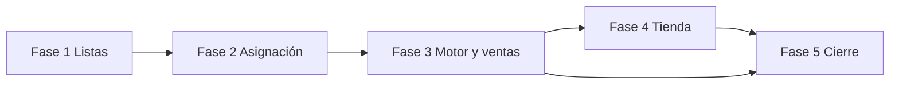

# Tasks: Listas de precios por cliente (MSF-442 / F-PRE-14 y MSF-453 / F-CLI-21)

**Spec**: [`spec.md`](./spec.md) · **Plan**: [`plan.md`](./plan.md) · Formato: `- [ ] T001 [P] [HISTORIA][USy] descripción — evidencia`.
Cada RF/SC tiene una tarea dueña y su verificación nombrada (tabla «Verificación por requisito» de `spec.md`). **Al cerrar cada fase ninguna tarea queda `[ ]`**: se hace con evidencia o se cierra con `Desvío: <motivo>` y un seguimiento trazado (regla de `CLAUDE.md`). Se implementa **fase por fase** (`/speckit-implement` con filtro de fase y `/clear` entre fases). Las migraciones usan la ventana `20270340000000+` y se renumeran al integrar.

## Matriz de trazabilidad (tracker ↔ US ↔ tasks)

| Tracker | Historia | US | RF / SC dueños | Tareas |
|---|---|---|---|---|
| MSF-442 (hija de MSF-373) | F-PRE-14 | US1 | RF-PRE-14-1…6, RF-LP-1…3, SC-003 | T001–T008 |
| MSF-453 (hija de MSF-450) | F-CLI-21 | US2 | RF-CLI-21-1…6, 8, SC-001 | T009–T019 |
| MSF-453 | F-CLI-21 | US2 | RF-CLI-21-7, SC-002 | T020–T022 |
| Tarea de cierre (label cierre) | — | — | docs, roadmap, seguridad, encendido y guards | T023–T027 |

## Phase 1: F-PRE-14 · Listas de precios (US1) — sin efecto en precios

- [ ] T001 [F-PRE-14][US1] Migración `20270340000000_listas_precios.sql`: tabla `dominio.listas_precios`, checks (ajuste −90…+100 con 2 decimales, nombre y descripción), índice único por organización sin mayúsculas, RLS, grants exactos, bandera `listas_precios` apagada (dueña de RF-PRE-14-1, RF-LP-1, RF-LP-2). Evidencia: pgTAP `listas_precios.test.sql` (estructura, topes, unicidad, grants) en dev dentro de `begin … rollback`.
- [ ] T002 [F-PRE-14][US1] RPC `guardar_lista_precios`, `archivar_lista_precios`, `restaurar_lista_precios` (`security definer`, `search_path = ''`, solo Administrador, bloqueo optimista, `55000` con bandera apagada salvo archivar, archivar bloqueado con clientes asignados, eventos de Actividad con valor anterior y nuevo) y vista `public.listas_precios_resumen` (dueña de RF-PRE-14-2, 3, 4, 6). Evidencia: pgTAP `listas_precios.test.sql` y `listas_precios_bandera.test.sql`.
- [ ] T003 [P] [F-PRE-14][US1] Aislamiento y seguridad: aislamiento entre organizaciones, `anon` sin privilegios, `search_path`, sin política `DELETE`, `rls_en_toda_tabla` y `privilegios_anon_endurecidos` verdes con la tabla nueva (dueña de RF-LP-1, RF-LP-3, SC-003). Evidencia: pgTAP `listas_precios.test.sql` + los dos existentes.
- [ ] T004 [F-PRE-14][US1] Migración `20270340000100_exportacion_total_listas_precios.sql` y prueba: la tabla entra a la exportación total (dueña de RF-CLI-21-8 parte base). Evidencia: pgTAP `exportacion_total.test.sql` extendido.
- [ ] T005 [F-PRE-14][US1] Pantalla Productos → Listas de precios (`pages/productos/listas-de-precios.tsx`, `lib/listasPrecios.ts`, hooks): tabla con carga infinita, diálogo crear/editar con ejemplo ilustrativo, archivar/restaurar, estados compartidos, aviso de bandera apagada, ruta lazy y destino de menú en Productos (dueña de RF-PRE-14-5, CA-PRE-14-1…5, CA-PRE-14-7). Evidencia: Vitest `listas-de-precios.test.tsx` (axe a 320/768/1440 px, solo administrador, bandera apagada).
- [ ] T006 [P] [F-PRE-14][US1] Fila «Empresa activa»: test de Vitest que cambia la empresa activa con la pantalla de listas abierta y verifica que no se recarga ni se pierde lo escrito (declaración «no aplica» de la matriz). Evidencia: `listas-de-precios.test.tsx`.
- [ ] T007 [P] [F-PRE-14][US1] Etiquetas de los eventos `lista_precios.*` en Actividad y ayuda de la pantalla (cobertura de ayuda). Evidencia: Vitest de Actividad y `ayuda-cobertura.test.ts`.
- [ ] T008 [F-PRE-14][US1] Guards de la fase: `node scripts/verificar-migraciones.mjs --estricto`, `pnpm docs:check`, `pnpm ui:empresas:check`, `pnpm matriz:check`, `pnpm der:check`, `tsc -b`, lint. Evidencia: salida de cada comando.

**Checkpoint F-PRE-14**: un administrador crea, edita, archiva y restaura listas; nada cambia todavía en ningún precio ni en ninguna venta.

## Phase 2: F-CLI-21 · Asignar una lista al cliente (US2) — sin efecto en precios

- [ ] T009 [F-CLI-21][US2] Migración `20270340000200_clientes_lista_precio.sql`: columna `clientes.lista_precio_id`, FK compuesta e índice, disparador defensivo (Consumidor final, archivada, ajena), sin `grant update` de la columna (dueña de RF-CLI-21-1). Evidencia: pgTAP `clientes_lista_precios.test.sql` (estructura, FK, grants).
- [ ] T010 [F-CLI-21][US2] RPC `asignar_lista_precios_cliente` (solo Administrador, idempotente, evento `cliente.lista_precio_asignada` con anterior y nueva, `55000` con bandera apagada salvo quitar) y conteo de clientes en `listas_precios_resumen` (dueña de RF-CLI-21-2, CA-CLI-21-1, 7, 8, 11). Evidencia: pgTAP `clientes_lista_precios.test.sql`.
- [ ] T011 [F-CLI-21][US2] Campo «Lista de precios» en la ficha del cliente (`FormularioCliente.tsx`, `pages/clientes/show.tsx`): selector de listas activas, solo lectura para no administradores, porcentaje visible y aviso cuando también hay descuento personal (dueña de RF-CLI-21-3, CA-CLI-21-1, 4, 11). Evidencia: Vitest `FormularioCliente.test.tsx` y `show.test.tsx` (axe incluido).
- [ ] T012 [P] [F-CLI-21][US2] Fusión de clientes: el cliente conservado mantiene su lista y la vista previa de la fusión avisa si difieren (caso borde). Evidencia: pgTAP de `fusion_clientes` extendido.
- [ ] T013 [F-CLI-21][US2] Guards de la fase (los de T008). Evidencia: salida de cada comando.

**Checkpoint F-CLI-21 (asignación)**: un administrador asigna y quita listas en la ficha del cliente; los precios siguen intactos.

## Phase 3: Motor de precio y ventas (US2) — único cambio de lo que se cobra, detrás de la bandera

- [ ] T014 [F-CLI-21][US2] Migración `20270340000300_lineas_snapshot_lista_precios.sql`: columnas `lista_precio_id` y `lista_ajuste_pct` en `dominio.comprobantes_venta_lineas` (dueña de RF-CLI-21-5, D12). Evidencia: pgTAP `ventas_lista_precios.test.sql` (estructura).
- [ ] T015 [F-CLI-21][US2] Migración `20270340000400_motor_precio_lista_cliente.sql`: `private.lista_precios_cliente`, extensión de `precio_para_calculo` y de `precio_linea_venta(_calculo)` con la precedencia D5–D7 (columnas nuevas al final, sin lista = resultado idéntico, USD y redondeo por tienda) (dueña de RF-CLI-21-4, SC-001). Evidencia: pgTAP `precio_lista_cliente.test.sql` (cada combinación: manual, escala, propio, lista, sin lista, descuento personal, promoción menor/igual/mayor, bandera apagada) y `ventas_precio_promocional_paridad.test.sql` verde.
- [ ] T016 [F-CLI-21][US2] Migración `20270340000500_ventas_usan_lista_precios.sql`: `guardar_lineas_comprobante`, `copiar_presupuesto` y la validación de `confirmar_comprobante` usan la lista y guardan el snapshot; notas de crédito reutilizan el snapshot (dueña de RF-CLI-21-5, CA-CLI-21-2…6). Evidencia: pgTAP `ventas_lista_precios.test.sql` y los de `ventas_*` y `ventas_precio_promocional*` existentes.
- [ ] T017 [F-CLI-21][US2] Marca «Lista: nombre ±n %» en el comprobante en edición (dueña de RF-CLI-21-6, CA-CLI-21-9). Evidencia: Vitest del comprobante (axe incluido).
- [ ] T018 [P] [F-CLI-21][US2] Paridad con lo vigente: sin lista o con la bandera apagada, los precios coinciden con una copia del cálculo anterior para una muestra de productos, tiendas, tipos de cliente y cantidades (dueña de CA-CLI-21-6). Evidencia: `precio_lista_cliente.test.sql` (bloque de paridad).
- [ ] T019 [F-CLI-21][US2] Guards de la fase (los de T008) y revisión de las funciones redefinidas contra la última versión de `dokploy` (rebasar si otra rama las tocó). Evidencia: salida y nota de revisión.

**Checkpoint Motor**: con la bandera encendida en dev, un cliente con lista compra al precio de su lista; con la bandera apagada, todo es idéntico a hoy.

## Phase 4: Tienda con cuenta web (US2)

- [ ] T020 [F-CLI-21][US2] Migración `20270340000600_tienda_precios_lista_cliente.sql`: `publico.precios_cliente_por_dominio` y el motor del presupuesto de la tienda (`validar_items_pedido`, favoritos) usan la lista de la cuenta web activa; misma firma y lista blanca (dueña de RF-CLI-21-7). Evidencia: pgTAP `precios_cliente.test.sql` extendido (estados de cuenta, visitante, lista blanca).
- [ ] T021 [F-CLI-21][US2] Paridad mostrador↔tienda: mismo cliente, producto y tienda dan el mismo precio en ambos caminos (dueña de SC-002, CA-CLI-21-10). Evidencia: pgTAP `precio_lista_tienda_paridad.test.sql`.
- [ ] T022 [P] [F-CLI-21][US2] Ficha de producto de la tienda: «Tu precio» con lista; las tarjetas del catálogo no cambian. Evidencia: Vitest `ficha-precios-cliente.test.tsx` y `TarjetaProducto.test.tsx`.

**Checkpoint Tienda**: el cliente con cuenta web ve y pide al precio de su lista; el visitante ve el precio público.

## Phase 5: Cierre

- [ ] T023 [CIERRE] Documentación en `docs/`: `listas-de-precios.md`, `producto/listas-de-precios.md`, actualizar `precios.md`, `precios-escalas.md`, `promociones-precio.md`, `clientes.md`, `cuentas-y-compras-a-proveedores.md`, `actividad.md`, `deployment.md` (bandera), `permisos-por-rol.md` y `mkdocs.yml`; retirar «cancelada» de F-PRE-14 en `docs/` y en las specs `20261105-100000-cotizacion-sugerida-y-mayoristas` y `20261029-100000-cuentas-y-compras-a-proveedores`. Evidencia: `pnpm docs:check` verde.
- [ ] T024 [CIERRE] `docs/roadmap-template.md` (filas F-PRE-14 y F-CLI-21) y revisión de seguridad integral (RLS, `anon`, `security definer`, grants, aislamiento, lista blanca de la tienda) en `docs/revision-seguridad-listas-de-precios.md`. Evidencia: documento y fila del roadmap.
- [ ] T025 [CIERRE] Encendido de la bandera `listas_precios` en dev (por SQL, por el equipo técnico) y verificación en dev del recorrido completo: lista → cliente → comprobante → confirmar → nota de crédito → tienda (comprobar el bundle y la función desplegados antes de decir «está en dev»). Stg y prd quedan apagadas hasta que Nicolás las autorice. Evidencia: acta de verificación en dev.
- [ ] T026 [CIERRE] Seguimientos trazados de lo que quedó fuera: asignación masiva, exportar la lista en la planilla de clientes, analítica por lista, listas por tienda o por tipo de cliente (Tarea `seguimiento` por cada una que Nicolás quiera).
- [ ] T027 [CIERRE] Guards finales: `verificar-migraciones --estricto`, `docs:check`, `matriz:check`, `der:check`, `prototipo:check`, `ui:empresas:check`, commitlint, `tsc -b`, lint y `vite build`. Evidencia: resultados en el informe de cierre.

## Plan de ejecución (fases)

| Fase | Depende de | Qué entrega | Riesgo en precios |
|---|---|---|---|
| 1 · Listas | — | Tabla, RPC, pantalla | Ninguno |
| 2 · Asignación | 1 | Columna, RPC, ficha | Ninguno |
| 3 · Motor y ventas | 1, 2 | Precedencia, snapshot, marca | **Sí**, detrás de la bandera |
| 4 · Tienda | 3 | Presupuesto y «Tu precio» | **Sí**, detrás de la bandera |
| 5 · Cierre | 1–4 | Docs, seguridad, encendido en dev | — |

Las fases comparten el motor de precio, así que **no** se paralelizan. Las fases 1 y 2 no tocan funciones de precio y pueden mergearse antes de decidir las dudas de precedencia; la 3 es la que Nicolás debe aprobar con las decisiones D3, D5, D6 y D7 a la vista.
