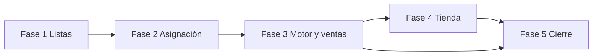

# Tasks: Listas de precios por cliente (MSF-442 / F-PRE-14 y MSF-453 / F-CLI-21)

**Spec**: [`spec.md`](./spec.md) · **Plan**: [`plan.md`](./plan.md) · Formato: `- [x] T001 [P] [HISTORIA][USy] descripción — evidencia`. **Hecho**: migración `20270340000000_listas_precios.sql` (tabla en `dominio`, checks, índice único sin mayúsculas, RLS de lectura por organización y sección `clientes`/`ventas`, grants exactos, bandera apagada, eventos de Actividad). pgTAP `listas_precios.test.sql` (77 pruebas, verde en dev dentro de `begin … rollback`).
Cada RF/SC tiene una tarea dueña y su verificación nombrada (tabla «Verificación por requisito» de `spec.md`). **Al cerrar cada fase ninguna tarea queda `[ ]`**: se hace con evidencia o se cierra con `Desvío: <motivo>` y un seguimiento trazado (regla de `CLAUDE.md`). Se implementa **fase por fase** (`/speckit-implement` con filtro de fase y `/clear` entre fases). Las migraciones de las Fases 1 y 2 usan la ventana `20270340000000+`; las de las Fases 3 y 4 usan `20270348000000+` (reservada, mayor que todo lo mergeado y que las ventanas en vuelo de opiniones, newsletter, gastos y seguridad) y se renumeran si hace falta al integrar.

## Matriz de trazabilidad (tracker ↔ US ↔ tasks)

| Tracker | Historia | US | RF / SC dueños | Tareas |
|---|---|---|---|---|
| MSF-442 (hija de MSF-373) | F-PRE-14 | US1 | RF-PRE-14-1…6, RF-LP-1…3, SC-003 | T001–T008 |
| MSF-453 (hija de MSF-450) | F-CLI-21 | US2 | RF-CLI-21-1…6, 8, SC-001 | T009–T019 |
| MSF-453 | F-CLI-21 | US2 | RF-CLI-21-7, SC-002 | T020–T022 |
| Tarea de cierre (label cierre) | — | — | docs, roadmap, seguridad, encendido y guards | T023–T027 |

## Phase 1: F-PRE-14 · Listas de precios (US1) — sin efecto en precios

- [ ] T001 [F-PRE-14][US1] Migración `20270340000000_listas_precios.sql`: tabla `dominio.listas_precios`, checks (ajuste −90…+100 con 2 decimales, nombre y descripción), índice único por organización sin mayúsculas, RLS, grants exactos, bandera `listas_precios` apagada (dueña de RF-PRE-14-1, RF-LP-1, RF-LP-2). Evidencia: pgTAP `listas_precios.test.sql` (estructura, topes, unicidad, grants) en dev dentro de `begin … rollback`.
- [x] T002 [F-PRE-14][US1] RPC `guardar_lista_precios`, `archivar_lista_precios`, `restaurar_lista_precios` (`security definer`, `search_path = ''`, solo Administrador, bloqueo optimista, `55000` con bandera apagada salvo archivar, archivar bloqueado con clientes asignados, eventos de Actividad con valor anterior y nuevo) y vista `public.listas_precios_resumen` (dueña de RF-PRE-14-2, 3, 4, 6). Evidencia: pgTAP `listas_precios.test.sql` y `listas_precios_bandera.test.sql`. **Hecho**: RPC `guardar_lista_precios`, `archivar_lista_precios`, `restaurar_lista_precios` y vista `listas_precios_resumen` en la misma migración; el conteo de clientes de la Fase 1 es `private.cantidad_clientes_lista` (0 hasta la Fase 2, que la redefine). pgTAP `listas_precios.test.sql` y `listas_precios_bandera.test.sql` (14 pruebas), verdes en dev.
- [x] T003 [P] [F-PRE-14][US1] Aislamiento y seguridad: aislamiento entre organizaciones, `anon` sin privilegios, `search_path`, sin política `DELETE`, `rls_en_toda_tabla` y `privilegios_anon_endurecidos` verdes con la tabla nueva (dueña de RF-LP-1, RF-LP-3, SC-003). Evidencia: pgTAP `listas_precios.test.sql` + los dos existentes. **Hecho**: aislamiento entre organizaciones, `anon` sin privilegios, `search_path` vacío, sin política de escritura ni `DELETE`, topes del porcentaje: `listas_precios.test.sql`; `rls_en_toda_tabla` (5) y `privilegios_anon_endurecidos` (9) verdes en dev con la migración aplicada.
- [x] T004 [F-PRE-14][US1] Migración `20270340000100_exportacion_total_listas_precios.sql` y prueba: la tabla entra a la exportación total (dueña de RF-CLI-21-8 parte base). Evidencia: pgTAP `exportacion_total.test.sql` extendido. **Hecho**: migración `20270340000100_exportacion_total_listas_precios.sql` (redefine `private.conjuntos_exportacion_total()` sobre `20270322100200` con la fila nueva) y prueba agregada a `exportacion_total.test.sql` (46 pruebas, verde en dev); `lista_precio_id` de `clientes` entra solo porque las columnas se leen del catálogo.
- [x] T005 [F-PRE-14][US1] Pantalla Productos → Listas de precios (`pages/productos/listas-de-precios.tsx`, `lib/listasPrecios.ts`, hooks): tabla con carga infinita, diálogo crear/editar con ejemplo ilustrativo, archivar/restaurar, estados compartidos, aviso de bandera apagada, ruta lazy y destino de menú en Productos (dueña de RF-PRE-14-5, CA-PRE-14-1…5, CA-PRE-14-7). Evidencia: Vitest `listas-de-precios.test.tsx` (axe a 320/768/1440 px, solo administrador, bandera apagada). **Hecho**: `pages/productos/listas-de-precios.tsx`, `lib/listasPrecios.ts`, hooks `useListarListasPrecios`/`useBanderaListasPrecios`, `components/listasPrecios/FormularioListaPrecios.tsx`, ruta lazy `/productos/listas-de-precios` y destino «Listas de precios» del menú Catálogo (audiencia administrador, sección `productos`). Vitest `listas-de-precios.test.tsx` (carga infinita con «Cargar más», alta y edición con bloqueo optimista, archivar/restaurar, solo administrador, bandera apagada, estados y axe a 320/768/1440 px). **Desvío menor**: el menú Productos de la spec es el grupo «Catálogo» (donde viven Productos y Promociones).
- [x] T006 [P] [F-PRE-14][US1] Fila «Empresa activa»: test de Vitest que cambia la empresa activa con la pantalla de listas abierta y verifica que no se recarga ni se pierde lo escrito (declaración «no aplica» de la matriz). Evidencia: `listas-de-precios.test.tsx`. **Hecho**: el último caso de `listas-de-precios.test.tsx` cambia la empresa activa con el diálogo abierto y verifica que no recarga ni pierde lo escrito.
- [x] T007 [P] [F-PRE-14][US1] Etiquetas de los eventos `lista_precios.*` en Actividad y ayuda de la pantalla (cobertura de ayuda). Evidencia: Vitest de Actividad y `ayuda-cobertura.test.ts`. **Hecho**: etiquetas de los cinco eventos en `lib/actividad.ts` (`lista_precios.*` y `cliente.lista_precio_asignada`) con su prueba en `lib/actividad.test.ts`; ayuda `listas-precios` en `ayuda/contenidos/catalogo.ts` y página del manual en `ayuda/manualPorDestino.ts` (`ayuda-cobertura.test.ts` y `manual.test.ts` verdes).
- [x] T008 [F-PRE-14][US1] Guards de la fase: `node scripts/verificar-migraciones.mjs --estricto`, `pnpm docs:check`, `pnpm ui:empresas:check`, `pnpm matriz:check`, `pnpm der:check`, `tsc -b`, lint. Evidencia: salida de cada comando. **Hecho**: `node scripts/verificar-migraciones.mjs --estricto` OK (689 archivos, 4 nuevos, todos mayores que la cola de `dokploy`), `docs:check` OK, `ui:empresas:check` OK, `matriz:check` OK, `prototipo:check` OK, `tsc --noEmit -p tsconfig.app.json` sin errores, Vitest de las pantallas tocadas verde; `der:check` falla por 139 specs históricas sin DER (la spec de listas figura «DER OK»), igual que en `dokploy`.

**Checkpoint F-PRE-14**: un administrador crea, edita, archiva y restaura listas; nada cambia todavía en ningún precio ni en ninguna venta.

## Phase 2: F-CLI-21 · Asignar una lista al cliente (US2) — sin efecto en precios

- [x] T009 [F-CLI-21][US2] Migración `20270340000200_clientes_lista_precio.sql`: columna `clientes.lista_precio_id`, FK compuesta e índice, disparador defensivo (Consumidor final, archivada, ajena), sin `grant update` de la columna (dueña de RF-CLI-21-1). Evidencia: pgTAP `clientes_lista_precios.test.sql` (estructura, FK, grants). **Hecho**: migración `20270340000200_clientes_lista_precio.sql`: columna, FK compuesta `(lista_precio_id, organizacion_id)`, índice parcial, disparador defensivo (Consumidor final, archivada) y sin `grant insert/update` de la columna. pgTAP `clientes_lista_precios.test.sql` (56 pruebas, verde en dev).
- [x] T010 [F-CLI-21][US2] RPC `asignar_lista_precios_cliente` (solo Administrador, idempotente, evento `cliente.lista_precio_asignada` con anterior y nueva, `55000` con bandera apagada salvo quitar) y conteo de clientes en `listas_precios_resumen` (dueña de RF-CLI-21-2, CA-CLI-21-1, 7, 8, 11). Evidencia: pgTAP `clientes_lista_precios.test.sql`. **Hecho**: RPC `asignar_lista_precios_cliente` (solo Administrador, idempotente, evento `cliente.lista_precio_asignada` con anterior y nueva, `55000` salvo quitar) y conteo real en `listas_precios_resumen`; archivar con clientes asignados responde `23503`. pgTAP `clientes_lista_precios.test.sql`.
- [x] T011 [F-CLI-21][US2] Campo «Lista de precios» en la ficha del cliente (`FormularioCliente.tsx`, `pages/clientes/show.tsx`): selector de listas activas, solo lectura para no administradores, porcentaje visible y aviso cuando también hay descuento personal (dueña de RF-CLI-21-3, CA-CLI-21-1, 4, 11). Evidencia: Vitest `FormularioCliente.test.tsx` y `show.test.tsx` (axe incluido). **Hecho**: campo «Lista de precios» en `FormularioCliente.tsx` (editar: selector de listas activas con su porcentaje, solo lectura para no administradores, aviso de que no se acumula con el descuento personal, solo se puede quitar con la bandera apagada), `pages/clientes/edit.tsx` (asigna por RPC antes de guardar la ficha) y `pages/clientes/show.tsx` (solo lectura + aviso). Vitest `FormularioCliente.test.tsx`, `edit.test.tsx` y `show.test.tsx` (axe a 320/768/1440 px). **Desvío**: el alta de cliente no ofrece el campo (la columna no se escribe en `INSERT`; se asigna al editar).
- [x] T012 [P] [F-CLI-21][US2] Fusión de clientes: el cliente conservado mantiene su lista y la vista previa de la fusión avisa si difieren (caso borde). Evidencia: pgTAP de `fusion_clientes` extendido. **Hecho**: migración `20270340000210_fusion_clientes_lista_precio.sql`: `fusionar_clientes` descarta la lista del absorbido y `vista_previa_fusion_clientes` devuelve la lista de cada ficha (el diálogo avisa si difieren). Probado en `clientes_lista_precios.test.sql`; `fusion_clientes.test.sql` (29) sigue verde en dev. **Desvío**: la prueba vive en el pgTAP de la fase y no se extendió `fusion_clientes.test.sql`.
- [x] T013 [F-CLI-21][US2] Guards de la fase (los de T008). Evidencia: salida de cada comando. **Hecho**: los guards de T008, corridos tras terminar la fase.

**Checkpoint F-CLI-21 (asignación)**: un administrador asigna y quita listas en la ficha del cliente; los precios siguen intactos.

## Phase 3: Motor de precio y ventas (US2) — único cambio de lo que se cobra, detrás de la bandera

- [x] T014 [F-CLI-21][US2] Migración `20270348000000_lineas_snapshot_lista_precios.sql`: columnas `lista_precio_id` y `lista_ajuste_pct` en `dominio.comprobantes_venta_lineas` (dueña de RF-CLI-21-5, D12). Evidencia: pgTAP `ventas_lista_precios.test.sql` (estructura). **Hecho**: migración `20270348000000_lineas_snapshot_lista_precios.sql`: columnas `lista_precio_id` y `lista_ajuste_pct` (check de que van juntas y de los topes, FK compuesta sin cascada, índice parcial); sin `grant` nuevo (mismos privilegios que `precio_referencia`, comprobado). pgTAP `ventas_lista_precios.test.sql` (bloque de estructura), verde en dev dentro de `begin … rollback`.
- [x] T015 [F-CLI-21][US2] Migración `20270348000100_motor_precio_lista_cliente.sql`: `private.lista_precios_cliente`, extensión de `precio_para_calculo` y de `precio_linea_venta(_calculo)` con la precedencia D5–D7 (columnas nuevas al final, sin lista = resultado idéntico, USD y redondeo por tienda) (dueña de RF-CLI-21-4, SC-001). Evidencia: pgTAP `precio_lista_cliente.test.sql` (cada combinación: manual, escala, propio, lista, sin lista, descuento personal, promoción menor/igual/mayor, bandera apagada) y `ventas_precio_promocional_paridad.test.sql` verde. **Hecho**: migración `20270348000100_motor_precio_lista_cliente.sql`: `private.lista_precios_cliente` (única lectura de la bandera y de la lista), `precio_para_calculo`, `precio_linea_venta_calculo` y `precio_linea_venta` con parámetro `p_cliente` (default null) y las columnas de la lista al final; precedencia D3/D5/D6/D7. Las definiciones de partida se comprobaron IGUALES a las vivas de dev (sin deriva). pgTAP `precio_lista_cliente.test.sql` (97 pruebas, verde): paridad contra una copia congelada del cálculo anterior sobre 1.280 casos con la bandera apagada y 480 con clientes sin lista (promociones encendidas y apagadas) y cada regla de precedencia con valores a mano. `ventas_precio_promocional_paridad.test.sql` verde (48). **Desvío**: cambia la firma (parámetro y columnas nuevas): se borra la firma vieja para no dejar una sobrecarga ambigua y se actualizaron las firmas citadas en `precio_sin_sesion.test.sql` y `ventas_precio_promocional.test.sql`.
- [x] T016 [F-CLI-21][US2] Migración `20270348000200_ventas_usan_lista_precios.sql`: `guardar_lineas_comprobante`, `copiar_presupuesto` y la validación de `confirmar_comprobante` usan la lista y guardan el snapshot; notas de crédito reutilizan el snapshot (dueña de RF-CLI-21-5, CA-CLI-21-2…6). Evidencia: pgTAP `ventas_lista_precios.test.sql` y los de `ventas_*` y `ventas_precio_promocional*` existentes. **Hecho**: migración `20270348000200_ventas_usan_lista_precios.sql`: `guardar_lineas_comprobante`, `copiar_presupuesto`, `obtener_comprobante` (suma `lista_ajuste_pct` y `lista_nombre`), `copiar_costo_linea_nota` (las notas heredan el snapshot) y `lineas_con_promocion_desactualizada` (la guarda de `confirmar_comprobante` compara con la lista y rechaza si el snapshot de lista ya no coincide con el motor; pgTAP en `ventas_lista_precios.test.sql`; `confirmar_comprobante` no se reescribe). pgTAP `ventas_lista_precios.test.sql` (65 pruebas, verde) y los de `ventas_*` y `ventas_precio_promocional*` existentes con el mismo resultado que antes de la migración (las fallas de dev con las banderas sembradas son idénticas con y sin ella).
- [x] T017 [F-CLI-21][US2] Marca «Lista: nombre ±n %» en el comprobante en edición (dueña de RF-CLI-21-6, CA-CLI-21-9). Evidencia: Vitest del comprobante (axe incluido). **Hecho**: marca «Lista: nombre ±n %» bajo el precio de la línea (`LineasComprobante.tsx`, `marcaListaLinea` en `lib/ventasLineas.ts`) y en el detalle del mostrador; sin lista no aparece nada. Vitest `LineasComprobante.test.tsx` (con axe a 320/768/1440 px) y `ventasLineas.test.ts`.
- [x] T018 [P] [F-CLI-21][US2] Paridad con lo vigente: sin lista o con la bandera apagada, los precios coinciden con una copia del cálculo anterior para una muestra de productos, tiendas, tipos de cliente y cantidades (dueña de CA-CLI-21-6). Evidencia: `precio_lista_cliente.test.sql` (bloque de paridad). **Hecho**: bloque de paridad de `precio_lista_cliente.test.sql`: con la bandera apagada el precio de línea y `precio_para_calculo` son idénticos a una copia del cálculo anterior en 1.280 casos (10 productos × 2 tiendas × 8 clientes × 8 cantidades, incluidos clientes con lista asignada); con la bandera encendida, idénticos para los clientes sin lista; ninguna línea devuelve lista sin lista o con la bandera apagada. `precio_sin_sesion.test.sql` (grilla contra la función original) también verde.
- [x] T019 [F-CLI-21][US2] Guards de la fase (los de T008) y revisión de las funciones redefinidas contra la última versión de `dokploy` (rebasar si otra rama las tocó). Evidencia: salida y nota de revisión. **Hecho**: guards: `node scripts/verificar-migraciones.mjs --estricto` OK, `verificar-documentacion-cambios` OK, `ui:empresas` OK, `matriz` OK, `prototipo` OK, `tsc --noEmit -p tsconfig.app.json` sin errores. Revisión contra `dokploy`: los cuerpos de partida de las 10 funciones redefinidas se compararon contra la definición VIVA de dev (normalizados, iguales) y contra la última migración que las define; `obtener_comprobante` parte de `20270322100600` (no de `20270310100200`). Al integrar, rebasar si otra rama las toca.

**Checkpoint Motor**: con la bandera encendida en dev, un cliente con lista compra al precio de su lista; con la bandera apagada, todo es idéntico a hoy.

## Phase 4: Tienda con cuenta web (US2)

- [x] T020 [F-CLI-21][US2] Migración `20270348000300_tienda_precios_lista_cliente.sql`: `publico.precios_cliente_por_dominio` y el motor del presupuesto de la tienda (`validar_items_pedido`, favoritos) usan la lista de la cuenta web activa; misma firma y lista blanca (dueña de RF-CLI-21-7). Evidencia: pgTAP `precios_cliente.test.sql` extendido (estados de cuenta, visitante, lista blanca). **Hecho**: migración `20270348000300_tienda_precios_lista_cliente.sql`: `private.precio_final_publico_escala` (+ `p_cliente`), `publico.precios_cliente_por_dominio`, `publico.mis_favoritos_por_dominio`, `private.motor_presupuesto_tienda` (devuelve la lista al final) y `publico.crear_presupuesto_tienda` (guarda el snapshot); misma lista blanca. `validar_items_pedido` no calcula precios y no se toca. pgTAP `precio_lista_tienda_paridad.test.sql` (35 pruebas: estados de cuenta, visitante, lista blanca, bandera apagada). **Desvío**: las pruebas viven en el archivo nuevo y no se extendió `precios_cliente.test.sql`; `tienda_presupuesto_cliente.test.sql` (182) y `tienda_favoritos.test.sql` (115) siguen verdes (a la primera se le actualizó el motor de reemplazo del caso M-3 con las columnas nuevas). **Fuera**: la lista de pedido («Enviar consulta») sigue mostrando el precio público de referencia (seguimiento MSF-969).
- [x] T021 [F-CLI-21][US2] Paridad mostrador↔tienda: mismo cliente, producto y tienda dan el mismo precio en ambos caminos (dueña de SC-002, CA-CLI-21-10). Evidencia: pgTAP `precio_lista_tienda_paridad.test.sql`. **Hecho**: pgTAP `precio_lista_tienda_paridad.test.sql`: 32 combinaciones producto × escala × tienda (con y sin IVA) de «Tu precio» contra el precio del mostrador, favoritos contra «Tu precio», y el presupuesto de la tienda contra el del panel línea por línea (precio, lista y descuento).
- [x] T022 [P] [F-CLI-21][US2] Ficha de producto de la tienda: «Tu precio» con lista; las tarjetas del catálogo no cambian. Evidencia: Vitest `ficha-precios-cliente.test.tsx` y `TarjetaProducto.test.tsx`. **Hecho**: sin código nuevo: la ficha ya muestra lo que devuelve `precios_cliente_por_dominio` (ahora con la lista) y las tarjetas del catálogo no reciben nada del cliente. Vitest `ficha-precios-cliente.test.tsx` (caso nuevo: cliente con lista, sin mencionar la lista, axe) y `TarjetaProducto.test.tsx` (caso nuevo: el catálogo conserva el precio público).

**Checkpoint Tienda**: el cliente con cuenta web ve y pide al precio de su lista; el visitante ve el precio público.

- [x] T026 [F-CLI-21][US2] Seguimientos reales de la revisión: **MSF-969** (la lista de pedido de la tienda, `precio_referencia_pedido`, muestra el precio público y puede diferir de «Tu precio» con lista) y **MSF-970** (la guarda de confirmación no veía la lista: resuelto en este PR con la comparación del snapshot; el ticket se cierra al mergear). Evidencia: tickets creados en ItsAPlan; pgTAP `ventas_lista_precios.test.sql` (guarda de lista, línea a $0) y extremos −90 % / +100 % en `precio_lista_cliente.test.sql`. La marca «Lista:» entra al prototipo (`VentasComprobante.dc.html`, con «(rige la promoción)» cuando gana la promoción) y a la ayuda de Comprobantes (`ayuda/contenidos/ventas.ts`; la de T023 de cierre debe citarla).

- [x] T027 [F-CLI-21][US2] Segunda revisión (menores): (a) la prueba de «bandera apagada después de guardar» apaga TAMBIÉN `promociones_precio` y se verificó con una mutación (la primera sentencia de la guarda devolviendo 0 con las dos banderas apagadas) que ahora falla; (b) nota de activación en `docs/precios.md` y `docs/deployment.md` (los borradores guardados antes de encender reciben un `40001` en su primera confirmación solo si el cliente tiene lista; re-guardar lo resuelve); (c) conteos reales de pgTAP (`plan` o `finish`): `precio_lista_cliente` 97, `ventas_lista_precios` 65, `precio_lista_tienda_paridad` 35, `precio_sin_sesion` 127, `ventas_precio_promocional_paridad` 48, `tienda_presupuesto_cliente` 182, `listas_precios` 78, `clientes_lista_precios` 60, `exportacion_total` 48; (d) el 22023 de la línea a $0 nombra el producto («El producto «X» (línea n) queda sin precio…»), con pgTAP y pruebas de UI en mostrador y comprobante; (e) pruebas de UI de la marca «Lista:» en el mostrador (con lista, con «(rige la promoción)» y sin lista); (f) el rechazo por lista usa el MISMO contrato (`40001`, hint `precios_cambiaron`) y agrega `detail = 'lista_precios'`: la UI muestra «El precio de la lista cambió: revisá el total y confirmá/cobrá de nuevo» (pgTAP del detail y Vitest del diálogo, el mostrador y `esCambioDeLista`). Las migraciones de las Fases 3 y 4 pasaron a `20270348000000` a `20270348000300` porque Opiniones ocupó `20270341…` en `dokploy`.

## Phase 5: Cierre

- [ ] T023 [CIERRE] Documentación en `docs/`: `listas-de-precios.md`, `producto/listas-de-precios.md`, actualizar `precios.md`, `precios-escalas.md`, `promociones-precio.md`, `clientes.md`, `cuentas-y-compras-a-proveedores.md`, `actividad.md`, `deployment.md` (bandera), `permisos-por-rol.md` y `mkdocs.yml`; retirar «cancelada» de F-PRE-14 en `docs/` y en las specs `20261105-100000-cotizacion-sugerida-y-mayoristas` y `20261029-100000-cuentas-y-compras-a-proveedores`. Evidencia: `pnpm docs:check` verde.
- [ ] T024 [CIERRE] `docs/roadmap-template.md` (filas F-PRE-14 y F-CLI-21) y revisión de seguridad integral (RLS, `anon`, `security definer`, grants, aislamiento, lista blanca de la tienda) en `docs/revision-seguridad-listas-de-precios.md`. Evidencia: documento y fila del roadmap.
- [ ] T025 [CIERRE] Encendido de la bandera `listas_precios` en dev (por SQL, por el equipo técnico) y verificación en dev del recorrido completo: lista → cliente → comprobante → confirmar → nota de crédito → tienda (comprobar el bundle y la función desplegados antes de decir «está en dev»). Stg y prd quedan apagadas hasta que Nicolás las autorice. Evidencia: acta de verificación en dev.
- [ ] T026 [CIERRE] Seguimientos trazados de lo que quedó fuera: asignación masiva, exportar la lista en la planilla de clientes, analítica por lista, listas por tienda o por tipo de cliente (Tarea `seguimiento` por cada una que Nicolás quiera).
- [ ] T027 [CIERRE] Guards finales: `verificar-migraciones --estricto`, `docs:check`, `matriz:check`, `der:check`, `prototipo:check`, `ui:empresas:check`, commitlint, `tsc -b`, lint y `vite build`. Evidencia: resultados en el informe de cierre.

## Plan de ejecución (fases)

| Fase | Depende de | Qué entrega | Riesgo en precios |
|---|---|---|---|
| 1 · Listas | — | Tabla, RPC, pantalla | Ninguno |
| 2 · Asignación | 1 | Columna, RPC, ficha | Ninguno |
| 3 · Motor y ventas | 1, 2 | Precedencia, snapshot, marca | **Sí**, detrás de la bandera |
| 4 · Tienda | 3 | Presupuesto y «Tu precio» | **Sí**, detrás de la bandera |
| 5 · Cierre | 1–4 | Docs, seguridad, encendido en dev | — |

Las fases comparten el motor de precio, así que **no** se paralelizan. Las fases 1 y 2 no tocan funciones de precio y pueden mergearse antes de decidir las dudas de precedencia; la 3 es la que Nicolás debe aprobar con las decisiones D3, D5, D6 y D7 a la vista.
