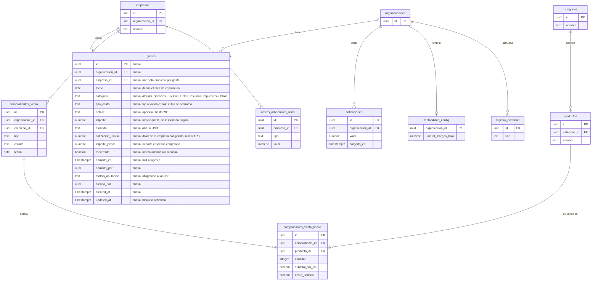
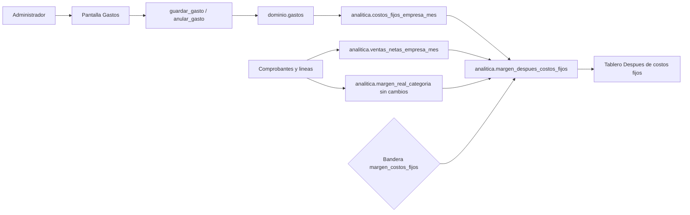
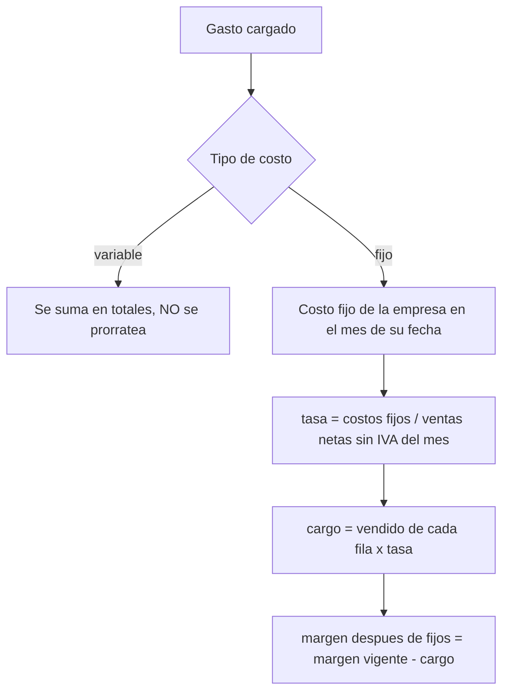
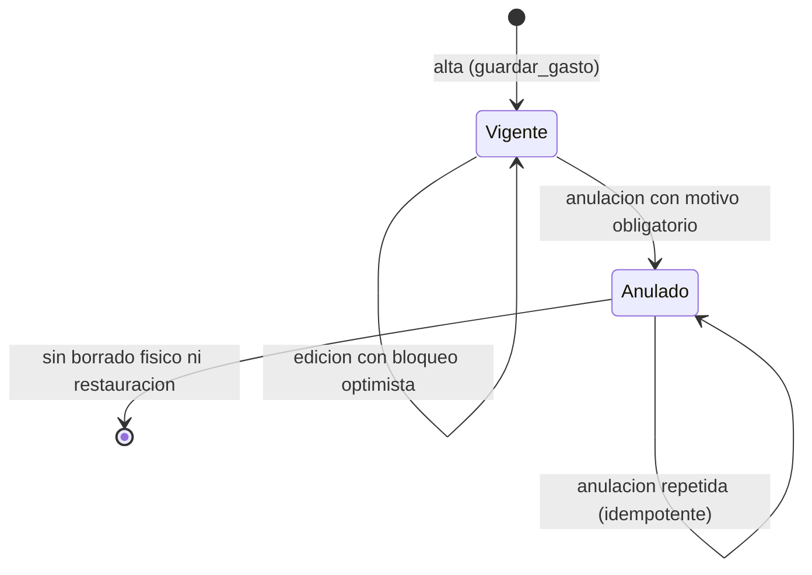
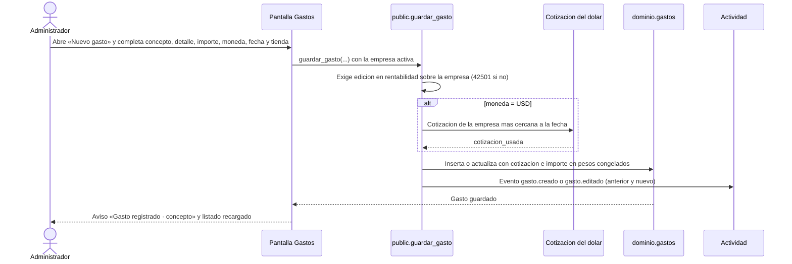

# Feature Specification: Gastos de la empresa y margen después de costos fijos (F-GAS-01…03)

**Épica**: MSF-469 (Plataforma · Gastos) · **Spec**: `gastos-de-la-empresa` · **Historias** (provisorias, la épica no tenía ninguna cargada): F-GAS-01 «Registrar gastos», F-GAS-02 «Consultar gastos por período y categoría», F-GAS-03 «Margen después de costos fijos» · **Prioridad**: P2 · **Hito**: Etapa 2 (desde enero de 2027)
**Alcance de entrega**: `refine`, `supabase` y `superset` (sin `kestra` ni `workers`: el prorrateo es SQL calculado al leer y el tablero lo sirve Superset).
**Estado**: spec redactada, **sin implementar**. No hay migraciones, funciones ni pantallas en este PR.
**Fuente**: decisión de Nicolás del 2026-11-15, el ticket MSF-469, el prototipo `design/pantallas/VentasGastos.dc.html`, `docs/rentabilidad.md`, `docs/tecnico/rentabilidad.md`, `docs/resumen-semanal-correo.md`, `docs/inicio-y-alertas.md`, `docs/configuracion-dolar-y-precio-propio.md`, las migraciones de `analitica.*` (`20270202201007`, `20270324100000`, `20270218500500`) y el código vigente de `dokploy` (migraciones hasta `20270326100000`).

## Objetivo

Que un **administrador** registre los **gastos generales** de cada empresa (alquiler, servicios, sueldos, etc.) y los consulte por **período y categoría** desde el panel, para **entender sus costos fijos**; y que, **si se enciende una bandera**, esos costos fijos se vean reflejados como una **medida nueva y separada**, «margen después de costos fijos», sin mover ninguno de los márgenes que el sistema calcula hoy.

## Decisión de negocio (Nicolás, 2026-11-15) y decisiones delegadas

**Decisión tomada por Nicolás**: «Gastos» son los gastos **generales** de una empresa, para entender sus **costos fijos**; esos costos fijos **impactarían** en el margen de los productos que esa empresa vende. Nicolás **no está seguro** de si impactan en otros lados además del margen. **Regla fijada**: el margen que se calcula hoy **no cambia**; el impacto es una **medida nueva y separada** detrás de una **bandera apagada por defecto**.

Todo lo que sigue **no estaba definido** y se resolvió con el criterio más simple que reutiliza el modelo vigente (rentabilidad real, costos adicionales del canal, cotización por empresa, sección `rentabilidad`). Cada fila es una **«Decisión (delegada)»** que Nicolás puede revisar; cambiar una no obliga a rehacer las demás salvo donde se indica.

| # | Decisión (delegada) | Motivo |
|---|---|---|
| D1 | **Qué es un gasto**: un registro de dinero que **una empresa** gastó para operar, con `fecha`, `importe`, `moneda` (ARS o USD), `categoría`, `detalle` (opcional, hasta 200), `tipo de costo` (fijo o variable), `recurrente` (sí/no) y **una sola empresa** (la «Tienda» del prototipo). No es un asiento contable, no tiene proveedor ni comprobante asociado. | Es lo que dibuja el prototipo (Fecha, Concepto, Detalle, Tienda, Importe) más lo mínimo para el prorrateo (moneda y tipo de costo). |
| D2 | **Categorías**: catálogo **cerrado** de 7, las del prototipo: Alquiler, Servicios, Sueldos, Fletes, Insumos, Impuestos, Otros. Sin pantalla para crear categorías propias. | Evita una pantalla de ABM más; el prototipo ya fija la lista. Si hace falta una nueva, es un cambio de `check` y de lista, no de modelo. |
| D3 | **Fijo vs variable** se guarda **en cada gasto** (`tipo_costo`), con un valor por omisión según la categoría que la persona puede cambiar: **fijo** = Alquiler, Servicios, Sueldos, Otros; **variable** = Fletes, Insumos, Impuestos. | Un alquiler es fijo y un flete depende de lo que se vende; «Impuestos» (p. ej. ingresos brutos) suele ser proporcional a la venta, por eso arranca variable. Se puede corregir gasto por gasto sin inventar una tabla de reglas. |
| D4 | **Solo los gastos FIJOS entran al prorrateo.** Los variables se registran, se suman en los totales y se muestran con su etiqueta, pero **no** se reparten sobre los productos. | El margen real ya descuenta el **costo** del producto y los **costos adicionales del canal** (F-REN-08: % y monto por unidad). Prorratear también los variables contaría dos veces el mismo costo. |
| D5 | **Período de imputación = el mes calendario de la `fecha` del gasto** (zona horaria de Buenos Aires). No hay campo «período» aparte: quien paga en noviembre las expensas de octubre pone fecha de octubre. | El prototipo tiene solo «Fecha». Un mes es el grano natural de los costos fijos y evita prorratear por día. |
| D6 | **Método de prorrateo: proporcional a las ventas netas sin IVA del mes de la misma empresa.** `tasa_fija(empresa, mes) = costos_fijos(empresa, mes) ÷ ventas_netas_sin_iva(empresa, mes)` y `cargo_fijo(línea del producto) = vendido × tasa_fija`. Fórmula y ejemplo numérico en «Prorrateo de costos fijos». | Reparte el costo en proporción a lo que cada producto aporta a la facturación; no castiga al producto barato como haría repartir por unidades (un cable de $ 500 cargaría lo mismo que una consola de $ 500.000). Consecuencia declarada: dentro de una empresa y un mes **todos los productos pierden los mismos puntos porcentuales de margen** (la tasa); lo que cambia entre productos es el importe. Repartir por unidades queda como alternativa (ver «Fuera de alcance»). |
| D7 | **Denominador = todas las ventas facturadas del mes de la empresa** (con el mismo predicado que el margen real: facturas y notas de crédito, no borradores, no anuladas), **incluidas las líneas sin costo guardado**; el cargo se aplica solo a las filas que el margen real ya muestra. La parte del costo fijo que le tocaría a las líneas sin costo **no se atribuye** y el tablero la muestra como «Sin atribuir». | La tasa tiene que ser honesta (costo fijo ÷ todo lo vendido). Atribuir todo a las filas con costo sobrecargaría a esos productos cuando faltan costos en el catálogo. |
| D8 | **Moneda**: se acepta ARS y USD. Un gasto en USD guarda `cotizacion_usada` = la cotización del dólar **de la empresa** (alcance «empresa» o «sistema», como la regla vigente `private.cotizacion_para`) **más cercana a la fecha del gasto** (la regla de la historia F-REN-07) e `importe_pesos` = importe × cotización, **congelados al guardar**. Sin cotización cargada, el alta se rechaza («Cargá la cotización del dólar»). Todos los totales y el prorrateo trabajan en `importe_pesos`. | Mismo criterio que el costo guardado en la línea de venta: un cambio posterior de cotización no reescribe lo ya cargado. No se inventa una cotización. |
| D9 | **Permisos**: se reutiliza la sección **`rentabilidad`** (no se crea una sección nueva). **Ver** gastos y la medida nueva requiere `lectura`; **cargar, editar y anular** requiere `edicion` (hoy, solo Administrador). Los costos son sensibles: nadie sin la sección ve ni el menú ni los importes, y ni el tablero ni Superset reciben el detalle de un gasto. | Los gastos pertenecen al mismo universo sensible que el costo y el margen, que ya se gobiernan con esa sección; el prototipo ubica «Gastos» solo para administradores. Una sección propia (`gastos`) es un cambio posible si un día se quiere separar a quien ve gastos de quien ve márgenes. |
| D10 | **Aislamiento**: por organización (RLS) **y por empresa**: una persona solo ve y carga gastos de las empresas a las que tiene acceso (`private.empresas_accesibles()`), igual que los costos adicionales del canal. | Evita que un administrador de una tienda lea los costos de otra. |
| D11 | **Edición y anulación, sin borrado físico.** Editar usa bloqueo optimista (`updated_at`). **Anular** marca el gasto (`anulado_en`, `anulado_por`, `motivo_anulacion` obligatorio, hasta 200) y deja de contar en totales y prorrateo; se puede ver con «Mostrar anulados». No hay `DELETE` ni restaurar. Cada alta, edición (nombres de los campos modificados, sin cifras: D19) y anulación deja un evento en Actividad. | «Sin borrado físico»: lo cargado por error se anula con motivo y queda la huella; un gasto mal anulado se vuelve a cargar. |
| D12 | **Recurrente = marca informativa mensual.** No genera gastos solos (sin workers ni Kestra). Se puede filtrar y se ve la insignia «Recurrente». Una acción «Repetir en este mes» es un seguimiento, no entra. | Un gasto que se genera solo es automatización con reglas de corte (mes sin días 29–31, cambio de monto) que no hace falta para entender los costos fijos. |
| D13 | **Carga masiva o importación: NO entra.** Un gasto se carga de a uno desde el diálogo. La **exportación** del listado filtrado (botón «Exportar» del prototipo) **sí** entra. La exportación total de la organización incluye `dominio.gastos`. | El volumen esperado es de decenas de gastos por mes; la importación abre validaciones (duplicados, mapeo de categorías) sin un caso real todavía. |
| D14 | **El impacto en márgenes es una medida NUEVA y separada.** Vista nueva `analitica.margen_despues_costos_fijos` (sobre `analitica.margen_real_categoria`, que no se modifica) con columnas `cargo_costos_fijos`, `margen_despues_fijos`, `margen_despues_fijos_pct` y su tablero propio en Rentabilidad. **Ninguna vista, tablero, RPC ni correo existente cambia su resultado.** Pruebas de paridad lo verifican. | Es la regla fijada por Nicolás: lo existente no se mueve. |
| D15 | **Bandera `margen_costos_fijos`, apagada por defecto en cada entorno** (`public.banderas_plataforma`, como `promociones_precio`). Apagada: la vista nueva **no devuelve filas**, la pestaña del tablero no se muestra y el resto del sistema es idéntico. Registrar y consultar gastos **no** depende de la bandera (no mueve ninguna cifra existente). Se enciende dev → stg → prd por SQL del equipo técnico. | Permite cargar gastos y mirarlos antes de decidir si se quiere ver el margen ajustado. |
| D16 | **Impactos incluidos (mínimo coherente)**: margen **por producto**, **por categoría** y **por tienda/consolidado**, todos como agregaciones de **la misma** vista nueva y mostrados en **una sola pestaña nueva** de Rentabilidad. Todo lo demás queda **fuera de alcance explícito** (tabla «Impactos posibles»). | Una sola vista y un solo tablero cubren los tres cortes sin tocar nada existente; el resto (correo, Inicio, comparativos, alertas) cambia lo que otras personas ya leen y merece decidirse aparte. |
| D17 | **UI**: el prototipo trae la pantalla `VentasGastos.dc.html`; se respeta y se declaran **adiciones mínimas** necesarias para los requisitos (moneda, tipo de costo, recurrente, tienda elegible en el diálogo, editar/anular, «Mostrar anulados»). Ver «Matriz pantalla↔criterios». | CLAUDE.md: el prototipo manda lo visible; lo que no dibuja y el requisito exige se declara, no se inventa en silencio. |
| D18 | **Gasto compartido entre empresas: fuera de alcance.** Un gasto es de **una** empresa; si un alquiler se comparte, se carga un gasto por empresa con su parte. | Repartir un gasto entre empresas exige un criterio de reparto adicional que Nicolás no definió. |
| D19 | **Actividad no lleva cifras de gastos.** Los eventos `gasto.creado\|editado\|anulado\|exportado` guardan en `detalle` y en el jsonb solo el concepto, el nombre de la empresa y, en la edición, los **nombres** de los campos modificados (`campos_modificados`); **nunca** el importe, la moneda, los pesos ni el motivo de anulación (el motivo vive en `dominio.gastos`, visible con `rentabilidad`). `exportar_gastos` con una empresa no accesible lanza `42501`. | Actividad se lee con la sección `actividad`, que no implica `rentabilidad` ni empresa accesible: un rol con Actividad y sin Rentabilidad leería cifras de gastos (hallazgo de seguridad). Decisión (delegada) de esta revisión; sustituye al «valor anterior y nuevo del importe» de RF-GAS-4/CA-GAS-5. |

## Impactos posibles de los costos fijos (y recomendación)

Nicolás no está seguro de dónde más impactan. Se enumeran y se recomienda el **mínimo coherente**: **I1 + I2 + I3** (una vista nueva, una pestaña nueva); el resto queda fuera y se puede pedir después sin rehacer nada.

| # | Impacto posible | Recomendación | Motivo |
|---|---|---|---|
| I1 | **Margen por producto** («margen después de costos fijos» por producto y tienda) | **ENTRA** (F-GAS-03) | Es la decisión de Nicolás. Medida nueva, flag apagada. |
| I2 | **Margen por categoría** | **ENTRA** (F-GAS-03) | Sin costo extra: `analitica.margen_real_categoria` ya trae la categoría; es la misma vista agrupada. |
| I3 | **Margen por tienda y consolidado** («resultado después de costos fijos» del mes) | **ENTRA** (F-GAS-03) | Es el corte que más se parece a «entender los costos fijos»: ventas − costo − costos adicionales − costos fijos, por empresa y mes. Misma vista agrupada. |
| I4 | **Reportes de rentabilidad existentes** (Resumen, Por producto, Comparativo, Historia, Ventas reales, umbral de margen bajo) | **NO cambian** | Regla fija de Nicolás. Solo se agrega una pestaña nueva. El umbral de «margen bajo» **no** se aplica a la medida nueva (la medida usa su propio estado informativo). |
| I5 | **Resumen semanal por correo (MSF-265)** | **FUERA** (seguimiento) | Es un correo que ya reciben los administradores con números concretos; mezclarle una cifra nueva y sensible (costos fijos) cambia un contenido ya acordado y su alcance de datos. Se decide cuando la medida esté probada en dev. |
| I6 | **Tablero de Inicio** (resumen por tienda, alertas) | **FUERA** | Inicio muestra ingresos y margen estimado con otros permisos por tienda; sumar costos fijos ahí cambia lo que ve cada rol. |
| I7 | **Comparativo e Historia por producto entre tiendas** | **FUERA** | Los costos fijos dependen del tamaño de cada tienda: compararlos entre tiendas **distorsiona** la lectura (una tienda chica siempre tendría más tasa). Mejor comparar el margen sin fijos, como hoy. |
| I8 | **Alertas de «producto con margen negativo después de fijos»** | **FUERA** | Requiere decidir umbrales y destinatarios; es notificación nueva. |
| I9 | **Precio sugerido o punto de equilibrio** (cuánto hay que vender para cubrir los fijos) | **FUERA** | Es una decisión de precios; toca el motor de precio. |
| I10 | **Rentabilidad por publicación de Mercado Libre** | **FUERA** | La pestaña ni existe todavía. |
| I11 | **Reportes de ventas** (`analitica.ventas_*`) | **No aplica** | No muestran costo ni margen. |

## Modelo y supuestos (verificados en el código de `dokploy`)

- **Margen real vigente**: `analitica.rentabilidad_ventas_real` (una fila por empresa × producto × fecha: `unidades`, `vendido` = Σ signo × `subtotal_sin_iva`, `costo` = Σ signo × cantidad × `costo_unitario` guardado en la línea, `costos_adicionales`, `margen`, `margen_pct`, `estado`) y `analitica.margen_real_categoria` (la misma más la categoría del producto). El predicado es `analitica.comprobante_cuenta_como_facturado` y el signo `analitica.signo_comprobante` (la nota de crédito resta). Esta spec **reutiliza** ambas y **no** reimplementa su cálculo.
- **Costos adicionales del canal** (F-REN-08): `dominio.costos_adicionales_canal` por empresa (porcentaje sobre el neto o monto por unidad). Son costos **variables** por venta; los **gastos variables** de esta spec no se suman para no contarlos dos veces (D4).
- **Aislamiento de `analitica`**: las vistas no son `security_invoker`, no tienen privilegios para `anon`/`authenticated` y las lee solo `superset_analitica`; la separación por organización **y empresa** la fuerza la cláusula `rls` del guest token (`organizacion_id` y `empresa_id`). Las vistas nuevas exponen esas dos columnas.
- **Cotización por empresa**: `private.cotizacion_para(org, empresa)` y, para fechas pasadas, `analitica.cotizacion_cercana(org, fecha, empresa)` (el dólar aplicado más cercano). La spec usa la **misma regla** de la historia del margen para un gasto con fecha pasada.
- **Permisos**: `private.nivel_seccion('rentabilidad')` y `private.empresas_accesibles()`; escritura solo por RPC `security definer` (patrón de `guardar_costo_adicional`).
- **Prototipo**: existe `design/pantallas/VentasGastos.dc.html` («Ventas · Gastos», item «Gastos» del menú Administración, solo administrador) con filtro de tienda, períodos Hoy / Semana / Mes / Mes anterior, tabla (Fecha, Concepto, Detalle, Tienda, Importe), total del período con desglose por concepto, «Exportar», «Nuevo gasto» y el diálogo «Nuevo gasto». **No** dibuja edición, anulación, moneda, tipo de costo ni recurrente, ni el tablero de margen. La spec `20261027-100000-ventas-mejoras` lo declaró fuera de alcance; esta spec lo asume.
- **Épica sin historias**: el ticket dice «no arrancar sin historias redactadas»: F-GAS-01…03 son una **propuesta** para crear como hijas de MSF-469.

### Esquema de datos (Constitución, Principio VII), verificado objeto por objeto

| Objeto | Esquema | Historia | Justificación | Acceso |
|---|---|---|---|---|
| `dominio.gastos` (tabla nueva) | **`dominio`** | F-GAS-01 | Es dato de negocio de la empresa (un costo de operar), como `costos_adicionales_canal` y `producto_costos`; no es plataforma | RLS por organización, empresa accesible y sección `rentabilidad` (≥ lectura); `select` para `authenticated`; **sin escritura directa** (solo RPC `security definer`); sin política `DELETE`; sin privilegios para `anon` |
| Fila `margen_costos_fijos` en `public.banderas_plataforma` | `public` (plataforma) | F-GAS-03 | Dato, no estructura (D15) | `authenticated` solo lee; la cambia el equipo técnico por SQL |
| `public.guardar_gasto`, `anular_gasto`, `listar_gastos`, `resumen_gastos` | `public` (RPC) | F-GAS-01, 02 | Superficie de ejecución sin datos propios | `grant execute` solo a `authenticated`; `revoke … from public, anon` |
| `analitica.costos_fijos_empresa_mes`, `analitica.ventas_netas_empresa_mes`, `analitica.margen_despues_costos_fijos` (vistas nuevas) y `analitica.bandera_activa(text)` (función de apoyo) | `analitica` (solo vistas y funciones, sin tablas) | F-GAS-03 | Lectura analítica; no se crean tablas en `analitica` | `revoke all … from public, anon, authenticated`; `grant select`/`execute` solo a `superset_analitica` |
| `private.cotizacion_gasto(org, empresa, fecha)` (si no alcanza reutilizar la existente) | `private` | F-GAS-01 | Cálculo de la cotización congelada | Sin `execute` para `anon`/`authenticated` |

## Modelo de datos (DER)

La única tabla nueva es `dominio.gastos`. No se altera ninguna tabla existente. Se dibuja el grafo completo que alimenta la medida nueva: de dónde sale el costo fijo (gastos), de dónde las ventas y el margen real (comprobantes, líneas, productos, categorías, costos adicionales), la cotización del dólar y la Actividad. `analitica.*` son vistas, no tablas (no figuran en el DER). La fila de `public.banderas_plataforma` es un dato (D15) y no se dibuja: es una tabla de claves sin relaciones.

| Tabla | Estado | Cambio |
|---|---|---|
| `dominio.gastos` | nueva | Gasto general de una empresa: fecha, importe, moneda, cotización congelada, importe en pesos, categoría, tipo de costo, recurrente, anulación y bloqueo optimista |
| `dominio.empresas` | existente | Tienda dueña del gasto; define el alcance de la cotización y el acceso |
| `public.organizaciones` | existente | Organización dueña de los gastos |
| `dominio.cotizaciones` | existente | Historial del dólar de donde sale la cotización congelada de un gasto en USD |
| `dominio.comprobantes_venta` | existente | Facturas y notas de crédito: ventas netas del mes de la empresa (denominador del prorrateo) |
| `dominio.comprobantes_venta_lineas` | existente | Líneas con `subtotal_sin_iva` y `costo_unitario` guardado: base del margen real |
| `dominio.productos` | existente | Producto vendido |
| `dominio.categorias` | existente | Categoría del producto para el corte por categoría |
| `dominio.costos_adicionales_canal` | existente | Costos variables del canal que el margen real ya descuenta (por eso los gastos variables no se prorratean) |
| `dominio.rentabilidad_config` | existente | Umbral de margen bajo del margen real (no se aplica a la medida nueva) |
| `public.registro_actividad` | existente | Eventos de alta, edición y anulación de gastos |



## Prorrateo de costos fijos (D4, D5, D6, D7, D8)

Para una empresa `E` y un mes `M` (mes calendario de la `fecha`, hora de Buenos Aires):

```text
costos_fijos(E, M)   = Σ importe_pesos de los gastos de E con tipo_costo = 'fijo',
                       sin anular, con fecha en M
ventas_netas(E, M)   = Σ signo × subtotal_sin_iva de TODAS las líneas facturadas de E en M
                       (analitica.comprobante_cuenta_como_facturado y analitica.signo_comprobante,
                        incluidas las líneas sin costo guardado)
tasa_fija(E, M)      = costos_fijos(E, M) ÷ ventas_netas(E, M)           (null si ventas_netas ≤ 0)

Para cada fila (empresa × producto × fecha) del margen real, con M = mes de su fecha:
cargo_costos_fijos         = vendido × tasa_fija(E, M)
margen_despues_fijos       = margen − cargo_costos_fijos
margen_despues_fijos_pct   = margen_despues_fijos ÷ vendido            (null si vendido ≤ 0)
```

`margen` y `vendido` son los de `analitica.rentabilidad_ventas_real`, sin tocarlos. Si `tasa_fija` es null (mes sin ventas) o no hay gastos fijos, `cargo_costos_fijos = 0` y la fila queda igual al margen real. El cargo sobre una nota de crédito resta (el `vendido` ya lleva el signo). **Sin atribuir** = `costos_fijos(E, M) − Σ cargo` de ese mes: la parte que le toca a las ventas sin costo guardado (D7).

**Ejemplo numérico** (San Javucho, octubre; pesos):

| Dato | Valor |
|---|---|
| Alquiler $ 800.000 + Servicios $ 120.000 + Sueldos $ 1.080.000 (fijos) | $ 2.000.000 |
| Fletes $ 60.000 (variable) | **no** se prorratea |
| Ventas netas sin IVA de octubre | $ 10.000.000 |
| **tasa_fija** | 2.000.000 ÷ 10.000.000 = **20 %** |

Un gasto fijo de US$ 500 con el dólar de la empresa a $ 1.200 entra como $ 600.000 (D8); sumado, los fijos serían $ 2.600.000 y la tasa 26 %. Abajo se usa el caso sin ese gasto (20 %).

| Producto | Vendido | Costo | Costos adic. | Margen vigente | Cargo fijo (20 %) | **Margen después de fijos** |
|---|---|---|---|---|---|---|
| A | $ 1.000.000 | $ 600.000 | $ 50.000 | $ 350.000 (35 %) | $ 200.000 | **$ 150.000 (15 %)** |
| B | $ 500.000 | $ 450.000 | $ 25.000 | $ 25.000 (5 %) | $ 100.000 | **−$ 75.000 (−15 %)** |

El margen vigente de A y B **no cambia**: sigue siendo 35 % y 5 % en todas las pantallas actuales. La medida nueva dice que, repartido el costo fijo, B no alcanza a cubrirlo.

## User Scenarios & Testing *(mandatory)*

### Historia 1 — Registrar gastos (F-GAS-01, P2)

Como **administrador** quiero registrar los gastos generales de cada tienda para tener a la vista cuánto cuesta operarla.

- **CA-GAS-1** — **Dado** un administrador con la tienda San Javucho activa, **cuando** abre «Nuevo gasto» y carga concepto «Servicios», detalle «Internet y telefonía», importe 36.800, fecha 06/10, **entonces** el gasto queda en esa tienda, aparece en el listado y en el total del período, y la Actividad registra quién lo cargó.
- **CA-GAS-2** — **Dado** un gasto en USD con la cotización de la tienda cargada, **cuando** se guarda, **entonces** guarda `cotizacion_usada` (la más cercana a su fecha) e `importe_pesos` congelados; **dado** que no hay cotización, **entonces** se rechaza con «Cargá la cotización del dólar» y no se escribe nada.
- **CA-GAS-3** — **Dado** un importe ≤ 0, una fecha futura a más de 31 días, una categoría fuera del catálogo o un detalle de más de 200 caracteres, **cuando** se guarda, **entonces** se rechaza con un error de validación claro.
- **CA-GAS-4** — **Dado** que se elige una categoría, **entonces** el «Tipo de costo» se precarga (D3) y se puede cambiar antes de guardar.
- **CA-GAS-5** — **Dado** un gasto vigente, **cuando** el administrador lo edita, **entonces** se guarda con bloqueo optimista (`40001` si otra persona lo cambió) y la Actividad registra qué campos cambiaron, sin cifras (D19); si cambia importe, moneda, fecha o tienda de un gasto en USD, se recalcula la cotización congelada (y si pasa de USD a ARS se quita).
- **CA-GAS-6** — **Dado** un gasto vigente, **cuando** se anula con un motivo, **entonces** deja de contar en totales y prorrateo, queda visible con «Mostrar anulados» y no hay forma de borrarlo; sin motivo se rechaza.
- **CA-GAS-7** — **Dado** un rol sin `edicion` en `rentabilidad`, **entonces** no ve «Nuevo gasto», «Editar» ni «Anular» y, si llama directo a la base, recibe `42501`; un rol sin `lectura` no ve el menú ni la pantalla (acceso restringido) y la base no devuelve filas.
- **CA-GAS-8** — **Dado** dos organizaciones, **entonces** cada una ve solo sus gastos y no puede cargar uno en una empresa ajena (pgTAP de aislamiento); **dado** un administrador acotado a una tienda, **entonces** no ve ni carga gastos de otra.

### Historia 2 — Consultar gastos por período y categoría (F-GAS-02, P2)

Como **administrador** quiero consultar los gastos por período, tienda y categoría para entender en qué se va el dinero y cuánto pesan los costos fijos.

- **CA-GAS-9** — **Dado** el período «Mes», **cuando** abro la pantalla, **entonces** veo la lista del mes de la empresa activa (o de todas), el **total del período** y su **desglose por categoría**, cada categoría con su tipo (fijo/variable); «Hoy», «Semana» (últimos 7 días) y «Mes anterior» funcionan igual.
- **CA-GAS-10** — **Dado** un listado largo, **entonces** carga por tandas con «Cargar más» accesible por teclado, el total y el contador siguen visibles y cambiar de período, de tienda o de filtro reinicia la lista desde el principio (carga infinita, sin paginación).
- **CA-GAS-11** — **Dado** que filtro por categoría o por tipo de costo, **entonces** el listado, el total y el desglose se ajustan; sin gastos, la pantalla dice «Sin gastos en el período».
- **CA-GAS-12** — **Dado** un listado filtrado, **cuando** pulso «Exportar», **entonces** descargo un archivo con las mismas filas y filtros (incluye moneda, importe original e importe en pesos) y el evento queda en Actividad.
- **CA-GAS-13** — **Dado** un gasto en USD, **entonces** el listado muestra el importe original con su moneda y, aparte, el importe en pesos con el que cuenta en los totales.
- **CA-GAS-14** — **Dado** que cambio la empresa activa de la barra superior, **entonces** el listado, el total y el desglose se recargan para esa empresa (o «Todas»), un diálogo abierto se cierra con aviso sin guardar y la selección y los filtros inválidos se descartan.

### Historia 3 — Margen después de costos fijos (F-GAS-03, P2)

Como **administrador** quiero ver el margen de mis productos descontando los costos fijos de la tienda para saber si lo que vendo cubre lo que cuesta operar.

- **CA-GAS-15** — **Dado** la bandera `margen_costos_fijos` **apagada**, **entonces** la vista nueva no devuelve filas, la pestaña «Después de costos fijos» no se muestra y **todas las vistas, tableros, RPC y correos existentes devuelven exactamente lo mismo que antes** (pgTAP de paridad).
- **CA-GAS-16** — **Dado** la bandera encendida y el ejemplo de «Prorrateo de costos fijos», **entonces** el producto A muestra cargo $ 200.000 y margen después de fijos $ 150.000 (15 %), y B muestra −$ 75.000 (−15 %); el margen vigente de A y B no cambia.
- **CA-GAS-17** — **Dado** que solo hay gastos **variables** o no hay gastos en el mes, **entonces** el cargo es 0 y la medida iguala al margen vigente.
- **CA-GAS-18** — **Dado** un mes sin ventas, **entonces** no hay tasa, el cargo es 0 y el tablero muestra «Sin ventas para repartir los costos fijos» con el monto de fijos del mes.
- **CA-GAS-19** — **Dado** ventas sin costo guardado en el mes, **entonces** el tablero muestra la parte «Sin atribuir» (D7) y la suma de cargos más «Sin atribuir» da el costo fijo del mes.
- **CA-GAS-20** — **Dado** una nota de crédito en el mes, **entonces** resta del `vendido` y del cargo con el mismo signo que el margen real.
- **CA-GAS-21** — **Dado** que se edita o anula un gasto de un mes pasado, **entonces** la medida de ese mes se recalcula (se calcula al leer) y la Actividad conserva quién y qué cambió.
- **CA-GAS-22** — **Dado** un token de Superset, **entonces** solo recibe las filas de su organización y empresa y **nunca** el detalle, la categoría ni el importe de un gasto individual: solo el total de fijos por empresa y mes.
- **CA-GAS-23** — **Dado** un rol sin `lectura` en `rentabilidad`, **entonces** la pestaña muestra acceso restringido, igual que Comparativo e Historia.
- **CA-GAS-24** — **Dado** cualquier corte (producto, categoría, tienda o consolidado), **entonces** el tablero suma la misma vista y los totales coinciden entre cortes.

### Casos borde

- **Mes parcial**: en el mes en curso, el costo fijo del mes completo se reparte sobre las ventas de lo que va del mes; la tasa es alta al inicio y baja hacia fin de mes. El tablero rotula «Mes en curso: costo fijo completo sobre ventas parciales». Una alternativa (prorratear por días) queda fuera de alcance.
- **Gasto fijo cargado a una empresa sin ventas ese mes**: cuenta en «Total de costos fijos» pero queda «Sin atribuir» (D7).
- **Gasto con fecha de un mes anterior**: se imputa a ese mes (D5); no hay cierre de períodos (cualquier mes se puede editar o anular; todo auditado).
- **Cambio de tipo fijo↔variable**: recalcula la medida de ese mes al leer.
- **Dólar**: sin cotización en el alcance de la empresa, se usa la general; sin ninguna, el alta de un gasto en USD se rechaza; una cotización cargada **después** no reescribe gastos ya guardados (D8).
- **Empresa pausada o desactivada**: sus gastos viejos siguen en el listado de «Todas» solo si la persona tiene acceso; no se pueden cargar gastos nuevos a una empresa inactiva.
- **Producto dado de baja o sin categoría**: cuenta como el margen real (sin categoría = «Sin categoría»).
- **Redondeo**: importes con 2 decimales; la tasa se calcula con precisión completa y se redondea solo al mostrar.
- **Exportación total de la organización** incluye `dominio.gastos`; la baja de organización los borra con ella (`on delete cascade`, como el resto de `dominio`).

## Requirements *(mandatory)*

### F-GAS-01 — Registrar gastos

- **RF-GAS-1**: DEBE existir `dominio.gastos` (esquema `dominio`, Principio VII) con `organizacion_id`, `empresa_id` (FK compuesta con la organización), `fecha date`, `categoria` (check del catálogo D2), `tipo_costo` (`fijo`|`variable`), `detalle` (opcional, ≤ 200), `importe numeric(14,2) > 0`, `moneda` (`ARS`|`USD`), `cotizacion_usada numeric(14,4)` (null si ARS, > 0 si USD), `importe_pesos numeric(14,2)`, `recurrente boolean`, `anulado_en`, `anulado_por`, `motivo_anulacion` (obligatorio si `anulado_en`), `creado_por`, `created_at`, `updated_at`. Un `check` liga moneda, cotización e importe en pesos.
- **RF-GAS-2**: Solo quien tiene `edicion` en `rentabilidad` sobre la empresa DEBE poder crear, editar y anular, por RPC `security definer` con `search_path = ''` (`guardar_gasto`, `anular_gasto`); la organización y el rol salen de la sesión, nunca de un parámetro. La edición usa bloqueo optimista (`40001`).
- **RF-GAS-3**: Un gasto en USD DEBE congelar `cotizacion_usada` e `importe_pesos` con la regla de D8; sin cotización, `22023` con mensaje claro. No se puede cargar a una empresa inactiva ni inaccesible (`42501`/`P0002`).
- **RF-GAS-4**: Cada alta, edición (nombres de los campos modificados) y anulación DEBE dejar un evento en Actividad (`gasto.creado|editado|anulado`) con el concepto, la empresa y, al editar, los nombres de los campos modificados, **sin cifras** (ni importe, ni moneda, ni motivo) ni datos personales (D19).
- **RF-GAS-5**: No DEBE existir `DELETE` ni política `DELETE` sobre `dominio.gastos`; no hay escritura directa para ningún rol de aplicación.

### F-GAS-02 — Consultar gastos por período y categoría

- **RF-GAS-6**: `public.listar_gastos` DEBE devolver, con carga por tandas (cursor por `fecha desc, id`), los gastos del período y los filtros (empresa, categoría, tipo de costo, «incluir anulados»), acotados por organización, empresas accesibles y sección `rentabilidad` ≥ lectura.
- **RF-GAS-7**: `public.resumen_gastos` DEBE devolver el total del período en pesos, el conteo y el desglose por categoría y tipo, con los mismos filtros y alcance que el listado.
- **RF-GAS-8**: La pantalla `/gastos` (menú Administración → «Gastos», ícono de moneda del prototipo, audiencia administrador) DEBE listar con carga infinita, ofrecer los períodos Hoy / Semana / Mes / Mes anterior, el filtro de tienda `FiltroEmpresa`, filtros por categoría y tipo, «Exportar» y «Nuevo gasto», usando los patrones compartidos de carga, vacío, error y éxito (Principio VI). Respeta la empresa activa (Principio VIII).
- **RF-GAS-9**: «Exportar» DEBE generar un archivo con el listado filtrado y registrar el evento en Actividad.

### F-GAS-03 — Margen después de costos fijos

- **RF-GAS-10**: DEBE existir la bandera `margen_costos_fijos` en `public.banderas_plataforma`, **apagada por defecto**; `analitica.bandera_activa(text)` la expone solo a `superset_analitica`.
- **RF-GAS-11**: DEBEN existir las vistas `analitica.costos_fijos_empresa_mes` (total de fijos en pesos por organización × empresa × mes, sin detalle de gastos) y `analitica.ventas_netas_empresa_mes` (Σ signo × `subtotal_sin_iva` por organización × empresa × mes, con el predicado y el signo del margen real).
- **RF-GAS-12**: DEBE existir `analitica.margen_despues_costos_fijos`: las columnas de `analitica.margen_real_categoria` más `tasa_fija`, `cargo_costos_fijos`, `margen_despues_fijos` y `margen_despues_fijos_pct`, calculadas con la fórmula de «Prorrateo». Con la bandera apagada **no devuelve filas**. Expone `organizacion_id`, `empresa_id` y `empresa_nombre`.
- **RF-GAS-13**: **Ninguna** vista, función, tablero ni correo existentes DEBE cambiar su definición ni su resultado; la medida nueva se construye **sobre** `analitica.margen_real_categoria` y no la modifica.
- **RF-GAS-14**: DEBE existir un tablero de Superset versionado en `infra/superset/dashboards/rentabilidad/` y una pestaña **«Después de costos fijos»** (ruta `/rentabilidad/costos-fijos`) con tarjetas por tienda y consolidado (ventas, margen vigente, costos fijos, margen después de fijos, «Sin atribuir»), cortes por producto y por categoría y el rótulo del método de prorrateo. La pestaña se muestra solo con la bandera encendida y `lectura` en `rentabilidad`; ante un 403 del token muestra el acceso restringido.

### Seguridad y datos (transversal)

- **RF-GAS-15**: RLS activada en `dominio.gastos` con política de solo lectura por organización, empresa accesible y sección `rentabilidad`; `anon` sin privilegios; toda RPC nueva con `revoke … from public, anon` y `grant execute … to authenticated` explícitos; las vistas de `analitica` sin privilegios salvo `superset_analitica`.
- **RF-GAS-16**: Migraciones aditivas e idempotentes con reversión en el encabezado de cada una; ninguna destruye datos en el mismo PR.
- **RF-GAS-17**: `dominio.gastos` DEBE entrar en la exportación total de la organización.
- **RF-GAS-18**: Los importes de gastos y la medida nueva **no** se exponen a ninguna otra superficie (correo, Inicio, API pública, tienda, publicaciones).

### Criterios de éxito

- **SC-001**: con la bandera encendida, el ejemplo numérico de la spec da exactamente los números de la tabla (pgTAP con datos sembrados); con la bandera apagada, todas las vistas de `analitica` existentes devuelven lo mismo que antes del cambio (pgTAP de paridad sobre una muestra) y la vista nueva no devuelve filas.
- **SC-002**: la suma de `cargo_costos_fijos` más «Sin atribuir» de un mes iguala el total de gastos fijos vigentes de la empresa en ese mes.
- **SC-003**: otra organización o una empresa ajena no ve ni carga gastos (pgTAP de aislamiento) y `rls_en_toda_tabla` sigue verde con la tabla nueva.

## Verificación por requisito

Las pruebas de base de datos corren en el job `database` del CI (`pnpm test:db`); las de interfaz con Vitest; el recorrido de punta a punta, con Playwright.

| Requisito | Verificación (test / comando) |
|---|---|
| RF-GAS-1, RF-GAS-5 | pgTAP `gastos.test.sql` (columnas, checks, FK compuesta, sin `DELETE`, sin escritura directa, grants exactos) |
| RF-GAS-2 | pgTAP `gastos_rpc.test.sql` (solo `edicion`: `42501` sin permiso, bloqueo optimista `40001`, organización y rol desde la sesión) |
| RF-GAS-3 | pgTAP `gastos_moneda.test.sql` (cotización por empresa y general, la más cercana a la fecha, sin cotización `22023`, snapshot inmutable) |
| RF-GAS-4, RF-GAS-9 | pgTAP `gastos_actividad.test.sql` (eventos sin cifras; exportación) |
| RF-GAS-6, RF-GAS-7 | pgTAP `gastos_listado.test.sql` (cursor, filtros, totales y desglose por categoría; anulados excluidos; acotado por empresa accesible) |
| RF-GAS-8 | Vitest `pages/gastos/index.test.tsx` (períodos, carga infinita, filtros, estados, diálogo, axe a 320/768/1440 px, cambio de empresa) y E2E `apps/web/e2e/gastos.e2e.ts` (cargar → total → anular) |
| RF-GAS-10 | pgTAP `gastos_bandera.test.sql` (apagada por defecto; solo `superset_analitica` ejecuta `bandera_activa`) |
| RF-GAS-11, RF-GAS-12 | pgTAP `margen_costos_fijos.test.sql` (ejemplo numérico, signo de notas de crédito, mes sin ventas, solo variables, «Sin atribuir», USD) |
| RF-GAS-13 | pgTAP `margen_costos_fijos_paridad.test.sql` (las vistas existentes de `analitica` devuelven lo mismo con la bandera apagada y encendida) |
| RF-GAS-14 | `pnpm test:superset:config` (dashboard versionado) y Vitest `pages/rentabilidad/costos-fijos.test.tsx` (pestaña oculta con bandera apagada, acceso restringido, error con reintento) |
| RF-GAS-15 | `rls_en_toda_tabla`, `privilegios_anon_endurecidos`, `gastos.test.sql` y el test que lista los privilegios de `analitica` |
| RF-GAS-16 | `node scripts/verificar-migraciones.mjs --estricto` |
| RF-GAS-17 | pgTAP `exportacion_total.test.sql` extendido |
| RF-GAS-18 | pgTAP `gastos_superficies.test.sql` (el resumen semanal y `resumen_inicio_bloques` devuelven lo mismo que antes y no mencionan gastos) |
| SC-001 | `margen_costos_fijos.test.sql` y `margen_costos_fijos_paridad.test.sql` |
| SC-002 | `margen_costos_fijos.test.sql` |
| SC-003 | `gastos.test.sql` (aislamiento) y `rls_en_toda_tabla.test.sql` |

## Matriz pantalla↔criterios

`pnpm prototipo:inventario` se corrió: el prototipo **sí tiene** la pantalla `VentasGastos.dc.html` («Ventas · Gastos»; tabla Fecha, Concepto, Detalle, Tienda, Importe; campos Concepto, Detalle, Importe, Fecha —los dos «(buscar: …)» del inventario son los textos de ejemplo de «Detalle» e «Importe», no un buscador—; botones Exportar, Nuevo gasto, Cancelar, Guardar gasto; diálogo «Nuevo gasto»; sin pestañas). **No** tiene pantalla de la medida de margen: la pestaña de Rentabilidad es una **decisión de UI mínima** (D17) que reutiliza el patrón de las pestañas Comparativo e Historia.

| Ítem | Dueño | Nota |
|---|---|---|
| Tabla Fecha / Concepto / Detalle / Tienda / Importe | RF-GAS-8, CA-GAS-9, CA-GAS-10, CA-GAS-13 | «Concepto» es la categoría; «Importe» muestra el importe original y, si es USD, el equivalente en pesos (adición declarada, CA-GAS-13). Carga infinita en lugar de una tabla completa (CLAUDE.md) |
| Selector de período Hoy / Semana / Mes / Mes anterior | RF-GAS-8, CA-GAS-9 | Como el prototipo (Semana = últimos 7 días, zona horaria de Buenos Aires) |
| Filtro de tienda (Todas las tiendas / una por empresa) | RF-GAS-8, CA-GAS-14 | `FiltroEmpresa` compartido, no `Chip` ni `Select` propios |
| Texto auxiliar del filtro de tienda: «Por defecto se ven todas; si elegís una empresa en la barra superior, se filtra por esa tienda.» | RF-GAS-8, CA-GAS-14 | Texto del prototipo, literal: la fila de filtro manda el valor por defecto (todas) y la barra superior acota |
| Filtro por categoría y por tipo de costo | RF-GAS-8, CA-GAS-11 | **Adición declarada**: el prototipo agrupa por concepto pero no filtra; la épica pide consultar «por período y categoría» (D2, D3) |
| «Total del período» (total, «N gastos · ‹período›») y panel «Por concepto» (píldoras «‹concepto› · $ ‹importe›») | RF-GAS-7, CA-GAS-9 | Se agrega la etiqueta fijo/variable de cada concepto (adición declarada, D3) |
| Aviso emergente («snack») «Gasto registrado · ‹concepto›», «Exportación a Excel preparada» e «Ingresá el importe del gasto» | RF-GAS-8, CA-GAS-1, CA-GAS-12 | Patrón compartido de éxito y error (Principio VI) con los textos del prototipo |
| Estado vacío «Sin gastos en el período» | CA-GAS-11 | Texto del prototipo |
| Botón «Exportar» | RF-GAS-9, CA-GAS-12 | Descarga el listado filtrado; en el prototipo solo muestra un aviso |
| Botón «Nuevo gasto» y diálogo «Nuevo gasto» (Concepto, Detalle, Importe, Fecha, «Guardar gasto», «Cancelar») | RF-GAS-2, CA-GAS-1…4 | **Adiciones declaradas** (el requisito las exige y el prototipo no las dibuja): **Moneda** (ARS/USD), **Tipo de costo** (fijo/variable, precargado), **Recurrente** y **Tienda** (precargada con la empresa activa; con «Todas» se elige una; usa `SelectorEmpresas` en modo una sola empresa, extendiéndolo y probándolo si hace falta). El **importe admite decimales** (el prototipo solo dígitos enteros). Textos de ejemplo del prototipo: «Ej.: Expensas de octubre» en «Detalle» y «0» en «Importe» (los dos «(buscar: …)» del inventario son esos textos de ejemplo, no un buscador) |
| Acciones de fila «Editar» y «Anular» (con motivo) y «Mostrar anulados» | RF-GAS-2, CA-GAS-5…7 | **Adición declarada**: el prototipo no dibuja edición ni anulación; la decisión D11 las exige |
| Buscador por texto en el listado | **FUERA DE ALCANCE** | El prototipo no dibuja ningún buscador en la lista y la épica no lo pide (consulta por período y categoría). Si más adelante se pide, es una historia aparte |
| Pestaña nueva «Después de costos fijos» en Rentabilidad: tarjetas, cortes por producto/categoría/tienda | RF-GAS-14, CA-GAS-15…24 | **Sin pantalla dibujada** (fuera de alcance por inexistencia, no por omisión); se resuelve con el sistema de diseño y el patrón de Comparativo e Historia; se revisa lado a lado al implementar |
| Menú Administración → «Gastos» (solo administrador) | RF-GAS-8, CA-GAS-7 | Ya figura en `AdminSider.dc.html` (`who: admin`) |
| **Empresa activa** | RF-GAS-8, CA-GAS-1, CA-GAS-14, RF-GAS-14 | **Los gastos son de una empresa.** La pantalla filtra por la empresa activa de la barra superior y, con «Todas mis empresas», muestra la columna «Tienda» y los totales combinados (en pesos). Al cambiar la empresa se invalidan y recargan **todas** las consultas (listado, total, desglose), se reencuadra la carga por tandas y se descartan filtros y selección que ya no existen. Un diálogo abierto se **cierra con aviso** sin guardar; nunca guarda datos de la empresa anterior bajo la nueva (el alta lleva la tienda elegida). La pestaña «Después de costos fijos» sigue la misma regla y su token de Superset lleva `empresa_id`. Test de Vitest que cambia de empresa con la pantalla y el diálogo abiertos |

La pantalla de gastos se ubica en **Administración** (lo dibuja el prototipo) y no en Rentabilidad, porque lo que se carga es el registro de gastos; solo la medida derivada vive en Rentabilidad. No se absorbe en otra pantalla existente: ninguna administra costos generales (Costos adicionales es por unidad vendida, Cuentas de cobro es dinero cobrado).

## Flujos

**Flujo 1 — cómo viaja un gasto hasta la medida de margen** (proceso):



Mapeo: `guardar_gasto`/`anular_gasto` → RF-GAS-2; escritura en `dominio.gastos` → RF-GAS-1 y RF-GAS-5 (sin `DELETE`); `costos_fijos_empresa_mes` y `ventas_netas_empresa_mes` → RF-GAS-11; `margen_despues_costos_fijos` → RF-GAS-12; `margen_real_categoria` **no se toca** → RF-GAS-13; bandera → RF-GAS-10; tablero → RF-GAS-14.

**Flujo 2 — cómo un gasto se convierte en cargo de costo fijo** (proceso):



Mapeo: la decisión fijo/variable → RF-GAS-1 y D3; el gasto variable que no se prorratea → RF-GAS-12 y D4; el mes de imputación → D5; la tasa → RF-GAS-12 y D6; el cargo por línea → RF-GAS-12; el resultado → RF-GAS-12 (la medida nueva; el margen vigente no cambia, RF-GAS-13).

**Flujo 3 — estados de un gasto** (máquina de estados):



Mapeo: alta → RF-GAS-2 y RF-GAS-3; edición con bloqueo optimista (`40001`) → RF-GAS-2 y D11; anulación con motivo obligatorio → RF-GAS-2 y D11; idempotencia de la anulación → RF-GAS-2; **no** hay borrado físico ni restauración → RF-GAS-5 y D11. «Recurrente» **no** es un estado: es una marca informativa mensual (D12, RF-GAS-1).

**Flujo 4 — alta de un gasto (secuencia)**:



Mapeo: permisos y organización desde la sesión → RF-GAS-2; cotización congelada (o rechazo con «Cargá la cotización del dólar») → RF-GAS-3 y D8; alta o edición → RF-GAS-1; evento de Actividad → RF-GAS-4; aviso de éxito → RF-GAS-8 y CA-GAS-1.

## Contratos

- [`contracts/gastos.md`](./contracts/gastos.md): tabla, RPC, vistas de `analitica`, eventos de Actividad y bandera.

## Riesgos y desvíos declarados

- **`gasto.exportado` sin empresa**: al exportar con «todas las tiendas» el evento se registra sin empresa y lo ve toda la organización con la sección `actividad` (filtros y cantidad de filas, nunca importes ni tiendas). Decisión de diseño: es un hecho de toda la organización.
- **Actividad y D19**: Actividad muestra la categoría del gasto, el nombre de la empresa y los nombres de los campos modificados, nunca cifras; quien tiene `actividad` sin `rentabilidad` puede inferir que existe un gasto de esa categoría (p. ej. «Sueldos») y que se cambió su importe. Es la consecuencia aceptada de D19; si más adelante se decide ocultar también la categoría, bastaría cambiar el `detalle` y el jsonb de las RPC `guardar_gasto` y `anular_gasto`. Además, `registro_actividad_select` filtra por organización y sección `actividad` pero no por empresa accesible (preexistente y común a todos los eventos, no se cambia en este PR): quien tiene `actividad` ve esos datos aun de empresas que no puede acceder. Seguimiento: MSF-968 «Actividad: filtrar registro_actividad por empresas accesibles».

- **No cambia lo existente, pero sí muestra una cifra sensible nueva.** Por eso la medida nace detrás de la bandera `margen_costos_fijos` (D15), con pgTAP de **paridad** de todo lo existente, y no sale a otras superficies (RF-GAS-18).
- **Método de prorrateo (D6) es la decisión a revisar.** Proporcional a ventas hace que todos los productos de una tienda y mes pierdan los mismos puntos porcentuales; si Nicolás espera que un producto «pese» más por rotación o por unidades, es otro método (ver «Fuera de alcance»). Cambiarlo toca solo la vista nueva (`tasa_fija` y `cargo`), no los gastos ni la pantalla.
- **Mes en curso**: la tasa es alta al inicio del mes porque el costo del mes completo se reparte sobre ventas parciales (rotulado en el tablero).
- **Editar o anular gastos pasados cambia la medida de ese mes** (se calcula al leer, a diferencia del costo de la línea que se guarda); no hay cierre de períodos. Mitigación: Actividad con anterior y nuevo; un cierre de período sería otra historia.
- **Clasificación fijo/variable manual (D3)**: un gasto mal clasificado distorsiona la medida; los valores por omisión y la etiqueta visible en el listado lo reducen.
- **Reutilizar la sección `rentabilidad` (D9)**: quien edita gastos también edita costos adicionales y el umbral; si se necesita separar, es una sección nueva con migración de permisos.
- **Gasto compartido entre tiendas (D18)** obliga a cargar una parte por tienda; es una limitación consciente.
- **Épica sin historias ni prototipo del tablero**: las historias son una propuesta y la pestaña de margen es UI mínima declarada; se revisará lado a lado al implementar.
- **Rendimiento**: el cruce por mes agrega ventas por empresa y mes; se apoya en `organizacion_id` y `empresa_id` como columnas del `GROUP BY` (el filtro del token se empuja al escaneo) y se mide con `EXPLAIN` contra datos reales antes de encender la bandera.
- **No validado contra sistemas reales** hasta implementar: esta PR es solo documentación; no hay migraciones, funciones ni pantallas.

## Fuera de alcance

- **Contabilidad** (asientos, plan de cuentas, libro diario), **impuestos** (liquidación, IVA, retenciones, declaraciones), **flujo de caja** (cobros, proyecciones) y **conciliación bancaria**.
- Facturas de proveedores, cuentas a pagar, comprobantes adjuntos y la relación con la épica de proveedores (los gastos no cuelgan de un proveedor).
- **Carga masiva o importación** de gastos desde planilla; gastos que se generan solos (recurrentes automáticos) y la acción «Repetir en este mes».
- **Buscador por texto** en el listado de gastos: el prototipo no lo dibuja y la épica pide consultar por período y categoría, no por texto libre.
- **Gastos compartidos** entre varias empresas y su criterio de reparto; categorías propias de la organización; cierre de períodos.
- Otros **métodos de prorrateo** (por unidades vendidas, por días, por rotación) y prorrateo a nivel de línea de venta o de comprobante.
- **Impactos I5 a I10**: resumen semanal por correo (MSF-265), tablero de Inicio, Comparativo e Historia por producto, alertas de margen negativo, precio sugerido o punto de equilibrio y rentabilidad de Mercado Libre.
- Cambiar el margen real vigente, sus vistas, su umbral o el motor de precio.
- Gastos de **infraestructura de la plataforma** (VPS, IA): son del equipo técnico, no de las empresas (`docs/roadmap-template.md`, filas 44 y 49).
