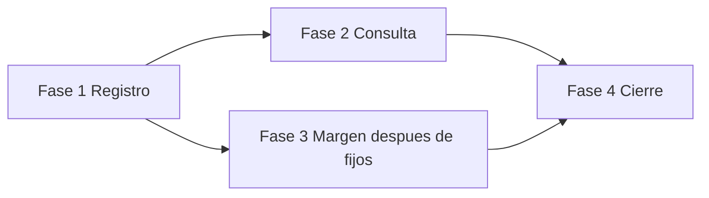

# Tasks: Gastos de la empresa y margen después de costos fijos (MSF-469)

**Spec**: [`spec.md`](./spec.md) · **Plan**: [`plan.md`](./plan.md) · Formato: `- [ ] T001 [P] [HISTORIA][USy] descripción — evidencia`.
Cada RF/SC tiene una tarea dueña y su verificación nombrada (tabla «Verificación por requisito» de `spec.md`). **Al cerrar cada fase ninguna tarea queda `[ ]`**: se hace con evidencia o se cierra con `Desvío: <motivo>` y un seguimiento trazado (regla de `CLAUDE.md`). Se implementa **fase por fase** (`/speckit-implement` con el filtro de tareas, `/clear` entre fases).

## Matriz de trazabilidad (tracker ↔ US ↔ tasks)

| Tracker | Historia | US | RF / SC dueños | Tareas |
|---|---|---|---|---|
| MSF-469 (hijas a crear) | F-GAS-01 | US1 | RF-GAS-1…5, RF-GAS-15…17, SC-003 | T001–T010 |
| MSF-469 | F-GAS-02 | US2 | RF-GAS-6…9 | T011–T016 |
| MSF-469 | F-GAS-03 | US3 | RF-GAS-10…14, RF-GAS-18, SC-001, SC-002 | T017–T025 |
| Tarea de cierre (label cierre) | — | — | docs, roadmap, seguridad, encendido | T026–T030 |

## Phase 1: F-GAS-01 · Registrar gastos (US1) — sin efecto en ninguna cifra existente

- [x] T001 [F-GAS-01][US1] Migración `20270349000000_gastos.sql`: tabla `dominio.gastos`, checks (importe > 0, moneda, cotización/pesos, categoría, tipo, motivo de anulación), índices, RLS por organización, empresa accesible y sección `rentabilidad`, grants exactos (dueña de RF-GAS-1, RF-GAS-5, RF-GAS-15). Evidencia: pgTAP `gastos.test.sql` (estructura, sin `DELETE`, sin escritura directa). ✔ Hecho: `supabase/migrations/20270349000000_gastos.sql`; pgTAP `gastos.test.sql` (25 aserciones: estructura, checks, FK compuesta, sin `DELETE`, sin escritura directa, grants) verde en dev.
- [x] T002 [F-GAS-01][US1] Migración `20270349000100_gastos_rpc.sql`: `guardar_gasto` y `anular_gasto` (`security definer`, `search_path = ''`, `edicion`, bloqueo optimista, empresa inactiva o ajena, cotización congelada con la regla de D8, eventos `gasto.creado|editado|anulado`) (dueña de RF-GAS-2, RF-GAS-3, RF-GAS-4). Evidencia: pgTAP `gastos_rpc.test.sql`, `gastos_moneda.test.sql`, `gastos_actividad.test.sql`. ✔ Hecho: `20270349000100_gastos_rpc.sql`; pgTAP `gastos_rpc.test.sql` (permisos, validación, `40001`, dólar de la empresa/general más cercano, snapshot inmutable, sin cotización, anulación, eventos) verde en dev. Desvío: moneda y Actividad van en el mismo archivo `gastos_rpc.test.sql` (no en tres).
- [x] T003 [P] [F-GAS-01][US1] Aislamiento y seguridad: entre organizaciones, entre empresas de una organización, `anon` sin privilegios, `search_path`, `rls_en_toda_tabla` y `privilegios_anon_endurecidos` verdes con la tabla nueva (dueña de RF-GAS-15, SC-003). Evidencia: `gastos.test.sql` y los dos tests existentes. ✔ Hecho: `gastos.test.sql` (aislamiento entre organizaciones y entre empresas, `anon`) y `rls_en_toda_tabla`, `privilegios_anon_endurecidos`, `service_role_privilegios`, `registro_inalterable` verdes con la tabla nueva.
- [x] T004 [F-GAS-01][US1] Migración `20270349000200_gastos_exportacion_total.sql`: la tabla entra a la exportación total (dueña de RF-GAS-17). Evidencia: pgTAP `exportacion_total.test.sql` extendido. ✔ Hecho: la migración copia COMPLETA la definición vigente de `private.conjuntos_exportacion_total()` de `20270342000300_exportacion_total_newsletter.sql` (con listas de precios, órdenes de compra, opiniones, newsletter y su filtro de `confirmacion_hash`) y suma solo `('dominio','gastos')` (un diff contra esa migración muestra una única fila de diferencia). `exportacion_total.test.sql` da 49/49 en dev (`begin…rollback`) con la aserción propia de gastos (RF-GAS-17) y las de opiniones y newsletter intactas. Desvío: las cuatro migraciones de gastos se renumeraron de `20270343…` a `20270349…` porque dokploy ya llegó a `20270346000000` (guard `--estricto`).
- [x] T005 [F-GAS-01][US1] Pantalla Administración → Gastos (`pages/gastos/`, `lib/gastos.ts`, hooks): ruta lazy, destino de menú solo administrador, tabla con los campos del prototipo, estados compartidos y acceso restringido sin `lectura` (dueña de RF-GAS-8, parte registro). Evidencia: Vitest `pages/gastos/index.test.tsx`. ✔ Hecho: `pages/gastos/index.tsx`, `lib/gastos.ts`, `hooks/useGastos.ts`, ruta lazy `/gastos` y destino «Gastos» en Administración (solo administrador, sección `rentabilidad`); Vitest `pages/gastos/index.test.tsx` (17 pruebas).
- [x] T006 [F-GAS-01][US1] Diálogo «Nuevo gasto»/«Editar gasto» con las adiciones declaradas (moneda, tipo de costo precargado, recurrente, tienda con `SelectorEmpresas` de una sola empresa, importe con decimales), validación del servidor y mensaje «Cargá la cotización del dólar» (dueña de CA-GAS-1…6). Evidencia: Vitest del diálogo con axe a 320/768/1440 px. ✔ Hecho: `pages/gastos/DialogoGasto.tsx` (`SelectorEmpresas` ahora admite `unica`, con prueba); Vitest con axe a 320/768/1440 px y el mensaje «Cargá la cotización del dólar».
- [x] T007 [F-GAS-01][US1] Acción «Anular» con motivo obligatorio y «Mostrar anulados» (dueña de CA-GAS-6). Evidencia: Vitest y pgTAP `gastos_rpc.test.sql`. ✔ Hecho: `DialogoAnularGasto.tsx` y «Mostrar anulados»; Vitest y pgTAP `gastos_rpc.test.sql`.
- [x] T008 [P] [F-GAS-01][US1] Fila «Empresa activa»: test de Vitest que cambia de empresa con la pantalla y el diálogo abiertos (se cierra con aviso, nada se guarda en la empresa anterior) (dueña de CA-GAS-14, parte registro). Evidencia: `pages/gastos/index.test.tsx`. ✔ Hecho: prueba que cambia de empresa con el diálogo abierto (se cierra con aviso, no guarda).
- [x] T009 [P] [F-GAS-01][US1] Etiquetas de los eventos `gasto.*` en Actividad y ayuda de la pantalla (cobertura de ayuda). Evidencia: Vitest de Actividad y `ayuda-cobertura.test.ts`. ✔ Hecho: etiquetas `gasto.*` en `lib/actividad.ts`, ayuda `gastos` en `ayuda/contenidos/administracion.ts` y mapa en `manualPorDestino.ts` (`ayuda-cobertura` y `manual.test`).
- [x] T010 [F-GAS-01][US1] Guards de la fase: `node scripts/verificar-migraciones.mjs --estricto`, `pnpm docs:check`, `pnpm ui:empresas:check`, `pnpm matriz:check`, `pnpm der:check`, `tsc -b`, lint. Evidencia: salida de cada comando. ✔ Hecho (2026-11-15, rama `feat/gastos-fases-1-y-2` con `origin/dokploy` integrado): `node scripts/verificar-migraciones.mjs --estricto` → «Migraciones OK: 705 archivo(s), 4 nuevo(s) contra origin/dokploy»; `verificar-trampas-conocidas.mjs` → «OK (4 migración(es), 3 prueba(s) pgTAP y 1 E2E revisados contra origin/dokploy)»; `verificar-documentacion-cambios.mjs` → «OK»; `verificar-estilos-sueltos.mjs` → «sin valores sueltos» (`estilos:check`); `verificar-ui-empresas.mjs` → «filtros y selectores de empresa usan los componentes compartidos»; `verificar-matriz-pantalla.mjs` → «OK»; `verificar-der.mjs` → «gastos-de-la-empresa/spec.md: DER OK»; `verificar-e2e-sin-escritura-directa.mjs` → OK; `tsc -b` sin errores; `oxlint` sin hallazgos en gastos; commitlint sin errores; Vitest de gastos, hook, lib, ayuda y higiene en verde; pgTAP `gastos`, `gastos_rpc` y `exportacion_total` en dev dentro de `begin…rollback`, sin fallas.

**Checkpoint F-GAS-01**: un administrador carga, edita y anula gastos de su tienda; ninguna cifra, vista, tablero ni correo existente cambia.

## Phase 2: F-GAS-02 · Consultar gastos por período y categoría (US2) — sin efecto en ninguna cifra existente

- [x] T011 [F-GAS-02][US2] Migración `20270349000300_gastos_consulta.sql`: `listar_gastos` (cursor por `fecha desc, id`, filtros de empresa, categoría, tipo, anulados) y `resumen_gastos` (total, conteo, desglose por categoría y tipo) (dueña de RF-GAS-6, RF-GAS-7). Evidencia: pgTAP `gastos_listado.test.sql`. ✔ Hecho: `20270349000300_gastos_consulta.sql` (`listar_gastos`, `resumen_gastos`); pgTAP en `gastos_rpc.test.sql` (cursor, filtros, total, desglose, anulados excluidos, acotado por empresa). Desvío: no hay `gastos_listado.test.sql` aparte.
- [x] T012 [F-GAS-02][US2] Pantalla: períodos Hoy / Semana / Mes / Mes anterior (hora de Buenos Aires), `FiltroEmpresa`, filtros por categoría y tipo, total y desglose por concepto con la etiqueta fijo/variable, carga infinita con «Cargar más» por teclado (dueña de RF-GAS-8, CA-GAS-9…11, CA-GAS-13). Evidencia: Vitest `pages/gastos/index.test.tsx`. ✔ Hecho: períodos Hoy/Semana/Mes/Mes anterior (hora de Buenos Aires, `lib/gastos.test.ts`), `FiltroEmpresa`, filtros de concepto y tipo, total y desglose con fijo/variable, carga infinita y «Cargar más».
- [x] T013 [F-GAS-02][US2] «Exportar» del listado filtrado con evento en Actividad (dueña de RF-GAS-9, CA-GAS-12). Evidencia: Vitest y pgTAP `gastos_actividad.test.sql`. ✔ Hecho: botón «Exportar» (CSV con moneda, importe original e importe en pesos) y evento `gasto.exportado`. Desvío: se agregó la RPC `exportar_gastos` (5.ª función) porque el evento solo se registra desde la base.
- [x] T014 [P] [F-GAS-02][US2] Fila «Empresa activa» de la consulta: al cambiar la empresa se recargan listado, total y desglose y se reencuadra la carga por tandas (dueña de CA-GAS-14). Evidencia: Vitest. ✔ Hecho: prueba de cambio de empresa recarga la consulta con la empresa nueva.
- [x] T015 [F-GAS-02][US2] E2E del recorrido: cargar un gasto, verlo en el total del mes y anularlo (dueña de RF-GAS-8). Evidencia: `apps/web/e2e/gastos.e2e.ts`. ✔ Hecho: corrida verde 43741637212 (`validate.yml`, job `e2e-visible-sesion`, `gastos.e2e.ts`: «1 passed», 52,4 s): carga un gasto, lo ve en el listado y el total, lo anula con motivo y lo ve con «Mostrar anulados».
- [x] T016 [F-GAS-02][US2] Guards de la fase (los de T010). Evidencia: salida de cada comando. ✔ Hecho (2026-11-15, sobre el HEAD final con `origin/dokploy` integrado): `verificar-migraciones.mjs --estricto` → «Migraciones OK: 705 archivo(s), 4 nuevo(s) contra origin/dokploy» (sin avisos de CREATE TABLE); `verificar-trampas-conocidas.mjs` → «OK (4 migración(es), 3 prueba(s) pgTAP y 1 E2E revisados contra origin/dokploy)»; docs-check → «Documentación de cambios: OK»; `estilos:check` → «sin valores sueltos»; ui:empresas → «usan los componentes compartidos»; matriz → «OK (0 specs nuevas revisadas)»; der → «gastos-de-la-empresa/spec.md: DER OK»; `verificar-e2e-sin-escritura-directa` → «ningún spec escribe directo»; `tsc -b` → 0 errores; `oxlint` → 0 hallazgos en gastos; Vitest gastos/hook/lib/higiene → 84 de 84; pgTAP `gastos`, `gastos_rpc` y `exportacion_total` en dev (`begin…rollback`) sin fallas.

**Checkpoint F-GAS-02**: el administrador consulta gastos por período, tienda, categoría y tipo, y exporta; las cifras de rentabilidad siguen intactas.

## Phase 3: F-GAS-03 · Margen después de costos fijos (US3) — único cambio visible, detrás de la bandera

- [ ] T017 [F-GAS-03][US3] Migración `20270349000400_costos_fijos_bandera_y_vistas.sql`: bandera `margen_costos_fijos` apagada, `analitica.bandera_activa`, `analitica.costos_fijos_empresa_mes` (sin detalle de gastos) y `analitica.ventas_netas_empresa_mes` con el predicado y el signo del margen real (dueña de RF-GAS-10, RF-GAS-11). Evidencia: pgTAP `gastos_bandera.test.sql` y `margen_costos_fijos.test.sql` (bloque de vistas).
- [ ] T018 [F-GAS-03][US3] Migración `20270349000500_margen_despues_costos_fijos.sql`: `analitica.margen_despues_costos_fijos` sobre `analitica.margen_real_categoria` con la fórmula de «Prorrateo de costos fijos»; sin filas con la bandera apagada; privilegios solo para `superset_analitica` (dueña de RF-GAS-12, RF-GAS-15). Evidencia: pgTAP `margen_costos_fijos.test.sql` (ejemplo numérico, notas de crédito, mes sin ventas, solo variables, USD, «Sin atribuir»).
- [ ] T019 [F-GAS-03][US3] **Paridad**: las vistas, funciones y RPC existentes de rentabilidad e Inicio devuelven lo mismo antes y después, con la bandera apagada y encendida (dueña de RF-GAS-13, SC-001). Evidencia: pgTAP `margen_costos_fijos_paridad.test.sql`.
- [ ] T020 [P] [F-GAS-03][US3] Ninguna otra superficie usa gastos: el resumen semanal y `resumen_inicio_bloques` no cambian ni los mencionan (dueña de RF-GAS-18). Evidencia: pgTAP `gastos_superficies.test.sql`.
- [ ] T021 [F-GAS-03][US3] Dashboard de Superset «Rentabilidad · Después de costos fijos» exportado a YAML y versionado: tarjetas por tienda y consolidado, cortes por producto y categoría, «Sin atribuir» y rótulo del método (dueña de RF-GAS-14, CA-GAS-16, CA-GAS-24). Evidencia: `pnpm test:superset:config`.
- [ ] T022 [F-GAS-03][US3] Pestaña «Después de costos fijos» en Rentabilidad (`/rentabilidad/costos-fijos`): oculta con la bandera apagada, acceso restringido sin `lectura` o ante 403, error con reintento, rótulo del mes en curso (dueña de RF-GAS-14, CA-GAS-15, CA-GAS-18, CA-GAS-23). Evidencia: Vitest `pages/rentabilidad/costos-fijos.test.tsx`.
- [ ] T023 [P] [F-GAS-03][US3] Fila «Empresa activa» de la pestaña: sigue la empresa de la barra superior y el token lleva `empresa_id` (dueña de CA-GAS-22). Evidencia: Vitest y prueba del token.
- [ ] T024 [F-GAS-03][US3] `EXPLAIN` del cruce por mes contra una base con datos de dev y nota con el resultado antes de encender (dueña de RF-GAS-12, rendimiento). Evidencia: nota en el informe de la fase.
- [ ] T025 [F-GAS-03][US3] Guards de la fase (los de T010) y revisión de que `analitica.margen_real_categoria` y `rentabilidad_ventas_real` no se redefinieron. Evidencia: salida y nota de revisión.

**Checkpoint F-GAS-03**: con la bandera encendida en dev, el tablero muestra el margen después de costos fijos por producto, categoría y tienda; con la bandera apagada todo es idéntico a hoy.

## Phase 4: Cierre

- [ ] T026 [CIERRE] Documentación en `docs/`: `gastos.md`, `producto/gastos.md`, actualizar `rentabilidad.md`, `tecnico/rentabilidad.md`, `actividad.md`, `deployment.md`, `mkdocs.yml`. Evidencia: `pnpm docs:check`.
- [ ] T027 [CIERRE] `docs/roadmap-template.md` (fila de Gastos) y revisión de seguridad integral (RLS, `anon`, `security definer`, grants, aislamiento por empresa, token de Superset) en `docs/revision-seguridad-gastos.md`. Evidencia: documento y salida de los tests.
- [ ] T028 [CIERRE] Encendido de la bandera `margen_costos_fijos` en dev (por SQL, por el equipo técnico) y verificación en dev del recorrido: cargar gasto, ver total, ver el margen después de fijos, anular y ver el recálculo (comprobar el bundle de dev y las vistas registradas).
- [ ] T029 [CIERRE] Seguimientos trazados de lo que quedó fuera si Nicolás lo quiere: impactos I5–I10 (correo semanal, Inicio, comparativos, alertas, precio sugerido), importación de gastos, recurrentes automáticos, gastos compartidos, otros métodos de prorrateo, cierre de períodos (Tarea `seguimiento` por cada una).
- [ ] T030 [CIERRE] Guards finales: `verificar-migraciones --estricto`, `docs:check`, `matriz:check`, `der:check`, `prototipo:check`, `ui:empresas:check`, commitlint, `tsc -b`, lint y `vite build`. Evidencia: resultados en el informe de cierre.

## Plan de ejecución (fases)

| Fase | Depende de | Qué entrega | Riesgo en cifras existentes |
|---|---|---|---|
| 1 · Registro | — | Tabla, RPC, pantalla | Ninguno |
| 2 · Consulta | 1 | Listado, totales, exportar | Ninguno |
| 3 · Margen después de fijos | 1 | Vistas nuevas, bandera, pestaña | **Ninguno por diseño** (medida nueva, detrás de la bandera, con paridad) |
| 4 · Cierre | 1–3 | Docs, seguridad, encendido en dev | — |

Las fases 2 y 3 dependen solo de la 1 y se pueden mergear en cualquier orden; la 3 es la que Nicolás debe aprobar con las decisiones D4, D6, D7 y D15 a la vista.
