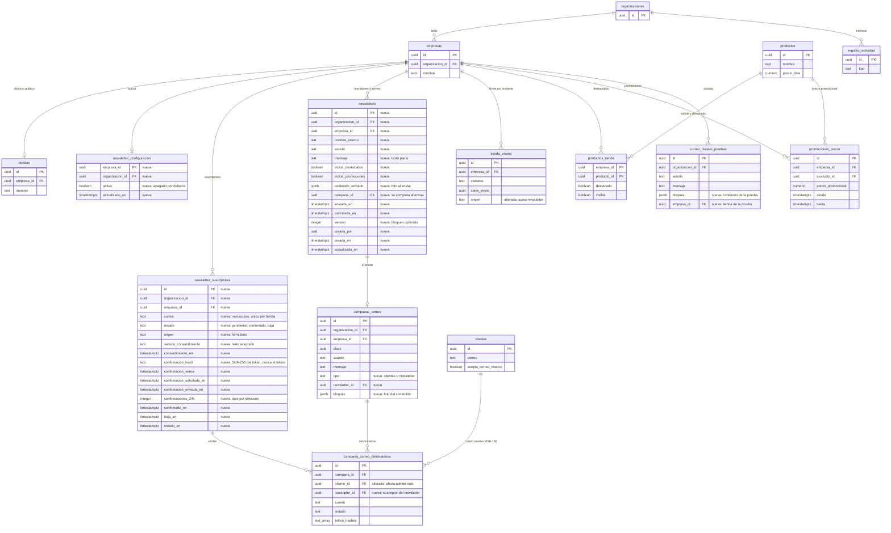
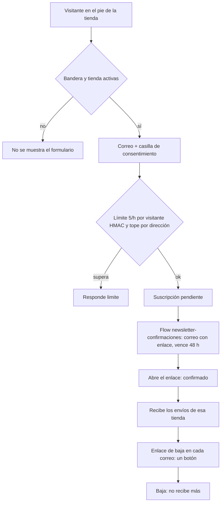
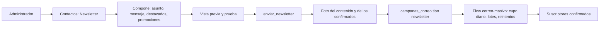

# Feature Specification: Tiendas online · Newsletter (suscripción, composición y envío)

**Épica**: MSF-468 (Tiendas online · Newsletter) · **Spec**: `newsletter-de-la-tienda` · **Prioridad**: P2 (provisoria) · **Hito**: Etapa 2
**Alcance de entrega**: `refine`, `supabase` y `kestra` (sin `superset` ni `workers`).
**Estado**: spec redactada, **sin implementar**. No hay migraciones, funciones ni pantallas en este PR.
**Fuente**: decisión de Nicolás (2026-11-15), el ticket MSF-468 y su pantalla de prototipo (`design/pantallas/Newsletter.dc.html`), el correo masivo ya entregado (épica MSF-155: `docs/correo-masivo.md`, `supabase/functions/baja-correo-masivo`, `infra/kestra/flows/correo-masivo.yml`), el formulario de contacto de la tienda (MSF-212: `docs/tienda-contacto.md`), los avisos y bajas personales (MSF-189: `docs/avisos-por-correo.md`) y el código vigente de `dokploy` (migraciones hasta `20270326100000`).

## Objetivo

Al terminar, **cada tienda pública tiene un formulario de suscripción en su pie**; quien se suscribe confirma por correo y puede darse de baja con un enlace; y el **dueño de la empresa compone cada envío** (asunto, texto y qué mostrar: productos destacados y promociones vigentes), lo **previsualiza**, se manda una prueba y lo **envía a los suscriptores confirmados**, reutilizando el motor de envío del correo masivo (MSF-155).

## Decisión de negocio (Nicolás, 2026-11-15) y decisiones delegadas

**Decisiones tomadas por Nicolás**:

1. Un **formulario de suscripción en el pie de la tienda pública**, con **baja personal**; sus suscriptores **alimentan el correo masivo que ya existe** (MSF-155: mismo proveedor SMTP, mismo cupo diario, mismo enlace de baja por destinatario).
2. **Obligatorio**: el **dueño de la empresa define qué contenido va en el newsletter**. Hay una forma de componer cada envío (asunto, texto y selección de qué mostrar), con **vista previa** y **envío** a los suscriptores.

**Decisiones delegadas** (todas «Decisión (delegada)» para que Nicolás las revise; cada una dice su motivo):

| # | Tema | Decisión (delegada) | Motivo |
|---|---|---|---|
| D1 | Doble confirmación (double opt-in) | **Sí.** La suscripción nace `pendiente`; solo pasa a `confirmado` al abrir el enlace del correo de confirmación (vence a las 48 h). Solo los `confirmado` reciben envíos | Un formulario público sin verificar permite suscribir a un tercero (acoso, mala reputación del remitente, rebotes). Es la única prueba de consentimiento que el sistema puede guardar. Costo bajo: reutiliza el SMTP de Kestra |
| D2 | Consentimiento y datos personales | Casilla **obligatoria y sin marcar** «Acepto recibir novedades de {tienda} por correo» + enlace a la política de privacidad de la tienda si existe. Se guarda: correo (minúsculas), tienda, `consentimiento_en`, `confirmado_en`, versión del texto aceptado y origen. **No** se guarda IP, navegador ni nombre. Sin cookies ni rastreo de aperturas | Mínimo dato que prueba el consentimiento (Ley 25.326 de protección de datos personales de Argentina); la IP solo se usa, como hash HMAC, para el límite |
| D3 | Baja | **Enlace firmado en cada correo** (token aleatorio de ~244 bits; la base solo guarda su SHA-256), que abre una página con **un botón «Darme de baja»** (un clic confirma) — igual que MSF-155: un visor de enlaces no debe dar de baja a nadie solo por abrirlo. Responde siempre `ok` (no enumera tokens). La persona puede volver a suscribirse (nueva confirmación) | Reutiliza la Edge Function `baja-correo-masivo` y `dar_de_baja_correo_masivo` ya revisadas en seguridad. El encabezado `List-Unsubscribe` (baja automática del cliente de correo) se agrega si el plugin de correo de Kestra lo admite (T011); si no, queda como seguimiento trazado |
| D4 | Límites y anti-spam del formulario público | Reutiliza el **patrón por visitante HMAC** del contacto: `private.visitante_hash(empresa)` + `private.registrar_envio_tienda(empresa, 'newsletter', clave)` (**5 por hora por visitante y empresa**, atómico, idempotente por `clave_envio`, comparte el cupo con el contacto y WhatsApp). Además: campo trampa oculto (honeypot; se responde `ok` sin guardar), máximo **3 correos de confirmación por dirección y 24 h**, respuesta idéntica exista o no la dirección (no enumera suscriptores) y poda de suscripciones `pendiente` de más de 7 días | La app ya probó este límite; el correo de confirmación es la superficie de abuso (bombardear a un tercero), por eso se limita también por dirección. Un CAPTCHA queda como seguimiento si hay abuso real |
| D5 | Clientes que ya existen | **No se suscribe a nadie automáticamente.** Los clientes con `acepta_correo_masivo` siguen recibiendo solo el correo masivo a clientes (MSF-155); el newsletter es **otra lista con otro consentimiento**. Si un cliente se suscribe por el formulario, es un suscriptor más (no se vincula ni se modifica la ficha del cliente). La baja de una lista no toca la otra | Un consentimiento dado para «correo masivo a clientes» no prueba el de un newsletter público; importar clientes sin consentimiento sería spam. Un puente cliente→suscriptor (con consentimiento explícito) queda fuera de alcance |
| D6 | Permisos | Ver suscriptores y envíos: lectura en la sección `clientes`. **Componer, enviar, cancelar, dar de baja a mano y borrar datos: rol Administrador** (el dueño) con edición en `clientes` y acceso a la tienda elegida (`private.empresas_accesibles_de_usuario`). Se comprueba **dentro de la RPC** (`42501`); la UI solo oculta | Lo que se envía es irreversible y habla en nombre de la tienda; mismo criterio que otras decisiones de política comercial del repo |
| D7 | Aislamiento | Toda fila lleva `organizacion_id` (sale de la sesión, nunca de un parámetro) y `empresa_id` con FK compuesta. **Una suscripción y un newsletter pertenecen a una tienda**; la misma dirección puede estar en dos tiendas con consentimiento y baja separados | La tienda es la identidad remitente y el espacio de consentimiento |
| D8 | Bandera y activación por tienda | Bandera de plataforma **`newsletter`, apagada por defecto** (`public.banderas_plataforma`; se enciende dev → stg → prd por SQL, no por migración). Además cada tienda lo activa con un interruptor propio («Mostrar suscripción en el pie de la tienda», apagado por defecto) en la misma pantalla | Es una capacidad que envía correo a terceros: nace apagada y se prende tienda por tienda. Apagada la bandera: el pie no muestra el formulario, las RPC de escritura responden `55000` (salvo baja y borrado de datos) y el flow no envía |
| D9 | Qué NO entra | Segmentación de destinatarios, **métricas de apertura/clic** (no hay pixel de rastreo: privacidad y alcance), plantillas visuales avanzadas, editor HTML/WYSIWYG, **programar** envíos, importar listas, A/B, automatizaciones (bienvenida, carrito), reenvío a bajas/bounces avanzados, CAPTCHA | Pedido de «alcance mínimo y coherente, sin editor complejo» |
| D10 | Composición (alcance mínimo) | Un envío tiene: **nombre interno** (≤ 100), **asunto** (≤ 200, una línea), **mensaje** de texto plano (≤ 10 000, como en MSF-155), **tienda remitente** y **dos secciones opcionales con interruptor**: «Productos destacados» (los marcados `destacado` en esa tienda, hasta 6) y «Promociones vigentes» (hasta 6, las de `dominio.promociones_precio` vigentes en esa tienda). Sin selector manual de productos: el dueño controla el contenido desde Productos y Promociones, que ya existen | Cubre «productos destacados y promociones vigentes» sin construir un editor ni duplicar curaduría. Un selector manual de productos es la primera ampliación natural (fuera de alcance, D9) |
| D11 | Envío | **Manual** («Enviar a N», con confirmación y clave idempotente). **No se programa.** Se puede **cancelar** lo que aún no salió | Programar suma estados, zonas horarias y fallos; el cupo diario ya reparte la entrega |
| D12 | Borradores e historial | **Sí guarda borradores** («Guardar borrador», editables) y **conserva los envíos anteriores** (solo lectura: asunto, mensaje, secciones enviadas y totales). Estados mostrados: Borrador, Enviando, Enviada, Cancelada | Lo pide el prototipo (botón y tabla de campañas) y el dueño necesita ver qué mandó |
| D13 | Contenido congelado | Al enviar (y al enviar la prueba) se guarda una **foto del contenido** (`bloques` jsonb: nombre, precio, precio promocional, imagen y enlace de cada producto) y el correo sale con esa foto, igual para todos. La vista previa usa la misma función y avisa «Precios al día {fecha}» | Un envío que dura días por el cupo no puede cambiar de precios entre destinatarios |
| D14 | Reutilización de MSF-155 | **Mismas tablas y mismo flow** (`dominio.campanas_correo`, `campana_correo_destinatarios`, `correo_masivo_pruebas`, `correo-masivo.yml`, cupo diario por organización, reclamos con vencimiento, baja por hash). Se agrega `tipo` a la campaña, `suscriptor_id` al destinatario y `bloques`. **El cupo diario se comparte** con el correo masivo a clientes (en orden de creación) | Un solo proveedor, un solo cupo y un solo circuito de baja ya revisado; evita un segundo motor de envío |
| D15 | Identidad remitente | El nombre visible del remitente es el de la **tienda** (`"{tienda}" <KESTRA_SMTP_FROM>`); la dirección técnica es la compartida. El pie fijo dice «Recibís este correo porque te suscribiste al newsletter de {tienda}» | No hay dominio de envío por tienda; «responder a» por tienda queda como seguimiento |
| D16 | Ubicación de la pantalla | **Contactos → Newsletter**, ruta `/clientes/newsletter`, ícono de sobre con tilde, junto a «Correo masivo». No absorbe a Miembros (los suscriptores no son personas del equipo) ni a «Correo masivo» (otro público, otra tabla de consentimiento) | Misma audiencia (Clientes) y misma familia de acciones |
| D17 | Datos al dar de baja o borrar | La baja **conserva el correo** con estado `baja` (lista de supresión: evita reenviar por error). **«Borrar datos»** (Administrador, para un pedido de supresión) elimina la fila y deja `[eliminado]` en el correo copiado de los envíos pasados | Equilibrio entre no reenviar y el derecho de supresión |
| D18 | Prueba | «Enviar prueba» manda el correo real (con la foto del contenido) al autor, con prefijo «[Prueba]»; no crea envío ni cuenta contra el cupo; mismo tope que MSF-155 (5 por hora y persona) | Reutiliza `correo_masivo_pruebas` |

## Modelo y supuestos (verificados en el código de `dokploy`)

- **Pie de la tienda**: `PieTienda` (texto del pie configurable, columna «Categorías», enlace «Escribinos» a `/contacto`). El formulario se suma al pie sin nueva ruta; la confirmación y la baja son dos rutas públicas nuevas de la tienda (`/newsletter/confirmar/:token`, `/newsletter/baja/:token`).
- **Formulario de contacto** (MSF-212): `publico.enviar_consulta_contacto` con `private.visitante_hash`, `private.registrar_envio_tienda` (límite 5/h, `pg_advisory_xact_lock`, idempotencia por `unique (empresa_id, clave_envio)`, poda de 24 h) y HMAC con el secreto de Vault `visitante_hmac` (`private.hmac_visitante`, MSF-945/946). `dominio.tienda_envios.origen` ya admite `formulario`, `whatsapp`, `pedido` y `presupuesto` (migración `20270321100000`): se le suma `newsletter`.
- **Correo masivo** (MSF-155): `dominio.campanas_correo` (asunto, mensaje, `clave` idempotente, empresa), `dominio.campana_correo_destinatarios` (`cliente_id not null`, `estado`, `token_hashes text[]`, reclamo con vencimiento), `private.reclamar_lote_correo_masivo`, `private.cerrar_envio_correo_masivo`, `public.dar_de_baja_correo_masivo(hash)` (solo `service_role`), Edge Function `baja-correo-masivo`, página `/baja-correo/:token`, flow `correo-masivo` cada minuto con `CORREO_MASIVO_LOTE` (50), `CORREO_MASIVO_LIMITE_DIARIO` (500) y `CORREO_MASIVO_URL_BAJA`.
- **Avisos y bajas personales** (MSF-189, `docs/avisos-por-correo.md`): son avisos **al equipo** (preferencias por usuario del panel, `avisos_pendientes`); **no** sirven para suscriptores externos. De MSF-189 se reutilizan solo el proveedor (SMTP de Kestra, F-NOT-01) y el patrón de cola con reclamo y reintentos.
- **Catálogo**: `dominio.productos_tienda.destacado` (por tienda y producto) y `dominio.promociones_precio` (vigentes en `[desde, hasta)`, no anuladas), con la bandera `promociones_precio` (si está apagada, la sección de promociones no aparece, igual que en la tienda).
- **Permisos**: `private.nivel_seccion('clientes')` y la comprobación de rol Administrador dentro de las RPC (patrón de listas de precios y descuento personal).
- **Prototipo**: `design/pantallas/Newsletter.dc.html` **sí existe**; su inventario (`pnpm prototipo:inventario`, corrido) trae dos tablas (suscriptores y campañas), el diálogo «Nueva campaña» y los botones «Nueva campaña», «Cancelar», «Guardar borrador» y «Enviar a 1.248». Ver la matriz.

### Esquema de datos (Constitución, Principio VII), verificado objeto por objeto

| Objeto | Esquema | Por qué |
|---|---|---|
| `dominio.newsletter_configuracion` | `dominio` | Hecho del negocio de la tienda (activación de su newsletter) |
| `dominio.newsletter_suscriptores` | `dominio` | Dato del negocio de la tienda (a quién escribe) |
| `dominio.newsletters` | `dominio` | Borradores y envíos de la tienda (contenido compuesto por el dueño) |
| `dominio.campanas_correo`, `dominio.campana_correo_destinatarios`, `dominio.correo_masivo_pruebas` (alteradas) | `dominio` | Ya viven ahí (MSF-155); solo columnas nuevas |
| `dominio.tienda_envios` (alterada) | `dominio` | Ya vive ahí (MSF-212); solo el check de `origen` |
| Fila `newsletter` en `public.banderas_plataforma` | `public` | Dato de plataforma |
| RPC del panel y vistas de lectura | `public` | Superficie sin datos propios |
| RPC públicas de la tienda (`newsletter_por_dominio`, `suscribirse_newsletter`, `confirmar_newsletter`) | `publico` | Superficie anónima de la tienda, sin tablas (como el contacto) |
| Reclamo y cierre de confirmaciones, armado de `bloques`, motor de lote | `private` | Lógica interna; solo `kestra_orquestacion` o `security definer` |

## Modelo de datos (DER)

Tres tablas nuevas (configuración por tienda, suscriptores y newsletters). Se alteran las tres tablas del correo masivo (la campaña gana `tipo`, `newsletter_id` y `bloques`; el destinatario admite un suscriptor en lugar de un cliente; la prueba lleva `bloques`) y `dominio.tienda_envios` (nuevo origen). El resto del grafo se muestra completo.

| Tabla | Estado | Cambio |
|---|---|---|
| `dominio.newsletter_configuracion` | nueva | Una fila por tienda: `activo` (interruptor del pie, apagado por defecto) |
| `dominio.newsletter_suscriptores` | nueva | Suscriptor de una tienda: correo, estado (`pendiente`, `confirmado`, `baja`), consentimiento, confirmación y baja |
| `dominio.newsletters` | nueva | Borrador o envío de una tienda: nombre interno, asunto, mensaje, secciones elegidas, foto del contenido enviado, campaña asociada y cancelación |
| `dominio.campanas_correo` | alterada | Columnas `tipo` (`clientes` / `newsletter`), `newsletter_id` y `bloques` (foto del contenido) |
| `dominio.campana_correo_destinatarios` | alterada | `cliente_id` pasa a admitir nulo y se suma `suscriptor_id` (uno u otro) |
| `dominio.correo_masivo_pruebas` | alterada | Columnas `bloques` y `empresa_id` para la prueba del newsletter |
| `dominio.tienda_envios` | alterada | El check de `origen` suma `newsletter` (límite por visitante) |
| `dominio.empresas` | existente | Tienda: nombre, remitente y dueña de todo lo anterior |
| `dominio.tiendas` | existente | Dominio público de la tienda (arma los enlaces de confirmación y baja) |
| `public.clientes` | existente | Sin cambios: solo se explica que **no** se enlaza con los suscriptores (D5) |
| `dominio.productos_tienda` | existente | `destacado` por tienda: fuente de la sección «Productos destacados» |
| `dominio.productos` | existente | Nombre, precio e imagen del producto mostrado |
| `dominio.promociones_precio` | existente | Fuente de la sección «Promociones vigentes» |
| `public.registro_actividad` | existente | Eventos `newsletter.*` (sin correos ni textos) |
| `public.organizaciones` | existente | Organización dueña de todo |

`public.banderas_plataforma` (fila `newsletter`) no se dibuja: es una tabla de claves sin relaciones; su fila es un dato (D8). `clientes` figura sin relación con `newsletter_suscriptores` a propósito (D5).

## User Scenarios & Testing *(mandatory)*

### Historia 1 — Suscribirse desde el pie de la tienda y confirmar (P1)

Un visitante escribe su correo en el pie de la tienda, marca la casilla de consentimiento y pulsa «Suscribirme». Ve «Te enviamos un correo para confirmar tu suscripción» (siempre, exista o no la dirección). Recibe el correo y abre el enlace: ve «Listo, ya estás suscripto».

**Por qué P1**: sin suscriptores no hay newsletter y es la única superficie anónima nueva.

**Escenarios**

1. **Dado** bandera y tienda activas, **cuando** el visitante envía un correo válido con la casilla marcada, **entonces** queda `pendiente` con su consentimiento y recibe el correo de confirmación.
2. **Dado** una suscripción `pendiente`, **cuando** abre el enlace dentro de las 48 h, **entonces** pasa a `confirmado`; **si** abre un enlace vencido o inexistente, ve un mensaje claro y puede pedir otro desde el pie.
3. **Dado** una dirección ya `confirmado`, **cuando** se vuelve a suscribir, **entonces** ve el mismo mensaje y no se envía otro correo (no se enumeran suscriptores).
4. **Dado** una dirección en `baja`, **cuando** se vuelve a suscribir, **entonces** vuelve a `pendiente` con nuevo consentimiento y nueva confirmación.
5. **Dado** un visitante que superó 5 envíos en una hora, **cuando** envía, **entonces** ve «Probá de nuevo en unos minutos» y no se guarda nada.
6. **Dado** la bandera apagada o la tienda sin el interruptor, **entonces** el pie no muestra el formulario.

### Historia 2 — Darse de baja con un clic (P1)

En cada correo del newsletter, el pie dice «Recibís este correo porque te suscribiste al newsletter de {tienda}. Si no querés recibirlo más, date de baja acá». El enlace abre una página con un botón «Darme de baja»; al pulsarlo queda `baja` y no recibe más (ni lo pendiente de un envío en curso).

**Escenarios**: (1) baja desde el enlace del último correo; (2) baja repetida o con enlace viejo responde `ok` sin error; (3) un enlace con forma inválida muestra «Enlace inválido»; (4) tras la baja, un envío en curso deja a esa persona `omitido`.

### Historia 3 — Componer, previsualizar y enviar (P1)

El administrador abre Contactos → Newsletter, pulsa «Nueva campaña», elige la tienda remitente, completa nombre interno, asunto y mensaje, activa o no «Productos destacados» y «Promociones vigentes», ve la **vista previa**, se manda una **prueba**, **guarda el borrador** o pulsa «Enviar a N» y confirma. El envío sale por lotes dentro del cupo diario.

**Escenarios**: (1) guardar borrador y retomarlo; (2) vista previa con el contenido real de la tienda y «Precios al día»; (3) prueba al propio correo; (4) enviar a los N confirmados de esa tienda con confirmación; el doble clic no duplica; (5) sin suscriptores confirmados, «Enviar» responde «Todavía no hay suscriptores confirmados» y no crea nada; (6) cancelar un envío en curso deja los pendientes `omitido`.

### Historia 4 — Ver suscriptores y envíos (P2)

El administrador ve los KPI (activos, pendientes de confirmar, bajas, envíos), la tabla de suscriptores (correo, tienda, origen, alta, estado y acción «Dar de baja» o «Borrar datos») y la tabla de envíos (campaña, tienda, asunto, fecha, destinatarios, estado), filtradas por la empresa activa.

### Casos borde

- Correo con formato inválido, con `,` o `;`, vacío o de más de 254 caracteres: `invalido` sin consumir cupo (la validación corre antes del límite, como el contacto).
- Casilla de consentimiento sin marcar: `invalido`.
- Correo con mayúsculas o espacios: se guarda recortado y en minúsculas; `Ana@X.com` y `ana@x.com ` son la misma suscripción.
- Dos pedidos simultáneos con la misma dirección: una sola fila (`unique (empresa_id, lower(correo))`) y un solo correo de confirmación.
- Reenvío de confirmación: máximo 3 por dirección y 24 h; el cuarto pedido responde `ok` sin enviar.
- Suscriptor `pendiente` de más de 7 días: se purga (no hay consentimiento confirmado).
- Un suscriptor pasa a `baja` mientras hay un envío en curso: el reclamo del lote lo re-verifica y lo deja `omitido` (igual que MSF-155).
- Tienda sin destacados ni promociones vigentes con las secciones encendidas: la sección se omite del correo y la vista previa lo dice; el mensaje de texto sigue siendo obligatorio.
- Producto oculto o archivado después de armar el borrador: la foto se toma **al enviar**, no al guardar; el borrador no guarda productos.
- Texto con HTML o `<script>`: se guarda y se envía **literal y escapado**; nunca HTML libre.
- Tienda desactivada o dominio quitado entre la confirmación y el envío: el lote omite lo pendiente de esa tienda y la pantalla lo muestra como `omitido`.
- La persona borra sus datos: la fila se elimina y el correo copiado de los envíos pasados queda `[eliminado]`.
- Cambio de empresa activa con el diálogo abierto: ver la matriz.
- Falla del SMTP: reintentos y `fallido` con motivo fijo, como MSF-155; la confirmación fallida queda sin enviar y se reintenta en el siguiente ciclo (máximo 4 veces).

## Requirements *(mandatory)*

### Suscripción y confirmación (tienda pública)

- **RF-NL-1**: `publico.newsletter_por_dominio(host)` devuelve `{activo, tienda}` solo si la bandera `newsletter` y la tienda están activas; con host desconocido o apagado devuelve `activo = false` sin distinguir el motivo.
- **RF-NL-2**: El pie de la tienda muestra el formulario (correo, casilla de consentimiento con su texto y botón «Suscribirme») solo si `activo`. Estados: enviando, éxito, inválido (por campo), límite (con espera) y error genérico con «Reintentar» que reutiliza la clave.
- **RF-NL-3**: `publico.suscribirse_newsletter(host, correo, consentimiento, clave, trampa)` valida (D2), aplica el límite por visitante HMAC (`origen = 'newsletter'`, D4) y el tope por dirección, crea o reactiva la suscripción `pendiente` y deja pedida la confirmación. Responde `ok | invalido (campos) | limite (espera_segundos) | error`; `ok` es idéntico exista o no la dirección y también con la trampa llena. Nunca devuelve ids, hash ni IP.
- **RF-NL-4**: La confirmación sale por el flow `newsletter-confirmaciones` (SMTP de Kestra), con el reclamo y los reintentos de MSF-155 (4 intentos, motivo fijo), un token aleatorio nuevo por envío (solo se guarda su SHA-256) y vencimiento de 48 h. El enlace apunta al dominio público de la tienda.
- **RF-NL-5**: `publico.confirmar_newsletter(host, token)` pasa a `confirmado` (idempotente), valida que el token pertenezca a la tienda del host y responde `ok | vencido | invalido`; aplica el mismo límite por visitante.
- **RF-NL-6**: Las suscripciones `pendiente` de más de 7 días se purgan en el reclamo de confirmaciones (sin cron nuevo).

### Baja (reutiliza MSF-155)

- **RF-NL-7**: Cada correo del newsletter lleva un enlace de baja **propio de cada destinatario** (token nuevo por reclamo; solo hash). La página pública de la tienda `/newsletter/baja/:token` pide **un clic de confirmación** y llama a la Edge Function `baja-correo-masivo` (sin cambiar su contrato `{ token }` ni su respuesta).
- **RF-NL-8**: `public.dar_de_baja_correo_masivo(hash)` se extiende: si el destinatario es un suscriptor, lo pasa a `baja` (`baja_en`), omite sus pendientes en envíos en curso y registra `newsletter.baja` solo la primera vez (sin correo). Sigue ejecutándose solo con `service_role` y respondiendo siempre `ok`.
- **RF-NL-9**: El pie del correo es fijo y no editable (D15); el encabezado `List-Unsubscribe` se agrega si el plugin lo admite (D3).

### Gestión y composición (panel)

- **RF-NL-10**: El administrador activa o desactiva el newsletter **por tienda** (`guardar_newsletter_configuracion`). Con la bandera apagada responde `55000`.
- **RF-NL-11**: Pantalla Contactos → Newsletter (`/clientes/newsletter`): KPI, tabla de suscriptores y tabla de envíos con carga infinita, filtro de tienda con `FiltroEmpresa` y estados compartidos de carga, vacío y error.
- **RF-NL-12**: Suscriptores: filtro por estado y búsqueda literal por correo; acciones «Dar de baja» (si está `pendiente` o `confirmado`) y «Borrar datos» (con confirmación), solo Administrador (`42501` si no). Los correos se muestran completos solo a quien tiene lectura en `clientes`.
- **RF-NL-13**: «Nueva campaña» abre el diálogo del prototipo: Nombre interno, Asunto del correo, Tienda remitente, Destinatarios («Suscriptores activos (N)», de solo lectura: un único grupo) y Mensaje, más las dos secciones con interruptor (D10). Valida los límites en cliente y servidor (espejo).
- **RF-NL-14**: «Guardar borrador» crea o actualiza (`guardar_newsletter`) con bloqueo optimista (`40001` si cambió); un envío ya enviado no se edita (`55000`); un borrador se puede descartar.
- **RF-NL-15**: **Vista previa**: `vista_previa_newsletter(empresa, destacados, promociones)` devuelve la foto del contenido y la cantidad de destinatarios; la pantalla arma el correo final (mensaje escapado, secciones, pie fijo con enlace de baja **de ejemplo**) y muestra «Precios al día {fecha}».
- **RF-NL-16**: **Enviar prueba** reutiliza `correo_masivo_pruebas` con `bloques`, al correo del autor, con «[Prueba]» y el tope de 5 por hora.
- **RF-NL-17**: **Enviar** (`enviar_newsletter(id, version, clave)`): exige Administrador y acceso a la tienda; si no hay `confirmado`, `22023` con hint `sin_destinatarios`; toma la foto del contenido, crea **una** campaña `tipo = 'newsletter'` con la foto de los suscriptores `confirmado` de esa tienda, marca el newsletter como enviado y registra `newsletter.enviar` (asunto y cantidad, sin correos). La `clave` lo hace idempotente.
- **RF-NL-18**: **Cancelar envío** (`cancelar_envio_newsletter`): deja `omitido` (motivo «Cancelado») lo `pendiente` y marca `cancelada_en`; lo ya enviado no se retira.
- **RF-NL-19**: **Historial de envíos**: tabla con campaña, tienda, asunto, fecha, destinatarios, estado (Borrador, Enviando, Enviada, Cancelada) y totales (enviados, fallidos, omitidos, bajas). **Sin columna «Aperturas»** (D9).

### Motor de envío (reutiliza MSF-155)

- **RF-NL-20**: Se extienden la campaña, el destinatario y el reclamo de lote para destinatarios suscriptor (D14): el reclamo re-verifica `estado = 'confirmado'`, la bandera y la tienda activa; devuelve `tipo`, `bloques`, nombre y dominio de la tienda; mismo cupo diario por organización, reclamo con vencimiento y token de baja nuevo por destinatario. Las campañas `newsletter` **no** aparecen en el historial de correo masivo a clientes, y las de clientes no aparecen en el de newsletter.
- **RF-NL-21**: El flow `correo-masivo` arma el HTML del newsletter con la foto (mensaje escapado; secciones con nombre, precio, precio promocional, imagen y enlace a la ficha) y el remitente con el nombre de la tienda. Un correo de clientes sale igual que hoy (sin regresión).

### Seguridad y datos (transversal)

- **RF-NL-22**: RLS por organización en las tres tablas nuevas; lectura con `private.nivel_seccion('clientes')`; `authenticated` solo con `select` (por columna: sin `confirmacion_hash` ni tokens); toda escritura por RPC `security definer` con `search_path = ''`; `anon` sin privilegios sobre tablas y solo `execute` sobre las tres funciones `publico`. Cada RPC nueva lleva `revoke … from public, anon` y `grant execute … to authenticated` explícitos (salvo las `publico`).
- **RF-NL-23**: Las tres tablas **entran en la exportación total** (`private.exclusiones_exportacion_total()`); los hashes de confirmación quedan fuera del volcado.
- **RF-NL-24**: Eventos de Actividad `newsletter.configurar`, `.guardar`, `.enviar`, `.cancelar`, `.baja_manual`, `.baja`, `.datos_borrados`, **sin correos, textos ni cuerpo**. Etiquetas legibles en Actividad.
- **RF-NL-25**: Bandera `newsletter` apagada por defecto con los efectos de D8 (formulario oculto, escritura `55000`, flow sin envíos); baja y borrado de datos funcionan siempre.
- **RF-NL-26**: Reversión documentada (sección «Reversión» del plan) y migraciones aditivas e idempotentes en la ventana `20270342000000+`.

### Criterios de aceptación

- **CA-NL-1**: Con la casilla sin marcar o un correo inválido, el formulario no envía y marca el campo; con datos válidos muestra el mensaje de éxito de D1.
- **CA-NL-2**: Un suscriptor `pendiente` no recibe ningún newsletter; uno `confirmado` sí; uno en `baja` no, aunque tuviera pendientes.
- **CA-NL-3**: La respuesta de suscribirse es indistinguible entre dirección nueva, existente y en baja.
- **CA-NL-4**: Más de 5 envíos por hora desde el mismo visitante y tienda responden `limite`; otro visitante no se ve afectado.
- **CA-NL-5**: Un enlace de confirmación vencido muestra «El enlace venció» y ofrece volver al pie; uno ya usado responde `ok`.
- **CA-NL-6**: La baja desde el enlace funciona una vez y es idempotente; el correo del newsletter incluye siempre el enlace de baja propio.
- **CA-NL-7**: Un usuario sin rol Administrador ve la pantalla en solo lectura (si tiene lectura en `clientes`) y no puede guardar, enviar ni cancelar (`42501` en la base).
- **CA-NL-8**: El administrador de otra organización no ve ni toca suscriptores ni envíos de esta; un usuario sin acceso a una tienda no puede componer ni enviar para ella.
- **CA-NL-9**: La vista previa muestra el mismo contenido y orden que el correo recibido (mismo `bloques`); el texto del dueño se ve literal.
- **CA-NL-10**: «Enviar a N» con N igual al número de confirmados de esa tienda; tras enviar, el envío figura «Enviando» y pasa a «Enviada» cuando no quedan pendientes.
- **CA-NL-11**: Con la bandera apagada, ninguna tienda muestra el formulario ni se envía un newsletter; los correos de clientes (MSF-155) siguen saliendo igual.
- **CA-NL-12**: Un newsletter enviado no se puede editar; «Cancelar envío» omite lo pendiente y conserva lo ya enviado.

### Criterios de éxito

- **SC-001**: 100 % de los destinatarios de un newsletter son suscriptores `confirmado` de la tienda remitente al momento del reclamo (pgTAP).
- **SC-002**: Ninguna respuesta pública permite distinguir si una dirección existe (pgTAP + Vitest).
- **SC-003**: Cero fugas entre organizaciones y entre tiendas en las tablas y RPC nuevas (pgTAP de aislamiento).
- **SC-004**: Con la bandera apagada, los correos de clientes de MSF-155 conservan su comportamiento (pgTAP de paridad del lote).

## Verificación por requisito

Las pruebas de base corren en el job `database` del CI (`pnpm test:db`), las de interfaz con Vitest y las de Kestra con los `test:kestra:*`.

| Requisito | Verificación (test / comando) |
|---|---|
| RF-NL-1, RF-NL-25 | pgTAP `newsletter_bandera.test.sql` (apagada: `activo = false`, `55000`, sin envíos; baja y borrado siguen) |
| RF-NL-2 | Vitest `PieTienda.newsletter.test.tsx` (estados, casilla, trampa oculta, axe a 320/768/1440 px) |
| RF-NL-3, RF-NL-4 | pgTAP `newsletter_suscripcion.test.sql` (validación, límite 5/h, honeypot, tope por dirección, no-enumeración, reactivación desde baja, `anon` solo `publico`) y `pnpm test:kestra:newsletter-confirmaciones` |
| RF-NL-5, RF-NL-6 | pgTAP `newsletter_suscripcion.test.sql` (confirmar, vencido, idempotente, otra tienda, poda de 7 días) y Vitest `confirmar-newsletter.test.tsx` |
| RF-NL-7, RF-NL-8 | `pnpm test:edge:baja-correo-masivo` (sin cambio de contrato), pgTAP `newsletter_baja.test.sql` (baja de suscriptor, omite pendientes, evento una sola vez) y Vitest `baja-newsletter.test.tsx` |
| RF-NL-9 | `pnpm test:kestra:correo-masivo` extendido (encabezado si el plugin lo admite) |
| RF-NL-10, RF-NL-12 | pgTAP `newsletter_gestion.test.sql` (Administrador vs otros, `42501`, `55000`, borrado de datos) |
| RF-NL-11, RF-NL-13, RF-NL-19 | Vitest `pages/clientes/newsletter/*.test.tsx` (tablas, diálogo, carga infinita, estados, axe) |
| RF-NL-14 | pgTAP `newsletter_composicion.test.sql` (borrador, `40001`, `55000` si ya enviado, descartar) |
| RF-NL-15, RF-NL-16 | pgTAP `newsletter_composicion.test.sql` (foto del contenido: destacados, promociones, límites de 6, bandera de promociones) y Vitest de la vista previa |
| RF-NL-17, RF-NL-18 | pgTAP `newsletter_envio.test.sql` (confirmados solo, `sin_destinatarios`, idempotencia, cancelar) |
| RF-NL-20, RF-NL-21 | pgTAP `correo_masivo_lote.test.sql` extendido (suscriptor, re-verificación, cupo compartido, paridad con clientes) y `pnpm test:kestra:correo-masivo` |
| RF-NL-22 | pgTAP `rls_en_toda_tabla`, `privilegios_anon_endurecidos` y `newsletter_gestion.test.sql` (grants exactos, sin `confirmacion_hash` en el `select`) |
| RF-NL-23 | pgTAP `exportacion_total.test.sql` extendido |
| RF-NL-24 | Vitest de Actividad (etiquetas) y pgTAP (eventos sin datos personales) |
| RF-NL-26 | `node scripts/verificar-migraciones.mjs --estricto` |
| CA-NL-1…CA-NL-6 | Vitest del pie y de las páginas, pgTAP de suscripción y baja, E2E `apps/web/e2e/tienda-newsletter.e2e.ts` |
| CA-NL-7, CA-NL-8 | pgTAP `newsletter_gestion.test.sql` y `newsletter_aislamiento.test.sql` |
| CA-NL-9 … CA-NL-12 | Vitest de la vista previa, pgTAP de envío y E2E del recorrido (compone → prueba → envía a un suscriptor de prueba) |
| SC-001…SC-004 | `newsletter_envio.test.sql`, `newsletter_suscripcion.test.sql`, `newsletter_aislamiento.test.sql`, `correo_masivo_lote.test.sql` |

## Matriz pantalla↔criterios

`pnpm prototipo:inventario` se corrió: el prototipo **sí trae pantalla** (`Newsletter.dc.html`, «Tienda · Newsletter, mailing y suscripciones (Etapa 2)») con inventario al día. El pie de la tienda (formulario de suscripción), la página de confirmación y la de baja **no están dibujados**: su UI mínima es una **decisión declarada** (D2, D3) y usa los componentes del template y los tokens del sistema de diseño.

| Ítem del inventario | Dueño | Nota |
|---|---|---|
| Tabla **Suscriptores**: Correo, Tienda, Origen, Alta, Estado, acción («Dar de baja», «Borrar datos») | RF-NL-11, RF-NL-12, CA-NL-7 | «Origen» muestra «Formulario» (único origen, D5/D9: no se agregan a mano). Estado: Pendiente, Confirmado, Baja |
| Tabla **Campañas**: Campaña, Tienda, Asunto, Fecha, Destinatarios, **Aperturas**, Estado | RF-NL-19, CA-NL-10 | **«Aperturas» fuera de alcance** (D9: sin pixel de rastreo); la columna no se dibuja y la matriz lo declara. Se suman totales de enviados/fallidos/omitidos/bajas (requisito, regla 6) |
| KPI (`{{k.l}}`/`{{k.v}}`) | RF-NL-11 | Activos, Pendientes de confirmar, Bajas, Envíos |
| Botón «Nueva campaña» | RF-NL-13, CA-NL-7 | Visible solo para Administrador |
| Diálogo «Nueva campaña»: Nombre interno, Asunto del correo, Mensaje | RF-NL-13, RF-NL-14, CA-NL-9 | Textos y límites de D10 |
| Campo «Tienda remitente» | RF-NL-13, CA-NL-8 | Solo tiendas accesibles; ver fila «Empresa activa» |
| Campo «Destinatarios» («Suscriptores activos (1.248)») | RF-NL-13, RF-NL-17 | Un único grupo, de solo lectura: **segmentación fuera de alcance** (D9); el número es el real de esa tienda |
| Botón «Guardar borrador» | RF-NL-14, CA-NL-12 | Con bloqueo optimista |
| Botón «Enviar a 1.248» | RF-NL-17, CA-NL-10 | Muestra el N real; pide confirmación |
| Botón «Cancelar» (del diálogo) | RF-NL-13 | Cierra y descarta lo no guardado (pide confirmar si hay cambios) |
| Interruptores «Productos destacados» y «Promociones vigentes», «Vista previa», «Enviar prueba», «Cancelar envío», interruptor «Mostrar suscripción en el pie» | RF-NL-10, RF-NL-15, RF-NL-16, RF-NL-18 | **No están en el prototipo**: los pide la decisión de Nicolás (composición con vista previa); mandan los requisitos (regla 6). UI mínima con los componentes compartidos |
| Pie de la tienda: formulario de suscripción | RF-NL-2, CA-NL-1 | Sin pantalla en el prototipo; mismo estilo del pie y del formulario de contacto |
| Páginas públicas de confirmación y de baja | RF-NL-5, RF-NL-7, CA-NL-5, CA-NL-6 | Sin pantalla en el prototipo; reutiliza el componente de `/baja-correo/:token` |
| **Empresa activa** | RF-NL-11, RF-NL-13, CA-NL-8 | **Pantalla de empresa.** Con una empresa activa filtra suscriptores, envíos y KPI por esa tienda (y la preselecciona como «Tienda remitente»); con «Todas mis empresas» muestra todas con la columna «Tienda» y `FiltroEmpresa` (píldoras «Todas las tiendas» + una por tienda, como el prototipo). Al cambiar la empresa se invalidan y recargan **todas** las consultas (KPI, suscriptores, envíos, cantidad de destinatarios), se reinicia la carga infinita y se descartan filtros y selecciones inválidos. Un **diálogo abierto se cierra con aviso** («Cambiaste de empresa: se cerró la campaña sin guardar») y nunca guarda ni envía con la empresa anterior; un borrador guardado no se pierde. Test Vitest que cambia de empresa con el diálogo y la confirmación de envío abiertos. **Pie, confirmación y baja públicas: «Empresa activa: no aplica»** (las resuelve el dominio de la tienda, no la empresa del panel) |

## Flujos

## Contratos

- [`contracts/newsletter.md`](./contracts/newsletter.md): RPC `publico` y `public`, funciones `private`, eventos de Actividad, extensión del lote, flows y bandera.

## Riesgos y desvíos declarados

- **Es una superficie anónima que envía correo a terceros.** Mitigaciones: double opt-in, límite HMAC por visitante, tope por dirección, honeypot, respuesta uniforme y bandera apagada por defecto. Un ataque distribuido (muchas IP, muchas direcciones) seguiría consumiendo correos de confirmación: si aparece abuso se agrega CAPTCHA (seguimiento, no se construye sin caso real).
- **Invariante de destinatarios (MSF-967).** Una dirección en `baja` puede volver a `pendiente` por el pedido de un tercero (conserva `baja_en`). El envío (reclamo de MSF-155 para suscriptores), los KPI de activos y la foto de `enviar_newsletter` filtran SIEMPRE `estado = 'confirmado'`, NUNCA `estado <> 'baja'`.
- **Alias de proveedor.** El tope por dirección no ve `+tag`, puntos de Gmail ni catch-all; se acota con el tope global por tienda (200 confirmaciones nuevas por hora) y el límite por visitante; residual documentado en `docs/newsletter.md`.
- **Cupo compartido.** Un newsletter grande (p. ej. 1 248 suscriptores con cupo 500) tarda tres días y **retrasa** los correos a clientes de MSF-155 de la misma organización (orden de creación). Hay que decidir si se separa el cupo (variable aparte) o se sube; por ahora se comparte (D14).
- **El plugin de correo de Kestra** puede no admitir encabezados (`List-Unsubscribe`): verificar en T011; sin él, la baja depende del enlace del cuerpo. Los clientes de correo grandes lo exigen para remitentes de volumen (entregabilidad).
- **Entrega «al menos una vez»** (heredada de MSF-155): si Kestra se corta entre enviar y cerrar, un correo puede salir dos veces.
- **Dos renderizados del mismo correo** (React en la vista previa y la plantilla del flow). Para que no diverjan, ambos leen el mismo `bloques` y hay un test de paridad estructural; aun así es deuda que vigilar.
- **Cambio de contrato en `campana_correo_destinatarios`** (`cliente_id` nulable): hay que revisar todas las funciones y vistas del correo masivo que lo unen a `clientes` (reclamo, historial, detalle, baja). La migración las redefine con las mismas firmas y hay pgTAP de paridad con campañas de clientes.
- **Consentimiento heredado sin importar** (D5): los clientes que ya aceptan el correo masivo no entran al newsletter; el dueño empieza con la lista vacía y la hace crecer con el formulario. Es la opción segura legalmente, pero es menos «rápida».
- **Precios en el correo** (D13): se publican con el cálculo público de la tienda al momento del envío; un envío lento los deja desfasados respecto de la tienda. El correo lo dice («Precios al día»).
- **Sin cancelación de lo ya enviado** (obvio) y sin deshacer una baja manual (la persona se vuelve a suscribir).
- **Prototipo con elementos que no se implementan** («Aperturas») y elementos no dibujados que sí se piden (secciones, vista previa, pie de la tienda): anotado en la matriz y en el PR de implementación.
- **No validado contra sistemas reales** hasta implementar: este PR es solo documentación.

## Fuera de alcance

- Segmentación de destinatarios (por compra, por tienda múltiple, por etiqueta), listas múltiples y grupos.
- Métricas de apertura y clic, pixel de rastreo, y la columna «Aperturas» del prototipo.
- Plantillas visuales avanzadas, editor HTML o WYSIWYG, imágenes subidas por el dueño en el cuerpo, selector manual de productos.
- Programar envíos para más tarde, envíos recurrentes y automatizaciones (bienvenida, carrito abandonado).
- Importar suscriptores desde planilla o desde clientes existentes, y dar de alta suscriptores a mano.
- Manejo avanzado de rebotes y quejas (feedback loops), dominio de envío propio por tienda y «responder a» por tienda.
- CAPTCHA (solo si hay abuso), A/B y reportes de newsletter en Superset.
- Cambiar el correo masivo a clientes de MSF-155 más allá de lo necesario para compartir su motor.
