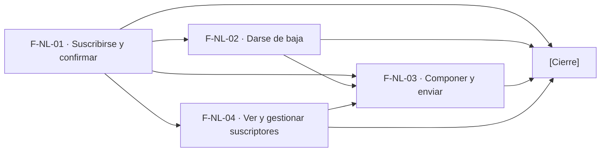

# Tasks: Tiendas online · Newsletter (MSF-468)

**Spec**: [`spec.md`](./spec.md) · **Plan**: [`plan.md`](./plan.md) · **Contratos**: [`contracts/newsletter.md`](./contracts/newsletter.md)

Formato: `- [ ] T001 [P] [STORY-NL-01][US1] descripción — evidencia`.

- **[P] es la autoridad del paralelismo**: dentro de una fase, las tareas marcadas `[P]` van **en paralelo** (archivos distintos, sin dependencia entre ellas). Las que no lo llevan son **secuenciales** (dependen de otra tarea de la misma fase).
- Cada RF/CA/SC tiene **exactamente una tarea dueña** (tabla «Dueños por requisito»): ninguna tarea describe alcance de otra historia.
- Las tareas de cada historia son **autosuficientes**: sus dependencias y su orden son solo dentro de la misma historia. El único apoyo entre historias es el **resultado ya mergeado del grupo anterior** (ver «Plan de ejecución»).
- La última fase (integración, E2E, docs, seguridad, encendido) **no la atiende ninguna historia** y por eso va con el token `[CIERRE]`: la ejecuta una sola Tarea de cierre (label `cierre`).
- Al cerrar cada fase **ninguna tarea queda `[ ]`**: se hace con evidencia o se cierra con `Desvío: <motivo>` y un seguimiento trazado en el tracker.
- Se invoca `/speckit-implement` **fase por fase** con `/clear` entre una y otra.

## Matriz de trazabilidad (tracker ↔ US ↔ tasks)

| Tracker | Historia (código) | US | RF / CA / SC dueños | Tareas | Grupo |
|---|---|---|---|---|---|
| MSF-468 | F-NL-01 · Suscribirse desde el pie y confirmar | US1 | RF-NL-1…6, 9, 22, 23, 25; CA-NL-1…5, 11; SC-002, SC-003 | T001–T013 | 1 |
| MSF-468 | F-NL-02 · Darse de baja con un clic | US2 | RF-NL-7, 8; CA-NL-6 | T014–T018 | 2 |
| MSF-468 | F-NL-04 · Ver y gestionar suscriptores | US4 | RF-NL-10, 11, 12, 24; CA-NL-7, 8 | T019–T027 | 2 |
| MSF-468 | F-NL-03 · Componer, previsualizar y enviar | US3 | RF-NL-13…21, 27; CA-NL-9, 10, 12; SC-001, SC-004 | T028–T040 | 3 |
| Tarea de cierre (label cierre) | — | — | RF-NL-26; E2E, docs, seguridad y encendido | T041–T046 | 4 |

## Dueños por requisito (uno por requisito, sin huérfanos)

| Requisito | Tarea dueña | Historia | | Requisito | Tarea dueña | Historia |
|---|---|---|---|---|---|---|
| RF-NL-1 | T002 | F-NL-01 | | RF-NL-19 | T030 | F-NL-03 |
| RF-NL-2 | T010 | F-NL-01 | | RF-NL-20 | T031 | F-NL-03 |
| RF-NL-3 | T002 | F-NL-01 | | RF-NL-21 | T032 | F-NL-03 |
| RF-NL-4 | T009 | F-NL-01 | | RF-NL-22 | T001 | F-NL-01 |
| RF-NL-5 | T002 | F-NL-01 | | RF-NL-23 | T004 | F-NL-01 |
| RF-NL-6 | T003 | F-NL-01 | | RF-NL-24 | T024 | F-NL-04 |
| RF-NL-7 | T014 | F-NL-02 | | RF-NL-25 | T005 | F-NL-01 |
| RF-NL-8 | T014 | F-NL-02 | | RF-NL-26 | T045 | [Cierre] |
| RF-NL-9 | T011 | F-NL-01 | | RF-NL-27 | T028 | F-NL-03 |
| RF-NL-10 | T019 | F-NL-04 | | CA-NL-1 | T010 | F-NL-01 |
| RF-NL-11 | T020 | F-NL-04 | | CA-NL-2 | T006 | F-NL-01 |
| RF-NL-12 | T019 | F-NL-04 | | CA-NL-3 | T006 | F-NL-01 |
| RF-NL-13 | T033 | F-NL-03 | | CA-NL-4 | T006 | F-NL-01 |
| RF-NL-14 | T028 | F-NL-03 | | CA-NL-5 | T012 | F-NL-01 |
| RF-NL-15 | T029 | F-NL-03 | | CA-NL-6 | T014 | F-NL-02 |
| RF-NL-16 | T029 | F-NL-03 | | CA-NL-7 | T025 | F-NL-04 |
| RF-NL-17 | T030 | F-NL-03 | | CA-NL-8 | T026 | F-NL-04 |
| RF-NL-18 | T030 | F-NL-03 | | CA-NL-9 | T038 | F-NL-03 |
| | | | | CA-NL-10 | T036 | F-NL-03 |
| | | | | CA-NL-11 | T005 | F-NL-01 |
| | | | | CA-NL-12 | T036 | F-NL-03 |
| | | | | SC-001 | T037 | F-NL-03 |
| | | | | SC-002 | T006 | F-NL-01 |
| | | | | SC-003 | T008 | F-NL-01 |
| | | | | SC-004 | T037 | F-NL-03 |

## Fase 1 — F-NL-01 · US1 «Suscribirse desde el pie de la tienda y confirmar» (Grupo 1)

- [ ] T001 [STORY-NL-01][US1] Migración `20270342000000_newsletter_suscripcion.sql`: bandera `newsletter` **apagada** (`public.banderas_plataforma`), `dominio.newsletter_configuracion` (`activo` apagado por defecto) y `dominio.newsletter_suscriptores` (correo en minúsculas ≤ 254 sin `,` ni `;`, `estado` en `pendiente|confirmado|baja`, `origen`, `version_consentimiento`, `consentimiento_en`, `confirmacion_hash` (solo SHA-256), `confirmacion_vence`, `confirmacion_solicitada_en`, `confirmacion_enviada_en`, `confirmaciones_24h`, `confirmado_en`, `baja_en`, `creado_en`; único `(empresa_id, lower(correo))`; FKs compuestas con `dominio.empresas`; RLS por `organizacion_id`; `revoke all` a `public`/`anon`/`authenticated` y `grant select` **por columna** a `authenticated` **sin `confirmacion_hash`**; sin políticas de escritura ni `DELETE`), y `check` de `dominio.tienda_envios.origen` que suma `newsletter`. Evidencia: pgTAP `newsletter_suscripcion.test.sql` (estructura, uniques, grants por columna).
- [ ] T002 [STORY-NL-01][US1] Migración `20270342000100_newsletter_publico.sql`: `publico.newsletter_por_dominio(host)`, `publico.suscribirse_newsletter(host, correo, consentimiento, clave, trampa)` y `publico.confirmar_newsletter(host, token)`, más `private.validar_suscripcion_newsletter` (correo válido, consentimiento obligatorio, honeypot, respuesta uniforme `ok` exista o no la dirección, tope de 3 confirmaciones por dirección y 24 h, reactivación desde `baja`); `revoke … from public, authenticated` y `anon` solo `execute` sobre las tres `publico`; sin `search_path` de cliente (`search_path = ''`). Evidencia: pgTAP `newsletter_suscripcion.test.sql` (validación, honeypot, no-enumeración, permisos de `anon`).
- [ ] T003 [STORY-NL-01][US1] Migración `20270342000200_newsletter_confirmaciones.sql`: `private.reclamar_confirmaciones_newsletter(lote, vence_seg)` (token nuevo por envío, solo su SHA-256, vencimiento de 48 h, reclamo con vencimiento, **poda de `pendiente` de más de 7 días**) y `private.cerrar_confirmacion_newsletter(suscriptor, resultado, error)`; `execute` solo para `kestra_orquestacion`. Evidencia: pgTAP `newsletter_confirmaciones.test.sql` (reclamo, hash, reintento, poda).
- [ ] T004 [STORY-NL-01][US1] Migración `20270342000300_exportacion_total_newsletter.sql`: `dominio.newsletter_configuracion` y `dominio.newsletter_suscriptores` entran en la allow-list `private.conjuntos_exportacion_total()` (rebasar sobre la definición vigente; no tocar `private.exclusiones_exportacion_total()`). Evidencia: pgTAP `exportacion_total.test.sql` extendido (las dos tablas aparecen y el volcado no trae el token en claro).
- [ ] T005 [P] [STORY-NL-01][US1] pgTAP `newsletter_bandera.test.sql`: con la bandera apagada, `newsletter_por_dominio` devuelve `activo = false` sin distinguir el motivo, las escrituras responden `55000` y no queda nada guardado; la baja y el borrado de datos siguen funcionando. Evidencia: salida de `pnpm test:db`.
- [ ] T006 [P] [STORY-NL-01][US1] pgTAP `newsletter_suscripcion.test.sql`: límite de 5 por hora y por visitante HMAC (compartido con el formulario de contacto y WhatsApp), `ok` idéntico para dirección nueva, existente y en `baja`, `pendiente` no es `confirmado` ni `baja`, un `confirmado` sí, reactivación desde `baja` con nuevo consentimiento. Evidencia: salida de `pnpm test:db`.
- [ ] T007 [P] [STORY-NL-01][US1] pgTAP `newsletter_confirmaciones.test.sql`: el enlace confirma dentro de las 48 h, vencido responde `vencido`, token inválido responde `invalido`, confirmar dos veces es idempotente, el token de otra tienda no confirma, la poda borra los `pendiente` de más de 7 días. Evidencia: salida de `pnpm test:db`.
- [ ] T008 [P] [STORY-NL-01][US1] Aislamiento y seguridad: pgTAP `newsletter_aislamiento.test.sql` (organización y tienda: una suscripción de la tienda A no se ve desde la B), `rls_en_toda_tabla` y `privilegios_anon_endurecidos` verdes con las tablas nuevas, y `tienda_contacto.test.sql` extendido (el origen `newsletter` comparte el cupo de 5 por hora con el formulario y WhatsApp). Evidencia: salida de `pnpm test:db`.
- [ ] T009 [P] [STORY-NL-01][US1] Flow `infra/kestra/flows/newsletter-confirmaciones.yml` (cada minuto: reclamar → enviar por el SMTP de Kestra con el nombre de la tienda → cerrar; 4 reintentos y motivo fijo) y variable `NEWSLETTER_CONFIRMACION_LOTE` en `infra/kestra/.env.example` (se reutilizan `KESTRA_SMTP_*` y `CORREO_MASIVO_*`). Evidencia: `pnpm test:kestra:newsletter-confirmaciones` y `pnpm infra:config`.
- [ ] T010 [P] [STORY-NL-01][US1] Formulario de suscripción en el pie de la tienda: `pages/tienda-publica/newsletter/FormularioSuscripcion.tsx`, `lib/tiendaNewsletter.ts` y el montaje en `PieTienda` (correo, casilla de consentimiento con su texto, campo trampa oculto, clave por intento, estados «enviando», «éxito», «inválido» por campo, «límite» con espera y error con «Reintentar»). Evidencia: Vitest `FormularioSuscripcion.test.tsx` con axe a 320/768/1440 px.
- [ ] T011 [P] [STORY-NL-01][US1] Verificación técnica: (a) si el plugin `MailSend` de Kestra admite encabezados (`List-Unsubscribe` y `List-Unsubscribe-Post`); si no, queda como seguimiento trazado y la baja depende del enlace del cuerpo; (b) CORS de la Edge Function `baja-correo-masivo` para los dominios de las tiendas. Evidencia: nota en `docs/newsletter.md` y, si cambia, `pnpm test:edge:baja-correo-masivo`.
- [ ] T012 [P] [STORY-NL-01][US1] Ruta y página públicas `/newsletter/confirmar/:token` (éxito «Listo, ya estás suscripto», «El enlace venció» con vuelta al pie, «Enlace inválido»; el token nunca se muestra). Evidencia: Vitest `confirmar-newsletter.test.tsx`.
- [ ] T013 [STORY-NL-01][US1] Guards de la historia: `node scripts/verificar-migraciones.mjs --estricto`, `pnpm docs:check`, `pnpm der:check`, `pnpm matriz:check`, `pnpm ui:empresas:check`, `pnpm test:db`, `tsc -b` y lint. Evidencia: salida de cada comando.

**Checkpoint Fase 1**: la base acepta suscripciones, las confirma y las limita; no hay pantalla de panel, ni flow de envío, ni lote todavía, y la bandera sigue apagada.

## Fase 2 — F-NL-02 · US2 «Darse de baja con un clic» (Grupo 2, en paralelo con la Fase 3)

- [ ] T014 [STORY-NL-02][US2] Migración `20270342000400_newsletter_baja.sql`: en `dominio.campana_correo_destinatarios`, `cliente_id` pasa a admitir nulo y suma `suscriptor_id` (FK a `dominio.newsletter_suscriptores`, `check (num_nonnulls(cliente_id, suscriptor_id) <= 1)`, único `(campana_id, suscriptor_id)`, índices); y extensión de `public.dar_de_baja_correo_masivo(hash)`: si el destinatario es un suscriptor, lo pasa a `baja` con `baja_en`, **conserva el correo** (lista de supresión) y registra `newsletter.baja` solo la primera vez (sin correo). Sigue con `service_role` y respondiendo siempre `ok`. Evidencia: pgTAP `newsletter_baja.test.sql`.
- [ ] T015 [P] [STORY-NL-02][US2] pgTAP `newsletter_baja.test.sql`: la baja de un suscriptor lo deja en `baja` con `baja_en` y conserva el correo, es idempotente (dos bajas → un solo evento), el evento no lleva el correo, y las campañas de clientes siguen dando de baja clientes como antes. Evidencia: salida de `pnpm test:db`.
- [ ] T016 [P] [STORY-NL-02][US2] Página pública `/newsletter/baja/:token` en la tienda: un botón «Darme de baja» que **confirma con un clic** (un visor de enlaces no da de baja a nadie solo por abrirlo), reutilizando el componente de `/baja-correo/:token`; respuesta siempre `ok`. Evidencia: Vitest `baja-newsletter.test.tsx`.
- [ ] T017 [P] [STORY-NL-02][US2] Edge Function `baja-correo-masivo`: el hash del token se resuelve contra clientes **o** suscriptores, sin cambiar el contrato `{ token }` → `{ ok: true }`. Evidencia: `pnpm test:edge:baja-correo-masivo` verde.
- [ ] T018 [STORY-NL-02][US2] Guards de la historia (los de T013). Evidencia: salida de cada comando.

**Checkpoint Fase 2**: el visitante se da de baja con un clic desde el correo y el suscriptor queda en `baja` con su correo conservado.

## Fase 3 — F-NL-04 · US4 «Ver suscriptores y envíos» (Grupo 2, en paralelo con la Fase 2)

- [ ] T019 [STORY-NL-04][US4] Migración `20270342000500_newsletter_gestion.sql`: RPC `guardar_newsletter_configuracion` (Administrador; `55000` con la bandera apagada), `listar_suscriptores_newsletter` (cursor, filtro por estado, búsqueda literal, `p_empresa` nulo = todas las accesibles), `resumen_newsletter` (confirmados, pendientes, bajas, envíos), `dar_de_baja_suscriptor_newsletter` (Administrador, idempotente, evento `newsletter.baja_manual`) y `borrar_datos_suscriptor_newsletter` (Administrador; borra la fila, deja `[eliminado]` en los correos copiados y **funciona aunque la bandera esté apagada**); `security definer`, `search_path = ''`, `revoke … from public, anon`, `grant execute … to authenticated`; `42501` si no es Administrador. Evidencia: pgTAP `newsletter_gestion.test.sql`.
- [ ] T020 [STORY-NL-04][US4] Pantalla `pages/clientes/newsletter/list.tsx` (ruta lazy `/clientes/newsletter`): KPI (activos, pendientes de confirmar, bajas, envíos), tabla de suscriptores con **carga infinita por cursor** (columnas Correo, Tienda, Origen, Alta, Estado; filtro por estado, búsqueda literal, `FiltroEmpresa`), interruptor «Mostrar suscripción en el pie de la tienda» (apagado por defecto) y acciones «Dar de baja» y «Borrar datos» solo para Administrador; estados compartidos de carga, vacío y error; `lib/newsletter.ts` con los mismos límites que la base. Evidencia: Vitest de la pantalla y axe a 320/768/1440 px.
- [ ] T021 [P] [STORY-NL-04][US4] Entrada de menú **«Newsletter (Etapa 2)» en el grupo «Canales»** del menú lateral (junto a Consultas, Empresas, Mercado Libre y «Opiniones (Etapa 2)»), **audiencia administrador**, carga diferida (`lazy`), ícono de sobre del prototipo y ruta `/clientes/newsletter`; el grupo «Canales» ya existe: se agrega el ítem sin duplicarlo (D19). Evidencia: Vitest de navegación y de audiencia.
- [ ] T022 [P] [STORY-NL-04][US4] Verificación de la pantalla: el contador total sigue visible, «Cargar más» es accesible por teclado como alternativa al scroll, los estados de carga, error (con reintentar) y fin de lista usan los patrones compartidos, y buscar o filtrar reinicia la lista desde el principio. Evidencia: Vitest de la pantalla.
- [ ] T023 [P] [STORY-NL-04][US4] Fila «Empresa activa»: test que cambia la empresa activa con la pantalla abierta y verifica que se invalidan y recargan **todas** las consultas (KPI, suscriptores y envíos), se reinicia la carga infinita y se descartan filtros y selecciones inválidos; con «Todas mis empresas» se ve la columna «Tienda». Evidencia: `empresa-activa.test.tsx`.
- [ ] T024 [P] [STORY-NL-04][US4] Etiquetas legibles de los eventos `newsletter.*` en Actividad (`configurar`, `guardar`, `baja_manual`, `datos_borrados`; sin correos, textos ni cuerpo) y ayuda de la pantalla. Evidencia: Vitest de Actividad y `ayuda-cobertura.test.ts`.
- [ ] T025 [STORY-NL-04][US4] pgTAP `newsletter_gestion.test.sql`: con lectura en `clientes` pero sin Administrador, guardar, dar de baja y borrar datos responden `42501`; con la bandera apagada, las escrituras responden `55000` salvo el borrado de datos; el borrado deja `[eliminado]` en el correo copiado de los envíos pasados. Evidencia: salida de `pnpm test:db`.
- [ ] T026 [STORY-NL-04][US4] pgTAP `newsletter_aislamiento.test.sql` (extiende el de la Fase 1): el administrador de otra organización no ve ni toca suscriptores ni envíos de esta, y un usuario sin acceso a una tienda no la compone ni la envía (la comprobación de acceso vive dentro de la RPC, no en la UI). Evidencia: salida de `pnpm test:db`.
- [ ] T027 [STORY-NL-04][US4] Guards de la historia (los de T013). Evidencia: salida de cada comando.

**Checkpoint Fase 3**: el administrador ve y gestiona suscriptores por tienda; todavía no compone ni envía nada.

## Fase 4 — F-NL-03 · US3 «Componer, previsualizar y enviar» (Grupo 3)

- [ ] T028 [STORY-NL-03][US3] Migración `20270342000600_newsletters.sql`: `dominio.newsletters` (nombre interno ≤ 100, asunto ≤ 200 sin saltos de línea, mensaje de texto plano ≤ 10 000, `incluir_destacados`, `incluir_promociones`, `contenido_enviado` jsonb, `campana_id`, `version` para el bloqueo optimista, `creada_por`, `cancelada_en`; RLS por `organizacion_id`; `grant select` por columna a `authenticated`; sin escritura directa) + su entrada en `private.conjuntos_exportacion_total()` (RF-NL-27); RPC `guardar_newsletter` (`40001` si el borrador cambió, `55000` si ya se envió), `descartar_newsletter` y `detalle_newsletter`. Evidencia: pgTAP `newsletter_composicion.test.sql`.
- [ ] T029 [STORY-NL-03][US3] Migración `20270342000700_newsletter_bloques_y_prueba.sql`: `private.armar_bloques_newsletter(empresa, destacados, promociones)` (hasta 6 destacados y hasta 6 promociones vigentes de esa tienda, con el precio público de la tienda, respetando la bandera `promociones_precio`), `vista_previa_newsletter` (misma función que arma el envío) y `solicitar_prueba_newsletter` (tope de 5 por hora, correo del autor, prefijo «[Prueba]», no cuenta contra el cupo diario); `dominio.correo_masivo_pruebas` suma `bloques` y `empresa_id`. Evidencia: pgTAP `newsletter_composicion.test.sql` (foto del contenido, límites de 6, sección vacía, bandera de promociones).
- [ ] T030 [STORY-NL-03][US3] Migración `20270342000800_newsletter_envio.sql`: `dominio.campanas_correo` suma `tipo` (`clientes|newsletter`), `newsletter_id` y `bloques` (la foto del contenido); RPC `enviar_newsletter(id, version, clave)` (Administrador y acceso a la tienda; `22023` con hint `sin_destinatarios`; toma la foto del contenido y de los `confirmado` de esa tienda; crea **una** campaña `tipo = 'newsletter'`; idempotente por `clave`; registra `newsletter.enviar` con asunto y cantidad, sin correos), `cancelar_envio_newsletter` (lo `pendiente` queda `omitido` con motivo «Cancelado») y `listar_newsletters` (cursor; estados `borrador`, `enviando`, `enviada`, `cancelada`; totales de enviados, fallidos, omitidos y bajas; **sin columna «Aperturas»**). Evidencia: pgTAP `newsletter_envio.test.sql`.
- [ ] T031 [STORY-NL-03][US3] Migración `20270342000900_newsletter_lote.sql`: redefine `private.reclamar_lote_correo_masivo` (misma firma de tres parámetros; **suma columnas al conjunto de retorno** — `tipo`, `bloques`, tienda y dominio — al final; re-verifica `estado = 'confirmado'`, la bandera y la tienda activa; mismo cupo diario por organización; token de baja nuevo por destinatario), `private.cerrar_envio_correo_masivo`, `listar_campanas_correo` y `detalle_campana_correo` (las campañas de newsletter **no** aparecen en el historial de correo masivo a clientes, y las de clientes no aparecen en el de newsletter). **BREAKING declarado** en `contracts/newsletter.md`. Evidencia: pgTAP `correo_masivo_lote.test.sql` extendido.
- [ ] T032 [P] [STORY-NL-03][US3] Flow `infra/kestra/flows/correo-masivo.yml`: si la fila trae `tipo = 'newsletter'`, arma el HTML con la foto (`bloques`: mensaje escapado, secciones con nombre, precio, precio promocional, imagen y enlace a la ficha), remitente `"{tienda}" <KESTRA_SMTP_FROM>`, pie fijo «Recibís este correo porque te suscribiste al newsletter de {tienda}» y enlace de baja a `https://{dominio}/newsletter/baja/{token}`; los correos de clientes salen **idénticos** a hoy. Evidencia: `pnpm test:kestra:correo-masivo` y `pnpm infra:config`.
- [ ] T033 [STORY-NL-03][US3] UI de composición: `DialogoNuevaCampana` con los campos del prototipo (Nombre interno, Asunto del correo, **Tienda remitente**, Destinatarios de solo lectura «Suscriptores activos (N)» y Mensaje) más los dos interruptores («Productos destacados», «Promociones vigentes»), «Guardar borrador», «Enviar prueba» y «Cancelar»; `VistaPreviaNewsletter` (mensaje escapado, secciones, pie fijo con enlace de baja de ejemplo y «Precios al día {fecha}»); `lib/newsletter.ts` con los mismos límites que la base. Evidencia: Vitest del diálogo y de la vista previa, axe a 320/768/1440 px.
- [ ] T034 [P] [STORY-NL-03][US3] UI de envío: «Enviar a N» con N real (suscriptores `confirmado` de la tienda), confirmación previa y clave idempotente (el doble clic no duplica), «Cancelar envío», y tabla de envíos con Campaña, Tienda, Asunto, Fecha, Destinatarios, Estado y totales (sin «Aperturas»). Evidencia: Vitest.
- [ ] T035 [P] [STORY-NL-03][US3] pgTAP `newsletter_composicion.test.sql`: guardar y retomar el borrador, `40001` si el borrador cambió, `55000` si ya se envió, descartar, límites de nombre/asunto/mensaje, foto del contenido con hasta 6 destacados y 6 promociones, sección vacía cuando no hay, y el tope de 5 pruebas por hora. Evidencia: salida de `pnpm test:db`.
- [ ] T036 [P] [STORY-NL-03][US3] pgTAP `newsletter_envio.test.sql`: solo entran los `confirmado` de esa tienda, `22023` `sin_destinatarios` si no hay ninguno, la clave hace la operación idempotente, cancelar deja lo `pendiente` en `omitido` y lo ya enviado no se retira, un envío enviado no se edita. Evidencia: salida de `pnpm test:db`.
- [ ] T037 [P] [STORY-NL-03][US3] pgTAP `correo_masivo_lote.test.sql` extendido: el reclamo devuelve `tipo`, `bloques`, tienda y dominio; re-verifica el `confirmado` (un suscriptor dado de baja queda `omitido`); el cupo diario es el mismo por organización para clientes y newsletter; **paridad**: una campaña de clientes se comporta igual que antes del cambio. Evidencia: salida de `pnpm test:db`.
- [ ] T038 [P] [STORY-NL-03][US3] Vitest de la vista previa y **paridad de render**: el mismo `bloques` produce la misma estructura en la vista previa del panel y en la plantilla del flow, y el texto del dueño se ve literal (nunca HTML libre). Evidencia: `lib/newsletter.test.ts` y `pnpm test:kestra:correo-masivo`.
- [ ] T039 [P] [STORY-NL-03][US3] Fila «Empresa activa» del diálogo: al cambiar de empresa con el diálogo abierto se **cierra con aviso** (no guarda ni envía con la empresa anterior) y «Tienda remitente» solo ofrece tiendas accesibles. Evidencia: Vitest.
- [ ] T040 [STORY-NL-03][US3] Guards de la historia (los de T013). Evidencia: salida de cada comando.

**Checkpoint Fase 4**: un administrador compone, guarda borradores, ve la vista previa, se manda una prueba y envía de punta a punta; con la bandera apagada, el correo a clientes de MSF-155 sigue idéntico.

## Fase 5 — [CIERRE] (integración, docs, seguridad y encendido)

- [ ] T041 [CIERRE] Documentación: `docs/newsletter.md` (nuevo, con `owner` y `sources`, y su entrada en `mkdocs.yml`), notas en `docs/correo-masivo.md`, `docs/tienda-contacto.md` y `docs/deployment.md` (bandera y pasos manuales), fila de MSF-468 en `docs/roadmap-template.md` y ayuda de la pantalla en el panel; **anotar en la descripción del PR la contradicción de navegación** (D16 «Contactos» vs. nota de navegación «Canales», resuelta con D19). Evidencia: `pnpm docs:check`.
- [ ] T042 [CIERRE] E2E `apps/web/e2e/tienda-newsletter.e2e.ts`: suscribirse desde el pie → confirmar → componer → vista previa → enviar a un suscriptor de prueba → darse de baja. Evidencia: corrida local con el stack y CI `e2e-tienda`.
- [ ] T043 [CIERRE] Revisión de seguridad de la épica con `authz-security` y `crypto-secrets` (RLS y `42501` de las RPC, superficie anónima `publico`, token de confirmación, baja, flows y secretos de SMTP); los hallazgos menores se arreglan siempre. Evidencia: informe en el PR y en `docs/newsletter.md`.
- [ ] T044 [CIERRE] Encendido y verificación en dev (nunca por migración): `update public.banderas_plataforma set activa = true where clave = 'newsletter';` y activar el interruptor de una tienda de prueba; verificar suscripción real, confirmación, prueba y envío en la tienda de dev. Evidencia: capturas y consulta SQL en la nota de cierre.
- [ ] T045 [CIERRE] Guards finales: `pnpm lint`, `pnpm build`, `pnpm infra:config`, `pnpm test`, `pnpm der:check`, `pnpm matriz:check`, `pnpm prototipo:check`, `pnpm docs:check` y `node scripts/verificar-migraciones.mjs --estricto` (regresión de las migraciones aditivas y del camino de reversión documentado, RF-NL-26). Evidencia: salida de cada comando.
- [ ] T046 [CIERRE] Seguimientos trazados en el tracker: CAPTCHA de la suscripción (si hay abuso real), `List-Unsubscribe` (si T011 lo difirió), cupo diario separado del newsletter, selector manual de productos y «responder a» por tienda. Evidencia: enlaces a los seguimientos.

**Checkpoint final**: todas las tareas hechas o cerradas con desvío y seguimiento trazado; la bandera queda apagada en staging y producción hasta decisión de Nicolás.

## Plan de ejecución (historias)

| Historia | Depende de | Grupo |
|---|---|---|
| F-NL-01 | — | 1 |
| F-NL-02 | F-NL-01 | 2 |
| F-NL-04 | F-NL-01 | 2 |
| F-NL-03 | F-NL-01, F-NL-02, F-NL-04 | 3 |
| [Cierre] | F-NL-01, F-NL-02, F-NL-03, F-NL-04 | 4 |

- **F-NL-02 y F-NL-04 van en el mismo grupo** (2): no comparten archivos, tablas ni migraciones, y ninguna depende de la otra. La baja cambia la tabla del correo masivo; la pantalla agrega RPC de panel y pantallas.
- **F-NL-03 va después**: usa la columna `suscriptor_id` que crea F-NL-02 y comparte la carpeta `pages/clientes/newsletter/` con F-NL-04 (tienen un orden lógico: primero la pantalla, después el diálogo). Por eso sus tareas no dependen de tareas de otras historias, sino del resultado ya mergeado del grupo anterior.
- La **Tarea de cierre** va al final, con las cuatro historias ya Finalizadas.

