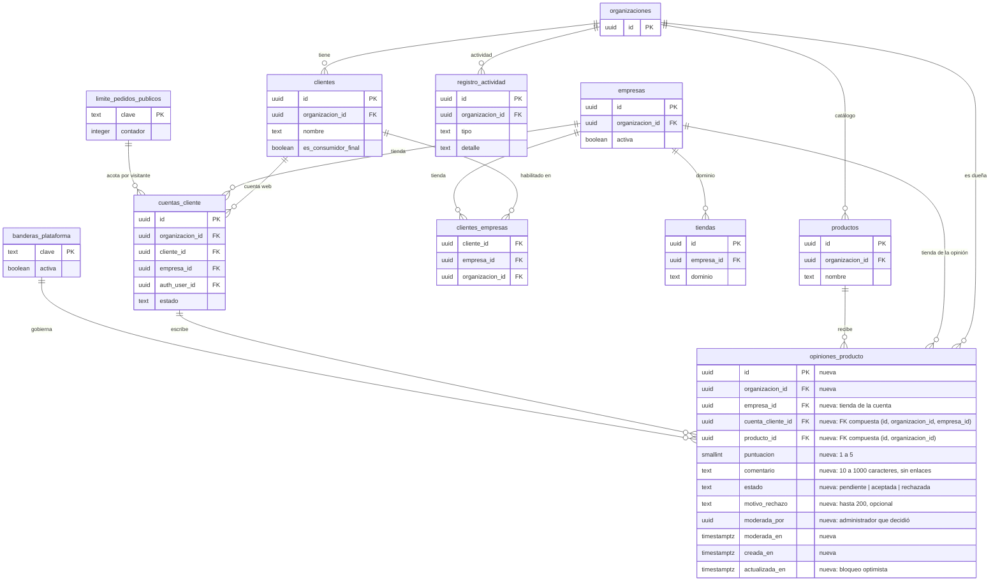
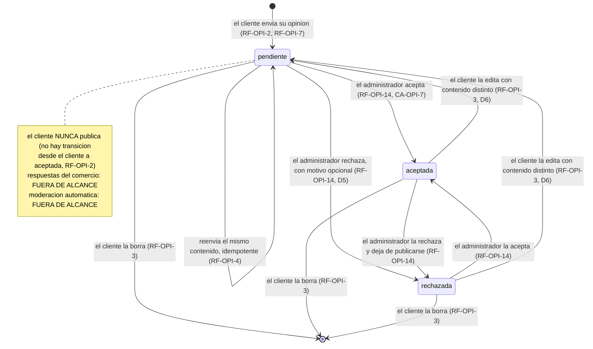
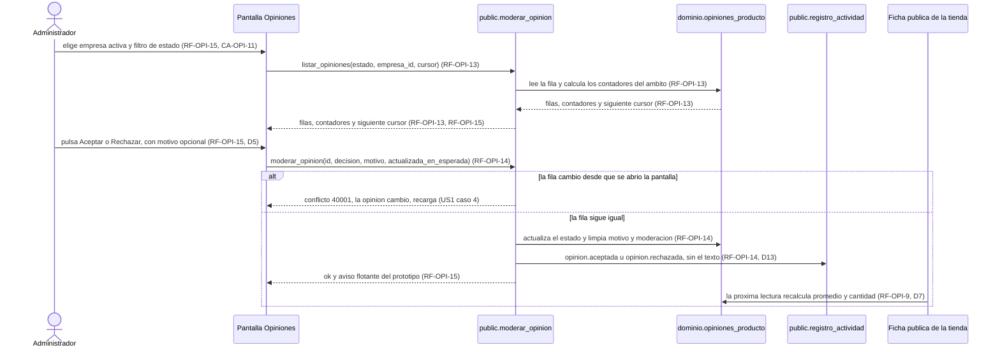
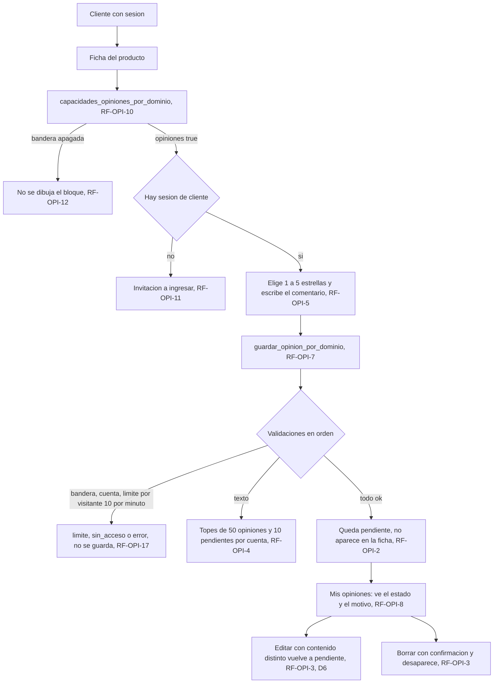
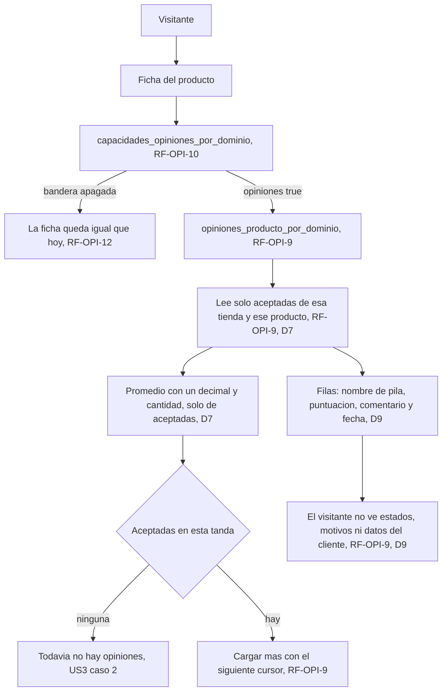

# Feature Specification: Opiniones de productos en la tienda (MSF-467)

**Épica**: MSF-467 «Tiendas online · Opiniones» (Etapa 2, P2 provisoria) · **Spec**: `opiniones-de-productos` · **Prioridad**: P2
**Alcance de entrega**: `refine` y `supabase` (sin `kestra`, `superset` ni `workers`).
**Estado**: **implementada y mergeada en `dokploy`** (F-OPI-01 en el PR #1044; F-OPI-02 y F-OPI-03 en el PR #1058; QA y Código/Seguridad aprobados, CI verde). Las tres historias están Finalizadas; **solo queda la fase de cierre** (T029 revisión de seguridad, T030 encendido de la bandera solo en dev, T031 guards finales), que sigue su curso normal del SDLC sobre `dokploy`. La épica no tenía historias cargadas («se redactan al planificar la Etapa 2»): esta spec las define (US1–US3, con código de historia `F-OPI-01`…`F-OPI-03`). La documentación de la épica (este `spec.md`, `plan.md`, `tasks.md` y `contracts/opiniones.md`) está **mergeada en `dokploy`** por el PR #1075.
**Fuente**: decisión de Nicolás (2026-11-15), el ticket MSF-467, el prototipo `design/pantallas/Opiniones.dc.html` (+ `Opiniones.inventory.json` y la entrada «Opiniones (Etapa 2)» de `AdminSider.dc.html`), `docs/tienda-compra-y-cuentas.md` (cuenta web, MSF-237/MSF-176), `docs/tienda-contacto.md` y `docs/seguridad-tienda-compra-y-cuentas.md` (límites por visitante HMAC), `docs/tiendas-online.md`, `docs/tienda-opiniones.md` y el código vigente de `dokploy` (migraciones hasta `20270419000200`).

## Objetivo

Que un **cliente con cuenta web activa** deje una **opinión con puntuación** (1 a 5 estrellas y un comentario) sobre un producto de **su** tienda, y que un **administrador** la **modere antes de que se publique** (moderación previa): solo las opiniones **aceptadas** se muestran en la ficha pública del producto, junto con el **promedio** y la **cantidad**. Todo detrás de una bandera apagada por defecto.

## Estado de la entrega y decisiones pendientes

Esta sección **no describe alcance nuevo**: documenta el estado real de la épica y qué falta para cerrarla. Es la que manda sobre cualquier lectura de «sin implementar» de versiones previas de esta spec.

### ✅ Implementada y mergeada

- **Historias**: F-OPI-01 (PR #1044 `feat/opiniones-fases-1-y-2`), F-OPI-02 y F-OPI-03 (PR #1058 `feat/opiniones-fases-3-a-5`), con QA y Código/Seguridad aprobados y CI verde. T001–T028 están `[x]` con su evidencia.
- **Documentación de la épica mergeada**: el PR #1075 (`epic/MSF-467-tiendas-online-opiniones` → `dokploy`) se **mergeó** el 2026-11-16 a las 11:10:51 (merge commit `78a893bb`), con `application`, `quality`, `liberar` y `validacion` en verde. Antes del merge, un commit `chore: integra dokploy` trayó el estado vigente de `dokploy` a la rama, así que el merge **no revirtió** la implementación real (PR #1044 y #1058). **El release a DEV quedó destrabado y la rama ya no está desfasada**: no hace falta ningún rebase manual.
- **Pendiente real**: **T029** (revisión de seguridad), **T030** (encendido de `tienda_opiniones` solo en dev) y **T031** (guards finales) siguen `[ ]` y se ejecutan sobre `dokploy`, que es donde vive la implementación.

### 🛡️ Decisiones de producto que le corresponden a Nicolás

No bloquean ningún trabajo técnico: la funcionalidad está entregada y apagada por defecto (D11).

1. **Bandera `tienda_opiniones` en dev**: ¿se enciende ahora o se espera a que cierren T029–T031 sobre `dokploy`? El procedimiento exacto de encendido está en `docs/tienda-opiniones.md`; staging y producción quedan apagados.
2. **Decisiones delegadas D1–D16** (en particular **D3**: no exigir compra previa para opinar) y la **respuesta del comercio** al cliente, que quedó **fuera de alcance** (ver «Fuera de alcance»): ¿se confirman tal cual o se cambian?

Mientras eso no se responda, la épica **no se cierra** y **no se vuelve a generar un PR de release** (los PR #1045 y #1067–#1075 fueron regeneraciones de la misma cabeza; el último se mergeó sin cambios de código).

> **Causa raíz ya trazada, sin pendiente en esta épica**: Release reintentaba el merge a DEV ignorando la etiqueta `desarrollo-manual` de la rama. Se abrió **MSF-984** (hija de MSF-515, deuda técnica) para que Release filtre esa label; no es el mismo bug que MSF-951 (ese es el sweep de adopción Backlog→Ready).

## Decisión de negocio (Nicolás, 2026-11-15) y decisiones delegadas

**Decisión tomada por Nicolás**: (1) opinan los **clientes con cuenta web**, con puntuación, sobre un producto en la **tienda pública**; (2) el administrador **modera antes de publicar**: una opinión nueva queda **pendiente** y no se ve hasta que se acepta. Nicolás confirmó esta propuesta.

Todo lo demás lo decidió el redactor con criterio simple y coherente con el repo. **Cada «Decisión (delegada)» está para que Nicolás la revise** (es la decisión pendiente 2 del «Estado de la entrega»): cambiarla ahora es un cambio de código sobre lo ya mergeado, no una edición de esta spec.

| # | Decisión (delegada) | Motivo |
|---|---|---|
| D1 | **Escala de 1 a 5 estrellas enteras**, sin medias estrellas. El comentario es **obligatorio** (10 a 1.000 caracteres). | El prototipo muestra «N sobre 5» y un texto en cada opinión. Un comentario obligatorio le da algo que moderar al administrador y evita puntuaciones vacías. |
| D2 | **Una opinión por cuenta web y producto** (única `(cuenta_cliente_id, producto_id)`). Para opinar de nuevo se **edita** la existente. | Evita inflar el promedio con duplicados; es el mismo tipo de unicidad que favoritos. |
| D3 | **No se exige haber comprado el producto.** Alcanza con una cuenta web **activa** en esa tienda. No hay marca «compra verificada». | Exigir compra obliga a cruzar comprobantes de cualquier canal (mostrador, teléfono, tienda) y deja afuera a quien compró sin cuenta; la moderación previa ya filtra abuso. Si Nicolás lo quiere, es un chequeo extra en una sola RPC (ver Fuera de alcance). |
| D4 | **Estados**: `pendiente` → `aceptada` / `rechazada`. «Aceptada» es lo que el roadmap llama «publicada» (el prototipo y la pantalla dicen «Aceptada»; un solo nombre en base, API y UI). Se puede aceptar una rechazada y rechazar (despublicar) una aceptada, como muestran los botones del prototipo (`canAcc` / `canRej`). | Igual al prototipo; permite corregir un error de moderación sin tocar la base. |
| D5 | **Motivo de rechazo opcional** (hasta 200 caracteres). Lo ve el administrador y **también el cliente** en «Mis opiniones», para que sepa qué corregir. | El prototipo no tiene el campo: se declara una UI mínima (diálogo corto al rechazar, ver la matriz). Sin motivo, el cliente solo ve «Rechazada». |
| D6 | **El cliente puede editar y borrar su opinión.** Editar una opinión **aceptada o rechazada la devuelve a `pendiente`** (y la oculta de la ficha hasta moderarla de nuevo); borrar la elimina por completo. | Con moderación previa, un texto editado es un texto nuevo y debe volver a revisarse; si no, se podría publicar algo limpio y cambiarlo después. Borrar atiende el pedido de supresión de datos sin intervención del comercio. |
| D7 | **Solo cuentan las aceptadas**: el **promedio** (un decimal) y la **cantidad** que se ven en la ficha salen únicamente de opiniones aceptadas de **esa tienda y ese producto**. Sin opiniones aceptadas no se muestra promedio, solo «Todavía no hay opiniones». | Un promedio con pendientes se movería antes de moderar y daría pistas del contenido. |
| D8 | **Aislamiento por tienda (empresa)**: cada opinión pertenece a la tienda de la cuenta que la escribió; una tienda **nunca** muestra opiniones de otra aunque comparta producto o cliente. | El prototipo dice «Cada opinión pertenece a la tienda donde se compró» y las cuentas web ya son por tienda (D-2 de MSF-176). |
| D9 | **Privacidad: en público se muestra solo el nombre de pila** (primera palabra de `clientes.nombre`, hasta 30 caracteres; «Cliente» si queda vacío), la fecha y la puntuación. Nunca apellido, correo, teléfono, DNI ni identificadores. El nombre se calcula al leer (no se copia a la opinión). El **administrador** ve el nombre completo del cliente en el panel (es su cliente y lo necesita para moderar). | Mínimo dato personal público; sin copia no queda un dato que sobreviva a un cambio o baja del cliente. |
| D10 | **Quién modera: el Administrador de la organización** (`private.es_administrador_de`); el prototipo marca la entrada de menú «Opiniones» solo para `admin`. Ningún otro rol ve la pantalla ni ejecuta las RPC de moderación. | Coherente con el prototipo y con Listas de precios; no se crea una sección de permisos nueva. |
| D11 | **Bandera `tienda_opiniones`, apagada por defecto en todo entorno** (`public.banderas_plataforma`). Se enciende solo en dev, con SQL del equipo técnico; ninguna migración ni despliegue la enciende. Apagada: las RPC del cliente y de lectura pública responden `sin_acceso` / lista vacía **sin tocar datos**; el panel muestra el aviso y solo permite lo que reduce exposición (rechazar). | Mismo patrón que `tienda_pedidos` (MSF-176) y `listas_precios`. |
| D12 | **Anti-abuso**: (a) límite por visitante con el HMAC existente: `private.visitante_publico(host)` + `private.registrar_pedido_publico` con clave propia `opinion\|…` (**10 llamadas por minuto** en escritura y 30 en lectura; falla cerrada sin IP); (b) tope de **50 opiniones por cuenta** y de **10 pendientes** a la vez; (c) el comentario **no admite enlaces** (`http`, `www.`, dominios) ni caracteres de control o marcas de dirección: responde `invalido`; (d) idempotencia: guardar dos veces el mismo texto no cambia estado ni gasta cupo extra. | Reutiliza lo ya revisado (MSF-945/946) en lugar de inventar un limitador; los enlaces son el spam típico (el prototipo lo ilustra con «Mensaje con enlaces a otro sitio de venta»). |
| D13 | **Sin avisos por correo** al administrador ni al cliente. La pantalla muestra el contador de **Pendientes**; el cliente ve el estado en «Mis opiniones». Los eventos de moderación quedan en **Actividad** (`opinion.aceptada`, `opinion.rechazada`; solo producto y puntuación, nunca el texto). | Sin infraestructura nueva (Kestra/Workers). Un aviso agrupado es una mejora posterior. |
| D14 | **Las opiniones entran en la exportación total** de la organización (son dato del negocio, a diferencia de favoritos, que es privado del cliente). | La exportación total es la garantía de portabilidad del administrador; incluye todo lo que el negocio posee. |
| D15 | **Retención**: no hay purga automática. Se conservan hasta que el cliente las borra, se da de baja su cuenta (`on delete cascade`) o se elimina el producto. | Evita un proceso nuevo; los casos de supresión ya están cubiertos. |
| D16 | **UI mínima de la tienda** (el prototipo solo dibuja la pantalla del administrador): bloque «Opiniones» en la ficha del producto (promedio, cantidad, lista con «Cargar más») y, con sesión, un formulario «Tu opinión» + «Mis opiniones» en la cuenta. Se arma con los componentes y tokens de la tienda, sin copiar HTML del prototipo. | Los requisitos mandan el comportamiento; sin dibujo, lo más cercano sin inventar secciones nuevas. |

> **Para Nicolás (el ticket dice más que la decisión)**: la descripción de MSF-467 habla de que el equipo «**modera y responde**». La decisión del 2026-11-15 solo confirma moderar; las **respuestas del comercio quedan fuera** de esta spec (ver Fuera de alcance) y se pueden sumar después como una columna más. Es parte de la decisión pendiente 2.

## Modelo y supuestos (verificados en el código de `dokploy`)

- **Dependencias**: MSF-467 no declara que bloquee ni que sea bloqueada por otra épica. En la práctica se apoya en dos cosas ya mergeadas en `dokploy`: la **cuenta web del cliente** (MSF-237/MSF-176), que da la identidad de quien opina, y la **ficha de producto de la tienda**, donde se muestra el bloque. No hace falta ninguna épica previa para que la funcionalidad arranque.
- La cuenta web es `public.cuentas_cliente` (una por cliente y tienda, estado `activa`/`suspendida`). La identidad de las RPC públicas sale de **`private.cuenta_de_tienda(host)`**, que devuelve `(cuenta_cliente_id, cliente_id, organizacion_id, empresa_id, tipo)` solo si la cuenta está activa, el cliente habilitado y la tienda activa; **ninguna RPC recibe `cliente_id`, `empresa_id` ni `organizacion_id`**.
- La visibilidad de un producto en una tienda la define `private.catalogo_tienda_efectivo`; una opinión solo se escribe y se lee sobre un producto **efectivamente visible**.
- El límite por visitante ya existe: `private.visitante_publico(host)` (HMAC con secreto de Vault, MSF-946) y `private.registrar_pedido_publico(clave, tope)` sobre `public.limite_pedidos_publicos`.
- La ficha pública es `publico.producto_por_dominio(host, producto)`. Esta spec **no la modifica**: el bloque de opiniones llama a RPC propias, así no se rediseña una función que otras épicas redefinen.
- El panel usa RPC `security definer` en `public` con `private.es_administrador_de`, auditoría con `private.registrar_actividad` y banderas con `private.bandera_activa`.

### Esquema de datos (Constitución, Principio VII), verificado objeto por objeto

| Objeto | Esquema | Por qué |
|---|---|---|
| `dominio.opiniones_producto` (nueva) | **`dominio`** | Contenido de negocio sobre un producto del catálogo de una tienda; no es plataforma. Se ata a la cuenta (identidad, `public`) y al producto. |
| `private.validar_texto_opinion`, `private.nombre_publico_cliente` | `private` | Lógica interna sin `execute` para la API. |
| RPC del panel: `public.listar_opiniones`, `public.moderar_opinion` | `public` | Superficie del panel, igual que las RPC de listas de precios. |
| RPC de la tienda: `publico.guardar_opinion_por_dominio`, `borrar_opinion_por_dominio`, `mis_opiniones_por_dominio`, `opiniones_producto_por_dominio`, `capacidades_opiniones_por_dominio` | `publico` | Superficie de la tienda; `publico` sigue **sin tablas**. |
| Fila `tienda_opiniones` en `public.banderas_plataforma` | `public` | Bandera de plataforma, igual que `tienda_pedidos`. |

## Modelo de datos (DER)

La única tabla nueva es `dominio.opiniones_producto`. No se altera ninguna tabla existente. Se muestra el grafo completo al que se ata (cuenta, cliente, tienda, producto, actividad, bandera y limitador).

| Tabla | Estado | Cambio |
|---|---|---|
| `dominio.opiniones_producto` | nueva | Opinión de una cuenta web sobre un producto de su tienda: puntuación 1–5, comentario, estado de moderación, motivo de rechazo y quién/cuándo moderó |
| `public.cuentas_cliente` | existente | Cuenta web del cliente en una tienda; autora de la opinión (FK compuesta con organización y tienda) |
| `public.clientes` | existente | Cliente; su nombre de pila es lo único que se publica |
| `public.clientes_empresas` | existente | Tiendas en las que el cliente está habilitado (parte de `cuenta_de_tienda`) |
| `dominio.empresas` | existente | Tienda dueña de la opinión |
| `dominio.tiendas` | existente | Dominio de la tienda; resuelve el host de las RPC públicas |
| `dominio.productos` | existente | Producto opinado |
| `public.organizaciones` | existente | Organización dueña de todo |
| `public.registro_actividad` | existente | Eventos `opinion.aceptada` y `opinion.rechazada` |
| `public.banderas_plataforma` | existente | Bandera `tienda_opiniones` (fila nueva, no cambia el esquema) |
| `public.limite_pedidos_publicos` | existente | Contador por visitante (HMAC) del límite de llamadas |

Reglas de la tabla (las impone la base, no el front):

- **Aislamiento**: FK compuestas `(cuenta_cliente_id, organizacion_id, empresa_id)` → `public.cuentas_cliente` (índice único `cuentas_cliente_id_org_empresa_uq` ya existente), `(empresa_id, organizacion_id)` → `dominio.empresas` y `(producto_id, organizacion_id)` → `dominio.productos`, todas `on delete cascade`: una fila no puede mezclar organizaciones ni apuntar a una tienda distinta de la de su cuenta.
- **Checks**: `puntuacion between 1 and 5`; `char_length(btrim(comentario)) between 10 and 1000`; `estado in ('pendiente','aceptada','rechazada')`; `motivo_rechazo` ≤ 200 y solo con estado `rechazada`; `moderada_por`/`moderada_en` presentes si y solo si el estado no es `pendiente`.
- **Índices**: único `(cuenta_cliente_id, producto_id)`; parcial `(empresa_id, producto_id, creada_en desc, id desc) where estado = 'aceptada'` para la ficha; `(organizacion_id, empresa_id, estado, creada_en desc, id desc)` para el panel.
- **RLS activada sin políticas y sin ningún privilegio** para `anon`, `authenticated` ni `public` (como `favoritos_cliente`): solo las RPC `security definer` leen y escriben.

## User Scenarios & Testing *(mandatory)*

### US1 (F-OPI-01) — El administrador modera las opiniones (P1)

Un administrador abre **Opiniones** en el menú, ve cuántas hay **Pendientes / Aceptadas / Rechazadas**, filtra por estado y por tienda, lee cada opinión («Sobre: producto», estrellas, texto) y pulsa **Aceptar** o **Rechazar**. Solo lo aceptado se verá en la tienda.

1. **Dado** una opinión pendiente, **cuando** la acepto, **entonces** pasa a «Aceptada», el contador de pendientes baja, queda el evento en Actividad y, desde ese momento, aparece en la ficha de su tienda.
2. **Dado** una opinión pendiente, **cuando** la rechazo (con o sin motivo), **entonces** queda «Rechazada» y no se publica; el cliente la ve rechazada en «Mis opiniones» (con el motivo si lo hay).
3. **Dado** una opinión aceptada, **cuando** la rechazo, **entonces** deja de verse en la tienda y el promedio y la cantidad se recalculan.
4. **Dado** otro administrador que moderó la misma opinión un segundo antes, **cuando** pulso un botón con la pantalla vieja, **entonces** veo «La opinión cambió, recargá» y no se pisa su decisión.
5. **Dado** un usuario que no es administrador, **cuando** intenta abrir la pantalla o llamar la RPC, **entonces** no hay entrada de menú y la RPC responde `42501`.

### US2 (F-OPI-02) — El cliente deja, edita y borra su opinión (P1)

Un cliente con sesión en la tienda abre la ficha de un producto, elige estrellas, escribe su comentario y lo envía. Ve «Gracias, tu opinión se publicará cuando la revisemos». En «Mis opiniones» ve el estado de cada una, puede editarla o borrarla.

1. **Dado** una cuenta activa y un producto visible, **cuando** envío 4 estrellas y un comentario válido, **entonces** queda `pendiente` y no aparece en la ficha pública.
2. **Dado** que ya opiné sobre ese producto, **cuando** vuelvo a enviar, **entonces** se edita la misma opinión (no se crea otra) y vuelve a `pendiente` si el contenido cambió.
3. **Dado** un comentario con un enlace, **cuando** lo envío, **entonces** veo el error del campo y no se guarda.
4. **Dado** un visitante sin sesión o con una cuenta suspendida, **cuando** intenta opinar, **entonces** ve la invitación a ingresar (o el mismo `sin_acceso` genérico) y nada se guarda.
5. **Dado** que borro mi opinión, **cuando** confirmo, **entonces** desaparece de «Mis opiniones», de la ficha y del promedio.

### US3 (F-OPI-03) — El visitante ve las opiniones aceptadas, el promedio y la cantidad (P2)

En la ficha de un producto, cualquier visitante ve «4,5 de 5 · 12 opiniones» y la lista de opiniones aceptadas (nombre de pila, estrellas, fecha, texto), nuevas primero, con «Cargar más».

1. **Dado** un producto con opiniones aceptadas, **cuando** abro la ficha, **entonces** veo promedio, cantidad y las primeras 10, sin pendientes ni rechazadas.
2. **Dado** un producto sin opiniones aceptadas, **cuando** abro la ficha, **entonces** veo «Todavía no hay opiniones» y, si tengo sesión, el formulario.
3. **Dado** la bandera apagada, **cuando** abro la ficha, **entonces** no se dibuja ningún bloque de opiniones y la ficha es idéntica a la de hoy.
4. **Dado** dos tiendas con el mismo producto, **cuando** miro la ficha de cada una, **entonces** cada una muestra solo sus opiniones.

### Casos borde

- **Cuenta suspendida o baja de «Habilitado en» después de opinar**: las opiniones **aceptadas siguen visibles** (son contenido ya moderado); la persona ya no puede crear, editar ni borrar hasta recuperar el acceso.
- **Producto que se oculta, se desactiva o cambia de categoría oculta**: sus opiniones no se muestran ni cuentan en la tienda; **no se borran** y reaparecen si vuelve a ser visible. El panel las sigue listando.
- **Producto eliminado**: las opiniones se borran en cascada.
- **Cliente fusionado con otro** (fusión de clientes): la opinión sigue atada a la cuenta, así que no se duplica ni se pierde. Como el `on delete cascade` de `dominio.opiniones_producto` se llevaba **todas** las opiniones de la cuenta web dada de baja, `public.fusionar_clientes` **reasigna** antes de la baja las opiniones a la cuenta que se mantiene de la misma tienda; si las dos cuentas de la fusión opinaron el mismo producto (única `(cuenta_cliente_id, producto_id)`), se conserva la más reciente por `actualizada_en` y se descarta la otra. Una opinión de una tienda donde la cuenta que se mantiene no tiene cuenta no puede moverse (la FK compuesta exige la misma tienda) y se va con la cuenta dada de baja (ver T018).
- **Texto con HTML, scripts o emojis**: se guarda y se muestra **literal** (nodos de React); un `<script>` no se interpreta. El largo se mide en caracteres de Postgres: con emojis el borde puede diferir en ±1 y el servidor manda.
- **Consumidor final / cliente archivado**: no tienen cuenta web válida (`cuenta_de_tienda` no devuelve nada); no pueden opinar.
- **Moderar a la vez que el cliente edita**: gana la última escritura **con bloqueo optimista**: la RPC de moderación recibe `actualizada_en` y responde `conflicto` si la fila cambió (D6: una edición vuelve a `pendiente`, así que una aceptación vieja no puede publicar el texto nuevo).
- **Cambio de empresa activa con la pantalla de moderación abierta**: ver la fila «Empresa activa» de la matriz.
- **Reintento por red caída**: guardar es idempotente (mismo contenido = misma fila, sin cambiar estado ni fecha).
- **Muchas opiniones**: la ficha y el panel cargan por tandas con cursor `(creada_en, id)`; el promedio y la cantidad se calculan con el índice parcial, sin leer el texto.

## Requirements *(mandatory)*

### Datos y reglas (US1–US3)

- **RF-OPI-1**: Existe `dominio.opiniones_producto` con las columnas, checks, FK compuestas e índices del DER; RLS activada sin políticas y sin privilegios para `anon`, `authenticated` ni `public`.
- **RF-OPI-2**: Una opinión nueva nace siempre `pendiente`. Solo una moderación explícita de un administrador la cambia a `aceptada` o `rechazada`; **ningún camino** del cliente publica directamente.
- **RF-OPI-3**: El cliente solo puede **crear, editar y borrar su propia** opinión (la de su cuenta); editar una `aceptada` o `rechazada` con contenido distinto la devuelve a `pendiente`, limpia motivo y moderación; borrar la elimina.
- **RF-OPI-4**: Unicidad por `(cuenta_cliente_id, producto_id)` (índice de la tabla, RF-OPI-1) y topes de **50 opiniones por cuenta** y **10 pendientes** a la vez (`limite_opiniones` / `limite_pendientes`), los aplican las RPC de la tienda.
- **RF-OPI-5**: Validación **en servidor** (`private.validar_texto_opinion`): puntuación entera 1–5; comentario recortado de 10 a 1.000 caracteres, sin caracteres de control, separadores ni marcas de dirección, **sin enlaces**; motivo de rechazo ≤ 200.
- **RF-OPI-6**: Solo se escribe y se lee sobre productos **efectivamente visibles** en la tienda del host (`private.catalogo_tienda_efectivo`); inexistente, oculto, inactivo, de otra tienda u otra organización responden todos `no_encontrado`.

### Tienda (US2, US3)

- **RF-OPI-7**: `publico.guardar_opinion_por_dominio(host, producto_id, puntuacion, comentario)` y `publico.borrar_opinion_por_dominio(host, producto_id)`, solo `authenticated`; identidad exclusivamente de `private.cuenta_de_tienda(host)`; orden de verificaciones: bandera → cuenta → límite → validar → trabajar (contrato en `contracts/opiniones.md`).
- **RF-OPI-8**: `publico.mis_opiniones_por_dominio(host, desde_creada, desde_id, limite)` devuelve las opiniones de la cuenta con su estado y el motivo de rechazo; solo la cuenta autora las ve.
- **RF-OPI-9**: `publico.opiniones_producto_por_dominio(host, producto_id, desde_creada, desde_id, limite)` (`anon` y `authenticated`) devuelve el **resumen** (`promedio` con un decimal, `cantidad`) y las opiniones **aceptadas** con una **lista blanca** de campos: `nombre_pila`, `puntuacion`, `comentario`, `fecha` (día), y, si hay sesión, `es_mia`. Nunca ids de cliente, cuenta, organización ni empresa, correo, apellido, estado ni motivo.
- **RF-OPI-10**: `publico.capacidades_opiniones_por_dominio(host)` → `{estado:"ok", opiniones:true|false}` para que el front dibuje o no el bloque. Host desconocido, empresa desactivada y tienda pausada responden lo mismo (`{estado:"error"}`), sin distinguir casos.
- **RF-OPI-11** (escribir): formulario «Tu opinión» en la ficha (estrellas operables con teclado, contador de caracteres) con sesión, invitación a ingresar sin sesión, y «Mis opiniones» dentro de «Mi cuenta» con editar y borrar (con confirmación) y el estado de cada una.
- **RF-OPI-12**: Con la bandera apagada el servidor impone el comportamiento (RF-OPI-7 a 10 no tocan datos) y el front no dibuja nada; la ficha es idéntica a la actual.
- **RF-OPI-20** (espejo en cliente): el navegador aplica **las mismas reglas** que el servidor (puntuación 1–5, comentario de 10 a 1.000 caracteres, sin enlaces ni caracteres de control) y se prueba con los mismos casos que la base.
- **RF-OPI-21** (leer en la ficha): bloque «Opiniones» de la ficha del producto con promedio, cantidad, lista con carga por tandas y «Cargar más», montado solo con la capacidad activa.

### Moderación (US1)

- **RF-OPI-13**: `public.listar_opiniones(estado, empresa_id, desde_creada, desde_id, limite)` (solo Administrador) devuelve por tandas las opiniones de la organización (o de una tienda) con tienda, nombre completo del cliente, producto, puntuación, texto, estado, motivo y `actualizada_en`, más los **contadores** Pendientes / Aceptadas / Rechazadas del mismo ámbito.
- **RF-OPI-14**: `public.moderar_opinion(id, decision, motivo, actualizada_en_esperada)` (solo Administrador): `aceptar` o `rechazar`; idempotente (repetir la misma decisión responde `ok` sin duplicar el evento); bloqueo optimista (`40001` / `conflicto`); registra `opinion.aceptada` u `opinion.rechazada` en Actividad con producto y puntuación, **sin el texto**. Con la bandera apagada solo se permite `rechazar`.
- **RF-OPI-15**: Pantalla **Opiniones** del panel, según el prototipo: título, aviso «Las opiniones nuevas quedan pendientes hasta que las aceptes o rechazes. Solo las aceptadas se muestran en la tienda.», filtro de tienda, tres contadores, filtros Pendientes / Aceptadas / Rechazadas / Todas (por defecto Pendientes), lista con tienda, nombre, fecha, estado, «N sobre 5», texto y «Sobre: producto», y botones **Aceptar** / **Rechazar** (cada uno oculto cuando ya es el estado actual). Carga infinita con «Cargar más».

### Seguridad y datos (transversal)

- **RF-OPI-16**: Toda RPC pública lleva `revoke … from public, anon` y `grant execute … to authenticated` explícitos (las dos de lectura y la de capacidades, además a `anon`); `security definer`, `set search_path = ''`; el `exception when others` registra solo `sqlstate`. El test que prohíbe funciones de `public` ejecutables por `anon` sigue verde: las de `anon` viven en `publico` y figuran en su lista blanca.
- **RF-OPI-17**: Límite por visitante con `private.visitante_publico` y `private.registrar_pedido_publico` (D12); la IP nunca se guarda; sin cabecera `x-forwarded-for` todos comparten un único cupo («sin-ip», falla cerrada).
- **RF-OPI-18**: Las opiniones entran en la exportación total (`private.conjuntos_exportacion_total`) y no se agregan a las exclusiones.
- **RF-OPI-19**: Migraciones **aditivas**, cada una con su reversión documentada, numeradas **por encima de la cola de `dokploy` en el momento de escribirse**: F-OPI-01 ocupó la ventana `20270341000000`–`20270341000500`; F-OPI-02 y F-OPI-03, al empezar, renumeraron a `20270419000000`+ porque la ventana `20270341…` ya no era mayor que la cola. `node scripts/verificar-migraciones.mjs --estricto` verde.

### Criterios de aceptación

- **CA-OPI-1** (RF-OPI-2, 3): una opinión nueva y una editada quedan `pendiente`; ninguna llamada del cliente cambia `estado` a otro valor.
- **CA-OPI-2** (RF-OPI-4): el 51.º producto o la 11.ª pendiente responden `limite_opiniones` / `limite_pendientes` sin guardar; reenviar la misma opinión es `ok`.
- **CA-OPI-3** (RF-OPI-5): puntuación 0 o 6, comentario de 9 o 1.001 caracteres, con enlace o con caracteres de control responden `invalido` con los campos erróneos y no guardan.
- **CA-OPI-4** (RF-OPI-9, D7): la ficha muestra solo aceptadas; promedio y cantidad coinciden con ellas; pendientes y rechazadas no aparecen ni cuentan; la respuesta no contiene ninguna clave fuera de la lista blanca.
- **CA-OPI-5** (D8, RF-OPI-1): una cuenta de la tienda A no puede crear ni leer opiniones de la tienda B; las FK compuestas impiden insertar una fila con tienda distinta a la de su cuenta.
- **CA-OPI-6** (D9): el nombre público es solo la primera palabra del nombre del cliente; con «Valeria Sánchez» se ve «Valeria».
- **CA-OPI-7** (RF-OPI-14): aceptar y rechazar cambian el estado, registran el evento y recalculan promedio y cantidad; con `actualizada_en` vieja responde `conflicto`.
- **CA-OPI-8** (D10): un usuario no administrador recibe `42501` en `listar_opiniones` y `moderar_opinion`; no ve la entrada de menú.
- **CA-OPI-9** (RF-OPI-14, D11): con la bandera apagada, el panel solo permite **rechazar**: `moderar_opinion` con `aceptar` responde `55000` y ninguna moderación cambia datos.
- **CA-OPI-13** (RF-OPI-7, D11): con la bandera apagada, `guardar_opinion_por_dominio` y `borrar_opinion_por_dominio` responden `sin_acceso` y la tabla no cambia (escritura de la tienda).
- **CA-OPI-10** (RF-OPI-17): superado el límite por minuto, la RPC responde `limite` con `espera_segundos` aun para llamadas inválidas.
- **CA-OPI-11** (RF-OPI-15): con la empresa activa elegida, la lista y los contadores corresponden solo a esa tienda; con «Todas», aparece la tienda de cada fila.
- **CA-OPI-12** (RF-OPI-18): la exportación total incluye `dominio.opiniones_producto` y su prueba falla si se omite.

### Criterios de éxito

- **SC-001**: ninguna opinión no moderada es visible para un visitante por ninguna RPC ni consulta directa (pgTAP con `anon`, `authenticated` de otra tienda y la propia cuenta).
- **SC-002**: promedio y cantidad de la ficha coinciden exactamente con las opiniones aceptadas del producto en esa tienda en una muestra con pendientes, rechazadas y otra tienda.
- **SC-003**: `rls_en_toda_tabla` y `privilegios_anon_endurecidos` verdes con la tabla nueva; ninguna función nueva de `public` ejecutable por `anon`.
- **SC-004**: con la bandera apagada, la ficha y la cuenta son idénticas a las de `dokploy` (prueba de paridad del front y de las RPC).

## Verificación por requisito

Las pruebas de base de datos corren en el job `database` del CI (`pnpm test:db`, pgTAP); las de interfaz con Vitest + axe; el recorrido completo con Playwright.

| Requisito | Verificación (test / comando) |
|---|---|
| RF-OPI-1 | pgTAP `opiniones_producto.test.sql`: estructura, checks, FK compuestas (fila con tienda ajena rechazada), RLS activa, **grants exactos** (ninguno a `anon`/`authenticated`/`public`), `search_path` |
| RF-OPI-2, 3 | pgTAP `opiniones_cliente.test.sql`: alta `pendiente`, edición que vuelve a `pendiente`, intento de forzar `estado`, borrado, no tocar la de otra cuenta |
| RF-OPI-4 | pgTAP `opiniones_cliente.test.sql`: unicidad, topes 50 y 10, idempotencia |
| RF-OPI-5 | pgTAP `opiniones_validacion.test.sql` (9/10/1.000/1.001, `http`, `www.`, dominio suelto, RTL, emoji) |
| RF-OPI-6 | pgTAP `opiniones_cliente.test.sql`: producto inexistente, oculto, inactivo, de otra tienda y de otra organización → `no_encontrado` idéntico |
| RF-OPI-7, 8 | pgTAP `opiniones_cliente.test.sql`: orden bandera → cuenta → límite → validar; `sin_acceso` idéntico (sin sesión, suspendida, no habilitada, usuario de panel, otra tienda, host desconocido, empresa desactivada) |
| RF-OPI-9, 10 | pgTAP `opiniones_lectura.test.sql`: lista blanca **por claves**, solo aceptadas, promedio/cantidad, cursor, producto oculto, aislamiento entre tiendas, `anon` puede leer y no escribir |
| RF-OPI-11 | Vitest `FormularioOpinion.test.tsx`, `MisOpiniones.test.tsx` (estados vacío, carga, error con reintento, axe a 320/768/1440 px, estrellas con teclado) |
| RF-OPI-12 | pgTAP `opiniones_bandera.test.sql` (apagada: `sin_acceso`, sin cambios en la tabla) y Vitest de paridad de la ficha |
| RF-OPI-13, 14 | pgTAP `opiniones_moderacion.test.sql`: solo Administrador (`42501`), contadores, `40001`/`conflicto`, idempotencia, evento de Actividad sin texto, apagada solo rechaza |
| RF-OPI-15 | Vitest `pages/opiniones/list.test.tsx` (contadores, filtros, botones según estado, diálogo de motivo, carga infinita, axe) |
| RF-OPI-16 | pgTAP `privilegios_anon_endurecidos` y `opiniones_privilegios.test.sql` (`has_function_privilege` por rol de cada RPC) |
| RF-OPI-17 | pgTAP `opiniones_limites.test.sql` (11.ª llamada en el minuto → `limite`; «sin-ip» compartido; inválidas también cuentan) |
| RF-OPI-18 | pgTAP `exportacion_total.test.sql` extendido |
| RF-OPI-19 | `node scripts/verificar-migraciones.mjs --estricto` |
| RF-OPI-20 | Vitest `validacion.test.ts` (espejo cliente-servidor: **los mismos casos** que RF-OPI-5) |
| RF-OPI-21 | Vitest `OpinionesProducto.test.tsx` (bloque de la ficha: promedio, cantidad, «Cargar más», estado vacío, montado solo con la capacidad activa) |
| CA-OPI-3 | pgTAP `opiniones_validacion.test.sql`: puntuación 0 o 6, comentario de 9 o 1.001 caracteres, con enlace o con caracteres de control → `invalido` con los campos erróneos y sin guardar |
| CA-OPI-11 / empresa activa | Vitest `list.test.tsx`: cambiar la empresa activa recarga lista y contadores, reencuadra la tanda, descarta lo seleccionado y cierra el diálogo de rechazo con aviso |
| CA-OPI-13 | pgTAP `opiniones_bandera.test.sql`: con la bandera apagada, escritura → `sin_acceso` y la tabla sin cambios |
| E2E | Playwright `apps/web/e2e/tienda-opiniones.e2e.ts`: cliente opina → no se ve en la ficha → admin acepta → se ve con promedio → cliente edita → desaparece hasta moderar → cliente borra (se omite sin `SUPABASE_URL`/`SUPABASE_SERVICE_ROLE_KEY`, como los demás E2E de tienda) |
| SC-001 | `opiniones_lectura.test.sql` (barrido por rol) |
| SC-002 | `opiniones_lectura.test.sql` (muestra mixta) |
| SC-003 | `rls_en_toda_tabla.test.sql` y `privilegios_anon_endurecidos.test.sql` |
| SC-004 | `opiniones_bandera.test.sql` y Vitest de la ficha |

## Matriz pantalla↔criterios

`pnpm prototipo:inventario` se corrió: **existe** la pantalla `design/pantallas/Opiniones.dc.html` (título «Tienda · Opiniones (Etapa 2)») con inventario `Opiniones.inventory.json`: **botones** «Aceptar» y «Rechazar»; sin tablas con encabezados, campos, tabs ni diálogos declarados. El HTML dibuja además: título, aviso informativo, filtro de tienda (píldoras), tres contadores, filtros de estado, la lista de opiniones y un aviso flotante («Opinión aceptada: ya se muestra en la tienda», «Opinión rechazada»). **El prototipo no dibuja nada de la tienda pública** (bloque en la ficha, formulario, «Mis opiniones»): su UI es la mínima declarada en D16. Tampoco dibuja el motivo de rechazo (D5). Cada ítem visible tiene dueño en la tabla siguiente; las diferencias entre lo dibujado y lo entregado van declaradas como **divergencia declarada** (no se omiten en silencio).

| Ítem | Dueño | Nota |
|---|---|---|
| Título de la pantalla | RF-OPI-15 | El prototipo escribe «Opiniones de clientes · Etapa 2»; el panel usa **«Opiniones»** (sin el sufijo de roadmap) con la descripción «Moderá las opiniones que los clientes dejan sobre tus productos». **Divergencia declarada**: el sufijo «Etapa 2» es una marca del roadmap, no del producto |
| Botón **Aceptar** (visible salvo si ya está aceptada) | RF-OPI-14, RF-OPI-15, CA-OPI-7 | Aviso de resultado «Opinión aceptada» (el prototipo lo redacta «Opinión aceptada: ya se muestra en la tienda») |
| Botón **Rechazar** (visible salvo si ya está rechazada) | RF-OPI-14, RF-OPI-15, CA-OPI-7 | Aviso «Opinión rechazada». **Decisión D5**: abre un diálogo corto con «Motivo (opcional)», «Rechazar» y «Cancelar»; el prototipo no lo dibuja (UI mínima declarada) |
| Aviso «Las opiniones nuevas quedan pendientes…» | RF-OPI-15 | Texto literal del prototipo |
| Aviso flotante tras decidir («Opinión aceptada: ya se muestra en la tienda» / «Opinión rechazada») | RF-OPI-15, CA-OPI-7 | Aviso de resultado con el patrón compartido. **Divergencia declarada**: el implementado dice «Opinión aceptada» (el prototipo agrega «: ya se muestra en la tienda»); el aviso de que la opinión ya se publica está en el patrón compartido y en la fila del botón Aceptar |
| Contadores Pendientes / Aceptadas / Rechazadas | RF-OPI-13, RF-OPI-15, CA-OPI-11 | Calculados en servidor para el mismo ámbito del filtro de tienda |
| Filtros Pendientes / Aceptadas / Rechazadas / Todas | RF-OPI-15 | Por defecto «Pendientes»; reinicia la lista |
| Filtro de tienda («Todas las tiendas» + una por empresa) | RF-OPI-15, CA-OPI-11 | `FiltroEmpresa` compartido; ver fila «Empresa activa». El prototipo lo acompaña del texto «Cada opinión pertenece a la tienda donde se compró. Si elegís una empresa en la barra superior, se filtra por esa tienda.» **Divergencia declarada**: el texto implementado dice «donde se escribió», porque «donde se compró» contradice D3 (no se exige compra previa) |
| Fila: chip de tienda, nombre, fecha, estado, «N sobre 5», texto, «Sobre: producto» | RF-OPI-13, RF-OPI-15, CA-OPI-6 | **Contradicción declarada**: el prototipo muestra «Valeria S.» (y «Cliente anónimo»); por D9/D10 el administrador ve el **nombre completo** del cliente y no existen opiniones anónimas. Mandan los requisitos; queda declarado acá y se anotó en el PR de entrega |
| Entrada de menú «Opiniones (Etapa 2)», solo `admin` | RF-OPI-15, CA-OPI-8 | Se llama «Opiniones» (sin «Etapa 2»), en el grupo **Canales** (donde el prototipo la dibuja, junto a Mercado Libre y Newsletter) y después de «Empresas», como en el prototipo; ruta `/opiniones`, sección de audiencia administrador, carga diferida (`lazy`), ícono de estrella del prototipo |
| Bloque «Opiniones» de la ficha, formulario «Tu opinión», «Mis opiniones» (tienda) | RF-OPI-11, RF-OPI-21, CA-OPI-1…4 | **No dibujado**: UI mínima del repo (D16), sin inventar secciones; se agrega a la matriz si el equipo lo dibuja |
| **Empresa activa** | RF-OPI-13, RF-OPI-15, CA-OPI-11 | **Pantalla del panel**: el prototipo lo exige («Si elegís una empresa en la barra superior, se filtra por esa tienda»). La empresa activa de la barra superior es la única fuente: filtra lista y contadores a esa tienda; con «Todas mis empresas» se muestra el chip de tienda en cada fila. `FiltroEmpresa` refleja esa selección (no guarda otra). Al cambiar la empresa: se invalidan y recargan **lista y contadores**, se reinicia la tanda y el cursor, se descarta lo seleccionado y un diálogo de rechazo abierto **se cierra con aviso** (nunca guarda con la empresa anterior). Test: Vitest que cambia la empresa con la pantalla y el diálogo abiertos. **Tienda pública**: «Empresa activa: no aplica» (no es pantalla de panel; la tienda es la del dominio y se resuelve por host) |

## Flujos

Cuatro flujos: el **ciclo de vida** de la opinión (máquina de estados), la **moderación** desde el panel (secuencia), el **alta y la edición** desde la tienda (proceso) y la **lectura en la ficha** (proceso). Cada estado, paso y transición apunta a un RF/CA/SC; lo que no tiene dueño queda declarado **FUERA DE ALCANCE**.

### Flujo 1 · Ciclo de vida de la opinión (máquina de estados)

### Flujo 2 · Moderación desde el panel (secuencia)

Con la bandera `tienda_opiniones` **apagada**, la pantalla solo deja **rechazar**: aceptar responde `55000` y no publica nada (RF-OPI-14, D11).

### Flujo 3 · Dejar, editar y borrar una opinión desde la tienda (proceso)

No se exige haber comprado el producto (D3): la moderación previa es el filtro. Fotos, votos útiles, respuestas del comercio y opiniones anónimas quedan **FUERA DE ALCANCE**.

### Flujo 4 · Ver las opiniones aceptadas en la ficha (proceso)

Estrellas en el catálogo, distribución por estrellas y datos `schema.org` (SEO) quedan **FUERA DE ALCANCE**: solo la ficha del producto.

### Dueño de cada paso, estado y transición

| Flujo | Elemento | Dueño | Nota |
|---|---|---|---|
| 1 | Estado `pendiente` inicial | RF-OPI-2, RF-OPI-7 | Toda alta nace pendiente |
| 1 | `pendiente → pendiente` (reenvío) | RF-OPI-4 | Idempotente: mismo contenido, mismo estado y misma fecha |
| 1 | `pendiente → aceptada` / `→ rechazada` | RF-OPI-14, CA-OPI-7 | Solo el Administrador; idempotente; evento de Actividad |
| 1 | `aceptada ⇄ rechazada` | RF-OPI-14, US1 caso 3 | El prototipo muestra siempre ambos botones |
| 1 | `aceptada/rechazada → pendiente` (edición) | RF-OPI-3, D6 | Editar con contenido distinto la vuelve a moderar |
| 1 | Cualquier estado → borrado | RF-OPI-3 | Borra también de la ficha y del promedio |
| 1 | Respuesta del comercio | — | **FUERA DE ALCANCE**: el ticket lo pedía, la decisión solo cubre moderar |
| 1 | Moderación automática | — | **FUERA DE ALCANCE** |
| 2 | Filtro de empresa y de estado | RF-OPI-13, RF-OPI-15, CA-OPI-11 | La empresa activa manda (ver matriz) |
| 2 | `moderar_opinion` con `actualizada_en` | RF-OPI-14, US1 caso 4 | Bloqueo optimista: `conflicto` / `40001` |
| 2 | Evento en Actividad | RF-OPI-14, D13 | `opinion.aceptada` / `opinion.rechazada`, sin el texto |
| 2 | Aviso flotante «Opinión aceptada: ya se muestra en la tienda» | RF-OPI-15 | Texto literal del prototipo |
| 2 | Aceptar con la bandera apagada | RF-OPI-14, D11 | `55000`; solo se puede rechazar |
| 3 | Bloque del formulario y contador | RF-OPI-5, RF-OPI-11 | Estrellas operables con teclado |
| 3 | Orden bandera → cuenta → límite → validar | RF-OPI-7, RF-OPI-17, CA-OPI-10 | Las llamadas inválidas también cuentan |
| 3 | Topes por cuenta | RF-OPI-4, CA-OPI-2 | 50 opiniones y 10 pendientes |
| 3 | Editar y borrar | RF-OPI-3, D6 | «Mis opiniones», con confirmación |
| 3 | Exigir compra previa | — | **FUERA DE ALCANCE** (D3): el filtro es la moderación |
| 4 | Resumen promedio y cantidad | RF-OPI-9, D7 | Un decimal; solo aceptadas |
| 4 | Lista blanca de campos | RF-OPI-9, D9 | Nombre de pila, puntuación, comentario y fecha |
| 4 | «Cargar más» | RF-OPI-9 | Cursor `(creada_en, id)` |
| 4 | Estrellas en catálogo o SEO | — | **FUERA DE ALCANCE**: solo la ficha |

## Contratos

`contracts/opiniones.md`: firmas, respuestas y errores de las siete RPC (dos del panel y cinco de la tienda), lista blanca de campos y eventos de Actividad.

Además, `public.fusionar_clientes(uuid, uuid, uuid)` —función **existente** que T018 redefine por dentro— **mantiene su firma y su respuesta** (misma `jsonb`, mismas claves); cambia el orden interno: reasigna las opiniones antes de dar de baja la cuenta web descartada. No hay `BREAKING:` que declarar.

**Estado de la bandera**: `tienda_opiniones` está **apagada** en todos los entornos (D11). El encendido **solo en dev** es la tarea T030, que sigue pendiente; staging y producción quedan apagados.

## Riesgos y desvíos declarados

1. **El ticket habla de «responder»** y la decisión solo de moderar (nota de arriba): las respuestas quedan fuera; si Nicolás las quiere, se suma una columna `respuesta` y una RPC.
2. **Cuenta sin bandera `tienda_pedidos`**: las opiniones dependen de la cuenta web (MSF-237), no de la bandera de pedidos; se verifica en dev que ingresar a la tienda funciona con `tienda_pedidos` apagada y `tienda_opiniones` encendida. Si no fuera así, la bandera de opiniones exigiría ambas (cambio de una condición).
3. **Límite por visitante y NAT**: muchos clientes tras una misma IP comparten cupo (10 por minuto); es el mismo riesgo aceptado del formulario de contacto y de pedidos.
4. **Opiniones falsas de cuentas legítimas** (alguien con cuenta que opina sin haber comprado, D3): lo acota la moderación previa; es la contrapartida de no exigir compra.
5. **Fusión de clientes**: puede chocar la unicidad `(cuenta, producto)` y el `on delete cascade` se llevaba las opiniones de la cuenta dada de baja; **resuelto en T018** (migración `20270419000200_opiniones_fusion_clientes.sql`): la fusión reasigna las opiniones a la cuenta que se mantiene y conserva la más reciente ante un choque. Probado en `opiniones_fusion.test.sql`.
6. **Redefiniciones**: la spec **no** redefine las funciones de la ficha, las capacidades ni la cuenta; solo agrega funciones nuevas, para no pelear con otras ramas. Las dos excepciones son `private.conjuntos_exportacion_total()` (D14, la tabla nueva entra en la exportación) y `public.fusionar_clientes` (T018), y **ninguna de las dos cambia su firma ni su respuesta**.
7. **Sin aviso al administrador**: las opiniones pendientes pueden quedar sin moderar; el contador de la pantalla es la única señal (D13).

## Reversión

Todas las migraciones son aditivas y se deshacen con una migración posterior, **en este orden** y sin ejecutarla en el mismo PR: (1) `drop function` de las siete RPC y de `capacidades_opiniones_por_dominio`; (2) restaurar `public.fusionar_clientes` a la versión previa (`20270340000210`, con `dominio.clientes`) y `private.conjuntos_exportacion_total()` a la versión previa; (3) `delete from public.banderas_plataforma where clave = 'tienda_opiniones'`; (4) `drop function private.validar_texto_opinion, private.nombre_publico_cliente`; (5) `drop table dominio.opiniones_producto` (**exportar antes**: pierde las opiniones). Apagar la bandera deja todo inerte sin tocar datos y es la reversión operativa inmediata. El código de `apps/web` se revierte con `git revert -m 1` del merge de la spec.

## Fuera de alcance

- **Respuestas del comercio** a las opiniones (ver nota para Nicolás).
- **Fotos o videos** en las opiniones.
- **Votos «útil»**, reportes de abuso por otros clientes y ordenamientos por utilidad.
- **Marca «compra verificada»** y exigir compra previa (D3).
- Estrellas en el **catálogo, buscador, resultados o tarjetas**, y datos estructurados `schema.org` (SEO): solo la ficha.
- **Distribución por estrellas** (gráfico de barras 5-4-3-2-1) y filtros por puntuación.
- **Avisos por correo o WhatsApp** al administrador o al cliente.
- Opiniones **anónimas** o de visitantes sin cuenta; opiniones sobre la tienda, servicios o reparaciones.
- Moderación **automática** por IA o listas de palabras (más allá del rechazo de enlaces).
- Importar opiniones de Mercado Libre.
- Opiniones en **Mercado Libre** u otros canales: solo la tienda propia.
