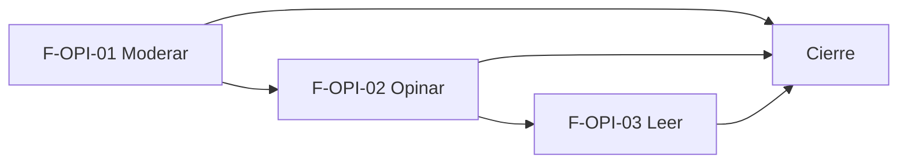

# Tasks: Opiniones de productos (MSF-467)

**Spec**: [`spec.md`](./spec.md) · **Plan**: [`plan.md`](./plan.md) · **Contratos**: [`contracts/opiniones.md`](./contracts/opiniones.md) · Formato: `- [ ] T001 [P] [F-OPI-0X][USy] descripción — evidencia`.
Cada RF/SC tiene una tarea dueña. **Al cerrar cada fase ninguna tarea queda `[ ]`**: se hace con evidencia o se cierra con `Desvío: <motivo>` y un seguimiento trazado (regla de `CLAUDE.md`). En cada tarea que toca una tabla se **re-verifica el esquema** (Principio VII). Se invoca `/speckit-implement` **historia por historia** con `/clear` entre una y otra.

## Matriz de trazabilidad (tracker ↔ US ↔ tasks)

| Tracker | Historia | US | RF / CA / SC dueños | Tareas |
|---|---|---|---|---|
| MSF-467 | Moderar las opiniones desde el panel | US1 (F-OPI-01) | RF-OPI-1, RF-OPI-5, RF-OPI-13, RF-OPI-14, RF-OPI-15, RF-OPI-16, RF-OPI-18, RF-OPI-19; CA-OPI-3, CA-OPI-6, CA-OPI-7, CA-OPI-8, CA-OPI-9, CA-OPI-11, CA-OPI-12; SC-003 | T001–T012 |
| MSF-467 | Dejar, editar y borrar su opinión | US2 (F-OPI-02) | RF-OPI-2, RF-OPI-3, RF-OPI-4, RF-OPI-6, RF-OPI-7, RF-OPI-8, RF-OPI-11, RF-OPI-17, RF-OPI-20; CA-OPI-1, CA-OPI-2, CA-OPI-5, CA-OPI-10, CA-OPI-13 | T013–T020 |
| MSF-467 | Ver las aceptadas, el promedio y la cantidad | US3 (F-OPI-03) | RF-OPI-9, RF-OPI-10, RF-OPI-12, RF-OPI-21; CA-OPI-4; SC-001, SC-002, SC-004 | T021–T026 |
| Tarea de cierre (label cierre) | — | — | E2E, docs, seguridad, encendido en dev y guards finales | T027–T031 |

## Fase 1: F-OPI-01 · Base de datos y bandera — sin efecto visible

- [ ] T001 [F-OPI-01][US1] Migración `20270341000000_opiniones_producto.sql`: tabla `dominio.opiniones_producto`, checks, FK compuestas (cuenta, tienda, producto), **índice único `(cuenta_cliente_id, producto_id)`**, RLS sin políticas, sin privilegios, bandera `tienda_opiniones` apagada (dueña de **RF-OPI-1**). Evidencia: pgTAP `opiniones_producto.test.sql`.
- [ ] T002 [F-OPI-01][US1] Migración `20270341000100_opiniones_validacion.sql`: `private.validar_texto_opinion` (largo, control, enlaces) y `private.nombre_publico_cliente` (dueña de **RF-OPI-5** y **CA-OPI-3**; el nombre público es la primera palabra del nombre, CA-OPI-6). Evidencia: pgTAP `opiniones_validacion.test.sql` (casos borde: 9/10/1.000/1.001, `http`, `www.`, dominio suelto, RTL, emoji).
- [ ] T003 [P] [F-OPI-01][US1] Aislamiento y seguridad: `rls_en_toda_tabla`, `privilegios_anon_endurecidos`, grants exactos, `search_path` (dueña de **RF-OPI-16** y **SC-003**; el test global se vuelve a correr en cada fase que agrega RPC —T013 y T021— y en el cierre). Evidencia: pgTAP `opiniones_privilegios.test.sql`.
- [ ] T004 [F-OPI-01][US1] Migración `20270341000300_exportacion_total_opiniones.sql`: la tabla entra a `conjuntos_exportacion_total` (dueña de **RF-OPI-18** y **CA-OPI-12**). Evidencia: pgTAP `exportacion_total.test.sql` extendido.
- [ ] T005 [P] [F-OPI-01][US1] Etiquetas `opinion.aceptada` / `opinion.rechazada` en Actividad (`pages/actividad`) y cobertura de ayuda (parte de RF-OPI-14, cuya dueña es T007). Evidencia: Vitest de Actividad y `ayuda-cobertura.test.ts`.
- [ ] T006 [F-OPI-01][US1] Guards: `node scripts/verificar-migraciones.mjs --estricto`, `pnpm docs:check`, `pnpm matriz:check`, `pnpm der:check`, `tsc -b`, lint (dueña de **RF-OPI-19**: toda migración es aditiva, con su reversión documentada, y re-verifica el esquema de la tabla). Evidencia: salida de cada comando.

**Checkpoint F-OPI-01 · Base**: la tabla existe, aislada y exportable; la bandera está apagada; nada cambia en la tienda ni en el panel.

## Fase 2: F-OPI-01 · Moderación en el panel (US1)

- [ ] T007 [F-OPI-01][US1] Migración `20270341000200_opiniones_moderacion_rpc.sql`: `public.listar_opiniones` y `public.moderar_opinion` (solo Administrador, contadores, cursor, bloqueo optimista, idempotencia, evento sin texto, apagada solo rechaza) (dueña de **RF-OPI-13** y **RF-OPI-14**, con CA-OPI-7 y CA-OPI-9). Evidencia: pgTAP `opiniones_moderacion.test.sql`.
- [ ] T008 [F-OPI-01][US1] Cliente de datos `lib/opiniones.ts` y hooks (listado por tandas con cursor, contadores, moderar con manejo de `conflicto`). Evidencia: Vitest de los hooks.
- [ ] T009 [F-OPI-01][US1] Pantalla `pages/opiniones/list.tsx` según el prototipo: aviso, `FiltroEmpresa`, contadores, filtros de estado, lista, Aceptar/Rechazar, diálogo de motivo (D5), carga infinita, estados compartidos, avisos de resultado (dueña de **RF-OPI-15**). Evidencia: Vitest `list.test.tsx` con axe a 320/768/1440 px.
- [ ] T010 [F-OPI-01][US1] Entrada de menú «Opiniones» (solo administrador), ruta `/opiniones` lazy, ícono del prototipo, aviso con la bandera apagada (parte de RF-OPI-15, cuya dueña es T009; dueña de **CA-OPI-8**). Evidencia: Vitest de navegación y de audiencia.
- [ ] T011 [P] [F-OPI-01][US1] Fila «Empresa activa»: test que cambia la empresa con la pantalla y el diálogo abiertos y verifica recarga de lista y contadores, tanda reiniciada, selección descartada y diálogo cerrado con aviso (dueña de **CA-OPI-11**). Evidencia: `list.test.tsx`.
- [ ] T012 [F-OPI-01][US1] Guards de la fase (los de T006) y `pnpm ui:empresas:check`. Evidencia: salida de cada comando.

**Checkpoint F-OPI-01 · Moderación**: con opiniones sembradas por SQL en dev, un administrador las acepta y rechaza; la tienda aún no muestra nada.

## Fase 3: F-OPI-02 · Opinar desde la tienda (US2)

- [ ] T013 [F-OPI-02][US2] Migración `20270341000400_opiniones_cliente_rpc.sql`: `publico.guardar_opinion_por_dominio`, `borrar_opinion_por_dominio`, `mis_opiniones_por_dominio` (identidad solo de `cuenta_de_tienda`, upsert, vuelve a `pendiente`, topes, producto visible, límite por visitante; `revoke … from public, anon` + `grant execute` explícitos) (dueña de **RF-OPI-2, RF-OPI-3, RF-OPI-4, RF-OPI-6, RF-OPI-7, RF-OPI-8, RF-OPI-17** y **CA-OPI-1, CA-OPI-2**). Evidencia: pgTAP `opiniones_cliente.test.sql` y `opiniones_limites.test.sql`.
- [ ] T014 [P] [F-OPI-02][US2] pgTAP de aislamiento: cuenta de la tienda A vs. B y otra organización, `sin_acceso` idéntico en todos los casos (dueña de **CA-OPI-5**). Evidencia: `opiniones_cliente.test.sql`.
- [ ] T015 [P] [F-OPI-02][US2] pgTAP de bandera apagada: `sin_acceso` en la escritura y tabla sin cambios (dueña de **CA-OPI-13**). Evidencia: `opiniones_bandera.test.sql`.
- [ ] T016 [F-OPI-02][US2] Cliente de datos `lib/tiendaOpiniones.ts`, hooks y `validacion.ts` espejo del servidor (dueña de **RF-OPI-20**; replica los mismos casos de la dueña T002). Evidencia: Vitest `validacion.test.ts` (mismos casos que T002).
- [ ] T017 [F-OPI-02][US2] Componentes `EstrellasPuntuacion` (teclado y lector), `FormularioOpinion` (contador, errores por campo, mensaje «se publicará cuando la revisemos», invitación a ingresar sin sesión) y «Mis opiniones» en la cuenta (editar, borrar con confirmación, estado y motivo) (dueña de **RF-OPI-11**). Evidencia: Vitest con axe.
- [ ] T018 [F-OPI-02][US2] Fusión de clientes: la unicidad `(cuenta, producto)` no rompe la fusión; se conserva la opinión más reciente y se avisa en la vista previa (caso borde). Evidencia: pgTAP de `fusion_clientes` extendido. Si la fusión no mueve cuentas web hoy, cerrar con `Desvío` y la prueba que lo demuestra.
- [ ] T019 [P] [F-OPI-02][US2] Cuenta suspendida o baja de «Habilitado en»: no escribe, y lo aceptado sigue visible (caso borde). Evidencia: pgTAP `opiniones_cliente.test.sql`.
- [ ] T020 [F-OPI-02][US2] Verificar `private.registrar_pedido_publico` con claves nuevas (`opinion|escritura|` 10 por minuto, `opinion|lectura|` 30 por minuto) y extender sin romper las llamadas existentes si hiciera falta (parte de RF-OPI-17, cuya dueña es T013; dueña de **CA-OPI-10**). Evidencia: pgTAP `opiniones_limites.test.sql` y los pgTAP de búsqueda y pedidos siguen verdes.

**Checkpoint F-OPI-02 · Opinar**: con la bandera encendida en dev, un cliente opina, edita y borra; su opinión queda pendiente y no se ve en la ficha.

## Fase 4: F-OPI-03 · Leer en la ficha (US3)

- [ ] T021 [F-OPI-03][US3] Migración `20270341000500_opiniones_lectura_publica.sql`: `publico.opiniones_producto_por_dominio` (lista blanca, promedio, cantidad, cursor, producto visible, `es_mia`; `anon` y `authenticated`, con `revoke … from public, anon` + `grant execute` explícitos) y `publico.capacidades_opiniones_por_dominio` (dueña de **RF-OPI-9, RF-OPI-10** y **CA-OPI-4**: solo aceptadas, promedio y cantidad exactos y ninguna clave fuera de la lista blanca). Evidencia: pgTAP `opiniones_lectura.test.sql`.
- [ ] T022 [P] [F-OPI-03][US3] pgTAP de barrido por rol: `anon`, otra tienda y la propia cuenta no ven pendientes ni rechazadas por ninguna RPC (dueña de **SC-001**), y promedio/cantidad exactos con muestra mixta (dueña de **SC-002**). Evidencia: `opiniones_lectura.test.sql`.
- [ ] T023 [F-OPI-03][US3] Bloque `OpinionesProducto` en la ficha (promedio, cantidad, lista por tandas, «Cargar más», estado vacío) montado solo con la capacidad activa (dueña de **RF-OPI-21**). Evidencia: Vitest con axe a 320/768/1440 px.
- [ ] T024 [P] [F-OPI-03][US3] Paridad con la bandera apagada: la ficha y «Mi cuenta» son idénticas a las de `dokploy` (dueña de **RF-OPI-12** y **SC-004**). Evidencia: Vitest de paridad.
- [ ] T025 [P] [F-OPI-03][US3] Texto literal: un comentario con `<script>` se muestra como texto (parte de RF-OPI-9, cuya dueña es T021; caso borde «Texto con HTML, scripts o emojis»). Evidencia: Vitest.
- [ ] T026 [F-OPI-03][US3] Guards de la fase (los de T006). Evidencia: salida de cada comando.

**Checkpoint F-OPI-03 · Leer**: con la bandera encendida en dev, la ficha muestra promedio, cantidad y las opiniones aceptadas de su tienda.

## Fase 5: Cierre (ninguna historia lo atiende)

- [ ] T027 [CIERRE] E2E `apps/web/e2e/tienda-opiniones.e2e.ts`: opinar → no visible → aceptar → visible con promedio → editar → oculta → borrar. Evidencia: `pnpm --filter @platform/web test:e2e tienda-opiniones`.
- [ ] T028 [CIERRE] Documentación: `docs/tienda-opiniones.md` (guía y reversión), enlace en `docs/tiendas-online.md`, `mkdocs.yml` y `docs/roadmap-template.md` (fila de MSF-467). Evidencia: `pnpm docs:check`.
- [ ] T029 [CIERRE] Revisión de seguridad de la épica (autorización/RLS, texto no confiable, límites) con hallazgos menores arreglados. Evidencia: informe en la nota del PR.
- [ ] T030 [CIERRE] Encendido de `tienda_opiniones` **solo en dev**, con SQL del equipo técnico y verificación del bundle de dev; staging y producción quedan apagados (D11). Evidencia: nota con el comando y la comprobación.
- [ ] T031 [CIERRE] Guards finales: `pnpm lint`, `pnpm build`, `pnpm infra:config`, `pnpm test:db`, `pnpm matriz:check`, `pnpm der:check`, `node scripts/verificar-migraciones.mjs --estricto`. Evidencia: salida de cada comando.

**Checkpoint final**: Nicolás revisa las decisiones delegadas D1–D16; con la bandera apagada, todo es idéntico a hoy.

## Plan de ejecución (historias)

| Historia | Depende de | Grupo |
|---|---|---|
| F-OPI-01 · Moderar las opiniones desde el panel | — | 1 |
| F-OPI-02 · Dejar, editar y borrar su opinión | F-OPI-01 | 2 |
| F-OPI-03 · Ver las aceptadas, el promedio y la cantidad | F-OPI-02 | 3 |
| [Cierre] | F-OPI-01, F-OPI-02, F-OPI-03 | 4 |

**Por qué van en serie**: las tres historias comparten la tabla `dominio.opiniones_producto` y los archivos del front `lib/tiendaOpiniones.ts`, `hooks/useOpinionesTienda.ts` y `pages/tienda-publica/opiniones/`; cada una trae **su propia** migración aditiva con su timestamp (`20270341000000`…`20270341000500`, una por historia y en orden), sin encadenarse con la de otra. F-OPI-03 va después de F-OPI-02 porque el bloque de la ficha y «Mis opiniones» comparten componentes y el recorrido E2E necesita una opinión real. El cierre va al final, cuando las tres historias están Finalizadas.
