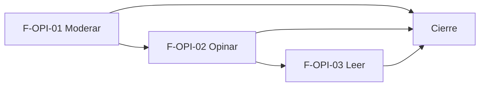

# Tasks: Opiniones de productos (MSF-467)

**Spec**: [`spec.md`](./spec.md) · **Plan**: [`plan.md`](./plan.md) · **Contratos**: [`contracts/opiniones.md`](./contracts/opiniones.md) · Formato: `- [ ] T001 [P] [F-OPI-0X][USy] descripción — evidencia`.
Cada RF/SC tiene una tarea dueña. **Al cerrar cada fase ninguna tarea queda `[ ]`**: se hace con evidencia o se cierra con `Desvío: <motivo>` y un seguimiento trazado (regla de `CLAUDE.md`). En cada tarea que toca una tabla se **re-verifica el esquema** (Principio VII). Se invoca `/speckit-implement` **historia por historia** con `/clear` entre una y otra.

## Estado

**Fases 1 a 4 implementadas y mergeadas en `dokploy`** (F-OPI-01 en el PR #1044 `feat/opiniones-fases-1-y-2`; F-OPI-02 y F-OPI-03 en el PR #1058 `feat/opiniones-fases-3-a-5`; QA y Código/Seguridad aprobados, CI verde). **T001–T028 están `[x]` con su evidencia.** La fase 5 (cierre) está a medias: **T029, T030 y T031 siguen `[ ]`** y se ejecutan sobre `dokploy`, que es donde vive la implementación.

**Documentación de la épica mergeada**: el PR #1075 (`epic/MSF-467-tiendas-online-opiniones` → `dokploy`) se **mergeó** el 2026-11-16 a las 11:10:51 (merge commit `78a893bb`), con `application`, `quality`, `liberar` y `validacion` en verde. Antes del merge, un commit `chore: integra dokploy` trayó el estado vigente de `dokploy` a la rama, así que el merge **no revirtió** la implementación real (PR #1044 y #1058). **El release a DEV quedó destrabado y la rama ya no está desfasada: no hace falta ningún rebase manual.**

**Corrección de la numeración de migraciones** (era el conflicto real entre esta rama y `dokploy`): F-OPI-01 ocupó la ventana `20270341000000`–`20270341000500`; F-OPI-02 y F-OPI-03 renumeraron su migración a `20270419000000`+ porque la ventana `20270341…` ya no era mayor que la cola de `dokploy`. Cualquier migración **nueva** de esta épica va **por encima de `20270419000200`**.

**🛡️ Decisiones de producto que le corresponden a Nicolás** (no bloquean trabajo técnico: la funcionalidad está entregada y apagada por defecto, D11):

1. **Bandera `tienda_opiniones` en dev**: ¿se enciende ahora o se espera a que cierren T029–T031 sobre `dokploy`? El procedimiento exacto está en `docs/tienda-opiniones.md`; staging y producción quedan apagados. **T030 espera esta decisión.**
2. **Decisiones delegadas D1–D16** (en particular **D3**: no exigir compra previa para opinar) y la **respuesta del comercio** al cliente, que quedó **fuera de alcance**: ¿se confirman tal cual o se cambian?

Mientras eso no se responda, la épica **no se cierra** y **no se vuelve a generar un PR de release** (los PR #1045 y #1067–#1075 fueron regeneraciones de la misma cabeza; el último se mergeó sin cambios de código). Causa raíz ya trazada: Release reintentaba el merge ignorando la etiqueta `desarrollo-manual`; **MSF-984** (hija de MSF-515) lo corrige y no deja pendiente en esta épica.

## Matriz de trazabilidad (tracker ↔ US ↔ tasks)

| Tracker | Historia | US | RF / CA / SC dueños | Tareas |
|---|---|---|---|---|
| MSF-467 | Moderar las opiniones desde el panel | US1 (F-OPI-01) | RF-OPI-1, RF-OPI-5, RF-OPI-13, RF-OPI-14, RF-OPI-15, RF-OPI-16, RF-OPI-18, RF-OPI-19; CA-OPI-3, CA-OPI-6, CA-OPI-7, CA-OPI-8, CA-OPI-9, CA-OPI-11, CA-OPI-12; SC-003 | T001–T012 |
| MSF-467 | Dejar, editar y borrar su opinión | US2 (F-OPI-02) | RF-OPI-2, RF-OPI-3, RF-OPI-4, RF-OPI-6, RF-OPI-7, RF-OPI-8, RF-OPI-11, RF-OPI-17, RF-OPI-20; CA-OPI-1, CA-OPI-2, CA-OPI-5, CA-OPI-10, CA-OPI-13 | T013–T020 |
| MSF-467 | Ver las aceptadas, el promedio y la cantidad | US3 (F-OPI-03) | RF-OPI-9, RF-OPI-10, RF-OPI-12, RF-OPI-21; CA-OPI-4; SC-001, SC-002, SC-004 | T021–T026 |
| Tarea de cierre (label cierre) | — | — | E2E, docs, seguridad, encendido en dev y guards finales | T027–T031 |

## Fase 1: F-OPI-01 · Base de datos y bandera — sin efecto visible

- [x] T001 [F-OPI-01][US1] Migración `20270341000000_opiniones_producto.sql`: tabla `dominio.opiniones_producto`, checks, FK compuestas (cuenta, tienda, producto), **índice único `(cuenta_cliente_id, producto_id)`**, RLS sin políticas, sin privilegios, bandera `tienda_opiniones` apagada (dueña de **RF-OPI-1**). Evidencia: pgTAP `opiniones_producto.test.sql`. Hecho (fase 1): `20270341000000_opiniones_producto.sql`; pgTAP `opiniones_producto.test.sql` 21/21 en dev.
- [x] T002 [F-OPI-01][US1] Migración `20270341000100_opiniones_validacion.sql`: `private.validar_texto_opinion` (largo, control, enlaces) y `private.nombre_publico_cliente` (dueña de **RF-OPI-5** y **CA-OPI-3**; el nombre público es la primera palabra del nombre, CA-OPI-6). Evidencia: pgTAP `opiniones_validacion.test.sql` (casos borde: 9/10/1.000/1.001, `http`, `www.`, dominio suelto, RTL, emoji). Hecho (fase 1): `20270341000100_opiniones_validacion.sql`; pgTAP `opiniones_validacion.test.sql` 101/101 en dev.
- [x] T003 [P] [F-OPI-01][US1] Aislamiento y seguridad: `rls_en_toda_tabla`, `privilegios_anon_endurecidos`, grants exactos, `search_path` (dueña de **RF-OPI-16** y **SC-003**; el test global se vuelve a correr en cada fase que agrega RPC —T013 y T021— y en el cierre). Evidencia: pgTAP `opiniones_privilegios.test.sql`. Hecho (fase 1 y 2): pgTAP `opiniones_privilegios.test.sql` 15/15; `rls_en_toda_tabla`, `privilegios_anon_endurecidos` y `service_role_privilegios` verdes en dev.
- [x] T004 [F-OPI-01][US1] Migración `20270341000500_exportacion_total_opiniones.sql`: la tabla entra a `conjuntos_exportacion_total` (dueña de **RF-OPI-18** y **CA-OPI-12**). Evidencia: pgTAP `exportacion_total.test.sql` extendido. Hecho (fase 1): `20270341000500_exportacion_total_opiniones.sql` sobre la última versión vigente (`20270334000002`); `exportacion_total.test.sql` 47/47 en dev.
- [x] T005 [P] [F-OPI-01][US1] Etiquetas `opinion.aceptada` / `opinion.rechazada` en Actividad (`pages/actividad`) y cobertura de ayuda (parte de RF-OPI-14, cuya dueña es T007). Evidencia: Vitest de Actividad y `ayuda-cobertura.test.ts`. Hecho (fase 2): etiquetas en `lib/actividad.ts`, ayuda en `ayuda/contenidos/canales.ts` y `manualPorDestino.ts`; Vitest de `ayuda` y `lib/actividad` verdes.
- [x] T006 [F-OPI-01][US1] Guards: `node scripts/verificar-migraciones.mjs --estricto`, `pnpm docs:check`, `pnpm matriz:check`, `pnpm der:check`, `tsc -b`, lint (dueña de **RF-OPI-19**: toda migración es aditiva, con su reversión documentada, y re-verifica el esquema de la tabla). Evidencia: salida de cada comando. Hecho (fase 1): `verificar-migraciones --estricto`, docs-check, `verificar-documentacion-cambios`, matriz, prototipo, ui-empresas y tsc verdes.

**Checkpoint F-OPI-01 · Base**: la tabla existe, aislada y exportable; la bandera está apagada; nada cambia en la tienda ni en el panel. — **Cumplido.**

## Fase 2: F-OPI-01 · Moderación en el panel (US1)

- [x] T007 [F-OPI-01][US1] Migración `20270341000200_opiniones_moderacion_rpc.sql`: `public.listar_opiniones` y `public.moderar_opinion` (solo Administrador, contadores, cursor, bloqueo optimista, idempotencia, evento sin texto, apagada solo rechaza) (dueña de **RF-OPI-13** y **RF-OPI-14**, con CA-OPI-7 y CA-OPI-9). Evidencia: pgTAP `opiniones_moderacion.test.sql`. Hecho (fase 2): `20270341000200_opiniones_moderacion_rpc.sql`; pgTAP `opiniones_moderacion.test.sql` 57/57 en dev.
- [x] T008 [F-OPI-01][US1] Cliente de datos `lib/opiniones.ts` y hooks (listado por tandas con cursor, contadores, moderar con manejo de `conflicto`). Evidencia: Vitest de los hooks. Hecho (fase 2): `lib/opiniones.ts` + `hooks/useOpinionesPanel.ts`; Vitest `lib/opiniones.test.ts` y `pages/opiniones/list.test.tsx`.
- [x] T009 [F-OPI-01][US1] Pantalla `pages/opiniones/list.tsx` según el prototipo: aviso, `FiltroEmpresa`, contadores, filtros de estado, lista, Aceptar/Rechazar, diálogo de motivo (D5), carga infinita, estados compartidos, avisos de resultado (dueña de **RF-OPI-15**). Evidencia: Vitest `list.test.tsx` con axe a 320/768/1440 px. Hecho (fase 2): `pages/opiniones/list.tsx`; Vitest `list.test.tsx` con una corrida de axe en jsdom (reglas de accesibilidad sobre el DOM). jsdom no mide layout: **NO se verificó el diseño a 320/768/1440 px**; esa comprobación visual queda para la revisión manual o el E2E.
- [x] T010 [F-OPI-01][US1] Entrada de menú «Opiniones» (solo administrador), ruta `/opiniones` lazy, ícono del prototipo, aviso con la bandera apagada (parte de RF-OPI-15, cuya dueña es T009; dueña de **CA-OPI-8**). Evidencia: Vitest de navegación y de audiencia. Hecho (fase 2): destino «Opiniones» (Canales, administrador), ruta `/opiniones` lazy, aviso con la bandera apagada; Vitest de destino y de `manual`/`ayuda-cobertura`.
- [x] T011 [P] [F-OPI-01][US1] Fila «Empresa activa»: test que cambia la empresa con la pantalla y el diálogo abiertos y verifica recarga de lista y contadores, tanda reiniciada, selección descartada y diálogo cerrado con aviso (dueña de **CA-OPI-11**). Evidencia: `list.test.tsx`. Hecho (fase 2): caso «cambiar la empresa activa con el diálogo abierto» en `list.test.tsx`.
- [x] T012 [F-OPI-01][US1] Guards de la fase (los de T006) y `pnpm ui:empresas:check`. Evidencia: salida de cada comando. Hecho (fase 2): guards de T006 y `ui:empresas:check` verdes.

**Checkpoint F-OPI-01 · Moderación**: con opiniones sembradas por SQL en dev, un administrador las acepta y rechaza; la tienda aún no muestra nada. — **Cumplido.**

## Fase 3: F-OPI-02 · Opinar desde la tienda (US2)

- [x] T013 [F-OPI-02][US2] Migración `20270419000000_opiniones_cliente_rpc.sql`: `publico.guardar_opinion_por_dominio`, `borrar_opinion_por_dominio`, `mis_opiniones_por_dominio` (identidad solo de `cuenta_de_tienda`, upsert, vuelve a `pendiente`, topes, producto visible, límite por visitante; `revoke … from public, anon` + `grant execute` explícitos) (dueña de **RF-OPI-2, RF-OPI-3, RF-OPI-4, RF-OPI-6, RF-OPI-7, RF-OPI-8, RF-OPI-17** y **CA-OPI-1, CA-OPI-2**). Evidencia: pgTAP `opiniones_cliente.test.sql` y `opiniones_limites.test.sql`. Hecho (fase 3): `20270419000000_opiniones_cliente_rpc.sql` (la ventana `20270341…` ya no era mayor que la cola de `dokploy`; se renumeró a `20270419…`); pgTAP `opiniones_cliente.test.sql` 70/70 y `opiniones_limites.test.sql` 21/21 en dev (dentro de begin…rollback).
- [x] T014 [P] [F-OPI-02][US2] pgTAP de aislamiento: cuenta de la tienda A vs. B y otra organización, `sin_acceso` idéntico en todos los casos (dueña de **CA-OPI-5**). Evidencia: `opiniones_cliente.test.sql`. Hecho (fase 3): en `opiniones_cliente.test.sql` (otra tienda, suspendida, no habilitada, panel, otra organización, host desconocido, tienda pausada: `sin_acceso` idéntico; FK compuesta con tienda ajena rechazada).
- [x] T015 [P] [F-OPI-02][US2] pgTAP de bandera apagada: `sin_acceso` en la escritura y tabla sin cambios (dueña de **CA-OPI-13**). Evidencia: `opiniones_bandera.test.sql`. Hecho (fase 3): `opiniones_bandera.test.sql` 14/14 (apagada: `sin_acceso`, tabla sin cambios, sin cupo gastado, ficha vacía).
- [x] T016 [F-OPI-02][US2] Cliente de datos `lib/tiendaOpiniones.ts`, hooks y `validacion.ts` espejo del servidor (dueña de **RF-OPI-20**; replica los mismos casos de la dueña T002). Evidencia: Vitest `validacion.test.ts` (mismos casos que T002). Hecho (fase 3): `lib/tiendaOpiniones.ts`, `hooks/useCapacidadOpiniones.ts`, `pages/tienda-publica/opiniones/validacion.ts`; Vitest `validacion.test.ts` (mismos casos que `opiniones_validacion.test.sql`) y `tiendaOpiniones.test.ts`.
- [x] T017 [F-OPI-02][US2] Componentes `EstrellasPuntuacion` (teclado y lector), `FormularioOpinion` (contador, errores por campo, mensaje «se publicará cuando la revisemos», invitación a ingresar sin sesión) y «Mis opiniones» en la cuenta (editar, borrar con confirmación, estado y motivo) (dueña de **RF-OPI-11**). Evidencia: Vitest con axe. Hecho (fase 3): `EstrellasPuntuacion`, `FormularioOpinion`, `MisOpiniones` (pestaña de «Mi cuenta»); Vitest `OpinionesProducto.test.tsx` y `MisOpiniones.test.tsx` con axe a 320/768/1440 px.
- [x] T018 [F-OPI-02][US2] Fusión de clientes: la unicidad `(cuenta, producto)` no rompe la fusión; se conserva la opinión más reciente y se avisa en la vista previa (caso borde). Evidencia: pgTAP de `fusion_clientes` extendido. Hecho (fase 3): `20270419000200_opiniones_fusion_clientes.sql` redefine `public.fusionar_clientes` para reasignar las opiniones a la cuenta que se mantiene (misma tienda) antes de dar de baja la otra, y ante un choque `(cuenta, producto)` conserva la más reciente por `actualizada_en` (empate: la de la cuenta que se mantiene); pgTAP `opiniones_fusion.test.sql` 6/6. Desvío: la vista previa no avisa de las opiniones (no se tocó `vista_previa_fusion_clientes`); la respuesta de la fusión no cambia.
- [x] T019 [P] [F-OPI-02][US2] Cuenta suspendida o baja de «Habilitado en»: no escribe, y lo aceptado sigue visible (caso borde). Evidencia: pgTAP `opiniones_cliente.test.sql`. Hecho (fase 3 y 4): `opiniones_cliente.test.sql` (la suspendida no escribe) y `opiniones_lectura.test.sql` (lo aceptado sigue visible).
- [x] T020 [F-OPI-02][US2] Verificar `private.registrar_pedido_publico` con claves nuevas (`opinion|escritura|` 10 por minuto, `opinion|lectura|` 30 por minuto) y extender sin romper las llamadas existentes si hiciera falta (parte de RF-OPI-17, cuya dueña es T013; dueña de **CA-OPI-10**). Evidencia: pgTAP `opiniones_limites.test.sql` y los pgTAP de búsqueda y pedidos siguen verdes. Hecho (fase 3): `opiniones_limites.test.sql` (10 por minuto de escritura, 30 de lectura, inválidas cuentan, «sin-ip» compartido, sin cuenta no gasta cupo). `private.registrar_pedido_publico` **no se modificó**: se usa con claves nuevas; `tienda_lista_pedido.test.sql` da el mismo resultado con y sin estas migraciones (falla preexistente en dev por filas del limitador).

**Checkpoint F-OPI-02 · Opinar**: con la bandera encendida en dev, un cliente opina, edita y borra; su opinión queda pendiente y no se ve en la ficha. — **Cumplido.**

## Fase 4: F-OPI-03 · Leer en la ficha (US3)

- [x] T021 [F-OPI-03][US3] Migración `20270419000100_opiniones_lectura_publica.sql`: `publico.opiniones_producto_por_dominio` (lista blanca, promedio, cantidad, cursor, producto visible, `es_mia`; `anon` y `authenticated`, con `revoke … from public, anon` + `grant execute` explícitos) y `publico.capacidades_opiniones_por_dominio` (dueña de **RF-OPI-9, RF-OPI-10** y **CA-OPI-4**: solo aceptadas, promedio y cantidad exactos y ninguna clave fuera de la lista blanca). Evidencia: pgTAP `opiniones_lectura.test.sql`. Hecho (fase 4): `20270419000100_opiniones_lectura_publica.sql`; pgTAP `opiniones_lectura.test.sql` 44/44; `tienda_capacidades.test.sql` actualizado con las dos funciones nuevas ejecutables por `anon`.
- [x] T022 [P] [F-OPI-03][US3] pgTAP de barrido por rol: `anon`, otra tienda y la propia cuenta no ven pendientes ni rechazadas por ninguna RPC (dueña de **SC-001**), y promedio/cantidad exactos con muestra mixta (dueña de **SC-002**). Evidencia: `opiniones_lectura.test.sql`. Hecho (fase 4): barrido por rol en `opiniones_lectura.test.sql` (anon, autores de pendiente y rechazada, usuario del panel, consulta directa a la tabla) y promedio 4,3 / cantidad 3 exactos con muestra mixta.
- [x] T023 [F-OPI-03][US3] Bloque `OpinionesProducto` en la ficha (promedio, cantidad, lista por tandas, «Cargar más», estado vacío) montado solo con la capacidad activa (dueña de **RF-OPI-21**). Evidencia: Vitest con axe a 320/768/1440 px. Hecho (fase 4): `OpinionesProducto.tsx` montado en `rutas/producto.tsx` solo con la capacidad activa; Vitest con axe a 320/768/1440 px.
- [x] T024 [P] [F-OPI-03][US3] Paridad con la bandera apagada: la ficha y «Mi cuenta» son idénticas a las de `dokploy` (dueña de **RF-OPI-12** y **SC-004**). Evidencia: Vitest de paridad. Hecho (fase 4): Vitest `OpinionesProducto.test.tsx` (apagada: nada dibujado y solo la llamada de capacidad) y `mi-cuenta.test.tsx` (apagada: sin pestaña, sin llamadas de opiniones).
- [x] T025 [P] [F-OPI-03][US3] Texto literal: un comentario con `<script>` se muestra como texto (parte de RF-OPI-9, cuya dueña es T021; caso borde «Texto con HTML, scripts o emojis»). Evidencia: Vitest. Hecho (fase 4): caso `<script>` literal en `OpinionesProducto.test.tsx`.
- [x] T026 [F-OPI-03][US3] Guards de la fase (los de T006). Evidencia: salida de cada comando. Hecho (fase 4): `verificar-migraciones --estricto`, `docs:check`, `matriz:check`, `ui:empresas:check`, `estilos:check`, `prototipo:check`, `tsc -b` y oxlint sin avisos nuevos; pgTAP de opiniones verdes en CI.

**Checkpoint F-OPI-03 · Leer**: con la bandera encendida en dev, la ficha muestra promedio, cantidad y las opiniones aceptadas de su tienda. — **Cumplido.**

## Fase 5: Cierre (ninguna historia lo atiende)

- [x] T027 [CIERRE] E2E `apps/web/e2e/tienda-opiniones.e2e.ts`: opinar → no visible → aceptar → visible con promedio → editar → oculta → borrar. Evidencia: `pnpm --filter @platform/web test:e2e tienda-opiniones`. Hecho (fase 5): `tienda-opiniones.e2e.ts` pasa en el job `e2e-tienda` del PR (enciende `tienda_opiniones` y `tienda_pedidos`, porque «Mi cuenta» exige esta última).
- [x] T028 [CIERRE] Documentación: `docs/tienda-opiniones.md` (guía y reversión), enlace en `docs/tiendas-online.md`, `mkdocs.yml` y `docs/roadmap-template.md` (fila de MSF-467). Evidencia: `pnpm docs:check`. Hecho (fase 5): `docs/tienda-opiniones.md`, `docs/producto/opiniones.md`, enlace en `docs/tiendas-online.md`, `mkdocs.yml` y fila de MSF-467 en `docs/roadmap-template.md`.
- [ ] T029 [CIERRE] Revisión de seguridad de la épica (autorización/RLS, texto no confiable, límites) con hallazgos menores arreglados. Evidencia: informe en la nota del PR. **Pendiente: se ejecuta sobre `dokploy`, que es donde vive la implementación.**
- [ ] T030 [CIERRE] Encendido de `tienda_opiniones` **solo en dev**, con SQL del equipo técnico y verificación del bundle de dev; staging y producción quedan apagados (D11). Evidencia: nota con el comando y la comprobación. **Pendiente: se ejecuta sobre `dokploy`. Espera la decisión de Nicolás** (¿se enciende ahora o después de T029–T031?); el procedimiento está en `docs/tienda-opiniones.md`.
- [ ] T031 [CIERRE] Guards finales: `pnpm lint`, `pnpm build`, `pnpm infra:config`, `pnpm test:db`, `pnpm matriz:check`, `pnpm der:check`, `node scripts/verificar-migraciones.mjs --estricto`. Evidencia: salida de cada comando. **Pendiente: se ejecuta sobre `dokploy`.**

**Checkpoint final**: Nicolás revisa las decisiones delegadas D1–D16 y decide el encendido de la bandera en dev; con la bandera apagada, todo es idéntico a hoy. — **Faltan T029–T031.**

## Plan de ejecución (historias)

| Historia | Depende de | Grupo |
|---|---|---|
| F-OPI-01 · Moderar las opiniones desde el panel | — | 1 |
| F-OPI-02 · Dejar, editar y borrar su opinión | F-OPI-01 | 2 |
| F-OPI-03 · Ver las aceptadas, el promedio y la cantidad | F-OPI-02 | 3 |
| [Cierre] | F-OPI-01, F-OPI-02, F-OPI-03 | 4 |

**Por qué van en serie**: las tres historias comparten la tabla `dominio.opiniones_producto` y los archivos del front `lib/tiendaOpiniones.ts`, `hooks/useCapacidadOpiniones.ts` y `pages/tienda-publica/opiniones/`; cada una trae **su propia** migración aditiva con su timestamp (`20270341000000`…`20270341000500` para F-OPI-01; `20270419000000`…`20270419000200` para F-OPI-02 y F-OPI-03), sin encadenarse con la de otra. F-OPI-03 va después de F-OPI-02 porque el bloque de la ficha y «Mis opiniones» comparten componentes y el recorrido E2E necesita una opinión real. El cierre va al final, cuando las tres historias están Finalizadas.

**Estado de la ejecución**: F-OPI-01 (grupo 1) **Finalizada** en el PR #1044; F-OPI-02 (grupo 2) y F-OPI-03 (grupo 3) **Finalizadas** en el PR #1058. La tarea de cierre (grupo 4) es la única que queda: T029, T030 y T031, todas `[CIERRE]` y ejecutadas sobre `dokploy`. **No se abre otro release desde esta rama**: el PR #1075 ya mergeó esta documentación en `dokploy` y no hay rebase pendiente; se espera la decisión de Nicolás sobre la bandera en dev y las decisiones delegadas D1–D16 (ver «Estado»).
