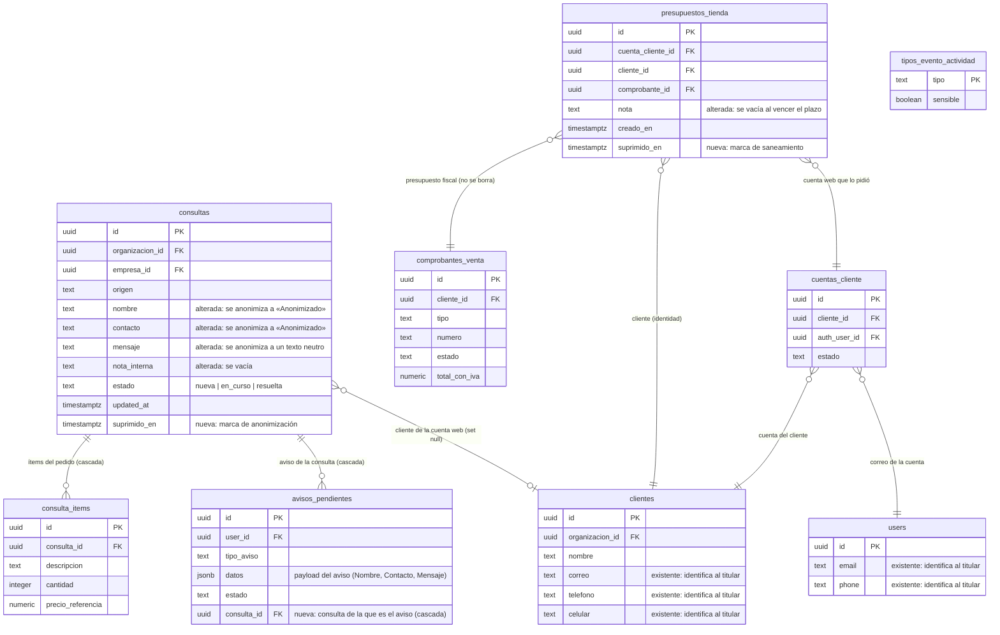

# Feature Specification: Retención y supresión de consultas, ítems y presupuestos de la tienda (MSF-944)

- **Slug**: `20270507170000-retencion-y-supresion-consultas-tienda`
- **Historia**: MSF-944 (seguimiento de MSF-176, T063 y T072; decisión D-20 de la épica MSF-176)
- **Alcance de entrega**: `supabase`, `kestra`, `refine` (`refine` solo por la etiqueta del evento
  nuevo en la actividad del panel: `apps/web/src/lib/actividad.ts`; no hay pantallas nuevas, D-24)
- **Modo**: bug (seguimiento de deuda trazada). Assessment: `.specify/bugs/msf-944/assessment.md`

## Objetivo

Cerrar la deuda de protección de datos que la épica MSF-176 dejó abierta (D-20: «sin purga
automática en esta épica… no se inventa un plazo legal»): las consultas que llegan desde la tienda
(orígenes `formulario`, `whatsapp` y `pedido`), sus ítems de pedido y los presupuestos creados
desde la tienda **se acumulan para siempre** y no existe ninguna vía para la **supresión a pedido
del titular**.

Con esta historia:

1. hay una **política de retención** con un plazo único y configurable, que una purga automática
   aplica (y que solo borra lo que ya no tiene valor comercial vivo);
2. hay un **procedimiento de supresión por titular** que elimina los datos personales de las
   consultas, de sus ítems, de las notas de los presupuestos de la tienda y de las copias que
   quedan en la cola de avisos, **sin tocar el registro fiscal**;
3. ambos caminos quedan **probados con pgTAP** y **documentados** para el equipo y para el usuario.

## User Scenarios & Testing

### User Story 1 — La consulta vieja se borra sola (P1)

Como responsable de una tienda online, quiero que las consultas que ya nobody atiende se borren
solas pasado un plazo, para no seguir guardando datos personales de visitantes que nadie va a
responder.

**Por qué importa**: hoy cada envío de la tienda deja nombre, contacto, mensaje e ítems guardados
para siempre; el volumen crece con cada visita y no hay ninguna política.

**Cómo se prueba**: pgTAP `supabase/tests/database/consultas_retencion.test.sql` — con dos
organizaciones, una consulta resuelta vieja, una consulta nueva vieja, una consulta en curso vieja
y una consulta reciente: la purga borra las que superaron el plazo y no están en curso, deja las
otras, es idempotente y no toca los datos de otra organización.

### User Story 2 — El titular pide que borren sus datos (P1)

Como visitante de una tienda que ya no quiere que guarden sus datos, quiero que el equipo pueda
borrar lo que hay de mí (consultas, ítems, notas de presupuesto y las copias de los avisos), para
que la promesa de la tienda sea cierta.

**Por qué importa**: hoy no hay ninguna vía: la única forma es un `delete` manual por SQL, sin
registro ni garantía de que se borre también la copia que quedó en la cola de avisos.

**Cómo se prueba**: pgTAP `consultas_retencion.test.sql` — la supresión deja `nombre`, `contacto`,
`mensaje` y `nota_interna` en valor neutro, borra los ítems de esas consultas, deja la nota del
presupuesto sin contenido, limpia la copia de la cola de avisos, **no borra el comprobante
fiscal** y deja un evento de actividad sin datos personales. Un rol sin permiso recibe `42501` y no
se toca nada.

### User Story 3 — El presupuesto de la tienda no guarda la nota para siempre (P2)

Como responsable de una tienda, quiero que la nota libre que escribe el cliente en un presupuesto
pedido desde la tienda se elimine pasado el plazo, sin que se toque el presupuesto como documento
fiscal.

**Por qué importa**: la nota es texto libre del cliente (dato personal); el presupuesto es un
comprobante de venta (registro fiscal) que se anula, no se borra.

**Cómo se prueba**: pgTAP `consultas_retencion.test.sql` — la purga vacía la nota de los
presupuestos viejos y deja el comprobante, sus líneas y su estado intactos.

## Requirements

### Retención (FR-001 a FR-006)

- **FR-001**: existe una **política de retención** con un plazo único en días, por defecto **180**
  (seis meses), que se cambia **por variable de entorno** (sin código) y que la base valida (un
  plazo fuera de 1 a 3650 días se rechaza con `22023`).
- **FR-002**: la purga **borra la consulta** cuando superó el plazo **y no está `en_curso`**. Una
  consulta `en_curso` (alguien la está atendiendo) **no se borra automáticamente**: es un
  compromiso comercial vivo. Una consulta `resuelta` o `nueva` (nadie la tomó) sí se borra.
- **FR-003**: los ítems de pedido (`dominio.consulta_items`) se van **en cascada** con la consulta
  (FK `on delete cascade`): no queda una copia de lo que pidió la persona.
- **FR-004**: la **nota** de los presupuestos de la tienda (`dominio.presupuestos_tienda.nota`) se
  vacía al superar el plazo. El **comprobante de venta no se toca**: importes, estados, líneas y
  fechas quedan intactos (misma línea que `public.anonimizar_contacto`).
- **FR-005**: la **copia de los avisos** (la cola `public.avisos_pendientes`, que guarda el nombre,
  el contacto y el mensaje del visitante) no sobrevive a la purga: la cola pasa a saber **de qué
  consulta es cada aviso** y la fila se va con la consulta.
- **FR-006**: la purga es **idempotente** (una segunda pasada no borra nada), deja un **evento de
  actividad** por organización con la cantidad (sin datos personales) y **solo** la puede ejecutar el
  rol de orquestación (Kestra): `anon` y `authenticated` reciben `42501`.

### Supresión a pedido del titular (FR-010 a FR-015)

- **FR-010**: existe un **procedimiento de supresión por titular** que recibe la organización y el
  contacto del titular (correo o teléfono tal como figura en los datos) y **an anonimiza** (no
  borra) sus consultas: `nombre` y `contacto` quedan en `Anonimizado`, `mensaje` en un texto
  neutro, `nota_interna` en `null`, y la fila queda marcada (`suprimido_en`).
- **FR-011**: la supresión **borra los ítems de pedido** de esas consultas (son la copia de lo que
  pidió la persona).
- **FR-012**: la supresión **vacia la nota** de los presupuestos de la tienda del titular y los
  marca; **no borra ni altera el comprobante de venta**.
- **FR-013**: la supresión **limpia la cola de avisos**: las filas de esas consultas que todavía no
  se enviaron se borran y las ya enviadas pierden las claves con datos personales (`Nombre`,
  `Contacto`, `Mensaje`, `Pedido`, `Cliente`).
- **FR-014**: la supresión **no copia datos personales** al registro de actividad y deja un evento
  `tienda.titular_suprimido` con las cantidades.
- **FR-015**: la supresión **solo la puede ejecutar el equipo técnico** (el rol de orquestación o el
  rol de la API): `anon` y `authenticated` reciben `42501` y **no se toca nada**. La supresión es
  **por organización**: nunca toca datos de otra.

### Comunes (FR-020 a FR-023)

- **FR-020**: los datos de la consulta son los de hoy: **la IP nunca se guarda** y el cupo de envíos
  se poda a 24 h (existente). Esta historia no cambia ese comportamiento.
- **FR-021**: todo cambio de esquema es **aditivo** y con **camino de reversión documentado**; no se
  destruye ninguna columna ni tabla en este PR.
- **FR-022**: toda función nueva es `security definer` con `search_path = ''`, sin `execute` para
  `anon` ni `authenticated`, y con la superficie de la API sin cambios (no hay RPC nueva).
- **FR-023**: la política queda **documentada** (qué se guarda, cuánto tiempo, quién lo ve, cómo se
  borra a mano y cómo se suprime a pedido del titular) y **probada con pgTAP**.

## Decisiones y justificación

- **D-21 (plazo por defecto: 180 días)**: el plazo legal definitivo lo define el negocio; esta
  historia deja un valor inicial **conservador y configurable** (seis meses cubre el ciclo
  comercial de una temporada) y ajustarlo no requiere código: la variable de entorno
  `TIENDA_CONSULTAS_RETENCION_DIAS` (flow `purgar-consultas-tienda`) y el parámetro de la función.
  El valor que se use en cada entorno se documenta en `docs/consultas.md`.
- **D-22 (qué se purga)**: se borra la consulta cuando superó el plazo **y no está `en_curso`**.
  `en_curso` significa que alguien la tomó: borrarla perdería un compromiso comercial vivo
  (riesgo señalado en el assessment). El caso «nadie la tomó nunca» (`nueva`) sí se purga: a los
  180 días no es una oportunidad, es un dato personal guardado sin motivo.
- **D-23 (la supresión anonimiza; no borra)**: sigue el precedente de `public.anonimizar_contacto`
  (MSF-260): se conservan la existencia de la fila, su estado y su trazabilidad comercial, y se
  reemplazan los **datos personales** por valores neutros. El borrado duro del registro fiscal
  (presupuesto) está prohibido: un comprobante de venta se anula, no se borra.
- **D-24 (sin pantalla)**: la supresión es un **procedimiento del equipo técnico** (documentado en
  `docs/consultas.md`), no una pantalla del panel: el pedido del titular llega al negocio, el
  negocio lo verifica y el equipo técnico lo ejecuta. Una pantalla agregaría prototipo, matriz
  pantalla↔criterios, permisos y E2E para una operación de baja frecuencia que el negocio todavía
  no pidió como función del panel (open question del assessment). Si más adelante se pide, es una
  historia nueva que reutiliza estas funciones.
- **D-25 (la cola de avisos se ata a la consulta)**: la cola `public.avisos_pendientes` no tenía
  ni FK ni purga y guardaba el nombre, el contacto y el mensaje del visitante. Se le agrega la
  columna `consulta_id` (FK a `dominio.consultas`, `on delete cascade`): con eso la purga se lleva
  la copia y la supresión sabe a qué consulta pertenece cada aviso. El correo **no** cambia: la
  clave interna `ConsultaId` se guarda en la columna y no viaja en el payload.
- **D-26 (la baja del cliente no suprime)**: `dominio.consultas.cliente_id` queda en `null` cuando
  se borra el cliente (`on delete set null`): la baja de un cliente **no** es una supresión y esta
  historia no la cambia. Para suprimir a un titular hay que llamar al procedimiento.

## Matriz pantalla↔criterios

No aplica: esta historia **no toca ninguna pantalla** (la capacidad es de plataforma: base de datos
y un flow programado). No hay ruta, componente ni prototipo nuevos.

- **Empresa activa: no aplica** — no hay pantalla ni diálogo que lea o escriba datos de empresa; la
  supresión se pide por organización (la del titular) desde un procedimiento técnico, y la purga es
  global por plazo.

## Modelo de datos (DER)

Sin tablas nuevas. Tablas del grafo afectado:

| Tabla | Estado | Cambio |
|---|---|---|
| `dominio.consultas` | alterada | Columna `suprimido_en timestamptz` (nullable) que marca la fila como anonimizada; sigue en `dominio` (registro de negocio). |
| `dominio.consulta_items` | existente | Sin columnas nuevas: sus filas se van en cascada con la consulta (FK `on delete cascade`) y la supresión las borra. |
| `dominio.presupuestos_tienda` | alterada | Columna `suprimido_en timestamptz` (nullable) que marca la fila como saneada; la `nota` se vacía. Sigue en `dominio` (vínculo de negocio). |
| `dominio.comprobantes_venta` | existente | **No se toca**: es el registro fiscal (importes, estados, líneas). La supresión actúa sobre el vínculo, no sobre el comprobante. |
| `public.avisos_pendientes` | alterada | Columna `consulta_id uuid` (nullable) con FK a `dominio.consultas (id) on delete cascade`: la cola pasa a saber de qué consulta es cada aviso y la copia del aviso se va con la consulta. Sigue en `public` (cola de plataforma). |
| `dominio.clientes` | existente | Solo se lee: el correo, el teléfono y el celular de la ficha identifican al titular (y su `cliente_id`). |
| `public.cuentas_cliente` | existente | Solo se lee: de la cuenta web del titular sale el `cliente_id` de sus consultas y presupuestos. |
| `auth.users` | existente | Solo se lee: el correo y el teléfono de la cuenta web identifican al titular. |
| `public.tipos_evento_actividad` | existente | Se suma la fila `tienda.titular_suprimido` (catálogo transversal). |



## Reversión

Migración aditiva. La reversión es una migración posterior (no se ejecuta en el mismo PR):

```sql
-- 1) Volver a la emisión de avisos sin la columna de consulta.
--    recreate private.emitir_aviso(text, uuid, jsonb, uuid) con el cuerpo de 20261210130300
--    y private.emitir_aviso_consulta(uuid) con el de 20270321100300.
-- 2) Sacar la columna de la cola (después de borrar las filas de aviso que sigan con datos).
alter table public.avisos_pendientes drop column if exists consulta_id;
-- 3) Sacar las marcas de supresión y las funciones.
alter table dominio.consultas drop column if exists suprimido_en;
alter table dominio.presupuestos_tienda drop column if exists suprimido_en;
drop function if exists private.purgar_consultas_tienda(integer);
drop function if exists private.suprimir_titular_tienda(uuid, text);
-- 4) Borrar el flow y la variable de entorno.
```

**Irreversible**: los datos personales borrados por la purga o por la supresión (y las consultas
borradas) no se recuperan salvo desde un backup; por eso la purga es idempotente, avisa por
actividad y solo borra lo que ya venció.

## Fuera de alcance / seguimientos

- **La purga de los respaldos y de los archivos de exportación**: quedan fuera (son copias
  deliberadas de la operación de respaldo; su ciclo de vida es otro).
- **El correo ya enviado**: no se puede deshacer un correo recibido; la supresión limpia la copia
  en la base, no el correo en la bandeja del equipo.
- **La baja de cuenta web y la baja de cliente**: no son supresión (D-26).
- **El plazo legal definitivo**: lo define el negocio (D-21); el valor de esta historia es el
  inicial y se cambia por variable de entorno.
- **Una pantalla de supresión en el panel**: no se pide en esta historia (D-24).
