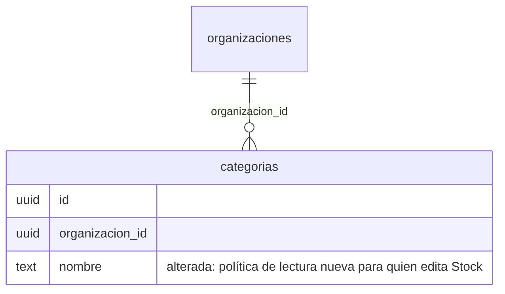

# Feature Specification: Lote 34 · interfaz, textos, roles y estados de pantalla

**Épica**: MSF-585 (hallazgos del dataset demo y del manual) · **Spec**: `lote-34-interfaz-textos-y-roles` · **Prioridad**: P3
**Alcance de entrega**: `refine` y `supabase` (una política de lectura; sin `kestra`, `superset` ni `workers`).
**Estado**: implementada en el PR del lote. Reúne arreglos chicos de interfaz; cada ítem enlaza su criterio y su prueba.
**Fuente**: decisiones registradas como «Decisión tomada» en cada ticket (MSF-594, 609, 615, 617, 620, 633, 664, 701, 717, 718, 719, 783, 927), `docs/clientes.md`, `docs/stock.md`, `design/pantallas/`.

## Objetivo

Quitar textos de plantilla, alinear pantallas con el rol que las usa, mostrar importes y fechas de forma única y correcta, y cerrar estados de error que dejaban la pantalla en un estado engañoso.

## Criterios de aceptación

- CA-L34-1 (MSF-717): un único formateador de importes (`lib/formatoImporte.ts`): entero sin decimales, con centavos siempre dos decimales («$ 64.200,50»), punto de miles también en cuatro dígitos. Los formateadores de precios, promociones, historial, ranking, gastos, comprobantes y service lo usan.
- CA-L34-2 (MSF-718): cobros, pagos y contrarreembolsos muestran el día de calendario de Buenos Aires de la marca de tiempo (`fechaDeMarca`), sin el corrimiento UTC posterior a las 21:00.
- CA-L34-3 (MSF-615): una reparación entregada no ofrece «Anular» ni «Guardar».
- CA-L34-4 (MSF-617, 927): el panel de marca del ingreso muestra «Ingresá a tu panel» y «© 2026 · Gestión comercial», sin nombres de tiendas ni «Panel interno»; el título del documento y `index.html` no nombran la plantilla; `lang="es"` y meta description (MSF-695).
- CA-L34-5 (MSF-783): `/stock/motivos` exige administrador (`RequiereAdministrador`); la base ya limitaba la escritura a `puede_escribir()`.
- CA-L34-6 (MSF-633): `/empresas` y `/empresas/edit/:id` exigen acceso a la sección `empresas`.
- CA-L34-7 (MSF-620): quien edita Stock (Depósito) lee las categorías de su organización en «Toma de inventario» (política `categorias_select_stock`; sin escritura).
- CA-L34-8 (MSF-719): la toma muestra el depósito principal sobre el que opera y ofrece «Sin categoría».
- CA-L34-9 (MSF-701): documento del cliente = DNI de 7 u 8 dígitos o CUIT con dígito verificador (solo si se modifica); CUIT de empresa con `validarCuit`; el chat IA devuelve el texto y retira el mensaje local si el envío falla, «Confirmar» se deshabilita mientras corre y el botón flotante solo lo ve quien puede escribir.
- CA-L34-10 (MSF-594): campo «Condición de IVA» en la ficha (selector de condiciones habituales + «Otra») y columna en el importador de clientes.
- CA-L34-11 (MSF-723): un costo ya cargado no se puede vaciar en la ficha del producto (la base lo leería como «sin cambio»): se pide 0.
- CA-L34-12 (MSF-635): la ausencia de foto de perfil (NoSuchKey) o una firma que falla se ve como inicial/sin foto, sin `console.error`.
- CA-L34-13 (MSF-686): `vencimientoSesion` tolera `localStorage` bloqueado.
- CA-L34-14 (MSF-616, 619): detalle de reparación de solo lectura sin «Todavía no cargaste…»; Recuperar acceso dice «Correo electrónico»; Mi perfil muestra el rol con su etiqueta; Mi organización muestra la zona horaria legible; las tarjetas de rol separan descripción y conteo.

## Modelo de datos (DER)

| Tabla | Estado | Cambio |
|---|---|---|
| `dominio.categorias` | alterada | Política de RLS `categorias_select_stock` (solo lectura para `stock = edicion`) |
| `public.organizaciones` | existente | Sin cambios |

Sin cambios de columnas. Reversión: `drop policy categorias_select_stock on dominio.categorias;`.

## Matriz pantalla↔criterios

`pnpm prototipo:inventario` se corrió. El prototipo manda: se actualizaron `Login`, `DefinirContrasena` y `RecuperarContrasena` (panel de marca) y `ClienteFicha` y `Clientes` (campo «Condición de IVA»); sus inventarios están al día.

| Ítem | Dueño | Nota |
|---|---|---|
| Panel de marca: «Ingresá a tu panel» y pie «Gestión comercial» | CA-L34-4 | Prototipo actualizado; se quitó la fila de tiendas |
| Ficha de cliente: campo «Condición de IVA» (selector + «Otra») | CA-L34-10 | **Adición declarada** al prototipo (`ClienteFicha`, `Clientes`); «Otra condición» aparece solo al elegir «Otra» |
| Importar clientes: columna «Condición de IVA» | CA-L34-10 | La plantilla CSV sale de la definición de la entidad; el diálogo del prototipo no lista columnas |
| Toma de inventario: depósito de solo lectura y opción «Sin categoría» | CA-L34-8 | Pantalla no dibujada en el prototipo (se arma con el sistema de diseño); elegir otro depósito necesita un parámetro en la RPC (pendiente de SQL) |
| Reparación entregada, Mi perfil, Mi organización, Roles, Recuperar acceso | CA-L34-3, CA-L34-14 | Ajustes de texto y de acciones visibles; sin elementos nuevos |
| **Empresa activa** | CA-L34-2, CA-L34-8, CA-L34-10 | Las pantallas tocadas conservan su comportamiento con la empresa activa (invalidación y recarga ya vigentes). Toma de inventario: no aplica, el stock es único por organización. Ficha de cliente: el cliente es de la organización. |

## Fuera de alcance / pendiente

- MSF-664 (una sola pantalla «Faltantes»): `/stock/faltantes` (líneas «A pedido») y `/ventas/faltantes` (faltantes de despacho con avisos, MSF-161) leen datos distintos; unificarlas o redirigir perdería funcionalidad. Necesita decisión de producto.
- MSF-719 (elegir depósito) y MSF-723 (borrar un costo): requieren cambiar RPC; quedan para el lote de SQL.
- MSF-616 (consultas de origen WhatsApp, MSF-993) y MSF-640: requieren SQL o reproducción.
