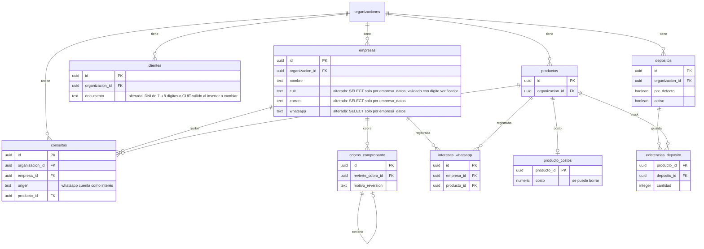

# Lote 38: ítems parciales con decisión tomada (SQL + interfaz)

**Alcance de entrega:** `refine` (panel y tienda pública) y `supabase` (migraciones y pgTAP). Sin `kestra`, `superset` (solo se redefine la vista de lectura que ya usa) ni `workers`.

Completa nueve ítems que habían quedado parciales y cuyas decisiones ya están registradas en cada ticket («Decisión tomada»). Cada ítem se verificó contra `origin/dokploy` antes de tocarlo; lo que ya estaba resuelto se deja asentado en la descripción del PR.

## Decisiones y reglas por ítem

| # | Ítem | Decisión aplicada |
|---|---|---|
| 1 | Revertir cobro | La RPC `public.revertir_cobro` ya existía (contra-asiento auditado, solo administrador, motivo obligatorio). Se agrega la pantalla: botón «Revertir cobro» por fila de la tarjeta Cobros del comprobante, visible solo para el administrador y solo en cobros revertibles (`manual`, sin reversión previa, sin conciliar), con diálogo de motivo obligatorio. `public.cobros_de_comprobante` suma `estado_reversion` y `motivo_reversion` para dibujar «Revertido» / «Reversión». |
| 2 | Aceptación de correo | La columna `acepta_correo` entra en la plantilla de importación de clientes (vacío = sin aceptación; valores sí/no, ya validados por la base). Acción masiva «Marcar aceptación» en el listado de Clientes sobre `marcar_aceptacion_correo_clientes` (solo administrador; registra quién y cuándo). |
| 3 y 4 | Precios de la tienda al centavo | `formatearPrecioArs` deja de redondear al peso. **Política:** el precio se muestra tal cual lo calcula la base (dos decimales, `private.aplicar_iva`): sin decimales si son pesos justos (como el prototipo, «$ 18.455») y con dos si hay centavos («$ 18.455,50»). Subtotales y total de la lista se suman en centavos enteros (`subtotalLinea`, `totalLista`). Se revisaron catálogo, ficha, lista de pedido, favoritos, buscador, mensaje de WhatsApp, presupuesto y compras: el resto ya mostraba dos decimales. El filtro «Precio máximo» sigue en pesos enteros (es un tope que escribe la persona, no un precio). El redondeo configurable por tienda (`redondeo_pesos`, múltiplos de 10 en la lista de precios) es una regla de negocio y no cambia. |
| 5 | Toma de inventario | `confirmar_toma_inventario(p_items, p_fecha, p_deposito_id)` (nueva firma; la de dos parámetros queda como envoltorio sobre el depósito principal). La pantalla ofrece el selector «Depósito» (principal por defecto), recarga los productos al cambiar de depósito o de empresa activa y descarta lo contado. |
| 6 | Costo vaciado y presupuesto vencido | `actualizar_producto(..., p_borrar_costo)`: vaciar el costo lo BORRA (nulo sin la marca sigue siendo «sin cambio»). Exige edición en Rentabilidad. Borra el costo vigente, no la historia ni el costo congelado de las ventas. El detalle del comprobante muestra «Vencido» en un presupuesto pendiente con la validez pasada, igual que el listado. |
| 7 | Interés por WhatsApp | La vista `public.interes_whatsapp_por_producto`, la vista de Superset `analitica.consultas_producto_mas_consultado` y `consultas_reportes_conteo` leen las consultas con origen WhatsApp de `dominio.consultas` (sin tabla aparte). `dominio.intereses_whatsapp` queda solo para el sembrado demo hasta retirarla en otro lote (el sembrado demo escribe también las consultas). |
| 8 | DNI/CUIT en el servidor | Disparadores que validan al insertar o cuando cambia el campo (sin `CHECK`, para no bloquear datos viejos): cliente = DNI de 7 u 8 dígitos o CUIT de 11 con dígito verificador; empresa = CUIT con dígito verificador. NULL o vacío se permite. La importación rechaza la fila con su motivo. |
| 9 | Seguridad de `dominio.empresas` | CUIT, correo y WhatsApp salen del `SELECT` de `authenticated` (grant por columna). Se leen por `public.empresa_datos` (sección `empresas`) y `public.empresa_contacto_documentos` (sección `empresas` o `service_tecnico`, sin CUIT). El selector de empresas, los filtros y las funciones `security definer` no cambian. |

**Límites documentados.** (6) El costo borrado no se refleja como «sin costo» en la historia de costos (es de solo agregado). (9) La política de UPDATE de `dominio.empresas` era la existente (`puede_escribir`); el seguimiento de endurecerla por sección se resolvió en el lote 42 (`20270507240000`: exige `nivel_seccion('empresas') = 'edicion'`).

## Matriz pantalla↔criterios

`pnpm prototipo:inventario` se corrió. El prototipo `Clientes.dc.html` se actualizó (botón «Marcar aceptación (N)» y su diálogo) y su inventario se regeneró. `VentasComprobante.dc.html` no dibuja la tarjeta «Cobros» (existe desde F-VTA-12 como adición declarada) y no hay prototipo de «Stock · Toma de inventario»: lo nuevo en esas dos pantallas se declara acá.

| Ítem | Dueño | Nota |
|---|---|---|
| Clientes: botón «Marcar aceptación (N)» (solo administrador, deshabilitado sin selección) | Ítem 2 | En el prototipo (`Clientes.dc.html`, junto a «Enviar correo a seleccionados») |
| Clientes: diálogo «Marcar aceptación» (opciones «Aceptan / No aceptan el correo masivo», Cancelar, Marcar) | Ítem 2 | En el prototipo |
| Importación de clientes: columna «Acepta correo» (opcional) | Ítem 2 | Plantilla y auto-mapeo del asistente; sin cambio visual del asistente |
| Comprobante · Cobros: columna «Estado» y botón «Revertir cobro» por fila (solo administrador) | Ítem 1 | **Adición declarada**: el prototipo no dibuja la tarjeta Cobros. Estados «Revertido» y «Reversión» ya existen en Pagos |
| Comprobante · Cobros: diálogo «Revertir cobro» (resumen, «Motivo» obligatorio, Cancelar, Revertir cobro) | Ítem 1 | **Adición declarada**; mismo patrón que «Registrar cobro» |
| Comprobante: estado «Vencido» en el presupuesto vencido | Ítem 6 | Etiqueta ya usada por el listado de presupuestos |
| Stock · Toma de inventario: selector «Depósito» (con «(principal)») y aviso «No hay depósitos activos» | Ítem 5 | **Adición declarada**: no hay prototipo de la toma |
| Tienda: precios con centavos | Ítems 3 y 4 | Mismo diseño; solo cambia el texto del importe cuando hay centavos |
| Ficha de producto: costo vacío borra el costo | Ítem 6 | Sin elementos nuevos |
| Empresas: lectura por RPC | Ítem 9 | Sin elementos nuevos |
| **Empresa activa** | Ítems 1, 2, 5 | **Cobros del comprobante:** el diálogo «Revertir cobro» se cierra al cambiar de tienda o de comprobante sin enviar nada; se recargan cobros y saldo (la pantalla ya lo hacía). **Clientes:** la selección es de la empresa activa; al cambiarla se descarta y un diálogo «Marcar aceptación» abierto se cierra con aviso, sin guardar. **Toma de inventario:** los depósitos son de la organización (no de una empresa); al cambiar la empresa activa se recargan depósitos y productos, se conserva el depósito elegido si sigue existiendo (si no, vuelve al principal) y se descartan los contados. Tests de Vitest que cambian de empresa con el diálogo o la selección abiertos. |

## Modelo de datos (DER)

Sin tablas nuevas ni columnas nuevas. Cambian privilegios, disparadores, un índice parcial y funciones. Se dibujan las tablas que tocan los ítems.

| Tabla | Estado | Cambio |
|---|---|---|
| `dominio.empresas` | alterada | `cuit`, `correo` y `whatsapp` salen del `SELECT` de `authenticated`; disparador de CUIT |
| `dominio.clientes` | alterada | Disparador que valida DNI/CUIT al insertar o cambiar `documento` |
| `dominio.consultas` | alterada | Índice parcial para el agrupado de WhatsApp por producto (sin columnas nuevas) |
| `dominio.cobros_comprobante` | existente | Libro de cobros: la tarjeta lee el estado de reversión |
| `dominio.depositos` | existente | Depósito elegido en la toma de inventario |
| `dominio.existencias_deposito` | existente | Stock por depósito que ajusta la toma |
| `dominio.productos` | existente | Producto editado en la ficha |
| `dominio.producto_costos` | existente | Costo que ahora se puede borrar |
| `dominio.intereses_whatsapp` | existente | Ya no la lee la aplicación; queda para el sembrado demo |
| `public.organizaciones` | existente | Organización dueña de todo |

## Migraciones (ventana 20270507210000–20270507219999)

| Versión | Contenido |
|---|---|
| `20270507210000` | `confirmar_toma_inventario` con `p_deposito_id` y envoltorio de dos parámetros |
| `20270507210100` | `actualizar_producto` con `p_borrar_costo` y `private.borrar_costo_producto` |
| `20270507210200` | Vistas `interes_whatsapp_por_producto` y `consultas_producto_mas_consultado` y RPC `consultas_reportes_conteo` sobre `dominio.consultas`; índice parcial |
| `20270507210300` | Validación de DNI/CUIT (clientes, empresas, importación) |
| `20270507210400` | `dominio.empresas`: SELECT por columna, `empresa_datos`, `empresa_contacto_documentos` |
| `20270507210500` | `cobros_de_comprobante` con `estado_reversion` y `motivo_reversion` |

Cada una lleva su marcador `-- Reversión:` con los pasos concretos.

## Pruebas

pgTAP nuevo: `lote38_toma_inventario_deposito`, `lote38_producto_borrar_costo`, `lote38_interes_whatsapp_desde_consultas`, `lote38_documento_dni_cuit`, `lote38_empresas_columnas_sensibles`, `lote38_cobros_estado_reversion`. Vitest: toma de inventario, reversión de cobros, «Marcar aceptación», precios de la tienda, edición de producto, empresas y documentos de reparación.
