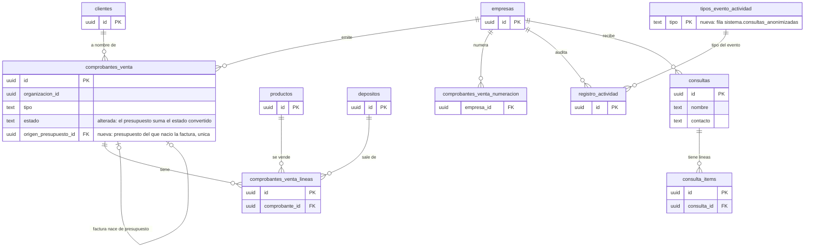

# Feature Specification: Facturar presupuesto y retención de consultas

**Lote**: 39 · **Decisiones de producto**: (A) «Facturar presupuesto» y (B) retención de consultas de 24 meses (decididas por Nicolás, registradas como «Decisión tomada»).
**Alcance de entrega**: `refine` (apps/web), `supabase` (migraciones, RPC y pgTAP) y `kestra` (un flow mensual). Sin `superset` ni `workers`.
**Migraciones**: `20270507220000` a `20270507220300` (ventana del lote).

## Objetivo

(A) Desde un presupuesto aceptado y vigente se genera la factura con vínculo y el presupuesto queda «Convertido». Hoy no hay vínculo: la persona rehace la factura a mano con «Copiar y modificar» y se pierde la relación y, con ella, el precio acordado.
(B) Las consultas de la tienda guardan datos personales; pasados 24 meses sin actividad se anonimizan (nombre, contacto, mensaje) y se conserva lo que sirve a los reportes.

## A · Facturar presupuesto

### Reglas
- **FR-A1** La factura nace en `borrador` con la misma tienda, cliente, canal, forma de pago, envío y contacto, fecha de hoy (Buenos Aires) y el operador que factura. Se confirma después por el flujo normal (`confirmar_comprobante`, con su control de stock). Facturar no toca existencias ni reservas.
- **FR-A2** **Precios congelados** (decisión de producto): las líneas se copian tal cual (precio, escala, descuento, promoción, lista, IVA, subtotales, depósito). No se recalcula. La guarda de precios de la confirmación (`precios_cambiaron`) no vigila una factura con `origen_presupuesto_id`. Si la persona edita las líneas de la factura en borrador, esas líneas se recalculan como en cualquier factura.
- **FR-A3** Solo un presupuesto **aceptado**, **no vencido** (`valido_hasta` posterior o igual a hoy en Buenos Aires) y **no convertido**. Pendiente → «Aceptá el presupuesto antes de facturarlo»; vencido → «El presupuesto está vencido y no se puede facturar» (`55000`).
- **FR-A4** Permisos: los de crear una factura (`ventas` en edición en la tienda del presupuesto). Otra organización responde como inexistente (`P0002`); sin permiso `42501`; sin sesión o `anon`, no ejecuta.
- **FR-A5** **Idempotente y a prueba de concurrencia**: `for update` sobre el presupuesto y un índice único `(origen_presupuesto_id, organizacion_id)`. Un segundo intento (doble clic, reintento, otra sesión) devuelve **la misma factura** sin crear otra ni auditar de nuevo. Un presupuesto se convierte una sola vez, aunque la factura se anule.
- **FR-A6** Guardas de datos vivos (`22023`, mensajes de negocio): presupuesto sin líneas, cliente archivado, producto que ya no está activo (se nombra), tienda desactivada. Un depósito que la tienda ya no usa se reemplaza por el principal; una forma de pago o envío que ya no existe no se copia.
- **FR-A7** Vínculo en los dos sentidos: `public.obtener_vinculo_presupuesto(p_id)` devuelve, de un presupuesto convertido, su factura y, de una factura nacida de un presupuesto, el presupuesto de origen. Cero filas sin vínculo o sin acceso (`ventas` en lectura o edición en la tienda).
- **FR-A8** Actividad: evento `presupuesto.facturado` («Facturó el presupuesto N como la factura M en Tienda»), un solo evento por conversión.
- **FR-A9** Un presupuesto convertido no se acepta, no se modifica y no se factura de nuevo; sí se puede copiar (renovar) e imprimir queda fuera (FR-021 de Presupuestos).

### Contratos
| RPC | Resultado | Errores |
|---|---|---|
| `public.facturar_presupuesto(p_presupuesto_id uuid)` | la factura (`dominio.comprobantes_venta`) | `42501` sesión o permiso · `P0002` no existe · `22023` dato inválido · `55000` estado que no admite facturar |
| `public.obtener_vinculo_presupuesto(p_id uuid)` | `presupuesto_id, presupuesto_numero, factura_id, factura_numero, factura_estado` (0 o 1 fila) | `42501` sin sesión |

Ambas: `security definer`, `search_path = ''`, `revoke … from public, anon`, `grant execute … to authenticated`.

## B · Retención de consultas

- **FR-B1** Plazo: **24 meses desde la última actividad** (`updated_at`). Se anonimiza lo que la supera estrictamente.
- **FR-B2** Se anonimizan `nombre`, `contacto` y `mensaje` («[anonimizado]»; el mensaje queda vacío en WhatsApp y pedido). Además se borra la `nota_interna` y se cortan `cliente_id` y `contacto_id` (con ellos la persona seguiría identificable). Se conservan producto, tienda, origen, estado, responsable, fechas e ítems del pedido: los agregados no cambian.
- **FR-B3** `private.anonimizar_consultas_antiguas(p_meses int default 24)`: `security definer`, `search_path = ''`, sin acceso para `public`, `anon` ni `authenticated`; `execute` para `service_role` y `kestra_orquestacion` (el rol del flow). `p_meses` debe ser ≥ 12 (`22023`; nulo también). Idempotente. Devuelve la cantidad y deja por organización un evento `sistema.consultas_anonimizadas` sin datos personales (el log de la ejecución).
- **FR-B4** Flow `anonimizar-consultas` (Kestra, `producto.clientes`): mensual (día 1, 05:30), `timeout`, `retry`, `concurrency` en 1, `errors:` con aviso. Solo habla con la base: sin worker ni salida a internet, por eso no figura en `workers/egress-allowlists.json`.

## Modelo de datos (DER)

| Tabla | Estado | Cambio |
|---|---|---|
| `dominio.comprobantes_venta` | alterada | Columna `origen_presupuesto_id` (FK compuesta a la misma tabla, índice único parcial e índice de FK); estado `convertido` del presupuesto |
| `dominio.comprobantes_venta_lineas` | existente | Se copian las líneas del presupuesto a la factura |
| `dominio.clientes` | existente | Cliente de la factura (debe estar disponible) |
| `dominio.empresas` | existente | Tienda |
| `dominio.productos` | existente | Productos de las líneas (deben estar activos) |
| `dominio.depositos` | existente | Depósito de las líneas |
| `dominio.comprobantes_venta_numeracion` | existente | Número correlativo de la factura |
| `public.registro_actividad` | existente | Eventos `presupuesto.facturado` y `sistema.consultas_anonimizadas` |
| `public.tipos_evento_actividad` | existente | Una fila nueva: `sistema.consultas_anonimizadas` (no sensible) |
| `dominio.consultas` | existente | Se anonimizan sus datos personales por antigüedad (sin cambio de esquema) |
| `dominio.consulta_items` | existente | Se conservan |

Esquemas (Principio VII): ninguna tabla nueva; la columna nueva es de `dominio.comprobantes_venta` (dominio del producto), las funciones de negocio viven en `public` (RPC) o `private` (anonimización). RLS: sin cambios (la columna hereda las políticas de la tabla, que no tiene escritura directa).

## Pantallas y prototipo

Prototipo actualizado: `design/pantallas/VentasComprobante.dc.html` (botón «Facturar» y los avisos de vínculo «Origen» / «Convertido en factura») y `design/pantallas/VentasPresupuestos.dc.html` (la nota ahora dice que los precios son los del presupuesto aceptado y no se recalculan al facturar). El botón «Facturar» de la fila ya estaba dibujado en Presupuestos.

## Matriz pantalla↔criterios

Inventarios revisados: `VentasPresupuestos.inventory.json` (botón «Facturar», sin cambios de inventario) y `VentasComprobante.inventory.json` (botón nuevo «Facturar»).

| Ítem | Pantalla / componente | Estado en el prototipo | Criterio |
|---|---|---|---|
| Botón «Facturar» por fila, habilitado solo con el presupuesto aceptado y vigente | `VentasPresupuestos.dc.html` (`PresupuestosList`) | Dibujado | FR-A3, FR-A4 |
| Botón «Facturar» en el detalle del presupuesto aceptado | `VentasComprobante.dc.html` (`ComprobanteVenta`) | Dibujado (agregado en este lote) | FR-A1, FR-A5 |
| Estado «Convertido en factura» (filtro, chip del listado y del detalle) | Presupuestos y detalle | Dibujado el filtro; chip del detalle agregado | FR-A9 |
| «Ver factura» en la fila de un presupuesto convertido | `PresupuestosList` | Definido en la spec (sin dibujo): lleva a la factura vinculada | FR-A7 |
| Aviso «Este presupuesto se convirtió en la factura N» con enlace | Detalle del presupuesto | Dibujado (agregado en este lote) | FR-A7 |
| Aviso «Esta factura nació del presupuesto N» con enlace | Detalle de la factura | Dibujado (agregado en este lote) | FR-A7 |
| Mensajes de error de negocio (pendiente, vencido, sin líneas, cliente, producto inactivo, permiso) | Alerta de la pantalla | Definidos en la spec (sin dibujo): catálogo `mensajeDeFacturarPresupuesto` | FR-A3, FR-A6 |
| Nota «Los precios son los del presupuesto aceptado» | Aviso de Presupuestos | Dibujada (texto corregido) | FR-A2 |
| Enviar por correo e Imprimir de la fila | `PresupuestosList` | Existentes, **fuera de alcance** de este lote | — |
| Empresa activa | Presupuestos y detalle ya siguen la empresa activa de la barra superior o «Todas»: el listado filtra y recarga todo al cambiarla (se remonta), y el detalle de una tienda distinta se cierra con aviso. «Facturar» y «Ver factura» actúan sobre la tienda del presupuesto elegido (la RPC valida el permiso en esa tienda) y nunca guardan datos de la empresa anterior | Sin cambios de comportamiento | FR-A4 |
| Retención de consultas | Sin pantalla: la ejecuta el flow mensual; no hay cambios visibles en Consultas más que los datos anonimizados («[anonimizado]») | Fuera de alcance de UI | FR-B1 a FR-B4 |
| Evento «Presupuesto facturado» y «Consultas anonimizadas por retención» en Actividad | `actividad.ts` (etiquetas) | Existente (pantalla Actividad) | FR-A8, FR-B3 |

## Verificación

- pgTAP: `facturar_presupuesto.test.sql` y `anonimizar_consultas_antiguas.test.sql`, más `seguridad_global_higiene_base`, comprobantes, presupuestos y consultas.
- Vitest: `lib/ventasPresupuestos.test.ts`, `pages/ventas/presupuestos.test.tsx`, `pages/ventas/comprobante.facturar.test.tsx`.
- Kestra: `pnpm test:kestra:anonimizar-consultas`, `test:kestra:deploy-flow`, `validar-robustez-flows`, y el guard de egress de workers.
- Reversión: migraciones aditivas con pasos de reversión en su encabezado; `git revert -m 1` del merge del PR.
